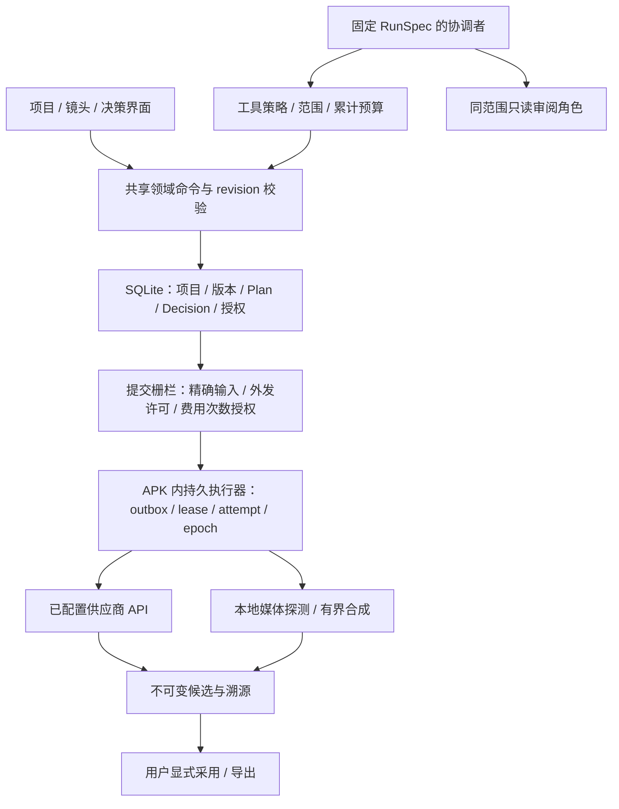

# 可控 AI 视频工作台：最终架构与迁移

运行架构初版：2026-11-01，对应工作台切片 1–40、修复 R1–R6（[历史台账](../reviews/2026-10-31-agent-workbench-progress.md)）。交互合同更新：2026-11-05，已接入 Agent M1–M5 与第 43 项项目权限，范围见 [50 项收尾](../design/agent-final-reconciliation.md) 和 [改造后复核](../design/agent-post-implementation-review.md)。当前源码数据库 schema 48；历史设计与旧审查不作为待实施清单。

## 现行 Agent 交互合同

会话负责输入和本轮对象摘要；下次消息技能快速选择与项目/全局默认分开，消息受理事务固定快照。技能添加按来源、编辑、检查/安装、完成组织，提炼按证据、接收方与外发、正文审阅、固定版本发布组织；安装/发布不自动选用，也不授予生成权限。

建议以原/当前/建议差异审阅；生成请求按实际快照、账号绑定、素材固定版本和费用范围核对，外发与消费分别确认。单次、计划及完整持久化批次复用同一审阅合同，配置保存不提交。图片处理参数与超分尺寸来自实际准备请求；视频展示工作流输入快照。

计划列表只显示状态和下一步，详情处理输入、选图、检查/依赖和执行控制；取消/隔离终态优先于保留的任务状态。批次范围与当前页分开，迟到读取不能回填另一个项目。UNKNOWN 核查原任务，不自动重复生成。项目概览的“项目权限”列完整未过期授权集合，最终撤销事务重新核对 ID/修订；项目切换器不再承担撤销。

运行历史按 thread/run 读取固定快照、实际完成的技能读取、阶段与诊断；当前选择不能重写历史解释。无模型连接仍可只读本项目本地会话。设备与真实供应商覆盖按证据报告区分，不能从已实现 UI 推导发布验收。

## 运行边界与事实源

所有 Agent、领域命令、计划调度、SQLite、文件 CAS 与合成都在 Android APK 内。外部仅提供已配置的模型/媒体生成 API；没有桌面或远端 Worker。界面、模型文本、检索缓存均不是执行事实源。

Plan/Step 表达生产意图、依赖和状态；Decision 保存用户选择及其 revision；Job/Operation 保存实际执行和租约。消息事件只推动界面与唤醒，不取代这些记录。每轮运行固定项目、镜头焦点、Skill 版本和连接配置；切换当前页面或默认连接不重写历史运行。

## 资源、能力与授权

角色/场景/风格/声音是版本化语义对象。草稿显式编译选中版本与媒体引用，保留来源清单；源版本变化不会暗中替换已准备输入。全文索引是可重建派生数据，按实时 fingerprint 过滤过期条目；采用本地关键词扫描，不依赖向量模型。

能力目录读取已安装 workflow、真实适配器 manifest 和本地账户状态；诊断不联网、不消耗、不自动切换供应商。模型连接单独安全存储，运行固定 ID/revision，撤销在每次网络发送前生效。图片能力需明确声明，原始音视频模型输入暂不支持。

三层授权独立：连接配置可用不表示素材允许外发；精确请求的素材外发许可不表示允许消费；次数/未知费用额度授权必须与实际请求和凭据代次匹配。确认后任何影响请求的修改均须重新准备。批次预授权原子完成，每次执行独立预留；UNKNOWN 保留占用，不用自动重试猜测是否收费。

模型调用在 transport 层计量，框架摘要、SDK 重试与只读审阅共用运行额度。默认每轮 32 次模型请求、100 次工具调用、300000 估算 token、20 分钟；报告 usage 与预留估算分列。这是调用/时间/token 约束，不是货币金额硬上限。

## Skill 与生产计划

兼容旧 Skill 包；新的版本化 metadata 声明工具、模型输入和依赖，运行前诊断缺口。项目组合与单次选择在消息接受时固定；撤销不能通过旧 UI 或恢复运行绕过。工具策略默认拒绝不受控框架执行工具；只读审阅继承父级范围、取消与累计预算，不能采用结果或扩权。

计划提供 selection、video 与 local_check 等有限 typed 节点，以及跨镜头完成依赖、循环拒绝、上游失败阻断。结构检查输出绑定输入签名，dispatch 再验。修改依赖撤销旧准备授权；失败重做保留尝试历史，已成功镜头不被自动覆盖。这里不是通用低代码 DAG 编辑器。

## 本地交付规格

时间线保存不可变版本/哈希：最多 20 段、总长 120 秒、毫秒裁剪、横/竖 720p、24fps、逐段软字幕、可选替换音轨。无音轨时输出静音，原片音轨不会混音保留。Android 产出 MPEG-4 MP4 / AAC / mov_text，解码和播放器兼容性仍受设备影响。

原件先核验再本地处理；每原件最多 100MB、输入总量最多 512MB，输出最多 100MB，空间按原件/时长预留，低空间与超时可终止。执行复用 EXPORT operation，attempt 隔离原生取消，租约丢失/epoch 变化不能提交结果。完成只创建候选；采用、导出均需用户动作。

清单可单独保存，也可连同去重原件导出最多 90MB 的 ZIP，内部为 manifest.json 和 media/<sha256>。工程包不含密钥、许可和可自动执行代码；本期不提供任意外部 ZIP 自动恢复执行。

本地媒体探测读取时长/尺寸/音轨并生成最多三张抽帧。感知检查须单次确认具体帧、目标连接和模型，最多 1000 输出 token、120 秒、零 SDK 重试，失败记 UNKNOWN。它只评价静帧，不证明运动连贯性、口型或声音质量。

## 迁移和恢复

| schema | 新增内容 |
| --- | --- |
| 41 | 持久运行预算 |
| 42 | 单次 Skill 选择 |
| 43 | 精确请求素材外发许可 |
| 44 | 时间线快照、输入引用与保护 |
| 45 | 本地合成记录 |
| 46 | 派生全文索引 |
| 47 | 媒体探测与感知检查 |
| 48 | typed local_check 节点约束 |

迁移沿用数据库升级前备份和事务。48 版通过临时备份表保存计划、依赖、决策、候选、outbox 与尝试，按依赖顺序重建约束后恢复，执行 foreign_key_check；不关闭外键检查。真实 SQLite 测试覆盖有数据迁移，通用 schema parity 测试覆盖新建/升级一致性。

恢复备份提升 execution epoch 并隔离旧执行，不让历史许可自动发起新消费；合成隔离，感知检查 PREPARED 取消、SENDING 转 UNKNOWN。缓存与全文索引可重新构建，源版本和哈希才是事实。旧 Job/历史版本继续可读，不把旧记录伪造成新的精确授权。

## 生命周期承诺

前台和系统允许的后台时间片可以推进持久计划。离线保留状态；用户强停期间不执行，重新打开后按租约和当前授权恢复。本地合成进程丢失后允许从不可变输入重算，不承诺恢复 FFmpeg 内部进度；同一 operation 不得提交两份候选。所有 OEM 后台持续运行、跨设备编码性能和真实付费服务结果都不能由模拟器或离线测试推定。

验证范围和证据见 [最终验收](../verification/2026-11-01-workbench-completion.md)。
