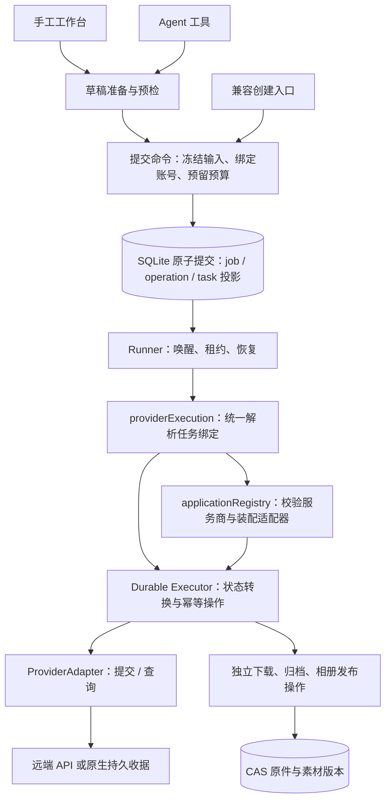

# 本地生成后端架构

应用采用本地优先架构，没有额外的业务服务器。SQLite 保存任务事实、操作队列、授权和读取投影；图片、音视频原件存入 CAS；密钥保存在设备安全存储。远端服务商负责生成。

## 执行链路

提交、轮询和下载是不同的操作。生成成功不意味着下载完成，下载完成不意味着已导出到相册；这些状态不能合并成一个“任务成功”。

## 模块职责

| 层 | 主要入口 | 负责什么 |
| --- | --- | --- |
| 输入与准备 | `creative/videoRuntime.ts`、`creative/novelAiRuntime.ts` | 校验草稿、工作流身份、源文件、账号和原生能力，形成不可变请求 |
| 原子命令 | `create/submissionCommand.ts`、`creative/videoSubmission.ts` | 同事务保存任务、发送操作、输入引用、投影；创作任务还保存授权、预算与命令收据 |
| 应用调度 | `tasks/executorRuntime.ts` | 装配 Runner，分派生成、下载、发布；不按服务商重复实现生成状态机 |
| 生成编排 | `tasks/providerExecution.ts` | 绑定解析、适配器选择、预算装饰与结果占用；手工、Agent 和兼容入口共用 |
| 账号引用 | `providers/credentials.ts`、`tasks/credentialBinding.ts` | 纯凭据契约；统一读绑定、校验账号/代次/服务商，写入时只取 ID |
| 服务商装配 | `providers/applicationRegistry.ts` | 声明 manifest、服务商、状态来源、工厂；拒绝重复 ID 和跨服务商凭据 |
| 通用执行内核 | `workflows/executor/`、`workflows/runtime/` | 租约、CAS 状态转换、未知结果、重试、输出映射；不依赖创作授权或具体服务商装配 |
| 服务商实现 | `workflows/providers/autodl/`、`creative/novelAiAdapter.ts` | 请求和响应协议、状态及错误规范化 |
| 原生收据与导入 | `creative/novelAiResponseStore.ts` | 原生发送/查收据、响应解析和 CAS 导入；不引入草稿或账号编排 |

工作流编译只需要 manifest。`workflowAdapters()` 不构造 HTTP 客户端、不读取秘密，也不初始化原生端点。已有任务的实际适配器只在执行时携带该任务解析出的秘密构造，不缓存默认 token。

## 绑定与恢复规则

- 有创作上下文的任务：使用预算预留记录里的账号和凭据代次。上下文存在但预留丢失时拒绝处理。
- 兼容入口的新任务：从原始 SUBMIT 操作的 `credentialBinding` 读取固定引用，提交、查询和下载地址刷新使用同一规则。
- 真正没有绑定的历史任务：仅保留现有默认账号兼容路径。损坏 JSON、不完整绑定、失效凭据不进入这条路径。
- 发送要求 active 代次；远端查询可以使用仍保留秘密的 retired 代次，不能使用 revoked 代次。
- 声明为 `local-receipt` 的服务商，在已绑定任务的 STATUS_SYNC 中只读取本地收据，不因断开账号而要求新的 token，也不重新发送生成。
- 尚未发送的凭据或适配器失败将任务置为 FAILED，释放 RESERVED；跨过发送边界后的不确定结果保留 UNKNOWN 与消费占用。
- 存储读取失败交回 Runner 恢复，不冒充永久账号错误。恢复环境的 epoch、隔离记录和原有授权栅栏继续生效。

数据库中的持久凭据形状仍为 `{accountId, generationId, provider}`。即使调用方传入带 token 的对象，序列化也只保留这三个字段；没有本轮数据库迁移。

前端只通过就绪状态检查账号；兼容视频表单也不读取或回传 Token。通用 `AppSettings` 不包含生成凭据，历史 `autodl.token` 只在账号迁移入口读取和删除。图片与视频共用工作台等待规则；人工核查只记录原任务已被检查，不能改写原任务事实、释放未知消费占用或复用旧授权。详见 [交联复核](../reviews/2026-10-25-frontend-backend-recheck.md)。

## 如何扩展

**同一服务商的新工作流**：发布声明式 workflow package，声明输入、绑定、输出和平台操作，经现有目录的兼容校验与版本/哈希校验后使用。额外参数通过编译后的绑定发送，不能在页面或任务执行器里新增特例。

**新的服务商**：实现 `ProviderAdapter`，在应用 registry 注册 manifest、provider、statusSource 和工厂；明确下载策略。再接入账号验证、安全存储及工作流目录的兼容声明。真实新服务商仍需要协议验收，注册本身不代表其远端可用；已有额外服务商测试证明执行内核不需要增加分支。

**新的媒体操作**：复用持久 operation、租约和收据，按职责增加下载或发布处理器。不要在组件回调中直接启动付费请求，也不要用内存 Promise 充当任务事实。

本轮没有增加通用 DI 容器或插件加载框架。历史记录、已发布迁移、读取投影和 CAS 引用保留各自职责，不能因为字段相似就删除或机械合表。

仍有明确的产品专属边界：视频目录准入当前声明 AutoDL，NovelAI 的图像准备与原生收据保留独立协议，`asset://` 成果提交仍限制在已实现的 NovelAI 本地原件链路。新服务商若返回本地产物，需接入同等哈希验证、租约和作用域检查，不能仅通过注册就绕过媒体安全边界。

## 已删除的冗余

- `workflows/adapters/autodlComfyUi/` 三个转发文件；独有协议断言迁至实际 provider 测试。
- 旧 `createBuiltinProviderAdapters` 装配入口；生产预检和执行使用同一应用 registry，通用 registry 文件只保留协议类型。
- `creative/queryCredential.ts` 查询专用包装层；查询和提交使用相同绑定解析。
- `executorSettingsFingerprint` / `createExecutorSettingsCache` 及无生产调用的同步维护认领函数。维护认领测试改用生产异步路径；下载设置只在下载操作需要时读取。
- 应用执行器中创作绑定、兼容绑定和默认账号三份 Durable Executor 装配分支；由 `providerExecution` 使用同一装配路径处理。

架构边界测试约束通用执行层不反向依赖创作编排、凭据契约不引入存储、原生收据不引入草稿，以及不重新引入旧适配器目录。

## 本轮验证（2026-10-25）

- TypeScript 检查通过。
- 全量 Jest 最终 237 套件、1557 项通过；原有 1 套件、4 项跳过。首次并行运行检查时，一项草稿交接测试超过默认 5 秒时限；该套件单独复测 16 项通过，随后完整重跑全部通过，没有放宽时限或修改该测试。
- 五种恢复场景、十个独立进程验证通过。
- 两个固定 workflow release 与 36 个 skill bundle 文件校验通过。
- Android x86_64 Debug APK 构建通过，包含新的 JS bundle；未安装或运行设备仪器测试。APK SHA-256：`A302FC50CF224DC19CC250CFDA977BAA58F99EF63E695C3EF307C700E7EF35CD`。
- 新增真实 SQLite 回归覆盖额外服务商提交/轮询、账号切换后的原凭据查询、孤立创作上下文拒绝降级、发送前失败释放预算、数据库读取故障不误标永久失败，以及断开账号后读取 NovelAI 收据。

验证使用隔离测试库与测试传输，没有触发收费生成，也没有操作模拟器中的应用数据。远端新增服务商的实际协议和长期运行稳定性不由这些离线测试推断。
