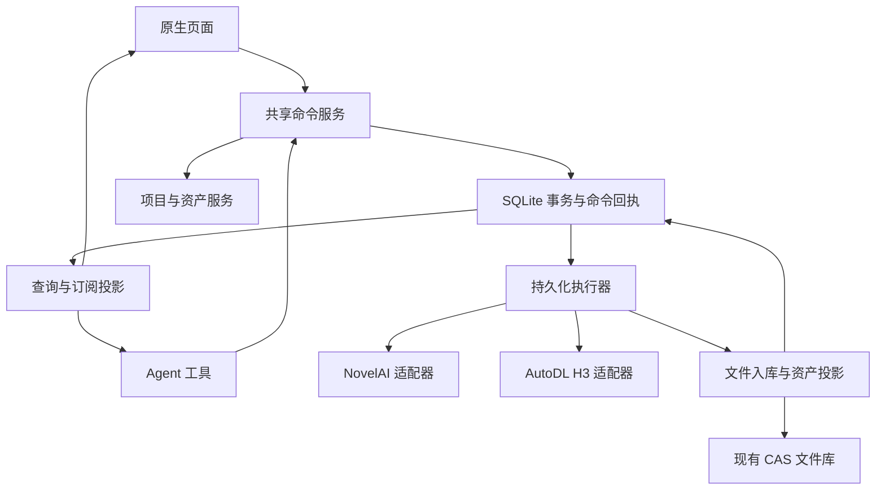

# 综合创作 App：交互与数据设计 v1.3（第一阶段开发基线）

2026-10-23 · 第一阶段开发基线，未实施数据库迁移。基于 schema v13、现有 ProviderAdapter、DurableExecutor、CAS 和 Agent 模块。第 11–17 节回应首轮七项意见；v1.2 补齐恢复隔离、账号身份、投影水位和执行来源；v1.3 仅统一 §2.3 版本采用语义与 §6 异步回执。所有审查项状态均为“设计已回应，待实现验证”，不是测试通过。后续转入实现和故障注入测试；相关前置验证未通过前，不启用新引用关系或 Agent 消费执行。官网已验证行为见 [测试记录](novelai-browser-test-record.md)，总路线见 [路线图](agent-creative-app-roadmap.md)。

## 1. 产品边界与关键决定

首期单用户、本地优先 Android 应用。后端指 app 内的命令服务、领域服务、SQLite、执行器与服务商适配器；不新增自建云 API。NovelAI 负责图像，AutoDL H3 负责视频，LLM 负责计划和工具调用。未来同步可复用稳定 ID/版本，但本期不承诺多设备冲突解决。

项目是上下文，资产是稳定创作对象，版本是不可变成果，任务是一次执行。四者不可互相替代。项目可没有任务；素材可没有项目；一次任务可输出多个版本；同一资产可跨项目使用。

主流程：项目简报 → 角色/场景资产 → 候选图片 → 选定参考 → 视频草稿 → H3 任务 → 视频候选 → 选定镜头成果。Agent 和手动操作调用相同命令。

## 2. 导航与页面契约

底部四入口：项目 / 资产 / 创作 / Agent。顶部统一提供任务中心（运行数、失败提示）与设置。现有 tasks、settings 深链接保留，gallery 迁至资产入口；旧 video/[id] 仍可访问。不要仅移除 Tab 注册导致路由失效。

| 页面 | 主要内容 | 主操作 | 状态规则 |
|---|---|---|---|
| 项目列表 | 最近项目、封面、当前阶段、进行中任务 | 新建项目 | 空态提供手动建项目/交给 Agent；归档独立筛选 |
| 项目详情 | 简报、镜头、素材、活动四个内部页签 | 继续创作、在本项目问 Agent | 记住页签；封面只引用选定版本 |
| 项目简报 | 目标、风格、比例、角色、约束 | 保存、让 Agent 补全 | Agent 修改展示差异；revision 冲突不覆盖 |
| 镜头清单 | 有序卡片、镜头描述、参考图、视频、状态 | 加镜头、选素材、生成视频 | 候选与已选分开；顺序拖动与输入编号均支持 |
| 资产库 | 全部/图片/视频/音频/Prompt/设定，搜索、标签 | 导入、加入项目 | 无项目素材出现在收件箱；不复制实体文件 |
| 资产详情 | 预览、版本、来源、使用位置 | 作为参考、继续生成、导出 | 选择历史版本后所有动作绑定该版本 |
| 创作 | 图片/视频模式、项目归属、草稿 | 生成 | 无项目也可生成，结果进收件箱 |
| Agent | 项目上下文、聊天、草稿卡/任务卡/资产卡 | 发送意图、查看成果 | 无项目时显示“全局”；不暗中沿用旧项目 |
| 任务中心 | 运行/待处理/完成，按项目/服务筛选 | 查看、重试下载、处理异常 | 远端完成与本地文件就绪分别显示 |

### 2.1 图片创作页

顶部：返回、项目/镜头选择、草稿保存状态。中心：当前预览；首次为空态。底部编辑区域分 Prompt / 参数 / 参考三栏，生成栏固定显示服务、预计费用和生成按钮。

Prompt：基础正面/负面文本为默认；角色卡可添加、重排、折叠，位置控件按模型能力出现。标签整理为可选模式，原文可往返。参数：模型、比例/尺寸、张数、Seed 常显，高级项折叠。参考：从资产库挑选、系统导入；每张引用明确版本、用途和强度。模型不兼容时在切换预览里列出将停用的参数，原草稿保留恢复能力。

V5 Curated 当前官网仅观察到 Image2Image；Vibe/精确参考标为待验证能力，不能先展示为可用。费用未知显示“暂无法估算”，不能显示 0。账户余额与本次估算分开。

键盘出现：隐藏主 Tab，编辑区滚动到光标；保留紧凑生成栏和收起键盘动作。复杂角色/蒙版使用全屏子页，不叠多层底部弹窗。返回自动保存草稿；失败时显示未保存及重试，不能伪装已保存。

### 2.2 图片进入视频

资产版本 → “生成视频” → H3 草稿，引用所选 versionId，携带项目/镜头上下文。仅导入图像引用，不把 NovelAI 标签直接当作 H3 镜头提示词；Agent 可按目标 H3 schema 编写描述。多个参考图顺序固定在草稿中，提交后冻结。创建草稿不立即上传素材；提交时按目标服务执行上传。

### 2.3 候选、选定与版本

每次生成创建新的候选版本，不覆盖当前选定图或镜头视频。镜头的“选定图片”“选定视频”是独立关联。修改草稿不改变历史；“继续生成”从所选版本复制快照成新草稿。列表默认折叠同一资产的版本，可展开比较；不同角色/用途的同内容文件仍可拥有不同资产 ID。

版本内容不可变，“采用哪个版本”是上下文中的可变引用，不是版本全局状态。统一规则如下：

| 概念 | 唯一事实源 | 更新规则 |
|---|---|---|
| 资产默认版本（字段仍名 current_version_id） | creative_assets.current_version_id | 全局资产库的默认展示/新引用建议；仅 asset.setDefaultVersion 显式修改，不等于最新生成版本 |
| 候选版本 | 资产版本集合；待选计划另由 creative_decision_candidates 固定 | 相对于当前操作/项目/镜头的未采用选项，不增加全局 candidate/selected 枚举；同一版本可在 A 项目被采用，在 B 项目仍是候选 |
| 项目固定版本 | creative_project_assets.pinned_version_id | 非空表示此项目/role 采用指定版本；asset.pinProjectVersion 显式修改，绝不随全局默认变化 |
| 项目跟随默认 | pinned_version_id = NULL | 仅项目浏览/新草稿建议解析到当前默认，UI 显示“跟随默认”；默认为空时显示“尚未选定”，不暗取最新版本 |
| 镜头采用版本 | creative_shot_assets 的 selected_* / reference_* version_id | 始终精确固定；shot.selectOutput 只改指定镜头槽位，不改变全局默认或项目 pin |

新建资产时 current_version_id 可空。用户直接导入/手动创作单个版本的命令可以明确将该初始版本设为默认，并在回执记录；纯生成入库（包括首次出图、多输出）始终只新增候选，不自动设默认。全局列表无默认时显示“待选定”的候选预览，按 version_no 确定展示顺序，并明确标为预览，不将其当作已采用版本。设置默认/固定版本均校验所属资产、类型与可用性，并使用 revision CAS。

asset.linkToProject 默认将用户选中的具体版本固定；若只选择资产且已有默认，则在事务中解析并固定该默认。没有默认时要求选择，或用户显式选择“跟随默认”才存 NULL。project_assets 增加 revision，pin 修改按关联 revision 检测冲突。项目封面是独立固定 versionId，不跟随任何默认指针。

新草稿选材解析顺序：用户明确选中的版本 → 指定镜头槽位 → 指定 project/asset/role 的 pin → 该关联明确跟随的资产默认；无项目时可建议全局默认。无法唯一解析时等待用户选择，禁止跨 role/镜头猜测。解析结果立即写入 creative_draft_inputs.version_id；其后默认/pin 的变化不修改已保存草稿、已提交任务或待决定计划的候选集合。更新引用须显式编辑草稿并递增 revision。

验收：生成 v2 不替换默认 v1；项目固定 v1 不受默认切到 v2 影响；跟随项目展示更新但既有草稿仍固定 v1；镜头选 v2 不改项目 pin；首次批量出图保持未选定；同版本可在不同项目拥有不同采用语义。

### 2.4 Agent 交互

任务示例：“为本项目做三张山顶天文台设定图，选一张后生成镜头。”Agent 建草稿并在已授权范围内提交前三张，输出三张可选卡片；“选一张”是用户决定时暂停依赖视频步骤。用户选定后，继续同一计划。若用户明确授权自动选择，则记录选图理由和引用版本。

命令卡展示实际状态，不能仅靠模型文本声称完成。状态：准备中/待决定/排队/生成中/结果整理中/完成/失败/结果未知。点击卡片可查看精确参数。Agent 运行与生成任务分离：关闭聊天不取消已提交任务。停止 Agent 只停止后续工具调用；停止队列阻止尚未发出的请求；远端取消是否支持由适配器决定。

## 3. 逻辑架构



唯一事实源：任务状态来自 workflow_jobs；二进制文件来自 artifact_blobs；创作归属/版本来自新领域表；Agent 会话沿用 agent_*。media_assets 在过渡期是旧画廊兼容投影，不作为新的资产权威来源。不得维护两套独立生成状态机。

## 4. 数据字典（目标逻辑 schema）

所有 ID 由现有 ID 工具生成；时间 UTC epoch 毫秒，展示转换本地时区。可编辑实体包含 revision、created_at、updated_at；删除使用 deleted_at，归档使用 archived_at，不混用。JSON 带 schemaVersion，写入时校验。以下表名为拟议名，实施时核对无冲突后迁移。

| 表 | 关键字段及约束 |
|---|---|
| creative_projects | id PK, title, brief_json, default_settings_json, cover_version_id nullable, revision, archived_at, deleted_at, timestamps |
| creative_assets | id PK, kind CHECK(image/video/audio/prompt/document), title, description, current_version_id nullable（显式默认，非最新版本，见 §2.3）, revision, deleted_at, timestamps；不要求 taskId/sourceUrl |
| creative_asset_versions | id PK, asset_id FK, version_no, source CHECK(import/generated/authored), source_job_id nullable FK workflow_jobs, recipe_json, metadata_json, created_at；UNIQUE(asset_id,version_no)，内容不可变 |
| creative_version_files | version_id FK, role CHECK(original/preview/thumbnail/sidecar), blob_sha256 FK artifact_blobs；PK(version_id,role)；文字文档也存 UTF-8 blob，不滥用 metadata 存大正文 |
| creative_project_assets | project_id FK, asset_id FK, role, pinned_version_id nullable（NULL 明确跟随默认，见 §2.3）, sort_key, revision；PK(project_id,asset_id,role)；pin 必须属于该 asset |
| creative_version_relations | from_version_id FK, to_version_id FK, relation CHECK(derived_from/reference/variant), slot；联合唯一；禁止自引用与派生环 |
| creative_tags / creative_asset_tags | 标签 ID/名称/规范化名称唯一；asset_id + tag_id 联合主键 |
| creative_shots | id PK, project_id FK, title, description, sort_key, editorial_status CHECK(planned/working/review/approved), revision, deleted_at, timestamps |
| creative_shot_assets | shot_id FK, slot CHECK(reference_image/reference_audio/selected_image/selected_video), ordinal, version_id FK；PK(shot_id,slot,ordinal)；selected_* 固定 ordinal=0 |
| creative_generation_drafts | id PK, project_id/shot_id nullable, target_asset_id nullable, provider_id, workflow_id/version/hash, model_id, capability_version, input_json, revision, timestamps |
| creative_draft_inputs | draft_id FK, slot, ordinal, version_id FK；联合主键；UI 用版本引用而非临时文件路径 |
| creative_job_contexts | job_id PK/FK workflow_jobs, draft_id nullable, draft_revision, project_id/shot_id nullable, target_asset_id, input_snapshot_json, plan_step_id nullable, created_at；提交后不可变 |
| creative_job_inputs | job_id FK, slot, ordinal, version_id FK；联合主键；冻结输入并为文件保留引用 |
| creative_output_links | job_id + artifact_id 联合 PK，version_id FK UNIQUE；防止结果回放重复创建版本 |
| creative_command_receipts | id PK, idempotency_key UNIQUE, command_name, payload_hash, actor_kind, execution_origin_id FK creative_execution_origins, scope_json, execution_epoch, status, result_json, error_json, timestamps |
| creative_thread_contexts | thread_id PK（引用现有会话稳定 ID）, project_id nullable, context_revision；项目删除时会话仍保留但范围失效 |

“选图后继续”上线前必须增加第 17 节的持久化计划与决定表；缺少该能力时界面仅提供“从选图新建视频草稿”，不能承诺自动续跑。聊天运行仍由现有 agent_runs 管理；长期执行审计引用第 19 节独立来源快照，不对 agent_runs 建外键。

生成 recipe_json 最少包含：provider、operation、模型标识、参数 schemaVersion、用户原始 Prompt、有效 Prompt（仅在已知时）、负面词、角色、实际 Seed、参考版本与变换、尺寸、适配器版本、原始元数据解析器版本。未知字段保留在原始元数据，不直接进入发往服务商的请求。

费用放命令/任务快照：estimate={amount,unit,source,estimatedAt,requestHash,certainty}、observedCharge 可空；Anlas 和 AutoDL 点数不能直接相加。不把生成前后的余额差当作准确单次费用。

## 5. 约束、索引与文件生命周期

- 新领域表之间的外键以 RESTRICT 为默认；纯 join 行可 CASCADE。旧任务表的引用必须先满足第 11 节写入改造门槛；不能直接给当前 REPLACE 写入路径添加引用外键。启用并验证每个 SQLite 连接的 foreign_keys，跨表复杂约束在同一命令事务中校验，迁移加 foreign_key_check。
- 非空 current_version、项目封面、镜头选定版本必须存在且类型兼容；需要设置默认的显式命令按插入资产→版本→current 指针的事务顺序执行；生成入库保持原指针（可空），遵循 §2.3。
- 索引：projects(updated_at,id)、assets(kind,updated_at,id)、project_assets(project_id,sort_key,asset_id)、versions(asset_id,version_no DESC)、shots(project_id,sort_key,id)、relations(to_version_id)、job_contexts(project_id,created_at,job_id)、receipts(status,updated_at)。分页使用时间+ID 游标。初期 SQL 标签/标题搜索，全文搜索后续按设备 SQLite 能力评估。
- 创建 version_files 同事务 retain CAS owner_type=creative_version、owner_id=versionId；草稿/执行输入也需要保留引用或阻止相关版本硬删除。现有 GC 必须先纳入新引用类型。
- 文件先写 staging → 校验哈希/大小/MIME → 原子移动 CAS → DB 事务挂引用。文件与 DB 无法同事务：记录 staging manifest 并提供崩溃恢复/孤儿回收宽限期，不能入库前立即 GC。
- 移出项目仅删除关联。删除资产进入回收站，不释放内容引用；被镜头/运行任务引用时展示使用位置。首期仅用户明确清空且无活跃引用才可硬删除；不定期自动清空。归档项目不取消任务、不释放素材。
- 旧 media tombstone 的防复活机制继续生效；新删除/结果入库也须检查领域 tombstone，避免后台任务恢复已删成果。

## 6. 命令合约与并发

```ts
type CommandEnvelope<T> = {
  commandId: string;
  idempotencyKey: string;
  actor: { kind: 'user' | 'agent'; threadId?: string; runId?: string };
  scope: { projectId?: string };
  expectedRevision?: number;
  payload: T;
};
type AsyncExecutionRef =
  | { kind: 'generation'; jobId: string }
  | { kind: 'export'; deliveryId: string; operationId: string }
  | { kind: 'file_transfer'; attemptId: string; operationId: string };
type CommandResult<T> =
  | { status: 'completed'; receiptId: string; value: T }
  | { status: 'accepted'; receiptId: string; execution: AsyncExecutionRef }
  | { status: 'needs_input'; receiptId: string; reason: string }
  | { status: 'failed'; receiptId: string; code: string; retryable: boolean };
```

actor/scope 由应用工具桥注入并核验，模型不能任意自称 user 或扩大项目范围。读工具不需要创建写回执；分页返回摘要与 ID，需要预览时单独获取。

Agent 写命令的 threadId/runId 必须同时提供并由工具桥验证；落库时转换为第 19 节的 execution_origin_id。所有外部写命令同时携带应用注入的 execution_epoch，模型不得自行设置。

首期命令：project.create/update/archive、asset.import/linkToProject/tag/setDefaultVersion/pinProjectVersion/export、draft.create/update/validate、generation.estimate/submit、shot.create/update/selectOutput；查询：asset.search/getVersion、generation.status、project.get、command.getReceipt。generation.submit 返回 accepted 与 execution={kind:'generation',jobId}，不能阻塞等待视频完成。

accepted 表示事务已持久化命令和执行引用，不表示完成。asset.export 返回 export 分支；异步导入/恢复返回 file_transfer 分支，不要求或伪造 jobId。同步完成的导入可直接返回 completed。每个命令在类型层约束自身允许的 execution 分支；字段均不可用无语义的通用 ID 替代。

receipt.result_json 持久化带 schemaVersion 的 execution 引用和最终 value；引用与 operation/delivery/attempt 在同一事务建立。command.getReceipt(receiptId) 是统一跟踪入口，按分支读取实际状态；执行引用在完成/失败后仍保留，用于审计和深链接。生成详情跳 job，导出详情跳 delivery，文件处理跳 attempt；多步骤计划使用自己的 plan/step ID，不冒充 generation。幂等重放返回原引用及当前回执状态，不新建执行实体。用户输入等待依旧返回 needs_input。

验收：无 jobId 的导入/导出可排队、重启恢复、查询和正确跳转；重复命令不重复 operation；生成仍返回真实 jobId；UI/Agent 穷举分支处理，不能假定所有 accepted 都是生成任务。

同一幂等键+相同 payload hash 返回原回执；同键不同参数返回 IDEMPOTENCY_CONFLICT。用户确实要再生成一次时使用新 key，即使 Prompt 相同。可编辑对象更新必须匹配 expectedRevision，否则 REVISION_CONFLICT 并返回当前版本供重新合并；不采用静默最后写入覆盖。

提交事务：校验授权并预留第 13 节额度→冻结草稿和输入版本→写 job/context/input 引用→enqueue SUBMIT→写 accepted 回执→提交→唤醒执行器。网络调用在事务外。命令重放不重复预留或 enqueue。UI 同一份查询投影订阅事件，Agent 结果卡按真实回执更新。

## 7. 生成执行与恢复

保留现有 workflow_jobs 状态和 operation lanes。ProviderAdapter.submit 扩展为判别结果 remote_job(handle) 或 inline_result(staged artifacts/manifest)，而不是伪造远端 ID；传递大文件路径/流句柄，不把 Base64 图片放进 operation JSON。具体接口须结合 NovelAI PoC 确定。

remote_job 继续 STATUS_SYNC；inline_result 先将响应可靠落地并记录接收凭证，再建立 workflow_artifacts 和入库操作。复用下载/入库管线，但显式区分远端下载和本地响应处理。每个输出用 output_links 唯一约束去重。

Job 的远端 SUCCEEDED 不等于资产可用；UI 根据文件入库状态显示“结果整理中”。本地失败只重试下载/入库。请求已发出、结果无法确认时标记 UNKNOWN，禁止自动重新消费；用户主动“重新生成”创建新任务并提示可能已扣费。未知提交若服务商支持查询再进行对账，不假定可查询。

收到输出后一个事务创建版本/文件引用/来源关系/output_link，并更新投影。候选不自动替换 shot selected。远端任务完成后通过原生调度恢复同步；手机被系统停止时不承诺即时执行，任务页展示最后同步时间。

## 8. Agent 的授权和长期工作

项目上下文只传简报、选定资产摘要与分页检索，不把全库塞进 Prompt。完整图片只在任务需要且目标允许时加载。凭据由适配器通过 SecureStore 读取，工具/DB 快照只存 credential reference，不存 token。

生成授权绑定具体服务、项目、最大请求数和费用范围/允许费用未知标记；估价 requestHash 必须与提交参数一致，参数变更需要重估。已授权范围内不逐张询问。停止计划撤销未提交步骤；不能假装撤销已发生的远端执行。不同供应商预算分开记录；并发提交通过事务预留份额避免超额。

第一版仅实现显式工具与串行步骤，先跑通图→视频。引入持久化计划时以 job event 唤醒步骤，记录事件处理 key，避免应用重启后重复执行。生成返回成功与美学质量判断分开；自动择优需要独立授权和可见理由。

## 9. 迁移与开发顺序

当前版本为 13。下一迁移号实施时重新读取，不能在设计期占号。

1. 先完成第 11–14 节兼容门槛，再新增项目、资产/版本/关联表与命令层；更新 APP_TABLES、CURRENT_SCHEMA_STATEMENTS、schema parity、备份/恢复和 GC 所有权规则。先保留旧路由与业务。
2. 用映射表 creative_legacy_asset_links(legacy_media_id PK, asset_id, version_id) 分批回填旧媒体；可中断续跑。无本地文件只建“待获取”状态的视图，不伪造 blob；旧标题/Prompt/来源保留。未归属项目的资产由收件箱查询呈现，不捏造一个项目。
3. 按第 12 节 epoch/水位切换协议切新资产页读取新事实源；旧 media_assets 改为单向投影。投影可重建，避免双向同步。旧删除路径统一接入新命令后才开放资产硬删除。
4. 项目/镜头 UI + H3 草稿上下文贯通；先用已有服务验证项目链路。
5. NovelAI 原生适配器与图片编辑页、费用/能力矩阵；复用既有官网样本，不重复基础官网出图。
6. Agent 业务工具接入，端到端验证后再加高级参考和长期计划。

禁止无备份破坏性重建旧表；保持升级恢复机制。升级后旧 APK 不保证可写，应沿用现有高 schema 只读保护。模型/能力更新与数据库迁移独立版本化。

## 10. 可交付开发包与验收

| 包 | 最小可用交付 | 验收重点 |
|---|---|---|
| A 项目+独立资产 | 建项目、导入图片、加入/移出项目、资产详情、历史作品迁移 | 同文件跨项目只存一份；移出不删文件；迁移中断恢复 |
| B 镜头+H3 | 新建镜头、选图、创建 H3 草稿、输出自动归档 | 引用固定版本；候选不覆盖已选成果；旧视频链路回归 |
| C NovelAI | 基础生成、多角色基础编辑、图片入库、继续生成 | 实际 Seed/参数快照；未知结果不重发；入库重放不重复 |
| D Agent 工具 | 创建项目、搜索引用、建草稿、提交与查询、结果卡 | UI/Agent 同命令；并发冲突；恢复不重复消费；项目范围隔离 |

测试覆盖：v13 升级、新库 schema 一致性、备份恢复、GC 与回收站、重复命令、崩溃点恢复、模型切换校验、无网/无凭据/费用未知、多输出部分成功，以及窄屏键盘/返回/草稿保存。先完成 A+B 的实用闭环，再加入 C+D；每个包都包含 UI 与数据实现，不先造无法使用的全套框架。

## 11. P1：旧任务写入与外键兼容门槛

代码依据：src/jobs/repository.ts 的 upsert 仍含 INSERT OR REPLACE INTO workflow_jobs；该 SQLite 操作会删除冲突旧行再插入。jobStateRepository.ts 和 jobs/repository.ts 的结果替换还会 DELETE workflow_artifacts 后重新插入。不能把这些行为视为普通 UPDATE。

实施顺序：先将所有 workflow_jobs 写入统一为 INSERT … ON CONFLICT(id) DO UPDATE 或已有 revision CAS UPDATE，保留 created_at/主键并明确更新列；同步/异步和恢复路径均覆盖。旧 artifact 整批替换应改成按 (job_id,id) upsert 与受控移除；来源关系不引用可变 artifact 行，creative_output_links 的 job_id 外键指向稳定 job，artifact_id 只是服务商输出标识。

task 清理与 job 删除分离：有版本/context/input/output 引用的 job 保留或归档，禁止级联删除创作历史；只有确认无引用时才可物理删除。旧版本来源 recipe 保留执行快照，不依赖远端记录永久可查。

启用门槛测试：foreign_keys=ON 时创建含所有子引用的 job，运行旧仓库 upsert、执行器状态更新、artifact 重同步、任务归档/删除与恢复，验证引用/版本不变且 foreign_key_check 为空。门槛未过禁止部署含这些 FK 的迁移；不能用关闭外键或 CASCADE 绕过。

## 12. P1：回填期间的新旧写入切换协议

新增 creative_migration_state(singleton PK, phase, epoch, backfill_cursor, replay_sequence, cutover_sequence, updated_at)；phase 为 LEGACY_CAPTURE/BACKFILL/CATCHUP/CREATIVE_PRIMARY。新增 creative_legacy_changes(sequence INTEGER PK AUTOINCREMENT, source_table, source_id, kind, snapshot_json, created_at)，删除必须保留 tombstone 快照。journal 追加与旧写入同事务，所有旧媒体写入点（含后台下载、导出、删除）由 DB trigger 覆盖；只捕获 ID 不足以恢复删除。

1. 短暂取得全局存储写门，停止新提交并排空/暂停后台执行器，再安装 capture triggers、初始化状态与新表，释放门。多连接不能绕过 gate；后台原生入口启动时也检查 epoch。
2. BACKFILL 保持旧表唯一写权威；用户新领域写入暂不开放。基于稳定主键游标分批读取旧行，在同一事务写映射与 cursor；映射唯一键保证重启不重复。文件复制/导入走第 16 节状态机，不在长事务内做 I/O。
3. CATCHUP 按 sequence 回放包括删除的完整快照。回放检查映射及 tombstone；顺序应用消除回填快照与并发修改的竞争。记录 replay_sequence 与投影变化同事务提交。
4. 切换时再次取得写门，暂停旧写入/后台操作；取 journal 最大水位 H，应用至 H，核对映射、缺失项、删除和文件状态。任一检查失败保留旧读写，不推进 epoch。
5. 单事务设置 CREATIVE_PRIMARY、epoch+1、cutover_sequence=H，并停用旧→新捕获路径。之后旧 UI/后台调用必须经新命令桥，新领域→旧表是单向兼容投影。旧 epoch 持有者写入失败后重新加载，不能“重试旧写”。投影写用受控路径，不触发反向回放。

投影事件放事务 outbox：creative_projection_events(id PK, epoch, projection_kind, entity_id, revision, payload_kind, payload_json, status, applied_at)；唯一(epoch,projection_kind,entity_id,revision)。新领域写入与事件同事务。payload_kind 只允许完整快照或 tombstone，不允许跳版本应用增量补丁。

新增 creative_projection_heads(projection_kind,entity_id 联合 PK, epoch, applied_revision, tombstoned, updated_at)。消费者在同一写事务比较当前激活的投影 epoch 与水位：非当前 epoch 的事件标 STALE；同 epoch 且 revision <= applied_revision 标 SUPERSEDED，不写投影；较新完整快照才更新投影和 head，并标事件 APPLIED。事件去重只保证不重复处理，水位才保证旧状态不覆盖新状态。删除也推进 revision 并持久化 tombstone head，不能删掉水位；恢复资产必须是明确的新 revision 命令。多来源聚合投影须从当前权威源重建并校验所有来源 revision，不能用单一实体水位掩盖依赖变化。

重建投影在新的 epoch 中构建完整基线及 heads，写门下追平并原子切换激活 epoch；不可仅清空 heads 后继续接收旧事件。备份恢复时旧投影 outbox 不直接重放，按第 14 节先建立新恢复代次并重建。验收额外覆盖 revision 12 先到、11 重试，删除后迟到更新、双消费者并发、epoch 变更和重建中断。

崩溃策略：切换前按 phase/cursor/sequence 续跑；切换事务要么全提交要么不提交；切换后只重建投影，禁止把旧表当权威回滚。降级需要整套备份恢复，不能仅反转 phase。验收覆盖回填时导入/完成任务/删除、切换瞬间后台写、每个持久化边界杀进程及重启后无遗漏/无复活。

## 13. P1：授权与额度账本

新增下列表，不再仅依赖 scope_json 或聊天文字：

| 表 | 字段/约束 |
|---|---|
| creative_authorizations | id PK, revision, project_id, provider_id, account_binding_id FK, credential_generation_id FK, execution_epoch, allowed_operations_json, request_limit, amount_limit nullable, unit, allow_unknown_cost, max_unknown_requests, expires_at, revoked_at, created_at |
| creative_budget_reservations | id PK, authorization_id FK, authorization_revision, account_binding_id, credential_generation_id, execution_epoch, command_id UNIQUE, job_id UNIQUE nullable, request_hash, request_units, reserved_amount nullable, unit, state, actual_amount nullable, evidence_json, timestamps |
| creative_budget_events | id PK, reservation_id FK, transition_key UNIQUE, from_state, to_state, amount_delta nullable, reason, created_at；只追加 |

金额用最小计费单位的整数存储，同一授权只绑定一个供应商/账户引用/单位；不混加点数。state：RESERVED → DISPATCHED → SETTLED 或 UNKNOWN_HELD；尚未发送可 RELEASED；明确未收费的终止才可结算为零。状态变更与事件同事务且 expected-state CAS，重复回调不重复结算。

### 13.1 不可混淆的账号与凭据绑定

现有 settings/storage.ts 的 autodl.token 槽位可被覆盖，provider registry 按凭据种类解析，不能直接用于持久化授权身份。新增 creative_account_bindings(id PK, provider_id, principal_namespace, verified_principal_id nullable, identity_mode CHECK(provider_verified/credential_bound), verified_at, created_at)；已创建记录的身份字段不可改写，身份变化创建新记录。principal 必须来自使用该凭据调用的服务商身份验证响应，邮箱/昵称/余额不作为身份键；各服务能否取得稳定 principal ID 必须经 PoC 确认。

新增 creative_credential_generations(id PK, account_binding_id FK, secure_store_key UNIQUE, generation_no, status CHECK(active/retired/revoked), created_at, verified_at)，UNIQUE(account_binding_id,generation_no)。每代 SecureStore key 独立且不覆盖内容，DB 只存引用不存 Token；generation 是本地不可复用 ID，不是默认槽位别名。拿不到稳定账号 ID 时 identity_mode=credential_bound，仅保证绑定这一代凭据，不声称识别真实账号；更换凭据一律视为新的授权边界。

授权、预留、提交快照和服务商恢复来源都保存账号绑定和凭据代次。发送前加载精确 generation 的密钥，验证其状态、账号/服务命名空间、授权 revision、执行 epoch；使用同一已校验密钥实例发请求，不能验证后再解析“当前默认 token”。可验证 principal 时校验响应与绑定一致；不可验证时只允许原代密钥。缺失/撤销/身份不符即阻塞，不自动回退新账号。

账号切换/Token 更新在凭据门内撤销旧默认映射并暂停旧账号尚未 dispatch 的队列；新建并验证代次后才设为默认。旧授权不自动迁移，即使服务商 principal 相同也需明确重新绑定授权范围。已 dispatch 请求继续归属原账号，查询也只能使用匹配 principal 的明确授权凭据。撤销与发送线性化规则沿用下文，不承诺取消已发请求。旧槽位迁移时只建立一个已验证代次，历史队列未绑定身份的须等待重新授权。

验收：排队后换为不同账号 Token、同账号轮换、重启、旧密钥删除、principal 无法取得、验证与发送间切换，均不能以新账号自动执行旧请求。

预留在独占写事务内检查授权状态/有效期/操作/范围/requestHash、所有已消耗与未释放请求数、已结算费用+占用额度，再插入 reservation/job/operation/receipt。零费用仍占请求数。未知费用只有 allow_unknown_cost 且未知请求配额足够才可发送；硬金额上限下，没有可信最大费用就拒绝未知费用请求，不能用 null 当 0。可信上限优先于点估算预留；估价有效期及 hash 不匹配重新估价。

执行器发送前事务复查授权未撤销且 reservation 有效，并转 DISPATCHED；这一刻是授权消耗的线性化点。之后撤销只阻止尚未 dispatch 的工作，不承诺收回网络请求。状态已 DISPATCHED 而进程退出时按可能已发送处理，不自动释放/重发。

结果未知保留 UNKNOWN_HELD，维持金额及请求份额；不因超时 TTL 自动释放。查询对账确认后结算，或用户明确关闭该预算占用并记录审计理由。远端完成但无实际费用凭证时保留占用/估算结算标记，不伪称已知实际费用。实际费用超出预留则记录真实值并阻止后续提交；本地预算无法保证供应商最终计费。

验收：两个并发提交争用最后一个名额仅一个成功；重复命令仅一预留；撤销/发送竞争符合线性化点；UNKNOWN 重启仍占用；重试下载不占生成配额；费用未知和各单位独立处理。

## 14. P1：数据库与文件的一致备份/恢复

src/storage/backup.ts 当前仅用 SQLite backup 复制数据库。保留并命名为“数据库恢复点”，不得在 UI 声称它能恢复原始素材。创作包备份另建流程。

备份包：manifest.json（formatVersion、schemaVersion、backupId、snapshot时间、数据库哈希、每个 blob 的哈希/大小/相对路径、缺失与外部资源清单）、snapshot.db、blobs/。不包含 SecureStore 凭据，恢复后重新连接服务。引用系统相册 URI 不等同于已备份文件。

流程：持久化 backup session → 获得存储维护门（暂停领域写入/GC/文件删除）→创建一致 DB 快照并枚举其文件依赖→为依赖建立 backup pin→释放写门→按 pin 复制并校验不可变 CAS blob→写 manifest→完成标记后原子发布备份包→释放 pins。pin 在 DB 外的维护 manifest 中也持久化，DB 恢复/切换不能遗失 GC 保护。失败可续跑或清理，未完成包不能列为可恢复备份。

仍在 staging 的任务标为未完成，不伪称完整保存。无法访问的外部文件和缺失 blob 明列；用户选择接受后只能标“部分备份”。未纳入 CAS 的可访问旧文件先转换并记录映射，否则不能宣称完整包。

恢复：在隔离目录验证 manifest/路径安全/大小/全部哈希与 DB integrity_check、foreign_key_check；恢复新库和 blob 集合后再暂停所有连接/执行器，以 durable restore journal 切换数据库和文件根。启动时根据 journal 完成或回退，不能先替换生产 DB 再慢慢复制文件。恢复后重建路径/引用并校验文件可用性，缺失项标 MISSING。文件校验通过只允许本地编辑，不意味着消费操作可以恢复；必须同时执行下述隔离协议。

### 14.1 恢复代次与外部副作用隔离

备份只证明快照时的本地状态，不证明之后是否消费。包括 READY_TO_SUBMIT、PENDING、RESERVED、READY 计划步骤在内，所有从备份带入的外部写操作、自动计划和授权均不自动执行；DISPATCHED 不是唯一危险状态。相同规则覆盖完整包恢复、数据库恢复点、迁移回滚和跨设备导入。

维护目录（不随业务备份覆盖）保存 current_execution_epoch 和 restore journal；每次恢复分配全新随机 epoch。恢复的命令、job context、reservation、授权、计划步骤保留原 epoch 并写入 creative_restore_quarantine(entity_kind,entity_id,restore_epoch 联合 PK, reason, disposition, reconciliation_json, resolved_at)。旧授权标恢复失效，旧账本保留审计但不可作为新预算余额。原表状态可用于展示，对执行资格无效。恢复期间关闭所有外部写入口；先将隔离标记写进待激活数据库，再激活新 epoch/DB。启动发现 journal 未完成或维护 epoch 缺失/不匹配，默认关闭执行并完成隔离，不从旧备份推断可继续。

dispatch、任务唤醒、Agent outbox、导出消费者均核验当前 execution_epoch 和隔离状态；旧进程/租约携带旧 epoch 一律拒绝，恢复前需停止并排空网络 dispatch 临界区。即便快照没有 job，但有 READY 步骤或待处理选图事件，也只能重建“待处理”卡片，不能自动创建新请求。

有原账号的可验证远端任务标识时可做只读对账并恢复下载/归档；不能把查不到请求等同于未执行。服务商明确证明未执行且仍有当前有效授权时，才可通过显式恢复命令解除隔离。无法对账时，用户明确选择“重新生成，可能重复消费”并授权新额度，创建新 epoch 下的新命令/任务，保存 supersedes 引用；不是把旧 SUBMIT 重新置为 PENDING。计划从需要的步骤复制为新执行代次，重新绑定实际已选版本及授权。

新授权不可从旧快照剩余额度自动生成；如原额度需要延续，必须完成历史对账或由用户明确设定新范围。恢复不擦除 UNKNOWN_HELD 的历史事实，也不能仅用旧余额释放预算。只读恢复文件允许单独放行；导出等外部副作用按自身对账/用户重授权处理。

验收反例：在 READY_TO_SUBMIT/RESERVED/READY 步骤时备份，随后成功生成或导出，再恢复该备份，启动/后台唤醒/打开 Agent 均产生零次自动外部写请求。另测跨设备、无维护文件、恢复切换崩溃、旧 worker、已过期账号和旧授权。以上只保证不自动重放，不宣称外部 exactly-once。

本地“数据库恢复点”若用于迁移回退，应另为其引用文件持久 pin 至恢复点删除；未建立 pin 的旧备份只能保证数据库恢复。验收：源文件删除后完整包仍可恢复、复制中断、磁盘不足、损坏 blob、恢复切换崩溃、token 不进入包、恢复后不重复生成。

## 15. P2：独立资产导出执行路径

现有 mediaCommandService.requestExport(taskId) 仅定位视频任务，exportOperation 还要求 operation.jobId 并回写 tasks。新增 asset.export(versionId,role,target) 命令，不伪造任务 ID。

新增 creative_deliveries(id PK, version_id FK, file_role, target, generation, status, operation_id UNIQUE, publication_key UNIQUE, destination_uri nullable, error_json, timestamps)。复用 workflow_operations 的 EXPORT lane，但 payload 使用判别联合 legacy_task / creative_version；creative_version 分支允许 jobId 为空，按 deliveryId/versionId 处理，不调用旧任务状态 SQL。调度器、唤醒、租约回收与取消都须验证无 jobId 的 operation，不止修改 payload 类型。

事务创建 delivery、enqueue、临时文件 pin；执行前检查可用性/删除状态→使用原生发布接口→记录 destination_uri→完成回执→释放临时 pin。相册用于图片/视频，文档/Prompt 使用文件保存或分享路径；不支持的 MIME 显式报错。导出不默认释放版本原始文件，缓存清理是独立操作。

同一 generation 重试使用稳定 publication_key；若原生目标可查询该标识则先对账。外部写成功但本地回执丢失且无法查询时标 DELIVERY_UNKNOWN，提示用户处理，不盲目重复发布。用户明确“另存一份”创建新 generation。验收导入无任务图片/文档导出、重启恢复、重复调用、已删除/缺失文件及旧任务导出回归。

## 16. P2：文件可用性与恢复来源落表

creative_version_files 表仅表达已挂接内容，增加下列可变实体保存生命周期，不修改不可变 recipe：

- creative_file_resources(id PK, version_id FK, role, expected_sha256 nullable, blob_sha256 nullable FK, state CHECK(PENDING/IMPORTING/AVAILABLE/MISSING/RESTORING/FAILED/EXTERNAL_ONLY), staging_manifest_id nullable, last_verified_at, error_json, revision, timestamps)，UNIQUE(version_id,role)。AVAILABLE 必须存在校验通过的 blob 与 version_files 引用；无文件不能靠空 localPath 猜状态。
- creative_recovery_sources(id PK, resource_id FK, kind CHECK(provider_artifact/import_uri/backup), provider_id nullable, account_binding_id nullable, credential_generation_id nullable, locator_json, expires_at nullable, persisted_permission, priority, last_attempt_at, last_error)。provider locator 存可刷新定位键，短期签名 URL 只作可过期缓存，敏感查询参数脱敏，不作为永久唯一恢复依据。服务商来源必须按第 13.1 节验证身份，不能使用当前默认账号兜底。
- creative_file_attempts(id PK, resource_id FK, operation_id UNIQUE, state, staging_path, expected_hash nullable, started_at, completed_at, error_json)。统一承接导入/补下载/恢复，幂等键按资源+恢复代次。

文件状态机：PENDING→IMPORTING→AVAILABLE；访问/校验发现丢失→MISSING；有来源→RESTORING→AVAILABLE 或 FAILED。外部 URI 未复制仅 EXTERNAL_ONLY；权限失效要求用户重新选择来源。复制时计算 hash，known expected hash 不符拒绝覆盖原版本；不同内容应创建新版本。

来源优先：已校验本地 CAS、可用备份、可刷新服务商 artifact、仍有权限的导入 URI；无有效来源显示“需重新定位文件”，不能承诺一键恢复。失效只改资源状态，版本/项目关联保留。应用启动抽查、使用前验证与后台 reconciliation 更新状态。恢复操作与 GC 共享 pin/维护门。

## 17. P2：选图续跑的持久化决定契约

新增 creative_plans(id PK, project_id, revision, state, created_at, updated_at)、creative_plan_steps(id PK, plan_id FK, revision, state, command_id nullable, input_binding_json, result_binding_json, error_json)、creative_plan_dependencies(step_id,depends_on_step_id 联合 PK)。步骤状态明确为 PENDING/WAITING_DECISION/READY/DISPATCHED/SUCCEEDED/FAILED/CANCELLED；禁止靠聊天内容推断续跑。

新增 creative_decision_requests(id PK, plan_id FK, step_id FK, plan_revision, step_revision, expected_shot_revision, state, selected_version_id nullable, resolved_command_id UNIQUE nullable, timestamps)；creative_decision_candidates(decision_id,version_id 联合 PK) 固定候选集合并保留引用。计划中止/改版将待决定请求标 STALE 或 CANCELLED，不复用旧卡片。

用户点击“选定并继续”执行 plan.resolveSelection(decisionId,versionId,expectedRevision,idempotencyKey)。同一事务校验计划/步骤/镜头修订、候选资格和文件可用性→更新镜头选定引用→写决定 RESOLVED→固定下游输入 versionId→步骤 READY→写唯一 outbox 事件(selection:decisionId)→回执。任一失败整体回滚。不同候选重复点击返回冲突，不更改已 dispatch 输入；同命令重放返回原结果。

持久化消费者以 eventId 去重，使用 stepId+executionGeneration 构造固定命令幂等键。续跑前重新校验授权、费用、项目状态；失效进入待用户处理，不因旧决定自动获得消费权限。创建 job/额度预留/步骤回执同事务，事件处理后标消费；崩溃重放不得生成第二个 job。

不依赖活跃聊天进程：启动与后台唤醒扫描 READY/outbox；聊天卡从 decision/step/job 读取。用户普通“选为镜头图”只更新镜头，不默认解除计划等待；界面显式提供“选定并继续”。若选图前用户改过镜头则返回修订冲突并展示差异，保留决定待处理。

验收：选图前/事务后/dispatch 前分别杀进程、重复点击、候选删除/缺失、计划取消、授权过期、镜头被手动修改；均不能错误覆盖或重复消费。该测试通过前隐藏“自动继续”承诺。

## 18. 审查闭环与开发准入

| 审查项 | 修订位置 | 开发准入证据 |
|---|---|---|
| P1 新 FK 阻断任务更新 | §11 | FK 开启的旧写路径兼容测试 |
| P1 新旧写入切换 | §12 | 并发写/删除/崩溃回放与水位切换测试 |
| P1 额度预留 | §13 | 并发授权预留与 UNKNOWN 占用测试 |
| P1 文件备份恢复 | §14 | 断点恢复及离线完整包恢复测试 |
| P2 独立资产导出 | §15 | 无 taskId 发布与未知结果处理测试 |
| P2 文件状态与来源 | §16 | 文件丢失、来源失效、哈希冲突测试 |
| P2 选图续跑 | §17 | 决定事务与幂等续跑故障注入测试 |

以上为设计层处理，不代表这些实现/测试已完成。四入口导航、项目/资产/版本/任务分离和候选不覆盖选定成果保持不变。

## 19. P2：独立执行来源与聊天删除

代码依据：storage/schema.ts 中 agent_runs 的主键为 (thread_id,id)，agent/threadStore.ts 的会话删除会清理该会话的 agent_runs。不可用单独 run_id 引用；也不使用复合 RESTRICT 阻止删除聊天，或 CASCADE 删除消费审计。

选择独立不可变来源快照：creative_execution_origins(id PK, origin_kind CHECK(user/agent/system), source_namespace, thread_id nullable, run_id nullable, tool_call_id nullable, agent_config_version nullable, tool_schema_version, intent_summary, input_digest, created_at)。source_namespace 为安装/导入谱系稳定标识，用于避免跨库同名 ID 混淆；它是历史来源标识，不是用于恢复防重放的 execution_epoch。Agent 类型要求 thread_id/run_id 非空。来源记录不对 agent_threads/agent_runs 建外键，原 pair 只是追溯标识。

回执引用 execution_origin_id，job context、授权授予/撤销事件、预算事件与计划决定通过明确 origin_id 或 command_receipt_id 关联审计。禁止依赖 agent_run_id 单列作为父键。来源快照与首次写命令回执在同一事务插入；同幂等命令重放返回原快照。只存必要的意图摘要、配置/工具版本与输入摘要，不复制整个聊天或凭据。

聊天删除保留独立执行来源、任务、授权、预算和回执，UI 显示“来源聊天已删除”并禁用跳转；删除聊天不等同于取消任务。新工具调用入口在删除时关闭该会话，未提交计划暂停；已被接受的生成仍由任务中心管理。删除与命令接收使用同一写门/事务串行：先接收则保存独立来源再允许删聊天；先删除则拒绝该会话的新命令。可通过额外 source-availability 投影标记聊天存在性，不修改不可变来源内容。

审计数据的彻底清除是独立用户数据删除流程，需同时处置关联任务/授权，不能借删除聊天触发级联。恢复包保存来源快照和命令关系，即使原聊天未包含也可解释来源；外部执行仍受第 14.1 节隔离。

验收：两个 thread 下相同 run ID 来源不混淆；删除有运行/完成任务的聊天不产生 FK 错误且回执/预算留存；删除与新工具命令竞争结果确定；备份无聊天仍能显示来源；新命令不能冒用已删 thread。

## 20. v1.2 审查追踪

| 本轮问题 | 修订契约 | 状态 |
|---|---|---|
| P1 恢复旧备份重新消费 | §14.1 全量外部操作隔离、新 epoch、账本不续用 | 设计已回应，待实现验证 |
| P1 账号身份混淆 | §13.1 principal/不可覆盖凭据代次、发送时精确绑定 | 设计已回应，待实现验证 |
| P2 投影乱序覆盖 | §12 projection_kind 字段、水位、tombstone、epoch 重建 | 设计已回应，待实现验证 |
| P2 Agent 来源主键与删除冲突 | §19 复合来源标识、独立不可变快照 | 设计已回应，待实现验证 |

首轮七项同样标为“设计已回应，待实现验证”。第一阶段可以按这些契约开始实现与验证；不把文档修订、格式检查或静态审查当作运行测试通过。
