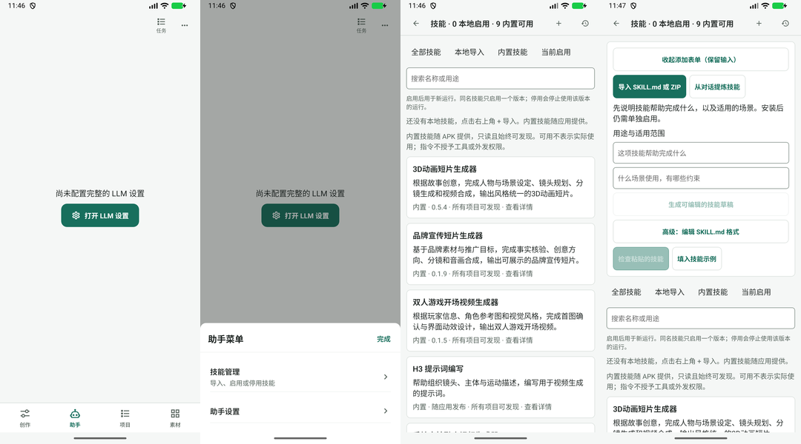

# Agent 操作逐项评估与优化合同

初评：2026-11-04（Asia/Shanghai）。本文保留当时的 **proposed 评估基线**；2026-11-05 已完成 M1–M5 实现与第 43 项补齐，当前每项结果/保留行为/验证限制见 [01–50 收尾对照](agent-final-reconciliation.md)。沿用 D001、F3/F4/F5 和现有稳定 ID。初评源码基线 `db7aa4d6`（31 路由文件、57 条目、48 点击边）；当前目录规模见 README。Android APK 内完成方案；禁止桌面执行端、远端 Worker。下文的“本轮”指初评，不把旧截图升级为最终验收。

## 结论与证据边界

问题集中在同一表面混合不同任务、不同作用范围，以及不同阶段的操作。优化单位应从“按钮”变成“对象在当前状态的下一步”。不宜把全部入口塞入更多菜单，也不宜给每个功能新增路由。

保留现有价值：四个主入口、项目独立会话、固定版本、单次技能选择、生成与外发的分别授权、结果未知保护、冲突检查，以及生成成果不自动采用。`ActivityGroup` 已有过程折叠，`AgentCreativeCards` 已按轮次汇总成果，不能笼统认定所有 Agent 功能仍是按钮平铺。

证据分两层：

- **V：本轮设备观察**。模拟器现装 beta.44（83），本轮采集缺模型 → 助手菜单 → 技能目录 → 添加表单四个状态，PNG 均保存并打开检查。仅支持这些旧版状态的视觉结论；不升级成当前 beta.47 或 HEAD 的验收。
- **S：当前源码结构审查**。下表 01–50 均有对应源码组，V 仅补充有明确步骤标注的项。未配置模型，没有制造运行数据、提交模型调用、安装技能或修改授权。已配置会话、计划、成果、提炼和异常状态均为源码依据与提案，尚待同版本设备验证。

本轮步骤、原图和限制见 [证据记录](evidence/2026-11-04-agent-controls/README.md)。旧截图未当作本轮证据。优先级 P1/P2/P3 表示设计实施顺序，不代表确定性缺陷严重度。

## 本轮观察到的流程

| 步骤 | 用户操作 | 健康度与证据 | 优化方向 |
| --- | --- | --- | --- |
| V1 | 从主导航打开助手 | 有明确补配置主操作；整页被配置空态接管（02-agent.png） | 保留恢复入口；用“连接助手模型”解释用途，已有本地记录应可只读访问，运行能力单独阻塞 |
| V2 | 打开助手菜单 | 菜单仅技能管理、助手设置，分组清晰（03-menu.png） | 保留管理入口；不要将高频单次选用继续放到管理路径 |
| V3 | 进入技能目录 | 9 项内置可见，搜索与来源齐全；说明占据首屏较多空间（04-skills.png） | 标题改为简短“技能”；计数放摘要，重要范围紧邻操作，技术解释下沉详情 |
| V4 | 点击添加技能 | 来源按钮、编写表单、格式工具、原目录同时出现，任务边界较弱（05-add.png） | 单独添加状态，按来源→编辑→检查→安装逐步展开；完成回新条目 |

## 操作归属：五层及作用范围

```mermaid
flowchart TB
  conversation[会话：讨论目标与提交消息] --> input[输入：参考、技能单次选择、简报]
  conversation --> proposal[提议：影响对象与前后变化]
  proposal --> review[审阅并明确采用修改]
  conversation --> plan[计划：步骤、阻塞与下一步]
  plan --> confirmation[核对具体请求并分别确认所需许可]
  confirmation --> execution[执行：阶段、停止与恢复]
  execution --> results[候选成果：预览与明确采用]
  conversation -.低频管理.-> management[模型连接、技能版本、项目权限]
  execution -.只读追溯.-> evidence[运行记录与诊断]
```

计划是项目对象；运行是一次执行记录；任务是服务端生成与本地归档单元；成果是固定素材版本。可以互相定位，不能复制为四份独立状态。会话完成也不等于所有生成任务完成。

## 逐项评估

### A. 项目、会话与输入（S1/S2；01 另有 V1，04 另有 V2）

| ID | 现有操作/能力 | 判断与建议承载 | 出现条件、主次与验收 | 优先级 |
| --- | --- | --- | --- | --- |
| 01 | 打开 LLM 设置 | 保留缺配置恢复；改为“连接助手模型”，补一句用途 | 缺连接时作为主操作；保存/取消回原会话，不自动发消息；本地历史读取不应依赖网络连接 | P1 |
| 02 | 切换创作项目 | 保留标题选择器；项目名和当前镜头分两级展示 | 运行中说明不能切换的原因；恢复目标项目原会话，保护原输入，不能重绑定原 transcript | P1 |
| 03 | 对话历史 / 新建 / 重命名 / 删除 | 保留历史入口；重命名、删除归会话行更多 | 搜索保留项目范围与滚动；删除确认实际影响，新建不丢原草稿 | P2 |
| 04 | 助手菜单 / 技能管理 / 助手设置 | 保留低频管理归属；菜单不再承担单次技能选用 | 菜单行明确“管理”，从会话来时带来源；返回恢复文字、附件与技能草案 | P1 |
| 05 | 当前镜头 / 移除镜头上下文 | 用输入区上方的紧凑上下文项；点击查看范围，移除按钮使用明确读屏标签 | 移除只影响后续发送；历史消息不重写；发送前核对镜头修订 | P1 |
| 06 | 添加图片 / 引用图片 / 移除附件 | 添加保留输入旁；引用在输入中按 @ 或附件条进入，不依赖更多菜单发现 | 仅有可引用附件时可用；移除引用文字与移除附件区分；稳定图片编号不跳号重绑定 | P2 |
| 07 | 补充创作信息 | 作为可选结构化输入，不作为新手必经表单 | 点“补充”才展开，空态可提示；加入输入前说明是替换还是追加，已有文字不可无提示覆盖 | P2 |
| 08 | 全屏编辑 / 完成编辑 | 长输入时就近展开；保留更多入口兼容 | 完成仅收起编辑，不等于发送；退出与重开保留光标、文本和附件 | P2 |
| 09 | Prompt 版本 / 复制 / 比较 / 移除 / 带入生成 | 从对应产物卡打开版本；默认预览，差异、复制和隐藏归二级 | “复制为最新版本”说明不重跑；带入前核对工作流/图片绑定；移除只隐藏版本，不暗示删除任务 | P2 |
| 10 | 发送 / 停止 / 重新生成这一轮 | 保留发送和运行中停止互换；重试只出现在对应失败轮次 | 明示停止的是助手运行；新尝试保留原记录与计费影响；结果未知的生成任务先查询，不能借重试无声重发 | P1 |

### B. 技能选用与管理（S3；11/12/13 另有 V3）

| ID | 现有操作/能力 | 判断与建议承载 | 出现条件、主次与验收 | 优先级 |
| --- | --- | --- | --- | --- |
| 11 | 会话内打开技能 | `toolPanel` 仍复用完整管理组件；改为短时“下次消息使用”选择层 | 输入旁可发现；只显示搜索、用途、选中项、范围与确认；安装/历史在独立管理表面 | P1 |
| 12 | 全部 / 本地 / 内置 / 当前启用 / 搜索 | 搜索保留；来源筛选降为辅助，默认优先呈当前范围组合 | 不把“本地启用数”为零表达成没有能力；空查询/无匹配可恢复 | P1 |
| 13 | 内置技能详情 / 文件 / 指纹 | 保留内置可发现；用途卡→说明→技术文件逐层展开 | 内置只读，不展示虚假启用开关；“可发现”与“本次实际读取”分开 | P1 |
| 14 | 选择下次 / 保存单次选择 / 取消覆盖 | 合成快速层底部一个“用于下次消息”主操作，项目继承作为明确选项 | 未确认关闭不写入；空选明确为仅内置；失效提示重新选择；取消覆盖回项目组合 | P1 |
| 15 | 项目技能开关 / 恢复全局选择 | 进入“此项目默认技能”，显示继承与覆盖关系 | 只影响新运行；不在快速层混入；恢复全局前能看见将继承什么 | P1 |
| 16 | 全局启用 / 停用 | 全局管理详情显示作用范围和关联运行影响 | 停用可能请求停止现有相关运行，须明确确认与结果反馈；不能与项目取消选用使用同一无说明开关 | P1 |
| 17 | 技能运行记录 / 全部范围 / 翻页 | 归会话运行历史，技能目录保留筛选快捷链接 | 行显示任务摘要、时间、结果；ID/指纹/预算放详情；返回保留范围、筛选和分页 | P2 |

### C. 添加与提炼（S3/S4；18–20 另有 V4）

| ID | 现有操作/能力 | 判断与建议承载 | 出现条件、主次与验收 | 优先级 |
| --- | --- | --- | --- | --- |
| 18 | 添加 / 导入 SKILL.md 或 ZIP / 手写 / 从对话提炼 | 添加先选一种来源；不在目录上方同时铺开所有表单 | 选择后进入对应任务；取消回原列表位置；保留现有安装格式校验 | P1 |
| 19 | 用途与范围 / 生成可编辑草稿 | 手写模式先填用途、限制，再进入正文 | 此“生成”是本地模板组装，应改名“创建草稿”，避免误解为模型调用；下一步唯一明确 | P1 |
| 20 | 高级格式 / 填示例 / 检查粘贴内容 | 格式编辑与示例在正文编辑器工具中，检查为该阶段主操作 | 错误靠近字段；示例填充前保护已有正文；收起不丢输入 | P1 |
| 21 | 安装此版本 / 关闭预览 | 固定版本预览后安装；安装成功定位新条目 | 安装完成仍不默认启用；“用于下次消息”与“设置默认”另行选择，取消不丢来源上下文 | P1 |
| 22 | 选择对话 / 选择消息 / 整理证据 | 提炼流程第 1 步，使用可多选列表与已选计数 | 不用一排按钮展示每段长文本；跨页已选保留；仅已保存文本，最多 12 段等限制可见 | P2 |
| 23 | 脱敏 / 提炼目标 / 发送证据 | 第 2 步预览待发送内容、接收模型和用途；脱敏是辅助，确认发送为主操作 | 允许回编辑；内容改变需重新核对；不宣称自动脱敏覆盖所有私人信息 | P1 |
| 24 | 取消提炼 / 保存草稿 / 检查待发布版本 | 第 3 步审阅正文；运行中取消可见，编辑中保存可用 | 取消后保留已存草稿；检查不是发布；保存失败留在原处 | P2 |
| 25 | 确认发布 / 打开技能库选用 | 第 4 步只确认固定版本；成功后解释已发布、尚未选用 | 返回新版本详情并保留会话来源；不通过隐式全局启用完成“使用” | P1 |
| 26 | 保存的提炼草稿 / 新建 / 删除 | 从提炼入口选择“新建/继续”，草稿列表独立于当前编辑 | 删除归草稿更多，说明不删除原会话/已发布版本；切换保护未存内容 | P2 |

### D. 提议、草稿与成果（S5/S6）

| ID | 现有操作/能力 | 判断与建议承载 | 出现条件、主次与验收 | 优先级 |
| --- | --- | --- | --- | --- |
| 27 | 本轮成果摘要 / 打开创作抽屉 | 保留现有按轮次汇总，升级为内容与状态摘要 | 待审阅时突出“待处理 1 项”；不把所有内容都叫成果，区分提议、草稿、任务、候选 | P1 |
| 28 | 修改建议 / 原内容 / 建议内容 | 在建议卡显示对象名、变更字段、影响和差异 | 会话可看摘要，完整审阅仍使用同一 proposal 身份；长差异逐项展开 | P1 |
| 29 | 采用修改 / 拒绝 | 在 WAITING 提议上展示明确主次；终态改显示结果与时间 | 采用前核对修订，冲突保留双方内容；采用文字修改不能顺带授权生成 | P1 |
| 30 | 编辑草稿 / 确认草稿并生成 | EDITING 卡先给输入/规格摘要，准备完整后主操作进入核对 | 缺输入主操作是补全；不同时突出两个生成入口；固定输入后再授权 | P1 |
| 31 | 成果预览 / 查看进度 / 生成任务详情 | 按状态换主操作：运行看进度，有结果审阅，未知核查 | 卡保留短状态；任务技术细节下沉；图片点开大图后仍能回对应卡 | P1 |
| 32 | 查看并处理计划或提议 | 将泛化文案变为“审阅修改”/“选择参考图”/“核对生成请求”等 | 定位具体 plan/proposal，并保留回当前轮消息锚点路径 | P1 |
| 33 | 采用候选 / 保存到手机 / 加入项目 | 成果审阅先明确对象与固定版本；采用与导出分任务 | 已生成、已归档、已采用、已保存到手机独立状态；取消不写采用关系 | P1 |

### E. 项目计划与编排（S7）

| ID | 现有操作/能力 | 判断与建议承载 | 出现条件、主次与验收 | 优先级 |
| --- | --- | --- | --- | --- |
| 34 | 批次列表 / 全部、未完成、失败 / 分页 | 顶部范围与筛选，批次用带完成数的列表，避免占满计划正文 | 区分项目总量和当前页；筛选保留定位来源计划，取消恢复原列表 | P2 |
| 35 | 新建选图计划 / 多镜头准备 | 合并“新建计划”入口，下一层选择单镜头或多个镜头 | 使用现有镜头选择器语义；选中项显示名称/缩略图/就绪性，不按镜头数量堆按钮 | P1 |
| 36 | 读取图片候选 / 加载更多 / 选定并继续 | 进入图片选择步骤自动加载候选；卡片勾选后底部确认 | 显示固定目标和版本；已有授权下“继续”可能提交，确认文案必须写清后果，不能仅称“选定” | P1 |
| 37 | 提示词 / 保存计划（不消费） | 参考与提示词作为同一准备流程，末步“保存计划” | 保存不生成；返回计划详情显示待选图/待授权；镜头版本变化给冲突恢复 | P1 |
| 38 | 增加生成前本地检查 | 默认展示是否已配置及检查结果，编辑归“检查与依赖” | 不能只为减少点击自动加入会改变行为的检查；必需项与可选项分开 | P2 |
| 39 | 设置/移除前置计划 | 计划详情用纵向步骤和依赖摘要；编辑依赖时打开搜索选择器 | 不限制为视觉上当前页的临时按钮；仍校验循环/状态；依赖完成不暗示采用其输出 | P2 |
| 40 | 授权并继续 / 准备并授权批次 | 等待授权时为主操作；批次进入明确请求清单，再确认实际集合 | 列出将提交、跳过与阻塞的镜头及次数；当前实现以 cards 集合准备，必须说明当前可见范围，不能暗示无条件覆盖全批次 | P1 |
| 41 | 按当前镜头重新准备 / 重做失败镜头 | 分别归输入过期、确定失败状态，说明将建新草稿 | 保留旧输入与任务；核对差异，重新授权；结果未知先核查，不走普通重做 | P1 |
| 42 | 暂停 / 继续后续 / 取消计划 / 查看任务 | 运行详情显示暂停或继续；取消在计划操作层；已提交任务保留可达 | 暂停不取消服务端已提交任务，取消不退款；状态主操作不能把停止/暂停藏到不可发现的多级菜单 | P1 |

### F. 许可与连接（S1/S5/S7/S8）

| ID | 现有操作/能力 | 判断与建议承载 | 出现条件、主次与验收 | 优先级 |
| --- | --- | --- | --- | --- |
| 43 | 撤销当前项目全部生成授权 | 从项目选择 Modal 移至“项目→权限→生成授权” | 先列有效授权与影响，明确确认撤销；切换项目不能意外变成撤销任务 | P1 |
| 44 | 单次生成许可 / 费用未知确认 | 将长 Alert 信息重排为请求审阅表面：对象、服务/账号、规格、次数、有效期、费用、确认按钮 | 仍调用现有准确请求与修订校验；费用未知和无金额上限不能折叠为可忽略说明；退出不提交 | P1 |
| 45 | 素材与提示词外发许可 / 撤销 | 同一次审阅展示与消费不同的许可项，分别解释；保留独立许可记录 | 素材用名称/缩略图，版本 ID 深入查看；不因统一 UI 合并授权含义或扩大 15 分钟授权范围 | P1 |
| 46 | 助手连接 / 生成服务 / 工作流能力缺口 | 从具体阻塞直接进入对应用途配置；不要让用户自己拼账号/模型关系 | 回同一 draft/thread/plan，刷新就绪性但不提交；取消配置返回原处，可恢复输入 | P1 |

### G. 运行与诊断（S2/S9）

| ID | 现有操作/能力 | 判断与建议承载 | 出现条件、主次与验收 | 优先级 |
| --- | --- | --- | --- | --- |
| 47 | 运行过程 / 工具输入输出 / TODO | 保留已有折叠和语义摘要；当前阶段优先，原始参数第三层 | 失败或待处理步骤可展开，不全量隐藏；TODO 是过程展示，不假装等于持久化生产计划 | P2 |
| 48 | 运行证据 / 刷新 / 全部消息 / 原始工具 JSON | 首屏给结果、时间、对象和实际行为；刷新次级，全消息是显式切换 | 当前 `SkillRunScreen` 直接 stringify tools，可改摘要→阶段→原文；不以当前技能/连接反推历史 | P2 |
| 49 | 任务入口 / 最近任务 / 全部任务 | 保留全局任务；当前轮或计划同时提供上下文进度 | 对话运行与生成任务分清；未知结果给“查询原任务”，不提供误导重生成；离开可恢复 | P1 |
| 50 | 项目活动 / 诊断详情 / 打开来源 | 活动作为已发生事实；待处理提议单独置顶，诊断留更多 | 打开对象是新导航，返回回原证据/活动锚点；不会把待确认提议混称已执行 | P2 |

## 状态决定主操作

“一个主操作”适用于当前对象，不是整屏只许存在一个按钮。列表中的多对象可各有下一步；选择器确认与取消必须同时可发现。

| 当前对象与状态 | 主操作 | 就地次操作 | 深层/管理 |
| --- | --- | --- | --- |
| 会话编辑中 | 发送 | 参考、单次技能、范围 | 设置、会话管理 |
| 提议 WAITING | 审阅/采用具体修改 | 拒绝、看差异 | 原始证据 |
| 计划缺参考 | 选择参考图 | 修改输入 | 依赖管理 |
| 计划输入就绪、待许可 | 核对并授权具体请求 | 编辑、暂停计划 | 项目许可列表 |
| 助手运行中 | 停止本轮（说明作用范围） | 查看当前阶段 | 工具原文 |
| 生成已提交 | 查看进度 | 核查/适用的停止操作 | 原始请求 |
| 结果未知 | 查询原任务 | 查看已知请求身份 | 新建尝试需另行明确确认 |
| 确定失败 | 修复阻塞或准备新尝试 | 查看错误 | 原始日志 |
| 候选可用 | 审阅后采用固定版本 | 比较、导出 | 来源与诊断 |

## 返回、退出与手机验收

快速层：关闭回原输入与焦点，未确认不改组合；从快速层进管理再返回时保留选择草案。长编辑：系统返回先处理键盘，再保存/放弃/继续；操作失败留在原处。配置：回原阻塞对象，配置保存不等于请求授权。任务定位：保留来源，返回回原消息或计划滚动位置。已有方案应复用 `useSourceBack` 的合同，不能把 `parent` 当运行时返回栈。

可见风险：V3 的长标题、说明与计数竞争空间，V4 多个按钮同样突出且禁用态文字偏淡；需量测实际对比度。源码部分控件为 44dp，后续按项目既定 48dp 目标核查布局，不把截图像素当 dp。TalkBack 应能读出技能作用范围、选中状态、计划阻塞、操作后果；弹层需验证焦点进入与关闭回焦。本轮未测试读屏、1.3/2.0 字号、键盘、触控目标实际测量或 reduced motion，不声称可访问性合规。

### 建议实施切片

1. **先做 11/14/15/16：单次技能快速层与管理拆分。** 任务是“保留已有输入→选技能→回输入→发送一次”。覆盖继承、空选、失效、取消、管理返回；保持安装与版本逻辑。
2. **再做 27–33、43–46：提议/草稿/许可/结果连续审阅。** 任务是“建议→核对变化→许可→任务→候选→采用”；缺连接往返和结果未知单独验证。
3. **再做 34–42：计划列表与详情分工。** 任务是“选镜头→准备输入→依赖检查→请求清单→授权→暂停/恢复→审阅”；先单镜头，再多镜头和跨分页批次。
4. **最后收口 03/09/17/22–26/47–50：历史、提炼与诊断。** 不先投入装饰主题重绘或手机节点画布。

每切片复用现有 ID，新增真正独立表面再登记到目录，修改 flow 与 decision 后再刷新源码指纹。验收记录任务完成率、误操作、找路/返回次数与耗时；先测同任务基线，不虚构“减少 50% 点击”。完整成功、取消、冲突、失败、重开各做一条；不以全部按钮可点代替任务通过。

## 源码索引

路径相对仓库根；S 表示本轮源文件审阅，并非对应完整运行路径通过。

| 组 | 来源 | 对应现有稳定 ID |
| --- | --- | --- |
| S1 | `mobile/src/creative/AgentWorkspace.tsx`、`AgentCreativePanel.tsx`、`AssistantActions.tsx`；`mobile/src/agent/AgentScreen.tsx` | agent、assistant-context、assistant-conversation、settings-assistant |
| S2 | `mobile/src/agent/PromptAssistantUi.tsx`、`PromptVersionPanel.tsx` | assistant-conversation、prompt-versions |
| S3 | `mobile/src/agent/skills/SkillLibraryScreen.tsx` | skills、skill-quick、skill-add、skill-history |
| S4 | `mobile/src/agent/skills/SkillExtractionScreen.tsx` | skill-extract |
| S5 | `mobile/src/creative/AgentCreativeCards.tsx` | assistant-conversation、project-plans、project-activity |
| S6 | `mobile/src/creative/ProjectActivityPanel.tsx`；F2/F6 现行合同（33 的采用/导出边界为合同沿用，未重新完整采样） | project-activity、shot-review、asset-detail |
| S7 | `mobile/src/creative/ProjectPlans.tsx` | project-plans |
| S8 | `mobile/src/creative/outboundConsentUI.ts`；F5 现行合同（46 的配置回流为合同沿用） | consents、settings-assistant、connections、capabilities |
| S9 | `mobile/src/conversation/ActivityGroup.tsx`；`mobile/src/agent/skills/SkillRunScreen.tsx` | assistant-conversation、run-evidence、skill-history |

这份评估细化现有提案，不改变 `page-catalog.json` 的 implemented/device-verified 状态，也不将 beta.44 截图挂到当前 beta.47 条目充当验收。
