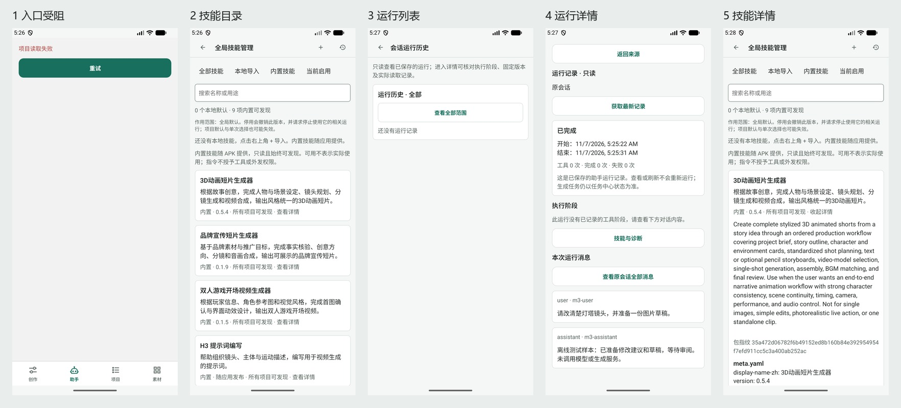

# Agent 移动界面设计评估 · 2026-11-07

结论：保留现有浅色与绿色主题，下一轮围绕「项目中的创作协作」组织信息。视觉属于轻度 unslop，交互层级和信息暴露需要更明显的调整。优先恢复助手入口、压低管理说明和辅助按钮的权重，再优化会话、技能、审批与成果之间的连续性。

这是**局部设备审查 + 当前源码评估**，不是完整 agent 流程验收。未修改产品源码。

## 范围与证据

- 源码：`2a44c522`，2026-11-07 当前工作区；已有未跟踪 release-readiness 文档未改动。
- 当前源码重新打包 JS/Hermes，复用既有 debug native shell；使用已有 `agent-roadmap-device.jsx` 合成离线数据。构建身份见 [metadata](evidence/2026-11-07-agent-design-audit/build-metadata.json)。这不是发行 APK。
- Android 模拟器 emulator-5556；1080×2400、420dpi，约 411×914dp；字体 1.0。模拟器时区与用户上海时区不同，截图时间保留设备原样。
- 助手入口在旧 QA 数据与清空后的新 QA 数据下均显示「项目读取失败」，重试未恢复。尚未查明根因，不能据此断言发行版同样失败。正常会话、输入、审批未取得本轮可用截图。
- 技能与运行详情通过应用深链访问。运行内容是合成记录；全局运行列表为空，不代表不存在会话记录，也不据此推断真实运行丢失。
- 本轮有效截图均已逐张查看。启动白屏/加载页及缺少 runId 的错误深链样本不作为正常页面证据。

| 步骤 | 观察与健康度 | 证据 |
|---|---|---|
| 1 进入助手 | 阻塞；只有错误与重试，缺少后续恢复入口 | 01-chat.png |
| 2 浏览技能目录 | 可用；能力列表前说明过多，范围/权限/空态说明重复 | 02-skills.png |
| 3 查看运行列表 | 可用空态；「全部」与「查看全部范围」同时出现，范围不清楚 | 03-history.png |
| 4 查看运行详情 | 可用合成记录；结果被返回、刷新、统计与解释向下推 | 04-run-detail.png |
| 5 展开技能详情 | 可用；中文摘要之后直接展开英文长描述、指纹与源文件 | 05-skill-detail.png |

## 三种方法的分工

Android 指南决定触控、键盘、安全区域、系统返回、导航和自适应；unslop 决定视觉克制与文字、间距、层级的一致性；Product Design Audit 用本轮截图核对用户能否发现入口、理解范围、完成任务与恢复错误。

unslop 的思想适用，但不照搬桌面数值：32–36px 导航行、16px 图标、宽侧栏、每屏一个装饰视觉，不作为手机标准。移动目标至少 48dp；图标视觉可约 20–24dp，点击区域独立。中性色可用于背景，结果图、镜头和候选承担视觉焦点；不必在 agent 对话里增加 hero 插图，也不因 unslop 将所有状态压成一个颜色。

Android 官方来源：[移动设计入口](https://developer.android.com/design/ui/mobile)、[布局基础](https://developer.android.com/design/ui/mobile/guides/layout-and-content/layout-basics)、[无障碍](https://developer.android.com/design/ui/mobile/guides/foundations/accessibility)、[导航层级](https://developer.android.com/design/ui/mobile/guides/layout-and-content/layout-and-nav-patterns)、[系统区域](https://developer.android.com/design/ui/mobile/guides/foundations/system-bars)、[预测性返回](https://developer.android.com/design/ui/mobile/guides/patterns/predictive-back)。以下具体页面方案是本次评估建议，不是官方对 agent 的指定设计。

## 建议方向（unslop 五行）

- 产品：让创作者在 Android 项目中与助手共同推进镜头、提示词和素材。
- 性格：沉着、明确、注重作品。
- 世界：分镜台与制作记录；沿用现有中性浅底、绿色操作色。
- 重点：当前镜头/成果预览，以及需要用户处理的一项审阅。
- 特征：一致的「提议 → 审阅 → 已应用/待生成 → 候选 → 采用」状态语言，各阶段分别映射真实对象状态，不伪装成一条必然完成的线性流程。

## 本轮截图确认的优先问题

### A01 · 入口异常没有完整恢复路线 · P0 调查 / P1 交互

证据：步骤 1；`mobile/src/creative/AgentWorkspace.tsx:15`。页面只保留「项目读取失败」和重试，错误覆盖了助手上下文。即使底部主导航仍能离开，用户也不知道本地历史、模型连接和项目数据哪个部分受影响。

建议保留页标题，解释「暂时无法读取项目」，提供重试，以及条件允许时的只读本地对话入口；提供可复制的诊断入口，向用户说明下一步。若数据库处于保护/恢复模式，应转入已有数据恢复路径，而不是无限重试。只有能保证项目范围正确时才开放历史，不能绕过存储保护。

验收：正常、暂时读取失败、恢复模式三种状态均有准确下一步；恢复后回原项目；失败不清除输入或重建会话。根因调查属于后续工程工作。

### A02 · 技能目录先讲实现，后展示用途 · P1

证据：步骤 2。第一张能力卡从约 y=962px（366dp）开始；目录标题、筛选、搜索、计数、全局停用说明、空态、内置权限说明占据大量垂直空间。

建议首屏顺序：标题/范围 → 搜索 → 分类 → 能力列表。范围收敛成「管理范围：全局」及可展开解释；停用后果在执行停用时明确展示；内置技能用一句「随应用提供，助手可按需读取」。说明选用不授予外发和消费权限仍需保留，但放在相关选择/授权处，不在每个列表层反复解释。

技能行以「名称、适用任务、来源/状态」为主；减少同尺寸完整边框卡的重复。9 项目录先验证紧凑列表，不增加复杂推荐算法。

验收：同设备字体 1.0 下首个能力在内容区上半部出现；1.3/2.0 字体下筛选不挤压成难点按的小目标；界面同时说清全局/项目/下次消息的作用范围。

### A03 · 技能详情把源码当作产品说明 · P1

证据：步骤 5；`SkillLibraryScreen.tsx:132`。展开后直接显示英文 description、完整指纹、meta.yaml 等文件，使后续能力移出屏幕。

建议独立全屏详情，默认中文展示「能做什么、需要提供什么、产出什么、适用范围」，随后显示来源与版本。「原始文件与包指纹」单独折叠；保留完整可检查性。已有 metadata 中包含中文内容，应优先消费结构化中文字段，不能把英文自动截断当作本地化。

验收：阅读用途无需浏览指纹/YAML；返回目录恢复搜索、分类与滚动；返回会话恢复尚未保存的技能选择。

### A04 · 运行列表的范围和名称不匹配 · P2

证据：步骤 3。全局入口标题是「会话运行历史」，卡片显示「全部」，按钮却仍为「查看全部范围」。无记录时这两个范围看起来一样。

建议标题随上下文显示「运行记录 / 此会话运行 / 此项目运行」，使用明确的范围控件；当前已是全局时不再显示通往相同范围的按钮。空态解释当前范围尚无记录。会话记录与固定技能证据不是同一个集合，名称不能暗示一定完整等价。

验收：全局、项目、会话各自有明确标题与过滤；空态不能被误解为全部历史丢失。

### A05 · 运行详情辅助操作与结果争夺注意力 · P1

证据：步骤 4。顶部全宽「返回来源」、中部全宽「获取最新记录」、下方「技能与诊断」「查看原会话全部消息」视觉相似；「已完成」没有先说明本轮完成了什么。原始消息角色和 ID 仍以 `user · m3-user`、`assistant · m3-assistant` 暴露。

建议统一顶部应用栏：返回箭头、运行标题、刷新图标；正文顺序为结果摘要 → 需要处理的事/关联成果 → 关键阶段 → 本轮消息 → 技能与诊断。辅助操作使用列表行/展开项。消息角色改「你 / 助手」，ID 留在诊断里；日期按应用语言/设备区域规范统一，不在中文页面默认混杂美式长日期。

「完成」必须注明对象，例如「助手回复已完成」；不能由助手运行完成推断素材已生成或已采用。零工具样本只表示没有记录的工具阶段，不能编造产出摘要。

验收：第一屏先读到本轮状态和结果；可找到相关对象；刷新不触发模型或生成；旧运行仍显示其固定版本证据。

## 当前源码发现，待正常流程截图验证

### S01 · 手机上管理技能仍与会话上下分屏 · P1

`PromptAssistantUi.tsx:358,417` 在窄屏把 toolPanel 与对话纵向排列，并分别占据 flex 空间。管理技能需要搜索、阅读、导入和选择，适合独立全屏任务；底部抽屉只承载短时的下次消息选择。大窗口才采用列表/详情双栏，按可用窗口与字体规模决定，不能把桌面侧栏压窄。

### S02 · 顶栏动作、上下文与输入区要按状态减负 · P1

`PromptAssistantUi.tsx:335` 起包含项目、历史、新建及 `AssistantActions` 的任务、更多；`AgentScreen.tsx:425` 起叠加镜头和技能上下文。建议顶栏保留项目与必要状态，把新建/历史组合到会话入口，低频管理留更多；输入上方用可展开的一行摘要表达镜头与下次技能。仍需 360dp/412dp 正常会话截图核对，不能断言当前已经裁切。

发送前展示当前范围，变更后即时反馈；失效技能和待授权属于关键阻塞，不能被折叠隐藏。运行期间保留明确停止动作，并说明停止助手不代表取消已提交生成任务。

### S03 · 生成审阅应先支持决策，再提供技术核验 · P1

`GenerationRequestReview.tsx:26–39` 包含草稿/绑定/凭据 ID、完整 JSON、固定版本 ID 和规格。建议先展示对象、服务、发送文本/素材、请求次数、费用状态，再分组展示规格、完整输入和版本证据。素材应有人可读名称与可查看版本，不能只列 ID。

费用未知与无金额上限不能藏入「高级」；外发与消费继续分别明确确认，不预勾选，不合并成泛化同意。信息分层改善理解，不削弱已有授权合同。长审阅使用全屏；确认区需保持可达，是否要求阅读全部内容沿用现有合同验证。

### S04 · 小目标、技术文案与装饰图标需要一次定点收尾 · P2

`AgentCreativeCards.tsx:98`、`ActivityGroup.tsx` 多处声明 44dp 最小行高，`PromptAssistantUi.tsx:835` 的展开全文未声明最小点击范围；实际命中区域仍需逐控件测量，不能用样式数值直接推定全部不合格。统一目标至少 48×48dp，图标视觉保持小而明确；不以缩小字体换空间。

`SkillLibraryScreen.tsx:119` 本地版本信息 11sp；建议重要辅助信息至少 12sp，主体 15–16sp（建议值，非全局强制替换）。`PromptAssistantUi.tsx:823,827` 的 `FINAL H3 PROMPT` 和星光图标、`SkillQuickPicker.tsx:104` 的星光可改为「提示词 · 最新版本」与技能/文件语义图标。保留 Material 系列图标体系，不因为 unslop 换成桌面图标库。

## 现有优势应保留

- 中性浅底和绿色强调已稳定，无需换色或新增视觉装饰。
- 四个同级主入口「创作 / 助手 / 项目 / 素材」清楚，无须新增全局「技能」入口；任务、设置继续作为辅助入口。
- 固定版本、单次与项目作用范围、实际读取记录的区别有明确实现；不能为了文案短而混为「已启用即已执行」。
- 运行详情已将原始诊断折叠；下一步是重新分配结果与辅助操作的视觉权重。
- 基础色 token 计算：辅助文字/背景约 5.68:1，绿色文字/白底 6.42:1，主按钮白字/绿色 6.05:1。无需笼统认定整套主题对比不足。
- 分隔边框/白底约 1.37:1 不自动等于违规；装饰分隔线与必须识别的输入框边界需分别判断。controlBorder/白底约 3.77:1。这里只验证 token 配对，不代表所有最终合成状态符合无障碍要求。

## 实施顺序与验收

| 批次 | 内容 | 验收重点 |
|---|---|---|
| 0 | 调查当前 QA 入口阻塞，补正常会话截图 | 明确数据/JS/native 边界；恢复后原项目与会话不变 |
| 1 | A02/A03/A05：技能目录与详情、运行记录层级 | 同状态前后图；用途和结果优先；搜索/滚动/未保存选择可恢复 |
| 2 | S01/S02/S03：会话、选择与审批表面 | 正常/运行/待审阅/失败/未知状态；返回原草稿；不隐式提交 |
| 3 | A04/S04：范围文案与组件一致性 | 48dp 命中、字体与图标；语言/读屏状态一致 |

目标矩阵：360dp、412dp 与更大窗口；1.0/1.3/2.0 字体；键盘弹起、旋转、系统返回与预测性返回、切后台恢复；TalkBack 的焦点回流、选中/展开/禁用状态和错误播报。目标是保留用户草稿和任务上下文，不是只看布局有没有溢出。尚未执行这组完整矩阵。

建议用实际用户任务验证：找到适用技能、改一次下次消息选择、识别等待审阅项、说明一次生成将发送什么、从失败恢复。记录任务成功率、误提交次数、返回后草稿丢失和主操作发现时间，避免以颜色偏好代替体验指标。

方法来源：本地 [unslop](../../../.agents/skills/unslop/SKILL.md) 及 Product Design Audit。unslop 作者 Damir Sokolovsky / [heydamir](https://heydamir.design/unslop)，CC BY 4.0；本报告对其思想做 Android 适配。
