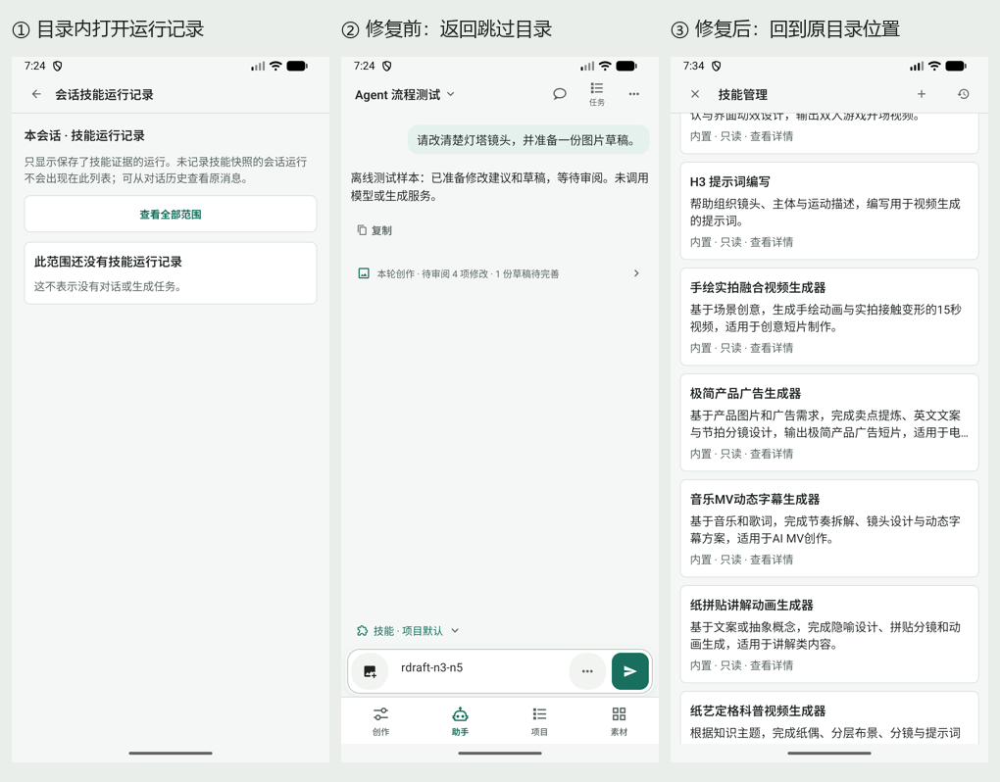
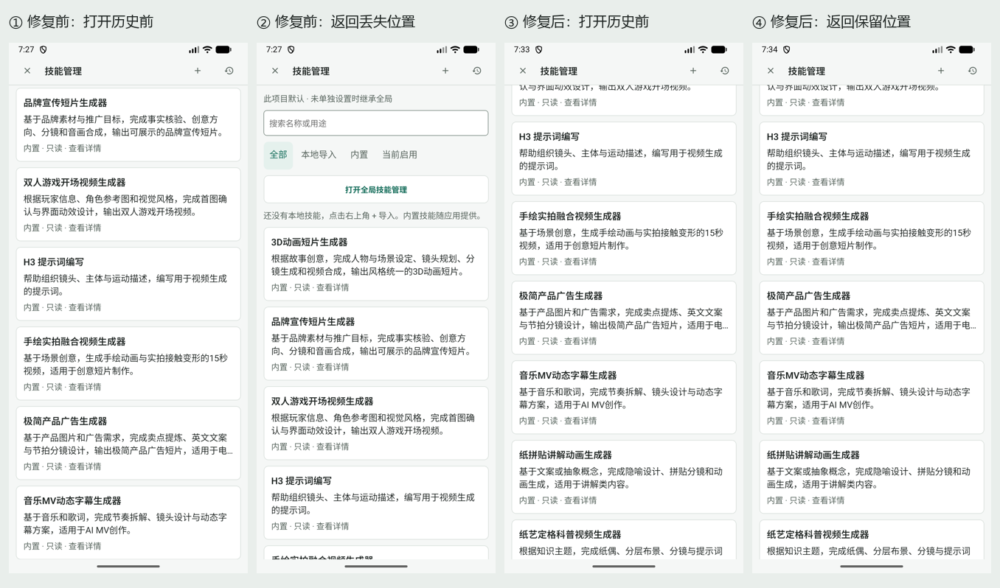

# Agent N0–N5 实施复核 · 2026-11-07

复核基线 `92f058f3`。检查范围是入口恢复、会话输入、技能目录与历史、请求审阅和候选/采用去向。沿用 [改造计划](agent-mobile-refactor-plan-2026-11-07.md) 的 Android mobile、unslop 内容层级及 Product Design 原则。

结论：发现并修复 3 个历史浏览问题。原先成功路径测试不足以证明范围切换失败和系统返回正确；本次先重现、补失败测试，再修复并用 Android 设备复测。仍保留一项既有运行时渲染告警，以及真实服务、完整读屏验收的覆盖限制。

## 设备证据

同一 Android 17 / API 37 / x86_64 模拟器，1080×2400、density 420、约 411dp、字号 1.0；只使用合成 Agent 流程会话和离线生成准备替身。没有提交付费生成。QA 包 `com.example.autodlh3` 保留原数据更新，既有 beta 包未改。

第二张图的 ①② 与 ③④ 分别比较各自一次滚动后的进入/返回位置；两次滚动距离不同，不据此作跨版本像素一致性判断。修复后 H3 标题的设备坐标在系统返回、页内返回前后均为 y=391px，卡片顺序、间距和截断位置一致。旧版页内返回后 3D 首卡重回 y=868px，实际丢失滚动位置。

## 发现与处理

| 级别 | 触发与影响 | 修复与验证 |
|---|---|---|
| P1，已修复 | 本会话→全部范围→本会话；最后一次读取失败时，其他会话的旧记录仍可能挂在“本会话”标题下，造成范围误认。 | 数据绑定会话、请求项目、可信项目、范围和游标的查询身份；只展示匹配记录。读取中、失败和空态分开，失败可以重试，同范围旧记录明确提示可能过期。新增回归先失败，修复后通过，并验证重试仍查询原会话。 |
| P2，已修复 | 目录→历史→Android 系统返回：会话内管理直接关闭到对话；全局路由直接退到来源管理，均跳过当前目录。 | 目录内部层优先消费返回；会话管理的原生 Modal 将 onRequestClose 交给子页面处理，再复用原未保存守卫。组件测试覆盖嵌入与已有导航栈两种来源；设备验证两种入口均先回目录，再回来源。 |
| P2，已修复 | 已向下滚动目录→历史→页内返回，列表从顶部重建，用户失去阅读位置。 | 保存目录滚动偏移，重建时恢复；安装新版本的定位流程仍显式归零。设备验证系统返回和页内返回均恢复位置。 |

代码集中在 [SkillLibraryScreen](../../mobile/src/agent/skills/SkillLibraryScreen.tsx)、[SkillRunHistory](../../mobile/src/agent/skills/SkillRunHistory.tsx)、[AgentScreen](../../mobile/src/agent/AgentScreen.tsx)。未更改历史查询 SQL、任务状态机、生成授权或存储结构。

## 回归结果

- 最终统一运行 10 个相关套件，149 项通过：入口恢复、AgentScreen、输入交互、技能目录、单次技能真实 SQLite 回流、运行详情/刷新集成、请求许可、创作卡片和真实活动读取。新增 3 项测试，另调整原历史测试以覆盖读取中→空态，而非立即宣称空记录。
- TypeScript `--noEmit` 通过；Android minified bundle 编译成功，当前 JS 装入匹配的 x86_64 原生壳后验证。
- 设备确认：会话内管理的历史→系统返回、历史→页内返回；全局管理的历史→系统返回→来源目录；搜索 H3→详情→系统返回保留搜索；退出管理后原输入 `rdraft-n3-n5` 保留。
- 当前 QA 进程的 ReactNativeJS:E / AndroidRuntime:E 日志采样为空；此结论仅覆盖本次路径，不等于全仓库无告警。
- 设计目录严格检查通过：31 个路由、67 个条目、74 条关键关系；只更新本次已复核来源的摘要。

本地构建身份与 SHA-256：`build/roadmap-qa/r1-metadata.json`；完整自动化结果：`build/recheck-final-results.json`。它们是本机 QA 产物，不是发布 APK。

## 保留问题与覆盖边界

自动化仍打印既有 React 告警：运行时在 AgentSession 的 useMemo 中 ensure，恢复旧运行时同步发布快照，触发 ReadyAgent 的状态更新（`AgentScreen.tsx` / `runtimeStore.ts`）。这条路径在复核前已存在，149 项测试通过不能消除其渲染阶段副作用。应独立调整运行时初始化/订阅发布时机，并验证旧运行恢复和会话切换；本次历史导航修复没有改动该合同。

Jest 沿用现有 forceExit，仍有 Node SQLite experimental 提示，不能据此认定所有计时器/句柄均已清理。本次没有重新完成真实模型→生成→归档→采用链、供应商费用核对、完整 TalkBack 朗读与手势顺序、预测性返回或旋转验收；此前 N5 的窄屏/大字体采样不等于这些项目通过。

## 原始截图索引

所有图片均附同名 UI XML，位于 `evidence/2026-11-07-agent-refactor/`。

| 路径 | 截图文件前缀 |
|---|---|
| 旧版会话内历史与错误系统返回 | r1-inline-history、r1-inline-history-back |
| 旧版全局历史与跳过目录返回 | r1-route-history、r1-route-history-back |
| 旧版目录位置丢失 | r1-directory-scrolled、r1-scroll-return-before |
| 修复后目录位置与两种返回 | r1-fixed-scrolled、r1-fixed-system-return、r1-fixed-ui-return |
| 修复后全局历史逐层返回 | r1-fixed-global-history、r1-fixed-global-return、r1-fixed-origin-directory |
| 搜索、详情、返回与会话草稿 | r1-fixed-search、r1-fixed-detail、r1-fixed-search-return、r1-fixed-draft-return |
