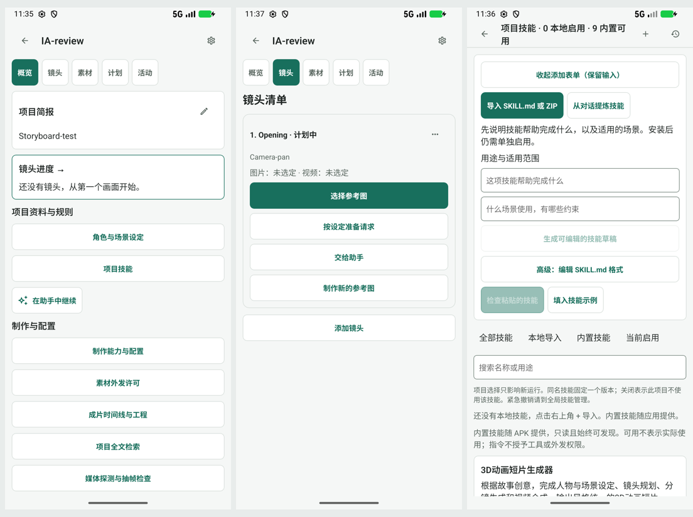

# 2026-11-01 页面结构采样

## 版本、环境与边界

源码基线 `56f16751`，beta.47。Android API 37 模拟器，1080×2400 px、420 dpi（约 411dp 宽），系统字体 1.0。使用临时只读实例 `emulator-5556`；测试项目 `IA-review`、简报 `Storyboard-test`、镜头 `Opening` / `Camera-pan`。不含真实素材、密钥、付费生成或模型调用。

**这是 UI 结构采样，不是正式 beta.47 APK 的完整验收。** 发布 APK 仅包含 ARM 库，当前模拟器为 x86_64，因此用既有 x86_64 debug 原生壳，替换为 beta.47 发布包的全部 `assets/`，重新对齐并以 Android 测试密钥签名。采样包的 JS 与资源逐项哈希对照见 [sampling-metadata.json](sampling-metadata.json)。包名/原生壳与发布包不同；不据此确认原生播放、后台恢复、签名、安全存储迁移或性能。先前采到的旧 JS 界面已排除，未混作当前证据。

原模拟器 `emulator-5554` 的 beta.44 用户草稿保持原状，没有安装、覆盖或交互修改。临时实例只读运行，结束后关闭，不把测试项目写回 AVD。不能据“只读”声称初始数据一定是全新重置。

每一步先读取当时的 UI XML，再点击实际存在的控件；PNG 与同名 XML 一起保留。所有列入下表的 PNG 均已打开检查。未做 TalkBack、放大字体、键盘遮挡、真实生成和长列表的完整测试。

## 采样步骤与结论

| 步骤 | 实际路径和屏幕 | 本轮能支持的结论 | 未验证 |
| --- | --- | --- | --- |
| 1 | 启动 → [创作空态](v47-01-create.png) | 四主入口和预览/输入/生成区已存在；不应整体推倒 | 有结果、输入键盘、费用确认 |
| 2 | 项目 → 新建测试项目 → [概览](v47-02-overview.png) | 进度之后仍排列多个资料、能力、许可、合成、检索、检查入口；概览承担工具目录 | 多项目、长简报、封面恢复 |
| 3 | 概览 → 项目技能 → [技能目录](v47-03-skills.png) | 9 个内置技能可见；首屏被说明、筛选占据，标题在当前宽度换行不自然 | 全局/项目停用、撤销中的运行 |
| 4 | 目录 → 添加 → [添加技能](v47-04-skill-add.png) | 导入、提炼、编写和检查进入后，原目录仍在下面，任务边界不清 | 导入文件、安装与退出草稿保护 |
| 5 | 返回项目 → 成片时间线与工程 → [空工程](v47-05-timeline-empty.png) | 空态已铺开片段、音轨和工程操作；需要任务分层 | 有片段、实际合成、导出；数值编辑问题以源码为依据 |
| 6 | 返回项目 → 角色与场景设定 → [空设定库](v47-06-semantic-empty.png) | 目录空态直接展开类型、描述、引用和保存表单；“浏览/新建”未分层 | 有实体、多版本和镜头绑定 |
| 7 | 返回项目 → 镜头 → 新建测试镜头 → [镜头卡](v47-07-shot-card.png) | 无图时已有推荐主操作，但下方仍同时展开准备请求、助手、新图三条路径；一张空卡占据较大高度 | 多镜头滚动、有图/视频、排序 |
| 8 | 镜头 → 选择参考图 → [空选择器](v47-08-picker-empty.png) → 系统返回 | 目标、恢复路径、禁用确认和显式采用已存在，应保留；入口“参考图”与目标“镜头成果”需解释角色 | 从导入/制作回选择器、冲突与真正采用 |
| 9 | 概览 → [制作能力](v47-09-capabilities.png) → [连接管理](v47-10-connections.png) → 系统返回两次 | 制作能力、服务账号、工作流、助手模型连接要跨层理解；返回链可走回项目 | 填写/撤销连接与原请求恢复 |
| 10 | 返回项目列表 → 助手 → [缺模型空态](v47-11-assistant.png) → [助手设置](v47-12-settings-assistant.png) → 系统返回 → [原助手](v47-13-assistant-return.png) | 缺配置已有明确恢复入口，且本次系统返回回到助手；设置页仍并存旧配置表单与连接管理 | 已填输入、活动运行、未保存修改 |
| 11 | 助手 → 任务 → [最近任务浮层](v47-14-tasks-empty.png) → 返回 → 素材 → [素材空态](v47-15-assets-empty.png)；再从助手任务浮层 → 全部任务 → [任务队列](v47-16-task-center-empty.png) | 快速任务摘要与完整队列为不同表面；素材和队列空态可达 | 运行任务、结果未知、长素材列表、批量处理 |

逐页完整建议在 [page-review.md](../../page-review.md)；表中未采样的表面按源码结构审查，不标为设备通过。优先级 A–E 是设计实施顺序，不能把这些 UX 建议作为现存功能错误的严重性评级。

## 关键屏幕并排

从左到右：项目概览、镜头卡、添加技能。仅等比例缩小拼排，未重画界面；原图见上表。

## 竞品证据

以下为发布者仓库截图，已打开观察，但本轮没有操作竞品生成流程。不能与本项目模拟器交互证据等同。

| 文件 | 固定来源 |
| --- | --- |
| [影策分镜](reference-canvas-storyboard.jpg) | `ddcat-ai/open-ai-canvas@82fc5c03233c33380a5335146c50bb507deb5692/assets/screenshots/storyboard.jpg` |
| [影策技能](reference-canvas-skills.jpg) | 同 commit，`assets/screenshots/skills.jpg` |
| [影策图片工作台](reference-canvas-image-studio.jpg) | 同 commit，`assets/screenshots/image-studio.jpg` |
| [Toonflow 画布](reference-toonflow-canvasLight.png) | `HBAI-Ltd/Toonflow-app@d7366e36ba30943cf308121c28011b45bbf922e0/docs/images/screenshots/canvasLight.png` |
| [Toonflow 节点菜单](reference-toonflow-nodeMenu.png) | 同 commit，`docs/images/screenshots/nodeMenu.png` |

外部出处和源码链接见 [research.md](../../research.md)。可以借鉴内容优先、对象关系和上下文工具；不照搬宽屏多栏、鼠标悬停、右键、桌面执行端或远端 Worker。
