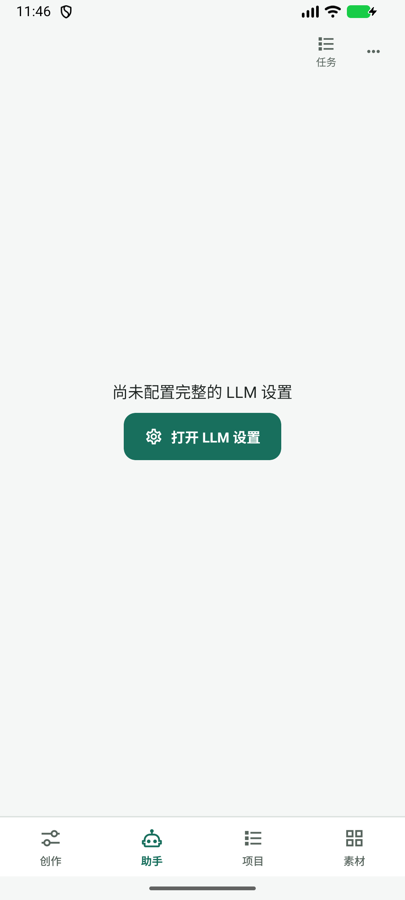
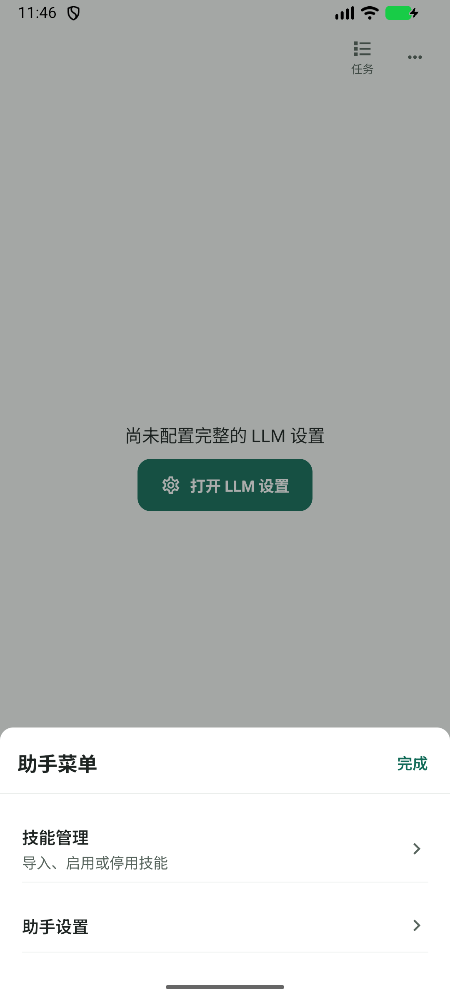
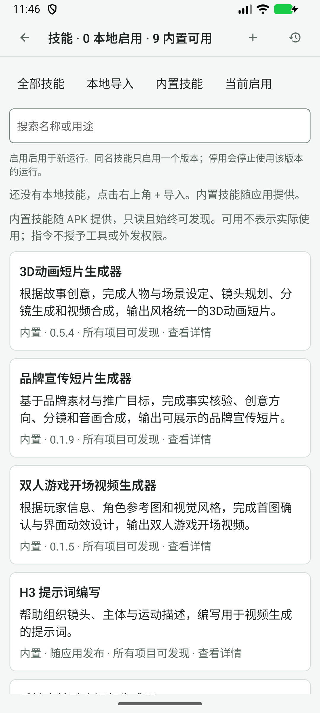
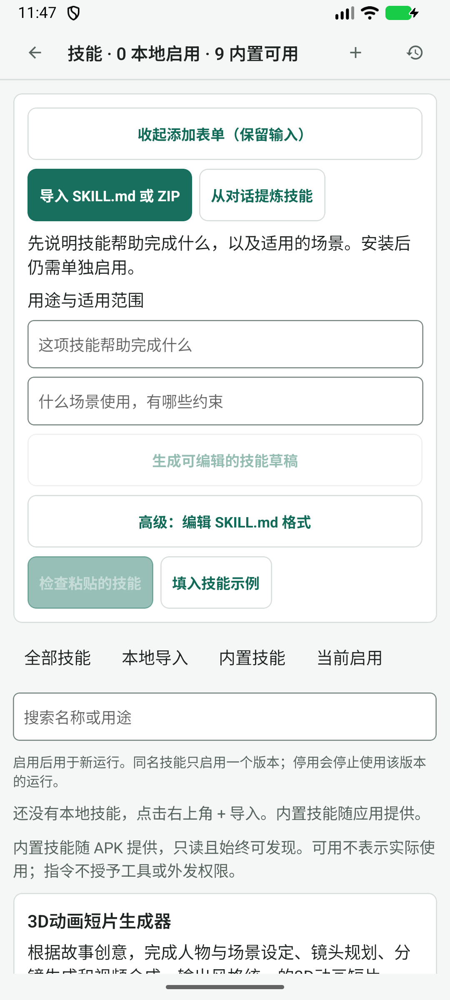

# 2026-11-04 Agent 操作评估：设备观察

本轮源码 `db7aa4d6`；设备 APK 为 `com.example.autodlh3.beta`，versionCode 83，`1.5.0-preview.4-beta.44`。**版本不匹配，不能用于声明 HEAD/beta.47 已设备验收。** 本轮不安装覆盖用户包，不配置模型，不提交生成、不安装技能、不修改授权或已有创作输入。

启动已有 AVD `AutoDL_Keyboard_QA_20261025`（隐藏窗口），serial `emulator-5554`。通过 adb UI XML 中实际控件的 bounds 计算点击中心。首次启动 Activity 使用错误包前缀失败，随后 resolve 得到 `com.example.autodlh3.beta/com.example.autodlh3.MainActivity`，成功打开。没有清空数据或强停。初始创作页 XML 仅用于定位主导航，非 Agent 审查截图。

| 编号 | 步骤 | 已保存并打开检查的截图 | 观察 |
| --- | --- | --- | --- |
| V1 | 创作→主导航助手 | 02-agent.png / 同名 XML | 缺 LLM 配置；明确主动作，但本地会话入口不可见。未填写连接 |
| V2 | 助手→助手菜单 | 03-menu.png / 同名 XML | 技能管理、助手设置；菜单边界清晰 |
| V3 | 菜单→技能管理 | 04-skills.png / 同名 XML | 搜索、4 个筛选、说明、9 项内置；首屏说明密集 |
| V4 | 目录→添加 | 05-add.png / 同名 XML | 添加表单展开在目录上方，多条来源与格式路径同屏 |

`contact.png` 仅将上述四张原图等比例缩至 270px 宽并排，未重画界面。原图为真实截图，均已打开检视。

未验证：模型已配置时的输入与会话、项目/镜头切换、单次技能选用、安装、提炼、计划/授权、运行/失败/未知状态、成果采用；读屏、字号放大、键盘遮挡、性能与真实网络。以上表面的建议见 [逐项评估](../../agent-action-review.md)，标为源码结构审查/合同建议，不称完整视觉审计。旧版运行详情的历史问题不能据此复发重报。
