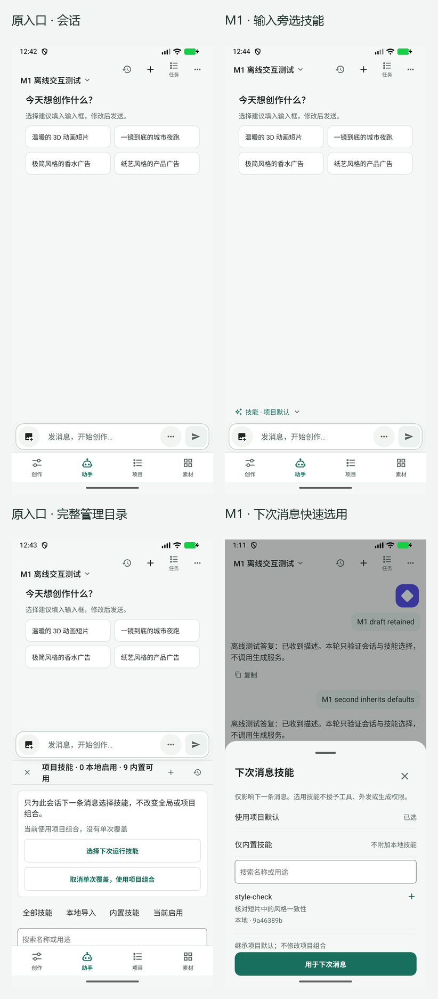
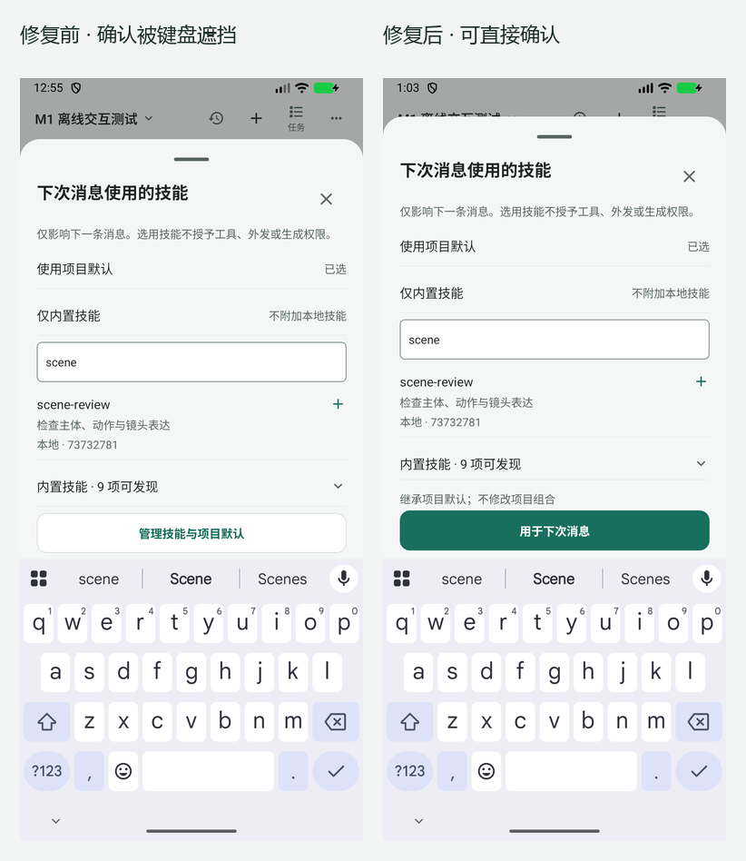

# M1 技能选用：原生设备证据

日期：2026-11-04。范围是 [M1 实现](../../agent-m1-implementation.md)，不是 M0 全状态验收或正式发布验收。前后采样使用同一 Android 模拟设备、原生组件和现有主题，未用网页代替 APK。

## 构建与数据来源

- 源码基线 `db7aa4d6`；候选为该基线上的本轮未提交改动。基线采样时仅将 AgentScreen、PromptAssistantUi、AgentCreativePanel、SkillLibraryScreen、nextRun 恢复到 HEAD 版本导出，随后恢复本轮文件；01/02 已核对不含新快速入口。新增快速组件在基线中不被引用。
- 原生基础包在本轮执行 `:app:assembleDebug -PreactNativeArchitectures=x86_64` 成功。基线与候选共用这个原生壳，SHA-256 为 `a6d5fcaa4dd9448139b9a5d64cbeb62ec716636e81315351ba76058fa3ffbd04`。分别用 Expo `export:embed --bytecode` 生成 Hermes 资源，注入 `assets/index.android.bundle`，zipalign 后用本地调试证书签名。此方式用于原生交互采样，不是正式 release 构建。
- 各阶段资源/采样包哈希见同目录四份 `*-metadata.json`。最终包为 `candidate-final-metadata.json`，SHA-256 `483f6fa0b3baa6c3da8cf2e0c69ee319d91d31ed084ad28314435a6eb4ff6f11`。后续源码仅改键盘避让注释，不改变可执行逻辑。
- 设备：`emulator-5556`，Android 17 / API 37，只读启动既有 AVD `AutoDL_Keyboard_QA_20261025`，测试包 `com.example.autodlh3`；未操作 `.beta` 包。常规采样 1080×2400、density 420、font_scale 1.0；大字体采样 1008×2240、density 420、font_scale 2.0（约 384dp 宽）。结束后恢复字体与尺寸。
- QA 引导是 `mobile/scripts/m1-skill-device.jsx`，不在正式入口导入。创建“M1 离线交互测试”合成项目、两个本地技能；图片是仓库现有图标。消息走宿主 8877 本地 SSE 回放，不连接真实供应商，不执行生成和外部工具。回放脚本归档为 `mobile/scripts/m1-skill-server.cjs`（收口为仅监听本机）；设备通过 `10.0.2.2` 访问宿主。数据库证据只导出该测试项目的技能 ID、计数与运行快照，不附真实内容。

## 已完成任务及原始证据

每张 PNG 配有同名 UIAutomator XML。XML 会包含滚动区域外的裁剪节点，超出屏幕的节点不计为可见。点击前重新抓取层级并从可见目标边界取点。

| 证据 | 实际任务与结果 |
| --- | --- |
| 01–02 baseline | 会话原入口、菜单内完整技能目录；用于与当前入口对照 |
| 03–05 candidate | 输入文字并添加图片；打开快速层、编辑后系统返回取消；文字和图片保留，默认不变 |
| 06–09 | 快速层选择 style-check，进入项目管理→全局管理；全局停用先取消再确认；正常返回后未确认的 style-check 勾选仍保留 |
| 10–11 | 确认为下次消息；输入文字与图片保留；force-stop 后重开，草稿、附件及已确认选择恢复 |
| 12–13 | 第一次发送消费 style-check；第二次无新选择发送继承默认；本地答复完成 |
| 14 | **已修复前的失败证据**：搜索键盘遮挡确认按钮；不能作为当前通过证据 |
| 15–17 | 键盘避让修复后，确认按钮在键盘上方；直接点选 scene-review 并确认，无需先收键盘；发送完成 |
| 18–19 | **标题修复前**的窄屏 2 倍字体；最后两字截断，保留为问题证据 |
| 20–21 | 最终文案版本、普通字体的会话与半屏快速层 |
| 22–24 | 最终文案版本、窄屏 2 倍字体：标题完整、确认按钮完整；上拖展开并滚动可发现技能和管理入口 |

01–02 对应 baseline metadata；03–14 对应 candidate-initial；15–19 对应 candidate-keyboard-fixed；20–24 对应 candidate-final。阶段间只修复本报告注明的问题，不能将初始截图视作最终版本。

## 数据结果与自动验证

`state-confirmed.json`→`state-accepted.json`→`state-second.json` 记录第一次确认、消费和第二次继承；`state-final-confirmed.json`→`state-final-consumed.json` 记录键盘流程。最后 pending 为空，项目/全局默认计数均为 0，三次运行本地版本依次为 `[style-check]`、`[]`、`[scene-review]`。style-check 的撤销修订为 1，说明管理停用后重新确认使用的是当前版本修订。

相关 8 套测试共 121 项通过，包含真实 SQLite 写入和消息受理、范围变化拒绝、失效、运行禁用、输入文字/光标/附件保留、全局停用确认、模态键盘避让与隐藏恢复。最终 TypeScript 检查通过；谱系严格校验另与源码变更一并运行。

## 明确的边界

这次没有在设备上验证 TalkBack、旋转、2 倍字体与键盘同时出现、全部字体档位、运行中范围冲突/撤销分支、真实供应商请求与生成、长列表性能，也没有进行用户耗时对照研究。部分分支只有自动测试或源码证据，不宣称完整可访问性或端到端通过。M0 的提议、许可、失败、结果未知及候选状态由后续切片补齐。

构建排查中，手动编译资源曾不能正确启动，改用 Expo bytecode 导出后完成任务；单靠 CLI `--config` 的首次基线导出未正确切换源码，已作废并重新导出、核对及覆盖 01/02。当前基线和候选的截图及哈希采用本报告记录的有效采样。

本地复核入口：在隔离模拟器上安装 `build/m1-qa/candidate.apk`，宿主运行 `node mobile/scripts/m1-skill-server.cjs` 后进入助手，选择测试项目。此包启动会配置上述合成项目和回放端点，仅供本轮调试；仓库普通入口与正式配置不导入该引导。重新导出时在 mobile 目录执行 `node node_modules/expo/bin/cli export:embed --platform android --entry-file scripts/m1-skill-device.jsx --bundle-output ../build/m1-qa/candidate/index.android.hermes --dev false --minify true --bytecode --max-workers 2`，再按前述资源注入/调试签名方式组装。原生生产入口构建仍使用常规 Gradle 流程。
