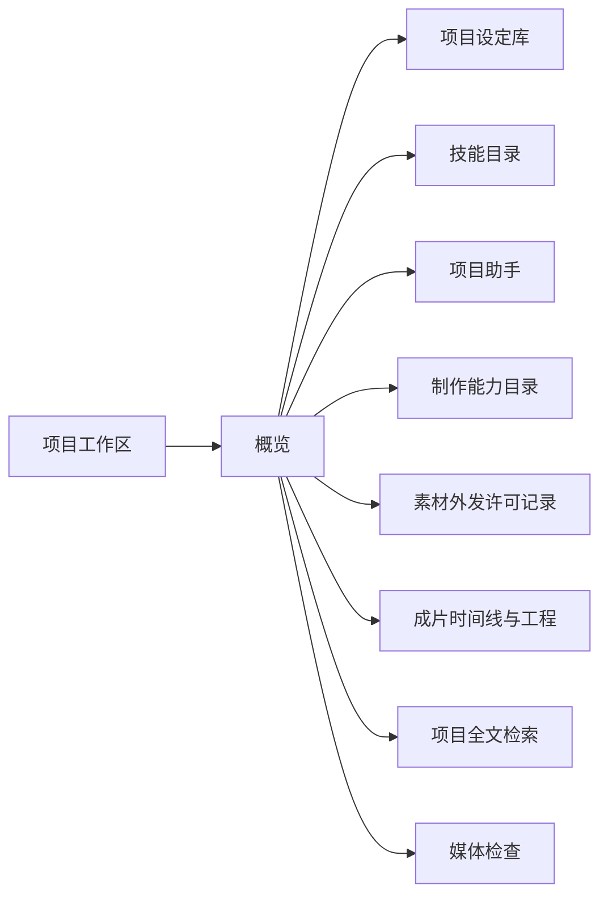

# 现状地图与逐页审查

基线：2026-11-01 / 56f16751 / Android APK beta.47。

> 本文件由 page-catalog.json 生成。改目录后执行 node scripts/design/check-page-catalog.mjs --write。

## 范围与结论

覆盖 29 个路由页面、2 个壳层、30 个重要子表面；记录 66 条源码确认的关键点击边。非路由清单不宣称穷尽全部 JSX 分支，点击边也不是运行时全图。

当前实现已有四入口、预览、参数抽屉、任务气泡、明确采用和不可变版本，方向不必推倒。M1 技能快速选用、M2 分步添加已独立，M3a 建议与草稿审阅、M3b1 单次请求审阅已按对象与状态接入；项目概览仍承担工具目录，镜头列表承担编辑器，技能目录与运行历史共享，时间线承担参数表与工程管理。应继续按对象和状态重组任务，不再给每项能力补一个常驻按钮。

目录中的归属是信息组织视角，不等于 Expo 文件嵌套或真实 back 栈。建议按条目标记 proposed / partially-implemented / implemented，设备覆盖单独记录在 evidenceLevel；页面状态是需要覆盖的规格，不能当作已通过的设备测试。历史基线与后续切片分别记录，见 D002–D005。

## 当前主要跳转：概览的扇出



图中箭头为打开入口，不是内容从属。这里的八个工具入口已经足以说明：一张概览不应继续成为所有新增功能的默认落点。

## 代码路由清单

| 稳定 ID | 页面 | 路由文件 | 信息归属 |
| --- | --- | --- | --- |
| app | [应用根与启动恢复](#app) | [_layout.tsx](../../mobile/app/_layout.tsx) | 根 |
| tabs | [工作台导航壳](#tabs) | [(tabs)/_layout.tsx](../../mobile/app/%28tabs%29/_layout.tsx) | 应用根与启动恢复 |
| entry | [默认入口](#entry) | [index.tsx](../../mobile/app/index.tsx) | 应用根与启动恢复 |
| create | [快捷创作](#create) | [(tabs)/create.tsx](../../mobile/app/%28tabs%29/create.tsx) | 工作台导航壳 |
| agent | [项目助手](#agent) | [(tabs)/agent.tsx](../../mobile/app/%28tabs%29/agent.tsx) | 工作台导航壳 |
| projects | [项目列表](#projects) | [(tabs)/projects.tsx](../../mobile/app/%28tabs%29/projects.tsx) | 工作台导航壳 |
| assets | [全局素材库](#assets) | [(tabs)/assets.tsx](../../mobile/app/%28tabs%29/assets.tsx) | 工作台导航壳 |
| tasks | [任务中心](#tasks) | [(tabs)/tasks.tsx](../../mobile/app/%28tabs%29/tasks.tsx) | 工作台导航壳 |
| legacy-gallery | [历史作品](#legacy-gallery) | [(tabs)/gallery.tsx](../../mobile/app/%28tabs%29/gallery.tsx) | 全局素材库 |
| settings-legacy | [设置 tab 入口](#settings-legacy) | [(tabs)/settings.tsx](../../mobile/app/%28tabs%29/settings.tsx) | 工作台导航壳 |
| settings | [独立设置](#settings) | [settings-panel.tsx](../../mobile/app/settings-panel.tsx) | 应用根与启动恢复 |
| project | [项目工作区](#project) | [creative-project/[id].tsx](../../mobile/app/creative-project/[id].tsx) | 项目列表 |
| shot-review | [镜头成果审阅](#shot-review) | [creative-shot/[id].tsx](../../mobile/app/creative-shot/[id].tsx) | 项目工作区 |
| asset-detail | [素材与版本](#asset-detail) | [creative-asset/[id].tsx](../../mobile/app/creative-asset/[id].tsx) | 全局素材库 |
| image-draft | [图片创作详情](#image-draft) | [image-draft/[id].tsx](../../mobile/app/image-draft/[id].tsx) | 快捷创作 |
| video-draft | [视频创作详情](#video-draft) | [creative-draft/[id].tsx](../../mobile/app/creative-draft/[id].tsx) | 快捷创作 |
| output-preview | [本次生成输出预览](#output-preview) | [creative-output/[id].tsx](../../mobile/app/creative-output/[id].tsx) | 视频创作详情 |
| task-detail | [任务与结果详情](#task-detail) | [creative-task/[id].tsx](../../mobile/app/creative-task/[id].tsx) | 任务中心 |
| legacy-video | [旧版视频详情](#legacy-video) | [video/[id].tsx](../../mobile/app/video/[id].tsx) | 历史作品 |
| draft-list | [创作草稿列表](#draft-list) | [creative-drafts.tsx](../../mobile/app/creative-drafts.tsx) | 快捷创作 |
| skills | [技能目录](#skills) | [agent-skills.tsx](../../mobile/app/agent-skills.tsx) | 项目助手 |
| skill-extract | [对话提炼技能](#skill-extract) | [agent-skill-extract.tsx](../../mobile/app/agent-skill-extract.tsx) | 技能目录 |
| run-evidence | [运行证据](#run-evidence) | [agent-run.tsx](../../mobile/app/agent-run.tsx) | 项目助手 |
| capabilities | [制作能力目录](#capabilities) | [creative-capabilities.tsx](../../mobile/app/creative-capabilities.tsx) | 独立设置 |
| connections | [模型连接与能力声明](#connections) | [model-connections.tsx](../../mobile/app/model-connections.tsx) | 独立设置 |
| semantic-library | [项目设定库](#semantic-library) | [project-settings-library.tsx](../../mobile/app/project-settings-library.tsx) | 项目工作区 |
| request-setup | [按设定准备镜头请求](#request-setup) | [shot-request-setup.tsx](../../mobile/app/shot-request-setup.tsx) | 项目工作区 |
| timeline | [成片时间线与工程](#timeline) | [project-timeline.tsx](../../mobile/app/project-timeline.tsx) | 项目工作区 |
| search | [项目全文检索](#search) | [project-search.tsx](../../mobile/app/project-search.tsx) | 项目工作区 |
| media-review | [媒体检查](#media-review) | [media-review.tsx](../../mobile/app/media-review.tsx) | 素材与版本 |
| consents | [素材外发许可记录](#consents) | [outbound-consents.tsx](../../mobile/app/outbound-consents.tsx) | 项目工作区 |

## 当前信息归属清单

以下仅为归属视角；辅助路由实际有多个来源，不据此决定 back。route=页面，surface=非路由表面，shell=导航壳。

```text
应用根与启动恢复 [shell; app]
  工作台导航壳 [shell; tabs]
    快捷创作 [route; create]
      图片创作详情 [route; image-draft]
        图片编辑与生成设置 [surface; image-tools]
      视频创作详情 [route; video-draft]
        本次生成输出预览 [route; output-preview]
      创作草稿列表 [route; draft-list]
      创作记录全屏层 [surface; create-records]
      生成结果与候选工具层 [surface; result-dock]
      最近任务气泡 [surface; task-inbox]
      提示词辅助工具 [surface; prompt-assist]
    项目助手 [route; agent]
      技能目录 [route; skills]
        对话提炼技能 [route; skill-extract]
        技能添加与安装预览 [surface; skill-add]
        技能运行历史 [surface; skill-history]
        会话菜单技能管理（兼容入口） [surface; skill-management-inline]
      运行证据 [route; run-evidence]
      助手项目/镜头上下文 [surface; assistant-context]
      助手会话与运行交互 [surface; assistant-conversation]
      会话内技能快速层 [surface; skill-quick]
      提示词版本面板 [surface; prompt-versions]
      助手本轮创作对象卡 [surface; assistant-creative-cards]
        生成请求审阅 [surface; generation-request-review]
        单次请求准备恢复 [surface; generation-request-recovery]
    项目列表 [route; projects]
      项目工作区 [route; project]
        镜头成果审阅 [route; shot-review]
        项目设定库 [route; semantic-library]
        按设定准备镜头请求 [route; request-setup]
        成片时间线与工程 [route; timeline]
        项目全文检索 [route; search]
        素材外发许可记录 [route; consents]
        项目 / 概览 [surface; project-overview]
        项目 / 镜头清单 [surface; project-shots]
          镜头编辑表单 [surface; shot-editor]
        项目 / 素材 [surface; project-assets]
        项目 / 计划 [surface; project-plans]
        项目 / 活动 [surface; project-activity]
        项目设置与封面选择 [surface; project-manage]
    全局素材库 [route; assets]
      历史作品 [route; legacy-gallery]
        旧版视频详情 [route; legacy-video]
      素材与版本 [route; asset-detail]
        媒体检查 [route; media-review]
        素材版本选择器 [surface; asset-picker]
        素材操作与使用位置 [surface; asset-tools]
    任务中心 [route; tasks]
      任务与结果详情 [route; task-detail]
    设置 tab 入口 [route; settings-legacy]
  默认入口 [route; entry]
  独立设置 [route; settings]
    制作能力目录 [route; capabilities]
    模型连接与能力声明 [route; connections]
    设置 / 创作账号 [surface; settings-accounts]
    设置 / 助手模型 [surface; settings-assistant]
    设置 / 工作流 [surface; settings-workflows]
    设置 / 存储导出与数据维护 [surface; settings-storage]
    设置 / 视频播放 [surface; settings-playback]
    设置 / 显示与诊断 [surface; settings-diagnostics]
```

## 逐页建议

<a id="app"></a>
### 应用根与启动恢复 · app · P1

**任务**：启动、数据可写性和维护恢复。

**现状问题**：恢复/维护会接管整个页面树，不能被普通空态规格遗漏。

**展示与交互建议**：启动阶段使用独立恢复表面，先说明数据状态、可执行恢复及退出；不把错误日志作为唯一说明。

**实施状态**：proposed。**证据范围**：source-reviewed。

**主操作**：依状态继续启动或恢复。**目标归属**：根。

**进入与返回**：冷启动、维护后重启 → 本表面；恢复完成回原安全入口；不可用时保留恢复页面。

**应覆盖状态**：启动中 / 旧库 / 只读恢复 / 维护失败 / 就绪。

**依据**：[app/_layout.tsx](../../mobile/app/_layout.tsx)；对照 R6（见 [调研](research.md)）。本表面未单独完成本轮设备采样，结论以源码结构为限。

<a id="tabs"></a>
### 工作台导航壳 · tabs · P1

**任务**：四个主要目的地和辅助目的地承载。

**现状问题**：注册了七个 tab，导航栏只展示四个；任务/旧作品/设置的壳层和返回语义不同。

**展示与交互建议**：四入口继续保留；任务与设置用统一全局 utility stack；旧作品保持迁移入口。先统一体验合同，再考虑改路由结构。

**实施状态**：proposed。**证据范围**：source-reviewed。

**主操作**：切换目的地。**目标归属**：应用根与启动恢复。

**进入与返回**：根入口或全局导航 → 本表面；主入口切换保留各自上下文；辅助页返回实际来源。

**应覆盖状态**：主入口 / 辅助页 / 键盘打开 / 返回历史。

**依据**：[app/(tabs)/_layout.tsx](../../mobile/app/%28tabs%29/_layout.tsx)；对照 R6（见 [调研](research.md)）。本表面未单独完成本轮设备采样，结论以源码结构为限。

<a id="entry"></a>
### 默认入口 · entry · P2

**任务**：scheme 冷启动指向创作。

**现状问题**：Redirect 本身合理；它不是要再设计一张欢迎首页。

**展示与交互建议**：保留稳定入口；冷链接校验成功后进入具体对象，失败给安全出口。

**实施状态**：proposed。**证据范围**：source-reviewed。

**主操作**：打开最近创作。**目标归属**：应用根与启动恢复。

**进入与返回**：应用 scheme 根 → 本表面；进入创作后使用主导航。

**应覆盖状态**：冷启动 / 恢复。

**依据**：[app/index.tsx](../../mobile/app/index.tsx)；对照 R6（见 [调研](research.md)）。本表面未单独完成本轮设备采样，结论以源码结构为限。

<a id="create"></a>
### 快捷创作 · create · P1

**任务**：不建项目也可快速图片/视频创作。

**现状问题**：已有预览/编辑分层；创作记录底部又重复项目、素材、工作流导航。

**展示与交互建议**：以画面预览、描述、规格摘要、生成作为主体；记录只负责恢复；全局导航和工作流管理回归各自层级。

**实施状态**：proposed。**证据范围**：source-reviewed; beta47-assets UI sample in x86_64 wrapper。

**主操作**：生成或补齐当前阻塞项。**目标归属**：工作台导航壳。

**进入与返回**：默认入口、草稿恢复、素材续作 → 本表面；关闭工具→关闭记录→保留当前创作；切 tab 不丢输入。

**应覆盖状态**：恢复 / 编辑 / 工具展开 / 提交 / 候选 / 未知。

**依据**：[src/creative/CreativeHome.tsx](../../mobile/src/creative/CreativeHome.tsx)；对照 B1、B2、R6（见 [调研](research.md)）。本轮截图：[v47-01-create.png](../../docs/design/evidence/2026-11-01/v47-01-create.png)。

<a id="agent"></a>
### 项目助手 · agent · P1

**任务**：围绕项目对话、提出和执行创作方案。

**现状问题**：M1 已补输入旁技能选用与明确范围；无项目空态仍须离开助手建项目，提议/授权等后续任务待重组。

**展示与交互建议**：空态提供就地轻量建项目；标题持久展示项目，镜头上下文显示可移除 chip；输入区以对话为主。不是新增无范围的执行会话。

**实施状态**：partially-implemented。**证据范围**：source-reviewed; beta47-assets UI sample in x86_64 wrapper; M1 local fixture candidate sample。

**主操作**：发送消息；运行时停止等待。**目标归属**：工作台导航壳。

**进入与返回**：底部、项目、镜头 → 本表面；主入口按导航历史；从镜头进入可回原镜头与位置。

**应覆盖状态**：无项目 / 未配模型 / 会话 / 运行 / 待审批 / 异常。

**依据**：[src/creative/AgentWorkspace.tsx](../../mobile/src/creative/AgentWorkspace.tsx)、[src/agent/AgentScreen.tsx](../../mobile/src/agent/AgentScreen.tsx)、[src/creative/AgentCreativePanel.tsx](../../mobile/src/creative/AgentCreativePanel.tsx)；对照 B1、B2（见 [调研](research.md)）。本轮截图：[v47-11-assistant.png](../../docs/design/evidence/2026-11-01/v47-11-assistant.png)、[v47-13-assistant-return.png](../../docs/design/evidence/2026-11-01/v47-13-assistant-return.png)、[03-candidate-agent.png](../../docs/design/evidence/2026-11-04-m1-skills/03-candidate-agent.png)。

<a id="projects"></a>
### 项目列表 · projects · P2

**任务**：找到并恢复一个项目。

**现状问题**：新建、归档开关、搜索与共享工作区逻辑混在同一组件；列表对下一步的表达弱。

**展示与交互建议**：卡片显示封面、镜头进展、最近修改和待处理；新建是主动作；归档用范围筛选。保留现有列表能力。

**实施状态**：proposed。**证据范围**：source-reviewed。

**主操作**：新建项目或继续选中项目。**目标归属**：工作台导航壳。

**进入与返回**：底部、助手空态 → 本表面；主入口；切换保留搜索与滚动。

**应覆盖状态**：加载 / 空 / 筛选空 / 归档 / 错误。

**依据**：[src/creative/CreativeWorkspace.tsx](../../mobile/src/creative/CreativeWorkspace.tsx)；对照 B2、R6（见 [调研](research.md)）。本表面未单独完成本轮设备采样，结论以源码结构为限。

<a id="assets"></a>
### 全局素材库 · assets · P1

**任务**：找、导入和整理可复用素材。

**现状问题**：全库、未归属、回收站、历史作品、草稿和迁入入口概念重叠。

**展示与交互建议**：主体为缩略图与类型/范围；导入为明确动作；回收站/旧作品迁移在管理层，草稿不混作素材。显示收纳/采用的区别。

**实施状态**：proposed。**证据范围**：source-reviewed; beta47-assets UI sample in x86_64 wrapper。

**主操作**：导入或打开素材。**目标归属**：工作台导航壳。

**进入与返回**：底部、工作流选取来源 → 本表面；主入口保留筛选；详情返回同一列表位置。

**应覆盖状态**：全库空 / 范围空 / 筛选空 / 缺原件 / 回收站。

**依据**：[src/creative/CreativeWorkspace.tsx](../../mobile/src/creative/CreativeWorkspace.tsx)；对照 B2、B3（见 [调研](research.md)）。本轮截图：[v47-15-assets-empty.png](../../docs/design/evidence/2026-11-01/v47-15-assets-empty.png)。

<a id="tasks"></a>
### 任务中心 · tasks · P1

**任务**：跨工作区观察进度并处理异常。

**现状问题**：任务处理与后台监控/维护概念在一个页面；用户需辨别任务和计划。

**展示与交互建议**：默认待处理/进行中，缩略图+所属项目/镜头+下一步；监控说明和维护下沉设置；行点击统一到任务详情。

**实施状态**：proposed。**证据范围**：source-reviewed; beta47-assets UI sample in x86_64 wrapper。

**主操作**：处理当前异常；普通状态查看详情。**目标归属**：工作台导航壳。

**进入与返回**：任务气泡、任务详情、辅助 tab → 本表面；返回实际工作区，冷入口回创作。

**应覆盖状态**：排队 / 执行 / 未知 / 归档 / 下载失败 / 离线。

**依据**：[app/(tabs)/tasks.tsx](../../mobile/app/%28tabs%29/tasks.tsx)；对照 B2、R6（见 [调研](research.md)）。本轮截图：[v47-16-task-center-empty.png](../../docs/design/evidence/2026-11-01/v47-16-task-center-empty.png)。

<a id="legacy-gallery"></a>
### 历史作品 · legacy-gallery · P2

**任务**：访问旧版视频结果。

**现状问题**：名称“结果”与新素材库重叠，旧 video 详情又是一套体验。

**展示与交互建议**：明确标“旧版作品”，仅在素材管理/迁入中进入；可中断迁移，保留未迁入项目原记录。不要与新素材库并列营销。

**实施状态**：proposed。**证据范围**：source-reviewed。

**主操作**：浏览旧作品或迁入。**目标归属**：全局素材库。

**进入与返回**：素材管理、旧链接 → 本表面；返回来源；无来源回素材库。

**应覆盖状态**：空 / 迁入中 / 选择管理 / 删除失败。

**依据**：[app/(tabs)/gallery.tsx](../../mobile/app/%28tabs%29/gallery.tsx)；对照 B2（见 [调研](research.md)）。本表面未单独完成本轮设备采样，结论以源码结构为限。

<a id="settings-legacy"></a>
### 设置 tab 入口 · settings-legacy · P1

**任务**：兼容已有设置入口。

**现状问题**：同一设置有隐藏 tab 和独立 stack 两个宿主；不能因为组件相同就认为来源一致。

**展示与交互建议**：一个共享设置模型和 utility shell；旧路径兼容重定向时保留 section/草稿/来源。

**实施状态**：proposed。**证据范围**：source-reviewed。

**主操作**：进入配置分类。**目标归属**：工作台导航壳。

**进入与返回**：旧入口或导航调用 → 本表面；分类返回索引；直达分类返回来源；输入先持久保留。

**应覆盖状态**：索引 / 分类 / 未保存 / 读取失败。

**依据**：[app/(tabs)/settings.tsx](../../mobile/app/%28tabs%29/settings.tsx)；对照 R6（见 [调研](research.md)）。本表面未单独完成本轮设备采样，结论以源码结构为限。

<a id="settings"></a>
### 独立设置 · settings · P1

**任务**：连接、偏好和数据管理。

**现状问题**：“助手模型”内原连接与独立模型连接形成双配置心智；多个面板保存机制不同。

**展示与交互建议**：设置首页按连接与能力、创作资源、使用偏好、数据维护分组；进入分类后保持单一标题；逐项写明即时生效/保存生效。

**实施状态**：proposed。**证据范围**：source-reviewed。

**主操作**：保存当前配置。**目标归属**：应用根与启动恢复。

**进入与返回**：全局设置、缺配置 CTA → 本表面；直达补配置完成回原 draft/version；全部设置进入后返回分类索引。

**应覆盖状态**：直达 / 分类索引 / 未保存 / 保存失败。

**依据**：[app/(tabs)/settings.tsx](../../mobile/app/%28tabs%29/settings.tsx)；对照 R6、B2（见 [调研](research.md)）。本表面未单独完成本轮设备采样，结论以源码结构为限。

<a id="project"></a>
### 项目工作区 · project · P1

**任务**：持续推进同一项目。

**现状问题**：概览/镜头/素材/计划/活动五个视图之外，概览还横向扇出许多工具页。

**展示与交互建议**：项目保留概览、镜头、资料、计划/待办；活动进入历史层；合成到交付；全局配置移出概览常驻区。保留稳定 projectId 和子目标。

**实施状态**：proposed。**证据范围**：source-reviewed。

**主操作**：继续项目推荐下一步。**目标归属**：项目列表。

**进入与返回**：项目卡、来源关系、任务回流 → 本表面；真实来源优先；无来源回项目列表；子视图切换不伪造多层返回。

**应覆盖状态**：有效 / 归档 / 删除 / 子目标缺失 / 编辑中。

**依据**：[src/creative/CreativeWorkspace.tsx](../../mobile/src/creative/CreativeWorkspace.tsx)；对照 B1、B2、R6（见 [调研](research.md)）。本表面未单独完成本轮设备采样，结论以源码结构为限。

<a id="shot-review"></a>
### 镜头成果审阅 · shot-review · P1

**任务**：审阅视频候选并明确采用。

**现状问题**：列表制作与此审阅页分离，候选按钮以编号文本呈现；容易与素材详情/输出预览混淆。

**展示与交互建议**：演进为镜头工作区的“审阅”状态；候选缩略图轨、当前采用标记、版本摘要；主动作采用，续作放次级。

**实施状态**：proposed。**证据范围**：source-reviewed。

**主操作**：采用此固定版本。**目标归属**：项目工作区。

**进入与返回**：镜头已选视频、候选回流 → 本表面；返回原镜头定位；显式“在项目中定位”与 back 分开。

**应覆盖状态**：未采用 / 有候选 / 已采用 / 版本失效 / 归档。

**依据**：[src/creative/ShotOutputReview.tsx](../../mobile/src/creative/ShotOutputReview.tsx)；对照 B2（见 [调研](research.md)）。本表面未单独完成本轮设备采样，结论以源码结构为限。

<a id="asset-detail"></a>
### 素材与版本 · asset-detail · P1

**任务**：预览版本、续作、检查引用和导出。

**现状问题**：同一组件还管理项目/资产列表；详情涉及处理、加入项目、采用、恢复、使用位置等多个层次。

**展示与交互建议**：预览优先，版本轨显示缩略图；常用动作按类型出现；使用位置独立可展开关系区，管理和诊断分层。对选择器返回和普通浏览使用不同意图。

**实施状态**：proposed。**证据范围**：source-reviewed。

**主操作**：依意图选择此版本或保存到手机。**目标归属**：全局素材库。

**进入与返回**：素材库、项目、任务、使用位置 → 本表面；回真实列表/来源，保持 versionId；版本不存在不偷偷选默认。

**应覆盖状态**：可用 / 缺原件 / 缺版本 / 多个版本 / 回收站 / 只读。

**依据**：[src/creative/CreativeWorkspace.tsx](../../mobile/src/creative/CreativeWorkspace.tsx)；对照 B1、B2、B3（见 [调研](research.md)）。本表面未单独完成本轮设备采样，结论以源码结构为限。

<a id="image-draft"></a>
### 图片创作详情 · image-draft · P1

**任务**：围绕图片草稿生成和编辑。

**现状问题**：已有抽屉、预览和编辑；但生成设置、画面编辑、历史、参考、增强等模式组合需统一表面规则。

**展示与交互建议**：保持大预览+底部紧凑描述/生成；长参数全屏/抽屉分类；当前只打开一个工具；关联项目/镜头可见但不占整段表单。

**实施状态**：proposed。**证据范围**：source-reviewed。

**主操作**：生成；阻塞时连接/恢复原件。**目标归属**：快捷创作。

**进入与返回**：创作恢复、镜头制作、素材续作 → 本表面；先关工具；保留输入；详情退出回来源。

**应覆盖状态**：编辑 / 图生图 / 重绘 / 增强 / 历史 / 候选 / 未知 / 冲突。

**依据**：[src/creative/ImageDraftScreen.tsx](../../mobile/src/creative/ImageDraftScreen.tsx)；对照 B1、B3（见 [调研](research.md)）。本表面未单独完成本轮设备采样，结论以源码结构为限。

<a id="video-draft"></a>
### 视频创作详情 · video-draft · P1

**任务**：配置视频输入、提交并审阅结果。

**现状问题**：工作流、账号、参考、参数、辅助、历史均存在；易把编辑下一次输入与查看本次结果混在一起。

**展示与交互建议**：分清当前草稿与已提交任务的时间；参考缩略图内编辑，规格显示摘要，更多参数下沉；生成确认呈现冻结输入和费用。

**实施状态**：proposed。**证据范围**：source-reviewed。

**主操作**：生成新尝试或核查当前未知。**目标归属**：快捷创作。

**进入与返回**：镜头、素材、创作记录 → 本表面；配置返回原草稿；退出回实际来源；未知任务仍有核查入口。

**应覆盖状态**：编辑 / 缺账号 / 工作流变化 / 提交 / 运行 / 候选 / 未知。

**依据**：[src/creative/VideoDraftScreen.tsx](../../mobile/src/creative/VideoDraftScreen.tsx)；对照 B2（见 [调研](research.md)）。本表面未单独完成本轮设备采样，结论以源码结构为限。

<a id="output-preview"></a>
### 本次生成输出预览 · output-preview · P2

**任务**：预览指定输出版本和本次结果。

**现状问题**：任务结果、素材详情、镜头审阅都能预览，页面职责需要解释。

**展示与交互建议**：固定为“本次生成的临时审阅入口”，共享同一预览组件；有镜头目标时提供返回目标并采用，不自动采用。管理操作去版本详情。

**实施状态**：proposed。**证据范围**：source-reviewed。

**主操作**：继续审阅或返回镜头采用。**目标归属**：视频创作详情。

**进入与返回**：生成结果卡 → 本表面；关闭回本次结果，保留当前候选；对象失效显示原因。

**应覆盖状态**：可用 / 加载 / 输出失效 / 归档待完成。

**依据**：[src/creative/CreativeOutputPreview.tsx](../../mobile/src/creative/CreativeOutputPreview.tsx)；对照 B2（见 [调研](research.md)）。本表面未单独完成本轮设备采样，结论以源码结构为限。

<a id="task-detail"></a>
### 任务与结果详情 · task-detail · P1

**任务**：核查一次提交的状态与结果。

**现状问题**：底部有来源计划、完整创作历史、任务中心等多个同级出口，容易形成循环。

**展示与交互建议**：首屏任务状态、结果和一个当前可执行恢复动作；来源用信息链接，任务中心为次级导航；查询明确不会重生成。

**实施状态**：proposed。**证据范围**：source-reviewed。

**主操作**：依状态下载/核查/查看候选。**目标归属**：任务中心。

**进入与返回**：任务卡、草稿、计划 → 本表面；back 回来源；打开计划属于显式定位，不冒充返回。

**应覆盖状态**：运行 / 成功 / 失败 / 未知 / 认证错误 / 来源丢失。

**依据**：[app/creative-task/[id].tsx](../../mobile/app/creative-task/[id].tsx)；对照 B2、R6（见 [调研](research.md)）。本表面未单独完成本轮设备采样，结论以源码结构为限。

<a id="legacy-video"></a>
### 旧版视频详情 · legacy-video · P2

**任务**：播放与导出旧版视频。

**现状问题**：旧版播放器、Prompt、诊断和新素材详情并存；缺失页与正常页 back 使用不一致。

**展示与交互建议**：保持兼容只读详情；标旧版，先给播放与保存；迁入后指向新素材版本；所有分支使用同一来源返回合同。

**实施状态**：proposed。**证据范围**：source-reviewed。

**主操作**：播放或保存旧作品。**目标归属**：历史作品。

**进入与返回**：旧作品列表、旧链接 → 本表面；有来源返回来源，无来源回旧作品/素材管理。

**应覆盖状态**：加载 / 可用 / 缺文件 / 记录删除 / 诊断。

**依据**：[app/video/[id].tsx](../../mobile/app/video/[id].tsx)；对照 R6（见 [调研](research.md)）。本表面未单独完成本轮设备采样，结论以源码结构为限。

<a id="draft-list"></a>
### 创作草稿列表 · draft-list · P2

**任务**：恢复尚未完成的输入。

**现状问题**：与创作记录重复，页首同时有返回和打开工作台。

**展示与交互建议**：作为统一“最近创作”的筛选/兼容入口；草稿行显示项目镜头、缩略图、修改时间，点击精确恢复。不要再扩展第三套历史页。

**实施状态**：proposed。**证据范围**：source-reviewed。

**主操作**：继续某份草稿。**目标归属**：快捷创作。

**进入与返回**：素材管理、旧入口 → 本表面；返回来源；冷入口回创作。

**应覆盖状态**：空 / 错误 / 草稿已删除。

**依据**：[app/creative-drafts.tsx](../../mobile/app/creative-drafts.tsx)；对照 B2（见 [调研](research.md)）。本表面未单独完成本轮设备采样，结论以源码结构为限。

<a id="skills"></a>
### 技能目录 · skills · P1

**任务**：查找、了解、管理技能及项目组合。

**现状问题**：M1 已区分项目默认/全局管理标题、范围与全局停用确认；M2 添加已为独立任务，完成定位固定版本。运行历史仍与目录共享，待 M5。

**展示与交互建议**：保持范围说明与分步添加；后续运行历史归助手，目录保持按用途和来源浏览。

**实施状态**：partially-implemented。**证据范围**：source-reviewed; device-sampled M1 project/global scopes and revoke; M2 add/install/highlighted version with defaults unchanged。

**主操作**：浏览技能与管理默认；添加进入独立任务。**目标归属**：项目助手。

**进入与返回**：助手、项目技能、深链接 → 本表面；管理回实际来源；添加先处理未保存，完成可定位确切版本。

**应覆盖状态**：全局 / 项目 / 单次 / 内置只读 / 无匹配 / 版本详情。

**依据**：[src/agent/skills/SkillLibraryScreen.tsx](../../mobile/src/agent/skills/SkillLibraryScreen.tsx)；对照 B1、B2（见 [调研](research.md)）。本轮截图：[v47-03-skills.png](../../docs/design/evidence/2026-11-01/v47-03-skills.png)、[07-project-management.png](../../docs/design/evidence/2026-11-04-m1-skills/07-project-management.png)、[08-global-confirmation.png](../../docs/design/evidence/2026-11-04-m1-skills/08-global-confirmation.png)、[12-located.png](../../docs/design/evidence/2026-11-04-m2-skills/12-located.png)、[22-origin-management.png](../../docs/design/evidence/2026-11-04-m2-skills/22-origin-management.png)、[38-final-located.png](../../docs/design/evidence/2026-11-04-m2-skills/38-final-located.png)。

<a id="skill-extract"></a>
### 对话提炼技能 · skill-extract · P1

**任务**：将证据提炼为可复用方法并审阅发布。

**现状问题**：选对话/证据、脱敏、发送、编辑发布、历史草稿顺序堆在一张长页面。

**展示与交互建议**：改为证据→外发审阅→草稿审阅的分步流程；草稿列表单独表面；步骤保留输入；本地保存与发布启用分别反馈。

**实施状态**：proposed。**证据范围**：source-reviewed。

**主操作**：当前步骤的继续/确认发送/发布。**目标归属**：技能目录。

**进入与返回**：技能添加、可选对话上下文 → 本表面；回上一步先保留；退出回原添加/会话上下文。

**应覆盖状态**：选证据 / 审阅外发 / 处理中 / 未知 / 编辑草稿 / 已发布。

**依据**：[src/agent/skills/SkillExtractionScreen.tsx](../../mobile/src/agent/skills/SkillExtractionScreen.tsx)；对照 R6、B1（见 [调研](research.md)）。本表面未单独完成本轮设备采样，结论以源码结构为限。

<a id="run-evidence"></a>
### 运行证据 · run-evidence · P1

**任务**：只读核验某次运行实际发生的行为。

**现状问题**：源码已补实时刷新；首屏仍直接输出工具 JSON、运行 ID 和会话消息，普通用户难以判断发生了什么。

**展示与交互建议**：摘要显示结果/开始结束/模型/工具次数/技能实际读取；阶段时间线可展开；原始 JSON 和完整会话为诊断层。

**实施状态**：proposed。**证据范围**：source-reviewed。

**主操作**：查看某一步证据。**目标归属**：项目助手。

**进入与返回**：技能运行记录、后续运行消息链接 → 本表面；回实际来源；冷入口回助手/项目上下文（需实现）。

**应覆盖状态**：运行中 / 完成 / 失败 / 刷新失败 / 历史不完整。

**依据**：[src/agent/skills/SkillRunScreen.tsx](../../mobile/src/agent/skills/SkillRunScreen.tsx)；对照 B1、B2（见 [调研](research.md)）。本表面未单独完成本轮设备采样，结论以源码结构为限。

<a id="capabilities"></a>
### 制作能力目录 · capabilities · P1

**任务**：了解可制作内容及配置缺口。

**现状问题**：把 provider/version/model/reasons 列表和模型连接、工作流配置拼在一起，用户需自己推导就绪性。

**展示与交互建议**：以用途分组：助手/图片/视频/媒体检查；卡显示可用性与唯一阻塞原因；详细配置进入对应连接。保留本地声明与远程验证区别。

**实施状态**：proposed。**证据范围**：source-reviewed; beta47-assets UI sample in x86_64 wrapper。

**主操作**：修复当前具体阻塞或查看能力详情。**目标归属**：独立设置。

**进入与返回**：项目概览、缺能力提示 → 本表面；返回实际来源，补配置后回阻塞请求。

**应覆盖状态**：可用 / 未连接 / 工作流失配 / 适配器不支持 / 分页。

**依据**：[src/creative/CapabilityCatalogScreen.tsx](../../mobile/src/creative/CapabilityCatalogScreen.tsx)；对照 B2、R6（见 [调研](research.md)）。本轮截图：[v47-09-capabilities.png](../../docs/design/evidence/2026-11-01/v47-09-capabilities.png)。

<a id="connections"></a>
### 模型连接与能力声明 · connections · P1

**任务**：管理助手与检查模型的连接。

**现状问题**：连接列表下直接追加完整新增表单；“使用原有连接”与设置页配置形成两套选择。

**展示与交互建议**：连接列表与添加/编辑分开；卡片展示用途、当前作用范围和本地状态；旧配置有统一来源标识，不复制密钥。撤销放详情危险区，说明中止范围。

**实施状态**：proposed。**证据范围**：source-reviewed; beta47-assets UI sample in x86_64 wrapper。

**主操作**：新增连接或选择一个连接。**目标归属**：独立设置。

**进入与返回**：能力目录、媒体检查 → 本表面；回来源并刷新能力；冷入口回连接设置。

**应覆盖状态**：列表 / 添加 / 未保存 / 已撤销 / 当前连接缺失。

**依据**：[src/settings/ModelConnectionsScreen.tsx](../../mobile/src/settings/ModelConnectionsScreen.tsx)；对照 R6（见 [调研](research.md)）。本轮截图：[v47-10-connections.png](../../docs/design/evidence/2026-11-01/v47-10-connections.png)。

<a id="semantic-library"></a>
### 项目设定库 · semantic-library · P1

**任务**：角色/场景/风格/声音及固定版本引用。

**现状问题**：设定列表、历史版本、编辑表单、逐镜头绑定与替换同时出现；规模增长后按钮乘积增长。

**展示与交互建议**：先类型卡片目录，点入设定详情；版本缩略图/摘要；“用于哪些镜头”独立多选器，仅对选中版本显示采用/绑定。

**实施状态**：proposed。**证据范围**：source-reviewed; beta47-assets UI sample in x86_64 wrapper。

**主操作**：创建设定或采用当前候选。**目标归属**：项目工作区。

**进入与返回**：项目资料、搜索、使用位置 → 本表面；回资料来源，保留实体与版本；编辑受保护。

**应覆盖状态**：列表 / 详情 / 版本 / 编辑 / 绑定 / 陈旧引用。

**依据**：[src/creative/SemanticResourcesScreen.tsx](../../mobile/src/creative/SemanticResourcesScreen.tsx)；对照 B1、B2（见 [调研](research.md)）。本轮截图：[v47-06-semantic-empty.png](../../docs/design/evidence/2026-11-01/v47-06-semantic-empty.png)。

<a id="request-setup"></a>
### 按设定准备镜头请求 · request-setup · P1

**任务**：从固定设定准备镜头生成输入。

**现状问题**：普通镜头制作和此入口并行，用户必须先理解“准备请求”与“制作视频”的区别。

**展示与交互建议**：合入镜头制作向导中的“输入与参考”步骤；来源版本、缺项和冲突可视化；高级入口兼容而不占每张列表卡。

**实施状态**：proposed。**证据范围**：source-reviewed。

**主操作**：确认准备输入；生成另行授权。**目标归属**：项目 / 镜头清单。

**进入与返回**：镜头按设定准备 → 本表面；取消回原镜头；成功回绑定草稿，不再让用户找新请求。

**应覆盖状态**：缺设定 / 缺原件 / 已准备 / 需授权 / 冲突。

**依据**：[src/creative/SemanticPreparationScreen.tsx](../../mobile/src/creative/SemanticPreparationScreen.tsx)；对照 B2（见 [调研](research.md)）。本表面未单独完成本轮设备采样，结论以源码结构为限。

<a id="timeline"></a>
### 成片时间线与工程 · timeline · P1

**任务**：排列片段、裁剪并本机合成。

**现状问题**：每片段使用毫秒输入及上移/下移/删除按钮；编辑器、已存工程、渲染历史和打包并列。

**展示与交互建议**：预览+可选择片段条，选中后编辑时长/字幕/音量；秒为用户单位，精确输入保留；工程列表和导出动作分层。主流程为编辑→保存快照→本机合成。

**实施状态**：proposed。**证据范围**：source-reviewed; beta47-assets UI sample in x86_64 wrapper。

**主操作**：保存当前工程；已存状态本机合成。**目标归属**：项目工作区。

**进入与返回**：项目交付、使用位置 → 本表面；离开先处理未保存；回原项目交付位置。

**应覆盖状态**：无片段 / 选片 / 编辑 / 保存 / 合成 / 失败 / 导出。

**依据**：[src/creative/TimelineScreen.tsx](../../mobile/src/creative/TimelineScreen.tsx)；对照 B1、B2（见 [调研](research.md)）。本轮截图：[v47-05-timeline-empty.png](../../docs/design/evidence/2026-11-01/v47-05-timeline-empty.png)。

<a id="search"></a>
### 项目全文检索 · search · P2

**任务**：从项目对象和正文定位来源。

**现状问题**：搜索与“更新全部本地索引”同级，暴露索引维护；结果以版本 ID 辅助信息为主。

**展示与交互建议**：项目标题栏进入搜索，按镜头/设定/素材分组，显示摘要和缩略图；索引覆盖做状态说明，需维护时提供小入口；定位后可返回原查询。

**实施状态**：proposed。**证据范围**：source-reviewed。

**主操作**：搜索并打开来源。**目标归属**：项目工作区。

**进入与返回**：项目全文检索入口 → 本表面；回原项目；结果往返恢复 query/结果/滚动。

**应覆盖状态**：初始 / 搜索 / 无结果 / 索引过期 / 部分不可读。

**依据**：[src/creative/ProjectSearchScreen.tsx](../../mobile/src/creative/ProjectSearchScreen.tsx)；对照 R6、B2（见 [调研](research.md)）。本表面未单独完成本轮设备采样，结论以源码结构为限。

<a id="media-review"></a>
### 媒体检查 · media-review · P1

**任务**：本地探测所选媒体，可选模型检查。

**现状问题**：从项目概览进入时要重新选择媒体；本地检查、配模型、外发调用和历史报告一页混合。

**展示与交互建议**：从具体素材版本进入；默认本地结果和抽帧；按需展开模型检查；预览目标/接收方并确认外发；报告进入所选素材历史。

**实施状态**：proposed。**证据范围**：source-reviewed。

**主操作**：本地检查；完成后可选模型检查。**目标归属**：素材与版本。

**进入与返回**：素材操作、项目工具兼容入口 → 本表面；回原版本；配置模型后继续当前检查。

**应覆盖状态**：选媒体 / 探测 / 抽帧 / 缺模型 / 待确认 / 检查中 / 未知 / 报告。

**依据**：[src/creative/MediaReviewScreen.tsx](../../mobile/src/creative/MediaReviewScreen.tsx)；对照 B3（见 [调研](research.md)）。本表面未单独完成本轮设备采样，结论以源码结构为限。

<a id="consents"></a>
### 素材外发许可记录 · consents · P1

**任务**：核查/撤销已绑定请求的许可。

**现状问题**：页面只给供应商、数量和期限，难理解具体素材、任务及是否已发送；与计划生成授权易混淆。

**展示与交互建议**：归入项目设置的权限记录；卡片呈现接收方、缩略图/版本、请求来源、发送状态和可撤销范围；实际授权发生在请求确认处。

**实施状态**：proposed。**证据范围**：source-reviewed。

**主操作**：查看许可详情；有效未发送时撤销。**目标归属**：项目工作区。

**进入与返回**：项目概览、后续请求详情链接 → 本表面；回项目权限/实际来源。

**应覆盖状态**：空 / 有效 / 过期 / 已撤销 / 已发送 / 分页。

**依据**：[src/creative/OutboundConsentScreen.tsx](../../mobile/src/creative/OutboundConsentScreen.tsx)；对照 R6（见 [调研](research.md)）。本表面未单独完成本轮设备采样，结论以源码结构为限。

<a id="project-overview"></a>
### 项目 / 概览 · project-overview · P1

**任务**：理解进展并继续创作。

**现状问题**：项目资料与规则、制作与配置两组累计八个 ListAction，还嵌计划摘要；视觉上成为入口目录。

**展示与交互建议**：上半屏为进展、一个下一步和最近工作；设定归资料、权限归设置、媒体检查归素材、时间线归交付；概览不重复配置中心。

**实施状态**：proposed。**证据范围**：source-reviewed; beta47-assets UI sample in x86_64 wrapper。

**主操作**：继续最紧迫的镜头/待办。**目标归属**：项目工作区。

**进入与返回**：项目概览标签（项目当前默认进入镜头，或恢复已保存子视图） → 本表面；同项目切视图；回原项目列表。

**应覆盖状态**：无镜头 / 有镜头 / 待审阅 / 归档。

**依据**：[src/creative/ProjectOverview.tsx](../../mobile/src/creative/ProjectOverview.tsx)；对照 B1、B2（见 [调研](research.md)）。本轮截图：[v47-02-overview.png](../../docs/design/evidence/2026-11-01/v47-02-overview.png)。

<a id="project-shots"></a>
### 项目 / 镜头清单 · project-shots · P1

**任务**：浏览镜头与进入制作。

**现状问题**：每卡除主动作，仍常驻按设定准备、交给助手、换/制图、草稿等；镜头多时重复成倍。

**展示与交互建议**：列表卡仅画面、简述、图片/视频状态、一个下一步；整卡打开镜头，更多承载低频管理；批量重排进入模式。

**实施状态**：proposed。**证据范围**：source-reviewed; beta47-assets UI sample in x86_64 wrapper。

**主操作**：按状态制作/审阅。**目标归属**：项目工作区。

**进入与返回**：项目镜头、来源定位 → 本表面；恢复列表位置/聚焦镜头，不退到空概览。

**应覆盖状态**：无图 / 有图 / 草稿中 / 候选 / 采用 / 缺原件。

**依据**：[src/creative/ProjectShots.tsx](../../mobile/src/creative/ProjectShots.tsx)；对照 B2（见 [调研](research.md)）。本轮截图：[v47-07-shot-card.png](../../docs/design/evidence/2026-11-01/v47-07-shot-card.png)。

<a id="project-assets"></a>
### 项目 / 素材 · project-assets · P2

**任务**：项目收纳与引用素材。

**现状问题**：媒体资产和角色/场景设定分处两处，名称接近但关系不明。

**展示与交互建议**：目标“资料”下媒体与设定分组/子标签；媒体卡显示收纳及镜头引用，不能把加入项目等同镜头采用。

**实施状态**：proposed。**证据范围**：source-reviewed。

**主操作**：导入或打开素材。**目标归属**：项目工作区。

**进入与返回**：项目子视图 → 本表面；恢复本项目范围与筛选。

**应覆盖状态**：无素材 / 筛选 / 引用 / 缺原件。

**依据**：[src/creative/CreativeWorkspace.tsx](../../mobile/src/creative/CreativeWorkspace.tsx)；对照 B1、B2（见 [调研](research.md)）。本表面未单独完成本轮设备采样，结论以源码结构为限。

<a id="project-plans"></a>
### 项目 / 计划 · project-plans · P1

**任务**：查看编排、依赖与待授权任务。

**现状问题**：M3b2 已迁移确切请求审阅；列表和详情、依赖搜索仍待 M4。

**展示与交互建议**：计划列表以需我处理/运行中/完成分组；点入计划步骤图或纵向阶段清单；状态只显示适用动作；依赖高级编辑。

**实施状态**：proposed。**证据范围**：source-reviewed。

**主操作**：处理当前阻塞步骤。**目标归属**：项目工作区。

**进入与返回**：项目计划、任务回流 → 本表面；回原计划焦点；选择后状态更新可见。

**应覆盖状态**：待选图 / 待授权 / 暂停 / 执行 / 失败 / 隔离。

**依据**：[src/creative/ProjectPlans.tsx](../../mobile/src/creative/ProjectPlans.tsx)；对照 B2（见 [调研](research.md)）。本表面未单独完成本轮设备采样，结论以源码结构为限。

<a id="project-activity"></a>
### 项目 / 活动 · project-activity · P2

**任务**：追溯项目变更。

**现状问题**：M3a 已将待审阅建议与已记录活动分组；建议按对象/变化字段审阅，冲突保留三方内容，已处理显示实际状态与时间。活动、任务与运行历史的进一步归并仍待 M5。

**展示与交互建议**：保持同一 proposal 身份与领域事务；只展开变化字段，长对照可展开完整正文。继续补齐来源失效、读屏与历史导航验收。

**实施状态**：partially-implemented。**证据范围**：source-reviewed; M3a synthetic Android samples of project/shot adoption, rejection, revision conflict, terminal history and return; 2x font scrolling; no provider generation。

**主操作**：待审阅建议按对象审阅并采用或拒绝；历史打开相关对象。**目标归属**：项目工作区。

**进入与返回**：项目活动 → 本表面；来自会话时返回原会话；保留 proposalId 定位与原轮次。

**应覆盖状态**：读取中 / 读取失败 / 无记录 / 指定建议不可用 / 待审阅列表 / 固定建议对照 / 长对照展开 / 修订冲突三方对照 / 已采用 / 已拒绝 / 隔离或过期。

**依据**：[src/creative/ProjectActivityPanel.tsx](../../mobile/src/creative/ProjectActivityPanel.tsx)、[src/creative/ProposalReviewCard.tsx](../../mobile/src/creative/ProposalReviewCard.tsx)、[src/creative/proposalPresentation.ts](../../mobile/src/creative/proposalPresentation.ts)、[src/creative/changeReview.ts](../../mobile/src/creative/changeReview.ts)；对照 B1、B2（见 [调研](research.md)）。本轮截图：[03-baseline-proposal.png](../../docs/design/evidence/2026-11-04-m3-review/03-baseline-proposal.png)、[06-project-review.png](../../docs/design/evidence/2026-11-04-m3-review/06-project-review.png)、[07-project-applied.png](../../docs/design/evidence/2026-11-04-m3-review/07-project-applied.png)、[10-shot-rejected.png](../../docs/design/evidence/2026-11-04-m3-review/10-shot-rejected.png)、[11-conflict-review.png](../../docs/design/evidence/2026-11-04-m3-review/11-conflict-review.png)、[13-shot-applied.png](../../docs/design/evidence/2026-11-04-m3-review/13-shot-applied.png)、[17-font2-comparison.png](../../docs/design/evidence/2026-11-04-m3-review/17-font2-comparison.png)。

<a id="project-manage"></a>
### 项目设置与封面选择 · project-manage · P2

**任务**：封面、归档及项目级规则。

**现状问题**：名为项目设置，但这里只管封面/归档，权限和技能在概览。

**展示与交互建议**：项目设置汇集封面、项目技能组合、权限记录和归档；选择封面时显示目标项目及固定版本确认。

**实施状态**：proposed。**证据范围**：source-reviewed。

**主操作**：保存当前设置。**目标归属**：项目工作区。

**进入与返回**：项目更多 → 本表面；关闭回原项目视图，不重置滚动。

**应覆盖状态**：普通 / 封面选择 / 归档。

**依据**：[src/creative/CreativeWorkspace.tsx](../../mobile/src/creative/CreativeWorkspace.tsx)；对照 R6（见 [调研](research.md)）。本表面未单独完成本轮设备采样，结论以源码结构为限。

<a id="shot-editor"></a>
### 镜头编辑表单 · shot-editor · P2

**任务**：编辑名称、描述和人工状态。

**现状问题**：状态切换使用多个按钮；状态与实际素材进度不可混同。

**展示与交互建议**：聚焦编辑表单；描述占主体；人工审阅状态独立选择且说明；保存/取消固定，保留未保存保护。

**实施状态**：proposed。**证据范围**：source-reviewed。

**主操作**：保存镜头。**目标归属**：项目 / 镜头清单。

**进入与返回**：镜头更多、新建 → 本表面；关闭/系统返回同一未保存处理。

**应覆盖状态**：新建 / 编辑 / 未保存 / 保存失败。

**依据**：[src/creative/ProjectShots.tsx](../../mobile/src/creative/ProjectShots.tsx)；对照 R6（见 [调研](research.md)）。本表面未单独完成本轮设备采样，结论以源码结构为限。

<a id="asset-picker"></a>
### 素材版本选择器 · asset-picker · P1

**任务**：为采用/参考/封面选择固定版本。

**现状问题**：共享选择器承担不同意图，用户必须知道加入项目和采用区别。

**展示与交互建议**：顶部写“为谁选择什么”，范围/类型过滤，版本预览→确认；空态可导入/制作并回流；取消无业务写入。

**实施状态**：proposed。**证据范围**：source-reviewed; beta47-assets UI sample in x86_64 wrapper。

**主操作**：使用此版本。**目标归属**：素材与版本。

**进入与返回**：镜头、封面、参考输入、工程 → 本表面；取消回发起表面；导入返回同一请求并定位候选。

**应覆盖状态**：范围空 / 全库空 / 版本选择 / 目标失效 / 并发变化。

**依据**：[src/creative/CreativeAssetPicker.tsx](../../mobile/src/creative/CreativeAssetPicker.tsx)；对照 B2（见 [调研](research.md)）。本轮截图：[v47-08-picker-empty.png](../../docs/design/evidence/2026-11-01/v47-08-picker-empty.png)。

<a id="asset-tools"></a>
### 素材操作与使用位置 · asset-tools · P1

**任务**：对选中版本处理和定位引用。

**现状问题**：管理面板含制作、恢复、外发检查和每个使用位置按钮，功能增长继续扩张。

**展示与交互建议**：按当前媒体类型呈现动作组；显示版本关系摘要，引用行点到具体对象；缺原件时恢复取代生成动作；危险项在底部。

**实施状态**：proposed。**证据范围**：source-reviewed。

**主操作**：当前对象最相关操作。**目标归属**：素材与版本。

**进入与返回**：素材更多 → 本表面；先关闭工具，保留所选版本。

**应覆盖状态**：图片 / 视频 / 文本 / 缺原件 / 回收站。

**依据**：[src/creative/CreativeWorkspace.tsx](../../mobile/src/creative/CreativeWorkspace.tsx)；对照 B1、B3（见 [调研](research.md)）。本表面未单独完成本轮设备采样，结论以源码结构为限。

<a id="create-records"></a>
### 创作记录全屏层 · create-records · P2

**任务**：查找最近创作与历史输入。

**现状问题**：历史内再次出现项目/素材/工作流导航，层内成为第二导航中心。

**展示与交互建议**：仅保留搜索、媒体/状态筛选、草稿/运行组；管理工作流从设置进入；关闭回原画面。

**实施状态**：proposed。**证据范围**：source-reviewed。

**主操作**：恢复选中记录。**目标归属**：快捷创作。

**进入与返回**：创作历史图标 → 本表面；关闭回当前草稿，不重置创作。

**应覆盖状态**：初始 / 搜索 / 空 / 分页。

**依据**：[src/creative/CreativeHome.tsx](../../mobile/src/creative/CreativeHome.tsx)；对照 B2（见 [调研](research.md)）。本表面未单独完成本轮设备采样，结论以源码结构为限。

<a id="image-tools"></a>
### 图片编辑与生成设置 · image-tools · P1

**任务**：修改描述、模型、参考、蒙版和规格。

**现状问题**：多个展开标志和处理态增加表面组合复杂度。

**展示与交互建议**：统一互斥 activeSurface，描述/参考/规格按任务分组；紧凑态显示改了什么；长编辑使用全屏，避免键盘遮住生成。

**实施状态**：proposed。**证据范围**：source-reviewed。

**主操作**：应用设置后生成。**目标归属**：图片创作详情。

**进入与返回**：底部编辑、设置、图像工具 → 本表面；键盘→当前工具→草稿；明确处理模式退出。

**应覆盖状态**：描述 / 参考 / 设置 / 蒙版 / 增强 / 放大。

**依据**：[src/creative/ImageDraftScreen.tsx](../../mobile/src/creative/ImageDraftScreen.tsx)；对照 B3（见 [调研](research.md)）。本表面未单独完成本轮设备采样，结论以源码结构为限。

<a id="result-dock"></a>
### 生成结果与候选工具层 · result-dock · P2

**任务**：审阅本次结果并继续创作。

**现状问题**：结果层既呈现历史、候选，又提供处理和参数恢复，需避免一组工具覆盖所有媒体。另发现 UpscaleDraftScreen.tsx 无调用引用，不应将它计作可达页面。

**展示与交互建议**：结果缩略图/候选为主体，当前选中对象决定工具；保存与采用分开；放大作为当前图片处理模式而非凭组件文件虚构独立路由。

**实施状态**：proposed。**证据范围**：source-reviewed。

**主操作**：依任务保存或回目标镜头采用。**目标归属**：快捷创作。

**进入与返回**：图片/视频工作台结果 → 本表面；关闭工具回当前结果，保留候选；返回编辑不丢草稿。

**应覆盖状态**：生成中 / 候选 / 处理 / 保存中 / 缺原件。

**依据**：[src/creative/CreativeResults.tsx](../../mobile/src/creative/CreativeResults.tsx)；对照 B1、B2、B3（见 [调研](research.md)）。本表面未单独完成本轮设备采样，结论以源码结构为限。

<a id="assistant-context"></a>
### 助手项目/镜头上下文 · assistant-context · P1

**任务**：选择对话所属项目。

**现状问题**：M1 项目留标题、镜头移至输入附近，运行时说明禁用原因；项目选择器仍含撤销全部生成授权，待 M3 迁移。

**展示与交互建议**：保持项目/镜头范围与运行锁定；授权撤销在 M3 迁移到权限表面。

**实施状态**：partially-implemented。**证据范围**：source-reviewed。

**主操作**：选定一个项目。**目标归属**：项目助手。

**进入与返回**：助手标题 → 本表面；关闭回原会话，不发送消息。

**应覆盖状态**：可选 / 运行锁定 / 项目失效。

**依据**：[src/creative/AgentCreativePanel.tsx](../../mobile/src/creative/AgentCreativePanel.tsx)、[src/agent/AgentScreen.tsx](../../mobile/src/agent/AgentScreen.tsx)；对照 B1（见 [调研](research.md)）。本表面未单独完成本轮设备采样，结论以源码结构为限。

<a id="assistant-conversation"></a>
### 助手会话与运行交互 · assistant-conversation · P1

**任务**：对话、审阅提议并跟踪运行。

**现状问题**：M1 输入旁已接入快速选技能并保留草稿/附件；提议、请求、运行与历史的重组仍待 M3/M5。

**展示与交互建议**：默认对话+项目/镜头 chips+输入；输入旁简短工具；提议用变更摘要/影响对象/确认动作；运行呈阶段和停止状态，日志再展开。

**实施状态**：partially-implemented。**证据范围**：source-reviewed; device-sampled composer draft/attachment round trip, restart and two local fixture messages。

**主操作**：发送或审阅待确认提议。**目标归属**：项目助手。

**进入与返回**：助手主入口 → 本表面；子工具先关闭；跨项目时保护输入。

**应覆盖状态**：空会话 / 编辑 / 运行 / 提议 / 待授权 / 停止 / 失败。

**依据**：[src/agent/AgentScreen.tsx](../../mobile/src/agent/AgentScreen.tsx)、[src/agent/PromptAssistantUi.tsx](../../mobile/src/agent/PromptAssistantUi.tsx)、[src/agent/skills/SkillQuickPicker.tsx](../../mobile/src/agent/skills/SkillQuickPicker.tsx)；对照 B1、B2（见 [调研](research.md)）。本轮截图：[05-cancel-return.png](../../docs/design/evidence/2026-11-04-m1-skills/05-cancel-return.png)、[10-confirmed-return.png](../../docs/design/evidence/2026-11-04-m1-skills/10-confirmed-return.png)、[11-reopened.png](../../docs/design/evidence/2026-11-04-m1-skills/11-reopened.png)、[12-first-completed.png](../../docs/design/evidence/2026-11-04-m1-skills/12-first-completed.png)。

<a id="skill-quick"></a>
### 会话内技能快速层 · skill-quick · P1

**任务**：为接下来一条消息选技能。

**现状问题**：M1 已独立快速层；M2 管理明确提交新单次选择后会采用新结果，未提交仍保留未确认草稿。TalkBack、旋转及全部异常设备矩阵仍待补齐。

**展示与交互建议**：保持仅下次消息任务；项目/全局管理单独进入，来源身份用 returnThreadId，正文和附件留原会话。

**实施状态**：implemented。**证据范围**：source-reviewed; device-sampled cancel/manage/confirm/reopen/send, keyboard confirm, 2x font narrow viewport with local model fixture; not full device matrix; M2 explicit install-and-select return sampled on initial candidate。

**主操作**：确认下次选用。**目标归属**：项目助手。

**进入与返回**：会话输入旁“技能” → 本表面；确认或取消回原输入；管理正常返回保留未确认草稿，明确提交新单次选择则采用新结果；进程重启仅恢复已确认选择。

**应覆盖状态**：项目继承 / 编辑未确认 / 空选仅内置 / 已固定单次 / 版本失效 / 管理返回 / 运行锁定 / 范围变化 / 读取失败。

**依据**：[src/agent/skills/SkillQuickPicker.tsx](../../mobile/src/agent/skills/SkillQuickPicker.tsx)、[src/agent/skills/nextRun.ts](../../mobile/src/agent/skills/nextRun.ts)、[src/agent/AgentScreen.tsx](../../mobile/src/agent/AgentScreen.tsx)、[src/ui/DraggableSheet.tsx](../../mobile/src/ui/DraggableSheet.tsx)；对照 B1（见 [调研](research.md)）。本轮截图：[04-picker-default.png](../../docs/design/evidence/2026-11-04-m1-skills/04-picker-default.png)、[06-picker-selected.png](../../docs/design/evidence/2026-11-04-m1-skills/06-picker-selected.png)、[09-management-return.png](../../docs/design/evidence/2026-11-04-m1-skills/09-management-return.png)、[10-confirmed-return.png](../../docs/design/evidence/2026-11-04-m1-skills/10-confirmed-return.png)、[11-reopened.png](../../docs/design/evidence/2026-11-04-m1-skills/11-reopened.png)、[12-first-completed.png](../../docs/design/evidence/2026-11-04-m1-skills/12-first-completed.png)、[15-search-fixed.png](../../docs/design/evidence/2026-11-04-m1-skills/15-search-fixed.png)、[17-final-completed.png](../../docs/design/evidence/2026-11-04-m1-skills/17-final-completed.png)、[21-final-picker.png](../../docs/design/evidence/2026-11-04-m1-skills/21-final-picker.png)、[22-font2-final.png](../../docs/design/evidence/2026-11-04-m1-skills/22-font2-final.png)、[24-font2-scrolled-final.png](../../docs/design/evidence/2026-11-04-m1-skills/24-font2-scrolled-final.png)、[25-origin-picker-return.png](../../docs/design/evidence/2026-11-04-m2-skills/25-origin-picker-return.png)、[26-origin-composer-return.png](../../docs/design/evidence/2026-11-04-m2-skills/26-origin-composer-return.png)。

<a id="skill-add"></a>
### 技能添加与安装预览 · skill-add · P1

**任务**：导入或编辑方法后检查安装。

**现状问题**：M2 已将添加独立为来源、编辑、检查、安装结果；安装默认不变，明确选用与保存分离。未安装草稿仅当前任务内存保留；提炼重组待 M5。

**展示与交互建议**：保持阶段与范围合同；用现有安装服务检查审阅版本，编辑后重检、覆盖先确认。继续补 TalkBack、旋转和大包设备验收。

**实施状态**：implemented。**证据范围**：source-reviewed; device-sampled source/edit/review/install/locate, MD error, ZIP references, cancel/replace/leave, origin return; final keyboard and 2x font retested; failure/scope drift integration-tested only。

**主操作**：当前阶段继续/安装。**目标归属**：技能目录。

**进入与返回**：目录添加、兼容菜单添加、intent=add 深链接 → 本表面；上一步保留草稿；关闭或系统返回先确认放弃；完成可定位确切版本，或明确单次选用后返回原会话。

**应覆盖状态**：选来源 / 导入取消 / 用途与范围草稿 / 正文编辑 / 覆盖确认 / 格式错误 / 附加文件预览 / 重新检查 / 安装失败重试 / 安装完成 / 固定版本定位 / 原会话单次选用 / 范围变化拒绝 / 未保存离开。

**依据**：[app/agent-skills.tsx](../../mobile/app/agent-skills.tsx)、[src/agent/skills/SkillAddFlow.tsx](../../mobile/src/agent/skills/SkillAddFlow.tsx)、[src/agent/skills/SkillLibraryScreen.tsx](../../mobile/src/agent/skills/SkillLibraryScreen.tsx)、[src/agent/skills/package.ts](../../mobile/src/agent/skills/package.ts)、[src/agent/skills/store.ts](../../mobile/src/agent/skills/store.ts)、[src/agent/skills/nextRun.ts](../../mobile/src/agent/skills/nextRun.ts)；对照 B1、B2（见 [调研](research.md)）。本轮截图：[v47-04-skill-add.png](../../docs/design/evidence/2026-11-01/v47-04-skill-add.png)、[01-baseline-add.png](../../docs/design/evidence/2026-11-04-m2-skills/01-baseline-add.png)、[15-format-error.png](../../docs/design/evidence/2026-11-04-m2-skills/15-format-error.png)、[19-zip-reference.png](../../docs/design/evidence/2026-11-04-m2-skills/19-zip-reference.png)、[24-origin-selected.png](../../docs/design/evidence/2026-11-04-m2-skills/24-origin-selected.png)、[30-final-font2-source.png](../../docs/design/evidence/2026-11-04-m2-skills/30-final-font2-source.png)、[32-final-font2-review.png](../../docs/design/evidence/2026-11-04-m2-skills/32-final-font2-review.png)、[33-final-source.png](../../docs/design/evidence/2026-11-04-m2-skills/33-final-source.png)、[34-final-editor.png](../../docs/design/evidence/2026-11-04-m2-skills/34-final-editor.png)、[35-final-keyboard.png](../../docs/design/evidence/2026-11-04-m2-skills/35-final-keyboard.png)、[36-final-review.png](../../docs/design/evidence/2026-11-04-m2-skills/36-final-review.png)、[37-final-installed.png](../../docs/design/evidence/2026-11-04-m2-skills/37-final-installed.png)、[38-final-located.png](../../docs/design/evidence/2026-11-04-m2-skills/38-final-located.png)。

<a id="skill-history"></a>
### 技能运行历史 · skill-history · P1

**任务**：找某次运行所用版本和实际读取。

**现状问题**：每条历史包含大量 fingerprint、预算和 ID，在目录内切换全屏内容。

**展示与交互建议**：归助手运行历史的技能筛选；行显示任务名/时间/结果，详情再看版本/实际读取/预算；保留“可发现不等于使用”。

**实施状态**：proposed。**证据范围**：source-reviewed。

**主操作**：打开该次运行。**目标归属**：项目助手。

**进入与返回**：技能历史图标、助手运行记录 → 本表面；返回原筛选和范围。

**应覆盖状态**：空 / 当前范围 / 全部 / 分页。

**依据**：[src/agent/skills/SkillLibraryScreen.tsx](../../mobile/src/agent/skills/SkillLibraryScreen.tsx)；对照 B1（见 [调研](research.md)）。本表面未单独完成本轮设备采样，结论以源码结构为限。

<a id="prompt-versions"></a>
### 提示词版本面板 · prompt-versions · P2

**任务**：查看输入修改与各次运行关联。

**现状问题**：版本与运行消息可能并行显示，需让用户知道修改是否用于后续运行。

**展示与交互建议**：以变更摘要、时间、运行状态展示版本；原文/差异展开；“用此版本继续”预填输入，不直接调用。

**实施状态**：proposed。**证据范围**：source-reviewed。

**主操作**：选择版本继续编辑。**目标归属**：项目助手。

**进入与返回**：助手消息版本入口 → 本表面；关闭回原消息锚点。

**应覆盖状态**：当前 / 历史 / 缺证据 / 运行中。

**依据**：[src/agent/PromptVersionPanel.tsx](../../mobile/src/agent/PromptVersionPanel.tsx)；对照 B1（见 [调研](research.md)）。本表面未单独完成本轮设备采样，结论以源码结构为限。

<a id="settings-accounts"></a>
### 设置 / 创作账号 · settings-accounts · P1

**任务**：配置生成服务凭据。

**现状问题**：不同提供商凭据面板与助手连接分离，缺少用途导航。

**展示与交互建议**：连接首页可按用途发现；账号详情保留服务名/保存与解绑；不要在每页重画账号设置。

**实施状态**：proposed。**证据范围**：source-reviewed。

**主操作**：保存当前连接。**目标归属**：独立设置。

**进入与返回**：设置、缺账号提示 → 本表面；直达时回原请求并刷新；列表时回连接首页。

**应覆盖状态**：未连接 / 已保存 / 撤销 / 校验失败。

**依据**：[src/creative/CreativeAccountPanel.tsx](../../mobile/src/creative/CreativeAccountPanel.tsx)；对照 R6（见 [调研](research.md)）。本表面未单独完成本轮设备采样，结论以源码结构为限。

<a id="settings-assistant"></a>
### 设置 / 助手模型 · settings-assistant · P1

**任务**：配置助手默认模型与高级参数。

**现状问题**：与 model-connections 的“原有连接”并存，用户难判断哪个实际生效。

**展示与交互建议**：统一展示默认连接来源；高级超时/重试/推理折叠；选用连接和编辑连接分开，迁移兼容。

**实施状态**：proposed。**证据范围**：source-reviewed; beta47-assets UI sample in x86_64 wrapper。

**主操作**：保存模型设置。**目标归属**：独立设置。

**进入与返回**：设置分类、助手缺配置 → 本表面；回来源并保留输入；保存后说明后续运行生效。

**应覆盖状态**：默认 / 命名连接 / 未保存 / 错误。

**依据**：[app/(tabs)/settings.tsx](../../mobile/app/%28tabs%29/settings.tsx)；对照 R6（见 [调研](research.md)）。本轮截图：[v47-12-settings-assistant.png](../../docs/design/evidence/2026-11-01/v47-12-settings-assistant.png)。

<a id="settings-workflows"></a>
### 设置 / 工作流 · settings-workflows · P2

**任务**：管理 APK 支持的生成能力定义。

**现状问题**：技术性同步、版本、能力配置与创作意图缺少直接映射。

**展示与交互建议**：用户先看用途和就绪性；详情管理安装版本和同步；变更先显示影响哪些草稿/计划，不能静默套用新协议。

**实施状态**：proposed。**证据范围**：source-reviewed。

**主操作**：安装/更新选中工作流。**目标归属**：独立设置。

**进入与返回**：设置、能力目录 → 本表面；回原草稿，保留旧输入并提示版本变化。

**应覆盖状态**：可用 / 更新 / 失配 / 损坏 / 离线。

**依据**：[src/settings/WorkflowSyncPanel.tsx](../../mobile/src/settings/WorkflowSyncPanel.tsx)；对照 R6（见 [调研](research.md)）。本表面未单独完成本轮设备采样，结论以源码结构为限。

<a id="settings-storage"></a>
### 设置 / 存储导出与数据维护 · settings-storage · P1

**任务**：日常空间管理与备份恢复。

**现状问题**：自动保存偏好、清理、完整备份、数据库与危险操作承载在同一分类。

**展示与交互建议**：上层显示占用和日常安全清理；完整备份、恢复、数据库工具分组；恢复/清空明确预览影响和恢复路径，不靠普通按钮样式区分。

**实施状态**：proposed。**证据范围**：source-reviewed。

**主操作**：依当前任务管理空间或备份。**目标归属**：独立设置。

**进入与返回**：设置存储、素材管理 → 本表面；维护未完成保留状态；返回安全来源。

**应覆盖状态**：健康 / 预览清理 / 备份 / 恢复 / 失败 / 隔离。

**依据**：[src/settings/DataManagementPanel.tsx](../../mobile/src/settings/DataManagementPanel.tsx)；对照 R6（见 [调研](research.md)）。本表面未单独完成本轮设备采样，结论以源码结构为限。

<a id="settings-playback"></a>
### 设置 / 视频播放 · settings-playback · P3

**任务**：遇到播放问题时调整解码。

**现状问题**：低频诊断选项占独立分类但合理；需防被当作生成规格。

**展示与交互建议**：保留偏好分类，说明仅影响本机播放；默认自动；保存反馈明确。

**实施状态**：proposed。**证据范围**：source-reviewed。

**主操作**：保存解码偏好。**目标归属**：独立设置。

**进入与返回**：设置分类 → 本表面；回设置或原播放器。

**应覆盖状态**：自动 / 选项修改 / 未保存。

**依据**：[app/(tabs)/settings.tsx](../../mobile/app/%28tabs%29/settings.tsx)；对照 R6（见 [调研](research.md)）。本表面未单独完成本轮设备采样，结论以源码结构为限。

<a id="settings-diagnostics"></a>
### 设置 / 显示与诊断 · settings-diagnostics · P3

**任务**：定位布局与运行环境问题。

**现状问题**：诊断不是创作任务，应防止污染普通页首屏。

**展示与交互建议**：置于高级维护；提供可读摘要与复制诊断；不把敏感原始数据默认展开。

**实施状态**：proposed。**证据范围**：source-reviewed。

**主操作**：查看或复制诊断。**目标归属**：独立设置。

**进入与返回**：设置高级 → 本表面；回设置。

**应覆盖状态**：摘要 / 展开 / 复制反馈。

**依据**：[src/settings/DisplayDiagnostics.tsx](../../mobile/src/settings/DisplayDiagnostics.tsx)；对照 R6（见 [调研](research.md)）。本表面未单独完成本轮设备采样，结论以源码结构为限。

<a id="task-inbox"></a>
### 最近任务气泡 · task-inbox · P2

**任务**：不中断当前创作查看进度。

**现状问题**：紧凑入口方向正确，需保证角标含义和定位与任务中心一致。

**展示与交互建议**：保留最近任务、待处理强调和查看更多；点行到同一任务；关闭不改变画面或输入；全局统一角标投影。

**实施状态**：proposed。**证据范围**：source-reviewed; beta47-assets UI sample in x86_64 wrapper。

**主操作**：查看当前任务。**目标归属**：快捷创作。

**进入与返回**：工作区任务图标 → 本表面；遮罩/系统返回关闭气泡。

**应覆盖状态**：空 / 进行中 / 异常 / 更新失败。

**依据**：[src/tasks/TaskInboxButton.tsx](../../mobile/src/tasks/TaskInboxButton.tsx)；对照 R6（见 [调研](research.md)）。本轮截图：[v47-14-tasks-empty.png](../../docs/design/evidence/2026-11-01/v47-14-tasks-empty.png)。

<a id="prompt-assist"></a>
### 提示词辅助工具 · prompt-assist · P2

**任务**：生成建议并由用户应用到当前输入。

**现状问题**：辅助对话与项目助手相似，但不应让用户误认为已修改项目或启动生成。

**展示与交互建议**：标题说明只改当前描述；建议展示差异与应用/撤销；补模型后回同一辅助会话；不扩张成第二个通用助手。

**实施状态**：proposed。**证据范围**：source-reviewed。

**主操作**：应用建议。**目标归属**：快捷创作。

**进入与返回**：图片/视频帮写描述 → 本表面；关闭回原编辑，保持未采用建议。

**应覆盖状态**：输入 / 请求 / 建议 / 应用 / 撤销 / 失败。

**依据**：[src/creative/PromptAssistSheet.tsx](../../mobile/src/creative/PromptAssistSheet.tsx)；对照 B1（见 [调研](research.md)）。本表面未单独完成本轮设备采样，结论以源码结构为限。

<a id="skill-management-inline"></a>
### 会话菜单技能管理（兼容入口） · skill-management-inline · P2

**任务**：兼容原菜单与会话内技能管理。

**现状问题**：仍展开完整目录，含旧单次兼容与历史；M1 输入旁快速入口已独立，M2 添加从兼容入口推入独立路由任务。

**展示与交互建议**：保留兼容入口回流与未保存保护，M5 再收口历史；避免扩展此内嵌目录。

**实施状态**：partially-implemented。**证据范围**：source-reviewed; baseline device sample only。

**主操作**：管理项目默认或打开完整添加。**目标归属**：技能目录。

**进入与返回**：助手菜单→技能管理 → 本表面；关闭管理回原会话；长编辑继续执行未保存保护。

**应覆盖状态**：目录 / 单次兼容 / 未保存 / 添加 / 历史。

**依据**：[src/agent/AgentScreen.tsx](../../mobile/src/agent/AgentScreen.tsx)、[src/agent/skills/SkillLibraryScreen.tsx](../../mobile/src/agent/skills/SkillLibraryScreen.tsx)；对照 B1、B2（见 [调研](research.md)）。本轮截图：[02-baseline-skills.png](../../docs/design/evidence/2026-11-04-m1-skills/02-baseline-skills.png)。

<a id="assistant-creative-cards"></a>
### 助手本轮创作对象卡 · assistant-creative-cards · P1

**任务**：从当前轮次找到修改建议、生成草稿、计划和候选的下一步。

**现状问题**：M3a 已显示待审阅数量、对象名与变化字段，待审阅优先，终态保留可追溯；空描述草稿主操作为完善。请求授权和执行到候选的完整重组仍待 M3b/M3c。

**展示与交互建议**：保持 runId 与固定对象身份，不能把修改建议称作已生成成果；请求审阅继续复用原 prepare/confirm，不新建执行状态。

**实施状态**：partially-implemented。**证据范围**：source-reviewed; M3a synthetic Android sampled summary, priority, exact proposal navigation, terminal return, empty draft detail; full generation/authorization deferred。

**主操作**：待审阅→审阅修改；已处理→查看修改结果；空描述草稿→完善；计划→查看步骤。**目标归属**：项目助手。

**进入与返回**：会话对应轮次的“本轮创作”摘要 → 本表面；关闭回当前会话；进入项目审阅/草稿详情再返回原轮次。

**应覆盖状态**：待审阅与草稿并存 / 对象摘要 / 原始轮次 / 已采用/拒绝 / 空描述草稿 / 读取失败 / 任务与候选（既有路径，M3a未重测完整生成）。

**依据**：[src/creative/AgentCreativeCards.tsx](../../mobile/src/creative/AgentCreativeCards.tsx)、[src/creative/agentCreativeActivity.ts](../../mobile/src/creative/agentCreativeActivity.ts)；对照 B1、B2（见 [调研](research.md)）。本轮截图：[01-baseline-conversation.png](../../docs/design/evidence/2026-11-04-m3-review/01-baseline-conversation.png)、[02-baseline-cards.png](../../docs/design/evidence/2026-11-04-m3-review/02-baseline-cards.png)、[04-candidate-conversation.png](../../docs/design/evidence/2026-11-04-m3-review/04-candidate-conversation.png)、[05-candidate-cards.png](../../docs/design/evidence/2026-11-04-m3-review/05-candidate-cards.png)、[08-return-conversation.png](../../docs/design/evidence/2026-11-04-m3-review/08-return-conversation.png)、[14-resolved-cards.png](../../docs/design/evidence/2026-11-04-m3-review/14-resolved-cards.png)、[15-open-draft.png](../../docs/design/evidence/2026-11-04-m3-review/15-open-draft.png)。

<a id="generation-request-review"></a>
### 生成请求审阅 · generation-request-review · P1

**任务**：核对原草稿的确切请求并分别确认外发与消费许可。

**现状问题**：单次、计划与批次共用请求字段与分别确认许可；真实供应商验证独立记录

**展示与交互建议**：沿用现有主题与 prepare/confirm；保存账号不提交，退出不写许可；计划授权迁移独立验收。

**实施状态**：implemented (M3b UI; offline device sampling)。**证据范围**：source-reviewed; offline request UI device samples, no real dispatch。

**主操作**：确认两项许可后生成一次。**目标归属**：项目助手。

**进入与返回**：本轮创作中的固定草稿请求入口 → 本表面；关闭返回原本轮创作；编辑打开原固定草稿。

**应覆盖状态**：准备中 / 待确认外发 / 待确认消费 / 正在提交 / 范围变化 / 提交失败。

**依据**：[src/creative/AgentCreativeCards.tsx](../../mobile/src/creative/AgentCreativeCards.tsx)、[src/creative/GenerationRequestReview.tsx](../../mobile/src/creative/GenerationRequestReview.tsx)、[src/creative/CreativeAccountPanel.tsx](../../mobile/src/creative/CreativeAccountPanel.tsx)、[src/creative/ProjectPlans.tsx](../../mobile/src/creative/ProjectPlans.tsx)、[src/creative/PlanRequestReview.tsx](../../mobile/src/creative/PlanRequestReview.tsx)、[src/creative/planReviewTargets.ts](../../mobile/src/creative/planReviewTargets.ts)；对照 B1、B2（见 [调研](research.md)）。本轮截图：[01-baseline-alert.png](../../docs/design/evidence/2026-11-05-m3b-request/01-baseline-alert.png)、[02-request-top.png](../../docs/design/evidence/2026-11-05-m3b-request/02-request-top.png)、[03-permission-default.png](../../docs/design/evidence/2026-11-05-m3b-request/03-permission-default.png)、[05-both-checked.png](../../docs/design/evidence/2026-11-05-m3b-request/05-both-checked.png)。

<a id="generation-request-recovery"></a>
### 单次请求准备恢复 · generation-request-recovery · P1

**任务**：修复账号或草稿后重新核对原请求。

**现状问题**：M3b1 已提供原位账号管理与原草稿编辑；完整连接用途恢复仍待后续

**展示与交互建议**：沿用现有主题与 prepare/confirm；保存账号不提交，退出不写许可；计划授权迁移独立验收。

**实施状态**：partially-implemented (M3b1; plan/batch pending)。**证据范围**：source-reviewed + mocked UI regression; no device account recovery。

**主操作**：重新核对原草稿。**目标归属**：项目助手。

**进入与返回**：本轮创作中的固定草稿请求入口 → 本表面；关闭返回原本轮创作；编辑打开原固定草稿。

**应覆盖状态**：缺账号 / 缺素材或规格 / 原位管理账号 / 重新准备 / 编辑原草稿 / 返回。

**依据**：[src/creative/AgentCreativeCards.tsx](../../mobile/src/creative/AgentCreativeCards.tsx)、[src/creative/GenerationRequestReview.tsx](../../mobile/src/creative/GenerationRequestReview.tsx)、[src/creative/CreativeAccountPanel.tsx](../../mobile/src/creative/CreativeAccountPanel.tsx)；对照 B1、B2（见 [调研](research.md)）。本表面未单独完成本轮设备采样，结论以源码结构为限。

## 关键点击关系与上下文

以下是当前实现的人工核对边；不是目标路由配置，也不保证全部分支都在设备走通。模态关闭、取消选择和写入后的回流要求见 target-and-flows.md。

| 来源 | 触发动作 | 目标 | 必须理解/保留的上下文 | 边类型 |
| --- | --- | --- | --- | --- |
| 默认入口 | 默认跳转 | 快捷创作 | 无业务对象参数 / 由当前工作区恢复 | navigate |
| 项目列表 | 打开项目 | 项目工作区 | projectId | navigate |
| 项目 / 概览 | 角色与场景设定 | 项目设定库 | projectId | navigate |
| 项目 / 概览 | 项目技能 | 技能目录 | projectId | navigate |
| 项目 / 概览 | 在助手中继续 | 项目助手 | projectId | navigate |
| 项目 / 概览 | 制作能力与配置 | 制作能力目录 | 无业务对象参数 / 由当前工作区恢复 | navigate |
| 项目 / 概览 | 素材外发许可 | 素材外发许可记录 | projectId | navigate |
| 项目 / 概览 | 成片时间线与工程 | 成片时间线与工程 | projectId | navigate |
| 项目 / 概览 | 项目全文检索 | 项目全文检索 | projectId | navigate |
| 项目 / 概览 | 媒体探测与抽帧检查 | 媒体检查 | projectId | navigate |
| 项目 / 镜头清单 | 选定图片/视频 | 素材版本选择器 | projectId+shotId+revision+slot | navigate |
| 项目 / 镜头清单 | 按设定准备请求 | 按设定准备镜头请求 | projectId+shotId | navigate |
| 项目 / 镜头清单 | 交给助手 | 项目助手 | projectId+shotId+shotTitle | navigate |
| 项目 / 镜头清单 | 继续/新建视频草稿 | 视频创作详情 | draftId | navigate |
| 项目 / 镜头清单 | 制作参考图 | 图片创作详情 | draftId | navigate |
| 项目 / 镜头清单 | 查看镜头视频 | 镜头成果审阅 | shotId+projectId | navigate |
| 全局素材库 | 打开素材 | 素材与版本 | assetId+versionId? | navigate |
| 素材操作与使用位置 | 检查此版本 | 媒体检查 | projectId+versionId | navigate |
| 素材操作与使用位置 | 从图创建视频 | 视频创作详情 | draftId | navigate |
| 素材操作与使用位置 | 恢复参数续作 | 图片创作详情 | draftId | navigate |
| 素材与版本 | 定位使用位置 | 项目工作区 | projectId+tab+shotId?+requestId | navigate |
| 创作记录全屏层 | 恢复图片记录 | 图片创作详情 | draftId；当前创作页内切换/恢复组件，不 push 详情路由 | restore-workspace |
| 创作记录全屏层 | 恢复视频记录 | 视频创作详情 | draftId；当前创作页内切换/恢复组件，不 push 详情路由 | restore-workspace |
| 图片创作详情 | 连接创作账号 | 独立设置 | section+surface+draftId+requestId | navigate |
| 视频创作详情 | 连接创作账号 | 独立设置 | section+surface+draftId+requestId | navigate |
| 视频创作详情 | 核查未知结果 | 任务与结果详情 | jobId | navigate |
| 最近任务气泡 | 查看全部任务 | 任务中心 | 无业务对象参数 / 由当前工作区恢复 | navigate |
| 任务与结果详情 | 任务中心 | 任务中心 | 无业务对象参数 / 由当前工作区恢复 | navigate |
| 任务与结果详情 | 完整创作历史 | 视频创作详情 | draftId / 图片时进入 image-draft | navigate |
| 任务与结果详情 | 定位来源计划 | 项目工作区 | projectId+planId | navigate |
| 项目 / 计划 | 查看生成任务 | 任务与结果详情 | jobId+projectId+planId+stepId | navigate |
| 技能添加与安装预览 | 打开对话提炼 | 对话提炼技能 | projectId?+原会话 threadId?；有草稿时先保留/安装；M2 仅源码核对入口，提炼完整重组待 M5 | navigate |
| 技能运行历史 | 查看运行 | 运行证据 | threadId+runId | navigate |
| 对话提炼技能 | 发布后打开技能库 | 技能目录 | projectId?+threadId? | navigate |
| 制作能力目录 | 模型连接 | 模型连接与能力声明 | 无业务对象参数 / 由当前工作区恢复 | navigate |
| 制作能力目录 | 工作流/账号配置 | 独立设置 | section | navigate |
| 媒体检查 | 配置检查模型 | 模型连接与能力声明 | 无业务对象参数 / 由当前工作区恢复 | navigate |
| 项目全文检索 | 查看素材来源 | 素材与版本 | assetId+versionId+projectId | navigate |
| 项目全文检索 | 查看镜头来源 | 项目工作区 | projectId+tab=shots+shotId | navigate |
| 项目全文检索 | 查看设定来源 | 项目设定库 | projectId+entityId+versionId | navigate |
| 成片时间线与工程 | 打开成片/工程文件 | 素材与版本 | assetId+versionId+projectId | navigate |
| 历史作品 | 打开旧作品 | 旧版视频详情 | assetId | navigate |
| 会话内技能快速层 | 管理技能与项目默认 | 技能目录 | projectId+returnThreadId（来源身份）；正文/附件/未确认草稿留原组件；返回核对明确提交结果 | navigate |
| 快捷创作 | 创作记录 | 创作记录全屏层 | 无业务对象参数 / 由当前工作区恢复 | open-surface |
| 项目助手 | 选择项目 | 助手项目/镜头上下文 | 无业务对象参数 / 由当前工作区恢复 | open-surface |
| 项目助手 | 输入旁技能快速层 | 会话内技能快速层 | threadId+会话范围；保留输入 | open-surface |
| 项目工作区 | 项目设置 | 项目设置与封面选择 | 无业务对象参数 / 由当前工作区恢复 | open-surface |
| 素材与版本 | 素材操作 | 素材操作与使用位置 | 无业务对象参数 / 由当前工作区恢复 | open-surface |
| 项目助手 | 助手菜单→技能管理（兼容） | 会话菜单技能管理（兼容入口） | threadId；既有未保存保护 | open-surface |
| 会话菜单技能管理（兼容入口） | 添加技能 | 技能目录 | intent=add+projectId+threadId；先处理未保存 | navigate |
| 技能目录 | 打开全局技能管理 | 技能目录 | 清除 projectId/threadId；正常 back 回项目管理 | navigate |
| 技能目录 | 添加技能 | 技能添加与安装预览 | 同一路由独立任务；项目范围与可选 returnThreadId 保留，不展示目录/历史 | open-surface |
| 技能添加与安装预览 | 查看已安装版本 | 技能目录 | 确切版本 id；本地筛选、清除搜索、版本置顶展开；不改默认 | open-surface |
| 技能添加与安装预览 | 从快速层进入时，安装后返回原会话 | 会话内技能快速层 | 来源返回栈；明确用于下次消息后采用新选择，仅安装则保留未确认草稿；正文/附件仍在原会话 | restore-workspace |
| 助手会话与运行交互 | 本轮创作 | 助手本轮创作对象卡 | threadId+runId；显示该轮持久化命令关联对象，保持原输入 | open-surface |
| 助手本轮创作对象卡 | 审阅修改 / 查看修改结果 | 项目 / 活动 | projectId+proposalId+requestId；同一固定建议，原会话返回栈保留 | navigate |
| 助手本轮创作对象卡 | 完善图片草稿 | 图片创作详情 | 固定 draft.id，不调用模型或提交生成 | navigate |
| 助手本轮创作对象卡 | 完善视频草稿 | 视频创作详情 | 固定 draft.id；M3a 源码核对，未走视频设备任务 | navigate |
| 助手本轮创作对象卡 | 查看计划步骤 | 项目 / 计划 | projectId+planId+requestId；M3a 源码核对，计划重组留 M4 | navigate |
| 助手本轮创作对象卡 | 核对这份草稿的生成请求 | 生成请求审阅 | 固定 draftId + projectId；重新准备后才确认，不携带凭据或提示词正文 | open-surface |
| 助手本轮创作对象卡 | 请求准备失败 | 单次请求准备恢复 | 固定 draftId + projectId；重新准备后才确认，不携带凭据或提示词正文 | open-surface |
| 单次请求准备恢复 | 重新核对原草稿 | 生成请求审阅 | 固定 draftId + projectId；重新准备后才确认，不携带凭据或提示词正文 | open-surface |
| 单次请求准备恢复 | 编辑原图片草稿 | 图片创作详情 | 固定 draftId + projectId；重新准备后才确认，不携带凭据或提示词正文 | navigate |
| 单次请求准备恢复 | 编辑原视频草稿 | 视频创作详情 | 固定 draftId + projectId；重新准备后才确认，不携带凭据或提示词正文 | navigate |
| 项目 / 计划 | 核对计划请求 | 生成请求审阅 | projectId + planId 或持久化 batchId；范围独立于当前分页 | open-surface |
| 项目 / 计划 | 核对批次请求 | 生成请求审阅 | projectId + planId 或持久化 batchId；范围独立于当前分页 | open-surface |

## 审查优先级

- P1：直接影响核心创作判断、上下文、授权或造成重复导航；优先重组完整流程。
- P2：列表、管理、历史与兼容入口的组织改进；跟随核心流程收敛。
- P3：低频偏好/诊断的层级优化。

此处优先级是 UX 设计优先级，不把每个源码结构问题自动认定为可复现功能 bug。
