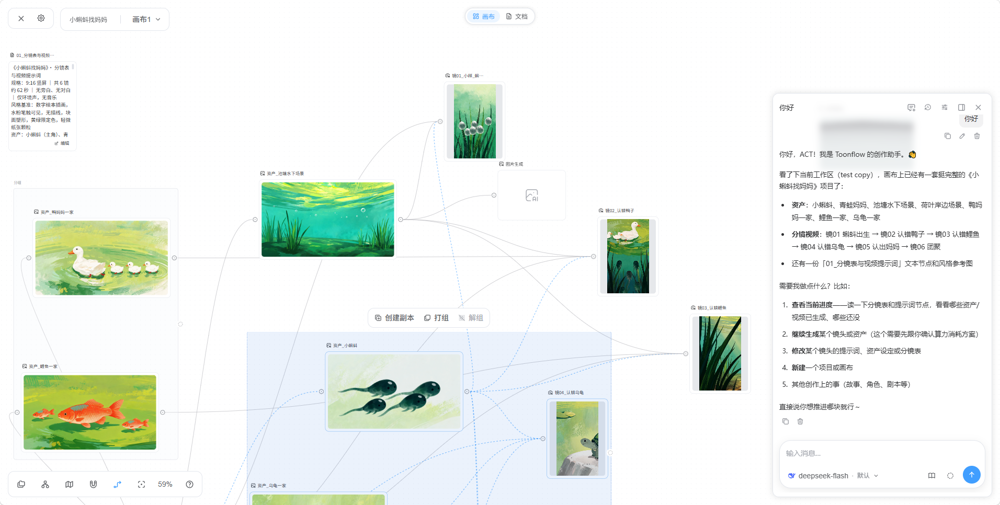
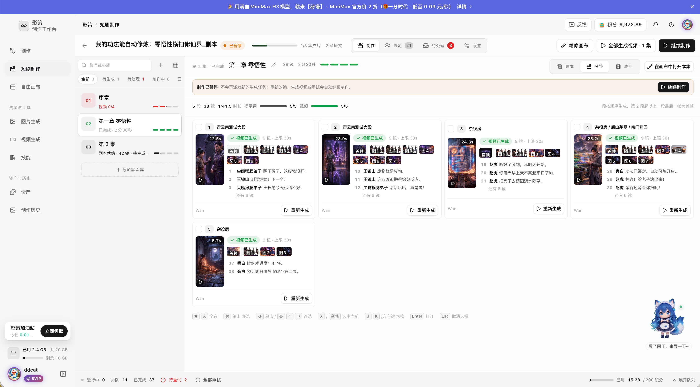

# 页面谱系的行业做法与竞品对照

调研日期：2026-11-01。结论：应从“功能入口集合”转为“围绕对象和任务组织的工作空间”。这不意味着所有功能都藏到更多菜单，也不意味着照搬桌面无限画布。

## 维护方式：采用哪些已有实践

| 来源 | 可证实的实践 | 本项目采用方式 | 不应过度推断 |
| --- | --- | --- | --- |
| [R1 NN/g：IA 与站点地图](https://www.nngroup.com/articles/information-architecture-sitemaps/) | 信息架构涉及内容组织，地图只表达其中一部分 | 页面 inventory + 归属图；跳转和状态另记 | 路由图完整不等于用户能找到功能 |
| [R2 GDS：Design history](https://designnotes.blog.gov.uk/2022/08/02/shaping-your-design-history-how-we-got-here-and-whats-next/) | 记录既有工作、理由、证据，选择团队易维护的工具；没有唯一格式 | 仓库中维护设计历史、来源和前后继；Git 留存 | GDS 使用过 Slides 不等于所有团队都应使用 Slides |
| [R3 DfE：设计历史写作](https://dfedigital.blog.gov.uk/2024/12/04/making-the-most-of-design-histories/) | 在工作过程中记录需求、取舍、验证和下一步 | 每个页面改动同步更新目录、决策和证据 | 发布说明和功能清单不能替代设计理由 |
| [R4 GOV.UK ADR framework](https://www.gov.uk/government/publications/architectural-decision-record-framework) | 重要架构决策需要结构化记录 | 借用“背景—决策—替代方案—后果—状态”，写设计决策记录 | ADR 本来面向架构；这里是借鉴，不是 UX 的强制规范 |
| [R5 Storybook：Stories](https://storybook.js.org/docs/writing-stories) | 一个 story 表达组件的一个渲染状态 | 先登记空、加载、缺配置、选中、处理中、失败等状态；将来可接组件故事 | Storybook 不管理产品页面树，也不应现在就加一套工具负担 |
| [R6 Android 导航和布局](https://developer.android.com/design/ui/mobile/guides/layout-and-content/layout-and-nav-patterns) | 主导航承载同级主要目的地；标签用于同级内容；高优先级操作与低频操作分层 | 保持四个主入口，项目子视图同级；对象工具随选择出现 | 没有“所有页面最多三个按钮”的通用标准 |

采用的是 **inventory + sitemap + task flow + state specification + design history** 的组合。Figma 可以作为图形编辑面，但不作为路由事实的唯一来源；本轮不新增 Figma、Storybook 或文档站依赖。

## 对标证据分级

- **实机采样**：本项目当前审查中实际采集、打开的屏幕，见 evidence；只能支撑对应版本/状态。
- **源码确认**：路由、组件、条件渲染、导航参数；可确认结构，不能确认触摸、遮挡、字体、读屏或运行时结果。
- **发布者界面示例**：官方仓库截图，能观察信息层级，不能当成本轮操作竞品的实测。
- **官方说明**：产品资料/文档；不据此声称“竞品此流程零摩擦”。

Toonflow 与 open-ai-canvas 均快速迭代，不能因为此前称其成熟就假设其每项设计已经验证。它们也有按钮多、跨层设置、极宽屏、快捷键依赖等限制。

## 对标：Toonflow

固定来源：[B1 仓库基线 d7366e36](https://github.com/HBAI-Ltd/Toonflow-app/tree/d7366e36ba30943cf308121c28011b45bbf922e0)。本轮读取的是当前 monorepo 的 `apps/web`，不沿用旧版独立前端的假设。

可见画布对象、引用连线、局部选择工具条与右侧助手共存。它把关系呈现在作品上；不是先去多个管理页找对象。源码 [selectionToolbar.vue](https://github.com/HBAI-Ltd/Toonflow-app/blob/d7366e36ba30943cf308121c28011b45bbf922e0/apps/web/src/pages/workspace/panels/canvas/components/selectionToolbar.vue) 根据选区控制排列/分组操作；[skillMenu.vue](https://github.com/HBAI-Ltd/Toonflow-app/blob/d7366e36ba30943cf308121c28011b45bbf922e0/apps/web/src/components/agent/skillMenu.vue) 在输入附近提供可搜索的技能选择。路由 [router/index.ts](https://github.com/HBAI-Ltd/Toonflow-app/blob/d7366e36ba30943cf308121c28011b45bbf922e0/apps/web/src/router/index.ts) 则很少：复杂度主要在工作区内部，说明“路由少”也不能单独衡量易用性。

本项目映射：镜头卡显示采用图/视频和来源关系；选中素材后再显示操作；助手携带当前项目/镜头；技能就地选择。手机使用卡片、底部工具和全屏编辑，不搬运桌面多栏、节点拖拽、右键或执行架构。比较的是交互组织，不建议接入其桌面端、远端执行或任意脚本运行能力。

## 对标：open-ai-canvas / 影策

固定来源：[B2 仓库基线 82fc5c03](https://github.com/ddcat-ai/open-ai-canvas/tree/82fc5c03233c33380a5335146c50bb507deb5692)；截图来自同一 commit 下 `assets/screenshots`，原始说明见 [README](https://github.com/ddcat-ai/open-ai-canvas/blob/82fc5c03233c33380a5335146c50bb507deb5692/README.md)。

界面按项目、集、段和镜头组织缩略图、文本与进度；对象卡提供局部重做。其[工作台截图](evidence/2026-11-01/reference-canvas-image-studio.jpg)将输入、参考和结果分区；[技能截图](evidence/2026-11-01/reference-canvas-skills.jpg)以名称、用途和分类浏览技能，安装与使用语义分开。这里也有多层导航与重复操作，不能直接缩小至手机。

本项目映射：镜头优先展示“这一镜是什么、已做到哪一步、下一步是什么”；用缩略图与状态代替并排命令；素材区统一生成与导入内容；技能卡先讲用途。不要复制社区运营、支付后台、3D 和服务器任务架构。本轮未登录演示账号、未运行其生成或计费流程。

## 补充：Photoshop 的上下文操作

[B3 Adobe 官方说明](https://helpx.adobe.com/photoshop/desktop/get-started/learn-the-basics/boost-workflows-with-the-contextual-task-bar.html)说明 Contextual Task Bar 根据当前选择提供相关工具。借鉴的是“对象/状态决定动作”，不是浮动条的外观。项目页不需要常驻媒体探测；选中视频后才出现“检查视频”，详情或工具层呈现结果。频繁且必须发现的动作仍需有明确入口，不能全部塞进无标签图标。

## 具体对照

| 本项目的现状问题 | 对标中的组织方法 | 建议落点 | 保留的约束 |
| --- | --- | --- | --- |
| 项目概览列出许多工具入口 | B1 在作品上下文操作，B2 阶段/对象进度 | 概览显示下一步与进展；设定属于资料、合成属于交付、检查属于素材 | 不更改数据作用域 |
| 镜头列表每卡重复制作、准备请求、助手、换图等 | B2 镜头卡 + 局部重做 | 一张卡一个推荐下一步；点入镜头后展开候选与制作 | 生成候选不自动采用 |
| 技能页面混合安装/选择/历史 | B1 输入旁选择，B2 独立技能目录 | 快速选用器 / 管理目录 / 编辑流程分工 | 内置只读、版本固定、撤销语义保留 |
| 媒体检查是项目级通用工具页 | B3 选择对象后提供相关操作 | 素材版本 → 本地检查 → 可选模型检查 | 外发前明确内容、接收方、调用范围 |
| 时间线成为参数表与工程历史集合 | B2 时间组织、B1 作品可视化 | 预览与片段条，选片后编辑；工程历史独立层 | 本机合成，保留原件 |
| 连接、能力、工作流的概念要跨页拼接 | R6 分层 + B2 用途优先 | 以“助手、图片、视频、检查”展示可用性；深入连接详情配置 | 不默默换供应商，不把声明等同远程验证 |

## 后续验证而非假定

当前没有访谈、点击热图或任务耗时基线。因此“减少认知负担”是设计假设，不报告虚构提升百分比。先让 3–5 名目标使用者分别完成首次生成、镜头采用、技能选用和补连接；记录首次点击、绕路、返回失误、未完成、误以为已采用/已授权。小样本发现问题，不宣称统计代表性。再使用相同任务比较新方案。
