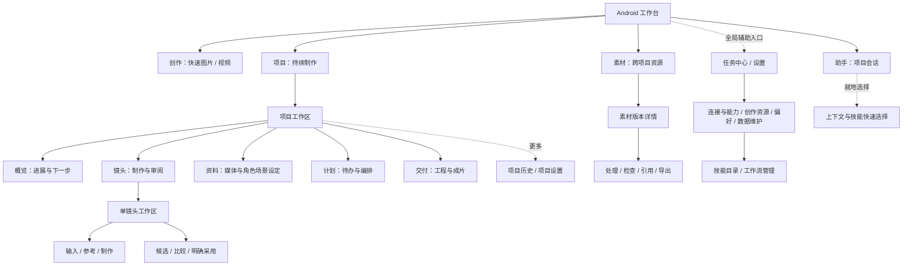
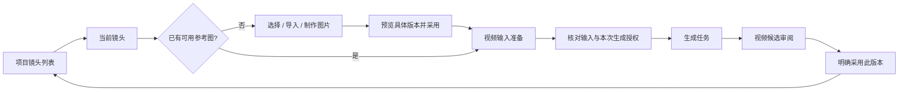
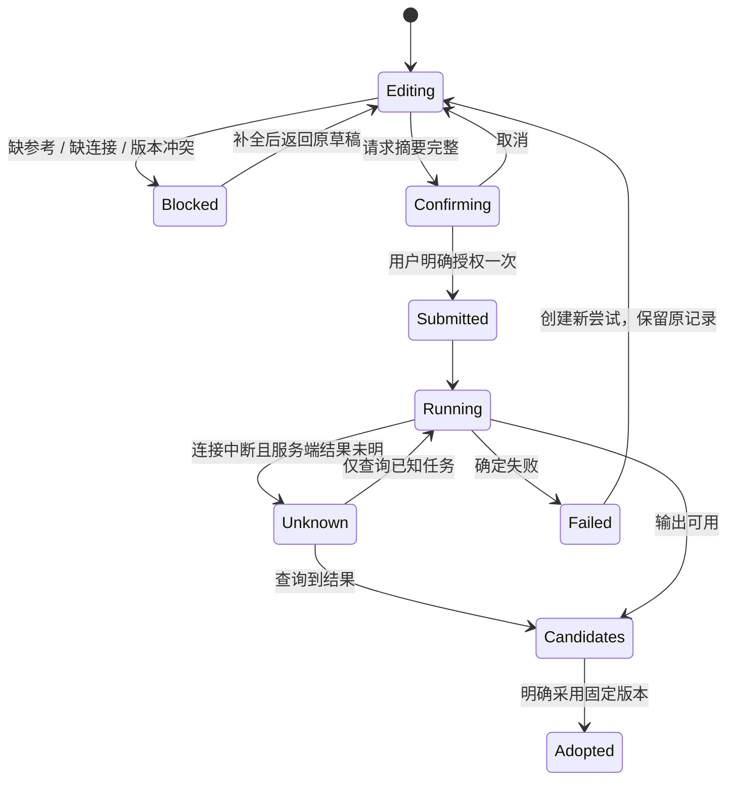

# 目标信息架构与交互合同

初版：2026-11-01，基线 `56f16751`；2026-11-05 Agent M1–M5 和第 43 项实现已收尾，见 [逐项对照](agent-final-reconciliation.md)。全产品其他提案仍按目录逐项状态追踪，不因 Agent 完成而统一标记已实现。稳定 ID 见 page-catalog.json，决策 D002–D007；设备覆盖与实现分别记录。桌面执行端、远端 Worker 禁止，所有方案均在 Android APK 内成立。

## 一、保留四入口，建立对象与任务层次

实线表示目标内容归属，虚线表示辅助或跨工作区能力，不是实际路由配置。项目子视图数量/名称需在手机原型中验证：五个视图不应挤成两行标签。窄屏采用可横向滚动的同级标签并显示当前位置；“项目历史/设置”从标题更多进入。不要为了五个标签再加第二套底部主导航。

“交付”是把现有时间线与成片重新组织，不是新增远端渲染。全局素材与项目资料是同一资源的不同范围，不能复制原件。助手、快捷创作和项目制作共享对象身份，但保留快速创作不强制建项目的用途。

## 二、各层只承担明确职责

| 层 | 应展示 | 不宜常驻 | 具体边界 |
| --- | --- | --- | --- |
| 列表 / 概览 | 对象、缩略图、状态、下一步 | 每个对象的全部编辑/诊断按钮 | 点击整卡进入对象；主操作可直达下一步 |
| 对象工作区 | 内容预览、当前版本、制作/审阅任务 | 全局账号、技能安装、数据库工具 | 当前对象/模式决定动作；始终知道作用对象 |
| 短时选择器 | 目标、范围、选项、确认/取消 | 安装流程、完整历史、危险管理 | 返回交还结果或取消，不改变发起上下文 |
| 编辑表面 | 当前编辑任务与必要参数 | 其他工具列表、项目导航重复入口 | 长编辑全屏，短参数用抽屉；未保存处理一致 |
| 管理页 | 连接、版本、权限、导入和维护 | 自动触发生成 | 配置完成回原阻塞处；管理不充当创作首页 |
| 历史 / 证据 | 已发生的事、来源和实际效果 | 默认原始 JSON、多个“返回”按钮 | 摘要→阶段详情→原始诊断，不用当前配置解释旧运行 |

主操作由状态决定，不由“这个功能很重要”决定。比如无参考图时主操作为选择/制作参考，正在生成时主操作为查看进度/处理阻塞，有候选时为审阅采用。取消、撤销、恢复和停止仍要在适用状态可发现；不会把风险操作一律藏起来。

## 三、页面展示规格

| 页面族 | 首屏结构 | 次级与高级交互 | 必须可见的语义 |
| --- | --- | --- | --- |
| 创作 | 大预览；紧凑描述；规格摘要；一个生成区 | 描述编辑、参考、参数、历史互斥展开 | 当前草稿 / 本次结果 / 下一次输入 |
| 项目概览 | 项目名与封面；镜头进度；一张下一步卡；最近工作 | 资料、交付、项目设置各归其层 | 不把有素材误称已完成或已采用 |
| 镜头列表 | 序号、画面缩略图、短描述、制作/审阅状态、推荐动作 | 多选重排/管理；更多仅低频动作 | 已采用版本与缺原件分开 |
| 单镜头 | 图片与视频阶段、参考来源、候选轨 | 按设定准备属于输入步骤；助手带上下文进入 | 当前镜头、输入版本、采用动作的影响 |
| 素材 | 缩略图网格/列表、范围与类型 | 管理模式、回收站、旧作品迁移 | 收纳到项目 ≠ 用作参考 ≠ 镜头采用 |
| 助手 | 项目/镜头 chips；对话；运行摘要；输入 | 技能就地选择；运行历史独立；管理深入 | 提议 / 已执行 / 等待授权 / 结果未知 |
| 技能 | 用途与适用场景卡；来源和状态；搜索 | 详情、添加、提炼为独立表面；历史归运行 | 可发现、项目选用、单次选用、实际读取不同 |
| 连接能力 | 按助手/图片/视频/检查的用途看就绪性 | 连接列表→详情/新增；工作流版本管理 | 声明能力 ≠ 远端验证；不隐式换账号 |
| 设定 | 按角色/场景/风格/声音分类，采用版本卡 | 详情→历史版本→绑定镜头选择器 | 固定引用与待复核，不跟着默认版本漂移 |
| 时间线 | 视频预览、片段轨与选中片段属性 | 工程列表、渲染记录和打包分层；精确数值作为高级输入 | 本机合成、静音/音轨状态、快照与当前编辑 |
| 任务/证据 | 人可读状态、结果、一个当前处理动作 | 关联对象、阶段、原始参数逐层展开 | 查询不重生成；解除等待不是取消服务端任务 |

保持现有主题、组件和版本语义，优先重排信息与动作。此文不指定新颜色、图标或装饰风格；这些需要同一任务的真实屏幕方案对比后决定。

## 四、关键流程与回流

### F1：首次快捷生成

1. 创作空态：输入描述并添加可选参考，不强制先去设置。
2. 生成区显示一个具体阻塞：“连接 NovelAI”或“选择视频能力”；点击只打开所需配置。
3. 保存配置：返回原草稿、原模式和原描述；刷新就绪摘要。
4. 用户核对供应商、规格、输入与用量，主动提交一次；配置保存本身不提交。
5. 结果回到当前生成组，显示候选；保存到手机与加入项目/采用分别处理。

验收：从图片/视频两种模式进入配置并返回，键盘、系统返回、切后台后输入和 draftId 一致。缺网络、撤销连接、未保存配置、能力变化都能在原位恢复；不以按钮是否可点代替流程完成。

### F2：镜头制作与采用

镜头工作区是任务容器，不必一次新增路由：可让现有成果审阅页逐步演进，保留旧 `/creative-shot/[id]` 链接。按设定准备不再每卡独立入口，但仍可从输入步骤进入。离开生成不阻止继续处理其他镜头，未知结果不能被误报为失败。

选择结果需携带 `intent + projectId + shotId + expectedRevision + slot + requestId`，确认前再次检查目标与版本；目标被删或改动时给出重新选择，不套用到另一个镜头。导入/制作后定位新候选再由用户确认，取消无采用写入。

### F3：助手建议到运行

当前实施（2026-11-05）：M3a 建议按具名对象和差异审阅，采用/拒绝显示真实终态，冲突保留三方内容；M3b 单次、计划、批次共用可滚动请求审阅，外发与消费分别确认。完整视频工作流输入与实际持久化批次集合可核对，退出不记许可。账号原位修复、工作流能力配置返回同一请求，需重新 prepare/审阅，配置保存不提交。M3c 区分助手运行、生成、归档、候选、采用与导出；未知结果先查询原任务。M4 列表/详情/准备分工，依赖在项目完整范围搜索，批次预览后确认范围。详见 [实现记录](agent-roadmap-completion.md)；离线设备样本不是完整供应商链验收。

1. 在当前项目/镜头中打开助手，标题和输入区能看见范围。
2. 选择技能只影响明确的下一次消息或项目组合；保留现有范围规则，不把选中 chip 当成新授权。
3. 助手先给提议：影响哪些镜头/输入、预期产物、需要什么许可。
4. 需要生成/外发时呈现明确确认，内容、供应商、版本、次数、有效期和费用/未知费用可见。
5. 运行消息展示阶段、阻塞、停止状态；用户离开后能从任务/项目历史恢复。
6. 输出以候选回项目，是否采用由用户决定；证据页解释实际读取、工具和运行结果。

计划依赖不是页面树：以纵向步骤或依赖摘要展示，需要编辑才展开关系。不因为参考桌面画布就引入节点编程界面、桌面执行端或远端 Worker。

### F4：技能选用、添加和提炼

当前实施（2026-11-05）：M1 快速选用、默认组合范围与全局停用确认已接入；M2 添加按来源→编辑→检查→安装结果独立呈现；M5a 提炼按证据→接收方核对→内容审阅→固定版本发布，已存草稿从独立入口继续。M5b 会话历史按固定 thread/run 追溯，摘要→阶段→诊断；目录快捷入口保持未保存选择，返回不重置。M5c 缺模型可看项目本地历史，长输入完成只回焦，简报追加、图片引用和版本工具不发送请求。见 D002/D003/D007 及 [分阶段记录](agent-roadmap-completion.md)，设备覆盖逐项认定。

选用：输入框旁“技能”→ 可搜索快速层 → 查看用途/内置来源 → 选择下次技能 → 回原输入框。管理目录从该层单独进入，带回源上下文。

添加：目录“添加”→ 选本地文件/编辑文本/从对话提炼 → 检查预览 → 安装此固定版本 → 查看已安装版本并置顶展开；来自会话时，可明确替换下次选择后返回，也能只安装返回。编辑后须重新检查，覆盖正文前确认，未安装草稿仅在当前任务内保留。管理路由携带 projectId + returnThreadId（来源身份），不携带输入正文；正常管理返回保留快速层未确认草稿，只有明确提交了新单次选择才采用新结果。内置只读条目也在同一发现目录，不复制成可编辑的本地安装版本。

提炼：选证据 → 审阅脱敏及接收方 → 用户确认发送 → 审阅/编辑草稿 → 发布固定版本 → 返回目录。草稿保存和发布分开；发布后不会默认全局启用。全局停用可能停止相关运行，必须明示该后果；项目不选用只影响后续运行，不能用同一种无说明开关暗示两者完全相同。

### F5：连接与能力缺口恢复

Agent 范围当前实现：缺模型进入助手设置，草稿准备缺账号就地管理，缺工作流进入对应用途能力配置，计划恢复保留原 plan/draft；返回后重读准备，不自动提交。项目全部生成授权已归概览→项目权限，完整清单审阅后原子撤销；素材外发许可保持独立记录。非 Agent 的其他配置路径仍按各目录条目状态验收。

制作/检查页具体阻塞 → 对应用途的连接列表 → 添加/选择连接 → 返回同一业务表面 → 再核对一次请求。避免“能力目录 → 通用设置 → 另一连接页 → 再自己寻找草稿”。面向用户使用“生成服务连接 / 助手模型连接”，而非“生成端口授权”。连接保存、能力声明、远端身份校验、单次请求许可、计划额度授权是不同事情，摘要可合并展示，授权不能合并偷换。

### F6：素材检查与复用

具体素材版本 → 本地探测与帧摘要 → 可选模型检查并确认外发 → 报告 → 回原版本。来自项目的版本范围保持；从报告打开来源后 back 返回同一报告。音频无静帧时解释不支持的评估，不能仅给灰按钮。

### F7：本机合成与交付

项目交付 → 已采用片段预填/手选 → 预览与调整 → 保存工程快照 → 本机合成 → 成片详情 → 保存到手机。查看旧工程先读详情，编辑创建副本；渲染结果不因继续编辑被覆盖。工程清单/原件包是可选导出项，不与保存编辑同级铺满首屏。

## 五、统一返回合同

当前实现有 `useSourceBack`、`returnToProject`、手写 `router.back()`、设置内部 section 等多种机制。应统一的是合同，再逐步复用实现，不要求先重写全部路由。

| 进入方式 | 返回行为 | 明确禁止的混淆 |
| --- | --- | --- |
| 主导航切换 | 恢复各自项目/草稿/筛选/滚动；服从未保存保护 | tab 切换不是新建对象或重置草稿 |
| 正常 push | back 回实际来源及位置 | 信息归属 parent 不覆盖真实来源 |
| 就地工具/短选择器 | 先处理键盘，再关闭当前表面；取消返回发起任务 | 关闭弹层不跳项目列表 |
| 长编辑 | 退出前保存草稿或明确放弃；保存失败留在原位 | 不因打开管理页丢输入 |
| 补配置 | 回原阻塞请求，重读配置但不提交、不覆盖输入 | 配置保存不是一次生成授权 |
| 任务/历史定位对象 | “打开来源”是新导航，保留回证据的路径 | “返回来源计划”若实际定位目标，不标成普通返回 |
| 冷链接/无历史 | 对象存在时到其稳定工作区，缺失给原因与明确出口 | 不依赖空 back 栈，不悄悄换对象/版本 |

业务路由参数用于定位身份，不能携带密钥、完整提示词或承诺新权限。返回上下文可使用短期 source token / 路由状态 / 现有工作区持久化；选技术实现前列明寿命和恢复行为，不把任意 URL 返回地址当成可信目标。

## 六、状态规格：用结果决定动作

这是 UX 状态示意，不替换现有数据库枚举。页面必须分别显示“生成完成、应用内归档完成、镜头已采用、保存到手机完成”，不能用单个“完成”覆盖。运行证据和历史状态来自实际持久化记录，不能由当前技能开关或当前连接反推。

## 七、实施顺序与验证门槛

| 阶段 | 交付 | 设备验收任务 |
| --- | --- | --- |
| A | 清理项目概览扇出；镜头卡收敛；建立镜头任务容器 | 项目→图→视频→候选→采用→回原镜头；无图/缺原件/归档各状态 |
| B | 技能快速选择、目录、添加/提炼分工；运行历史摘要 | 选用不改全局；添加后回原会话；内置查找；撤销语义 |
| C | 连接/能力与请求恢复；设置 utility shell 一致 | 图片、视频、检查三条缺配置路径往返；不自动提交 |
| D | 资料/设定、素材上下文检查、计划阶段展示 | 绑定固定版本；引用定位；计划阻塞和授权回流 |
| E | 时间线可视化与交付；旧入口兼容与历史汇合 | 剪辑保存→本机合成→导出；原件/旧工程保留；旧链接可达 |

每阶段先做同任务的当前/建议低保真状态稿和可点原型，再实施一条完整纵向流程。任务耗时、点击次数、返回失误需先建立基线；目标应是更少错误与找路，而非一律更少页面。

设备基线建议 360–400dp 宽，系统字体 1.0/1.3/2.0；验证键盘、长标题、TalkBack 焦点、屏幕边缘安全区、48dp 触控布局目标和 reduced motion。这里 48dp 是移动端设计目标，不把 WCAG 的 CSS px 指标直接换算成 dp，也不凭截图宣布可访问性合规。
