# 逐步截图与健康度

按取证顺序列出每个状态。accepted=接纳画面及对应树，visual-only=仅截图；接纳不是全功能通过。每步仅描述本次所见。通用未覆盖：TalkBack、大字体/键盘/宽屏、收费生成、多版本真实任务及数据破坏操作。

[主报告与问题卡](../../reviews/2026-10-31-full-product-ux-audit.md) · [跳转轨迹](navigation-trace.md) · [按钮台账](ui-controls.md)

## 步骤 01 · 启动瞬态

健康度：**排除**。未形成可审查的业务页面；不作为App缺陷。

[保留原图，不计有效业务状态](01-launch.png)

## 步骤 02 · Android System UI无响应

健康度：**排除**。系统阻塞，不归因于App；点等待后可继续。

[保留原图，不计有效业务状态](02-current.png)

## 步骤 03 · 创作：独立视频草稿

健康度：**需优化/条件可用**。缺AutoDL连接，生成禁用；四主入口可见。F04/F08。

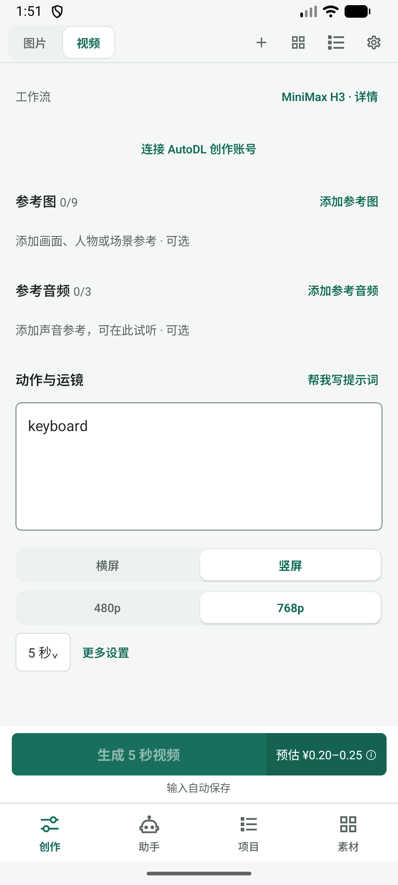

## 步骤 04 · 创作：图片空画布

健康度：**需优化/条件可用**。缺NovelAI连接时生成仍启用；没有点生成，不推断后果。F04/F08。

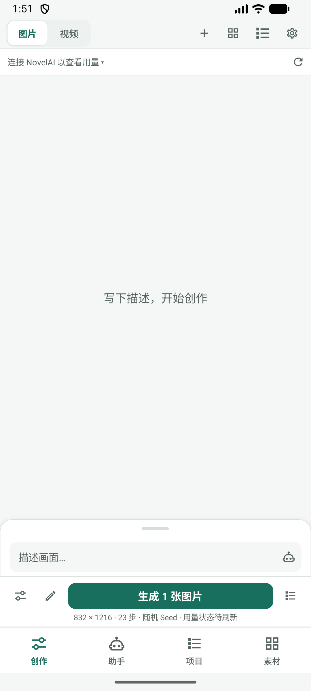

## 步骤 05 · 图片生成设置抽屉

健康度：**需优化/条件可用**。参数在局部表面内可滚动；命中区与大字体仍需专项测试。F08。

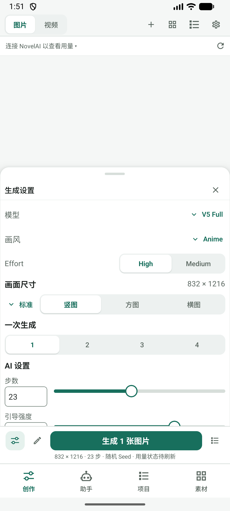

## 步骤 06 · 助手首页

健康度：**当前状态可达；相关执行分支未全验**。当前项目和输入可见；没有发送真实对话。

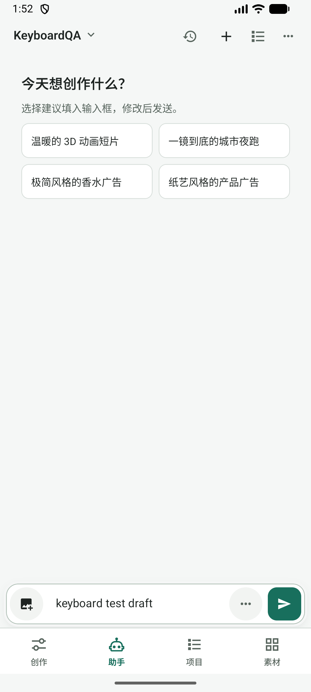

## 步骤 07 · 助手菜单

健康度：**当前状态可达；相关执行分支未全验**。技能管理、助手设置可发现；入口位于二级菜单。

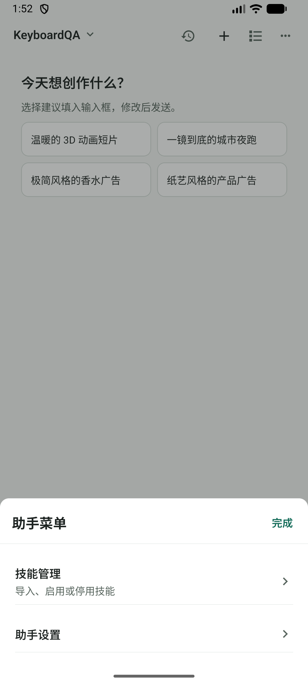

## 步骤 08 · 内嵌技能面板

健康度：**需优化/条件可用**。技能与聊天输入同屏；空态。F10。

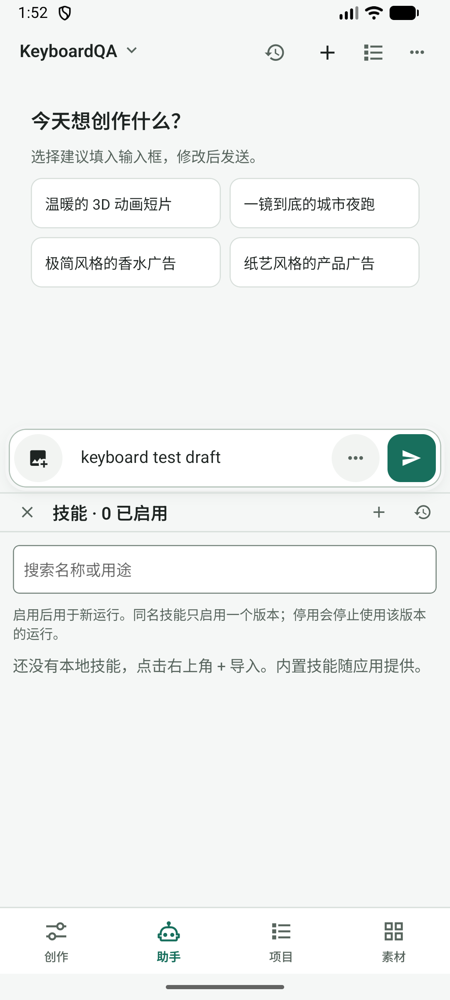

## 步骤 09 · 技能导入展开

健康度：**需优化/条件可用**。SKILL.md/ZIP等入口可见；未安装或启用技能。F10。

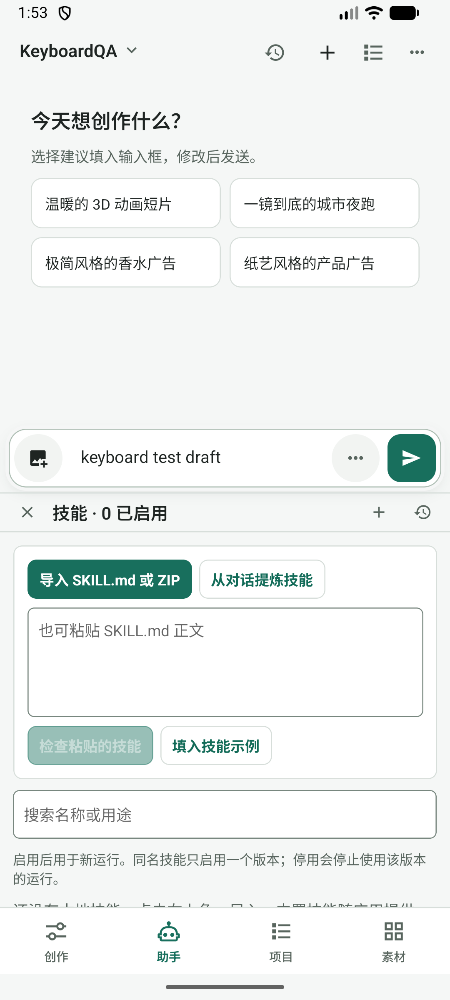

## 步骤 10 · 项目列表：原KeyboardQA

健康度：**当前状态可达；相关执行分支未全验**。新建和项目卡可达；归档未执行。

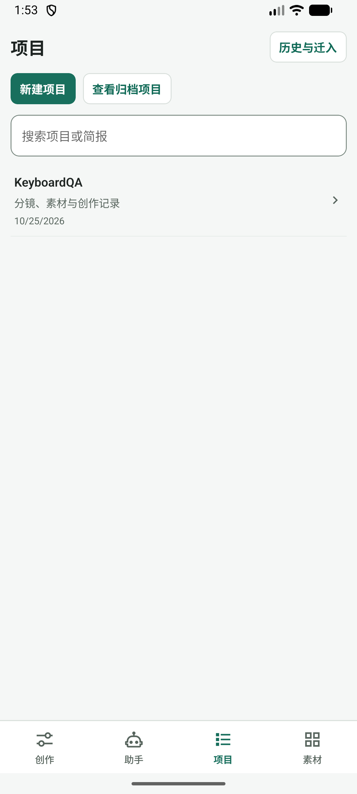

## 步骤 11 · 项目详情：空镜头页

健康度：**当前状态可达；相关执行分支未全验**。项目页签清楚，当前无镜头。

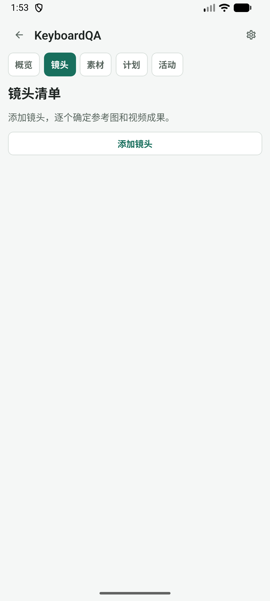

## 步骤 12 · 项目概览

健康度：**当前状态可达；相关执行分支未全验**。简报、进度及助手入口可见；未编辑原项目。

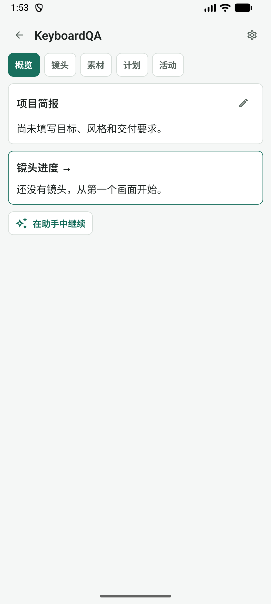

## 步骤 13 · 项目计划空态

健康度：**需优化/条件可用**。尚无镜头仍显示编排表单。F13；授权风险另以源码为证。

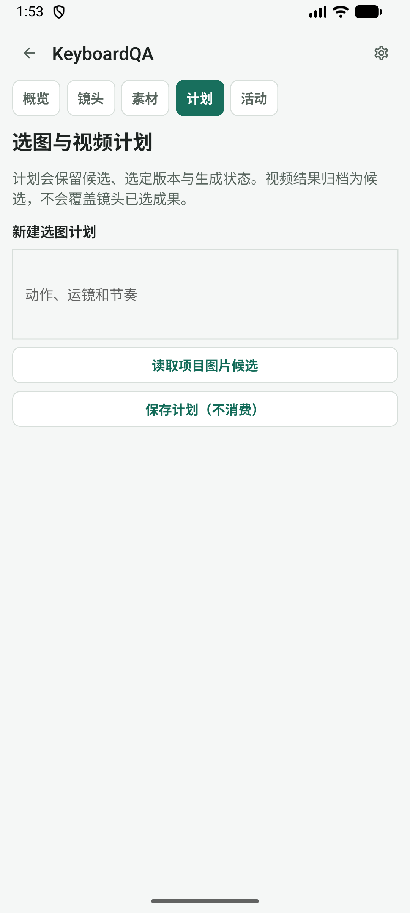

## 步骤 14 · 项目活动

健康度：**需优化/条件可用**。显示project.create内部命令。F07。

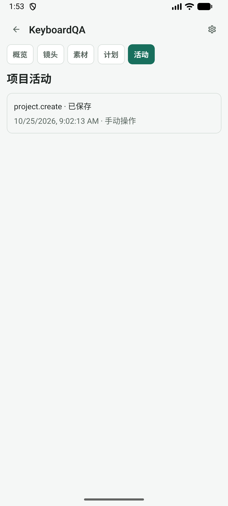

## 步骤 15 · 项目设置内联展开

健康度：**需优化/条件可用**。封面说明要求跨页面操作；不是独立设置页。F06。

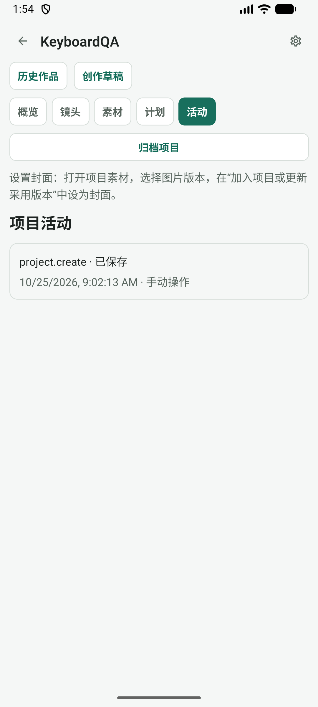

## 步骤 16 · 新建项目表单

健康度：**当前状态可达；相关执行分支未全验**。列表内展开创建表单；下一步只创建审计项目。

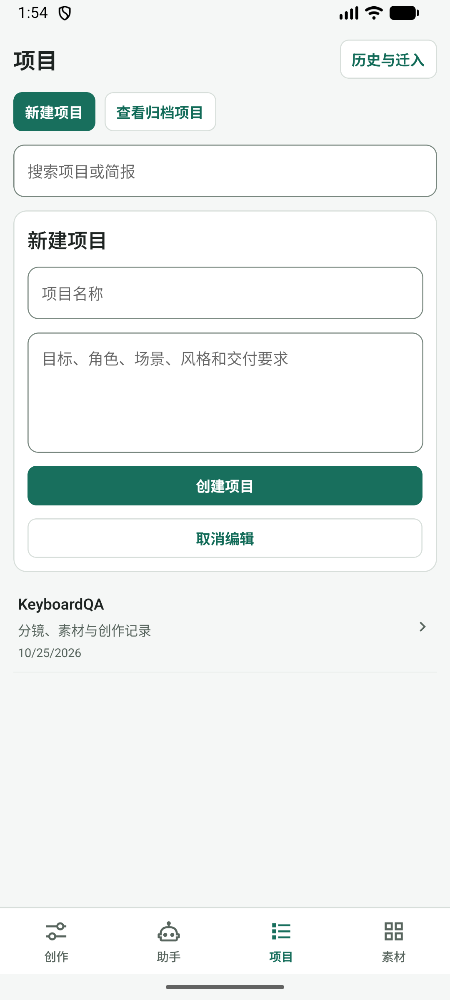

## 步骤 17 · 已创建UX-AUDIT-1031

健康度：**当前状态可达；相关执行分支未全验**。本地项目创建完成；审计对象保留。

## 步骤 18 · 添加镜头表单

健康度：**当前状态可达；相关执行分支未全验**。全屏编辑任务；只写入审计镜头。

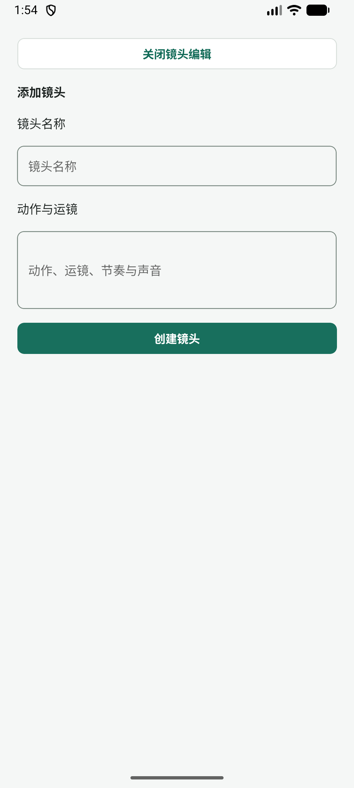

## 步骤 19 · 已创建AUDIT-Shot-01

健康度：**需优化/条件可用**。空镜头有选择参考图和制作新图两个直接入口。F01前态。

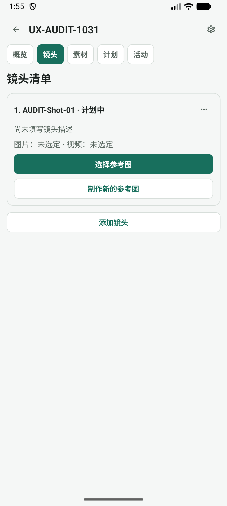

## 步骤 20 · 镜头更多操作

健康度：**当前状态可达；相关执行分支未全验**。编辑、选图、选视频、另建草稿、移除；没有执行移除。

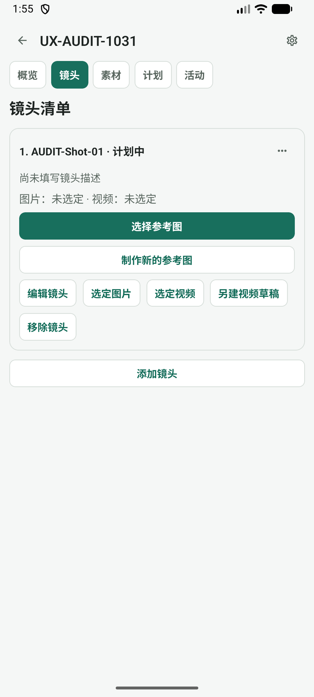

## 步骤 21 · 空图片版本选择器

健康度：**需优化/条件可用**。目标镜头清楚，确认禁用；缺直接导入/生成出口。F02。

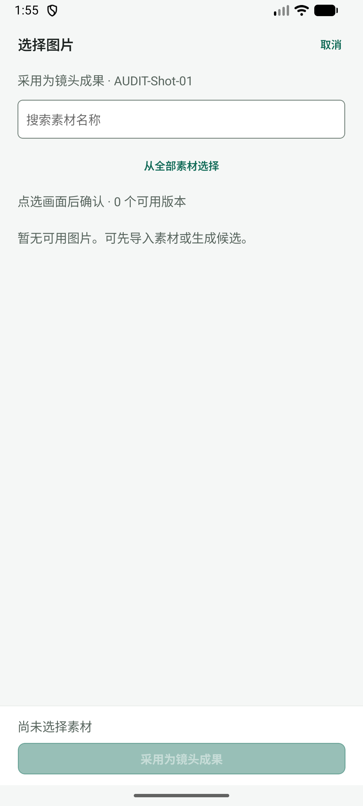

## 步骤 22 · 镜头来源的图片草稿

健康度：**需优化/条件可用**。来源条含项目/镜头；未生成直接返回。F01中间态。

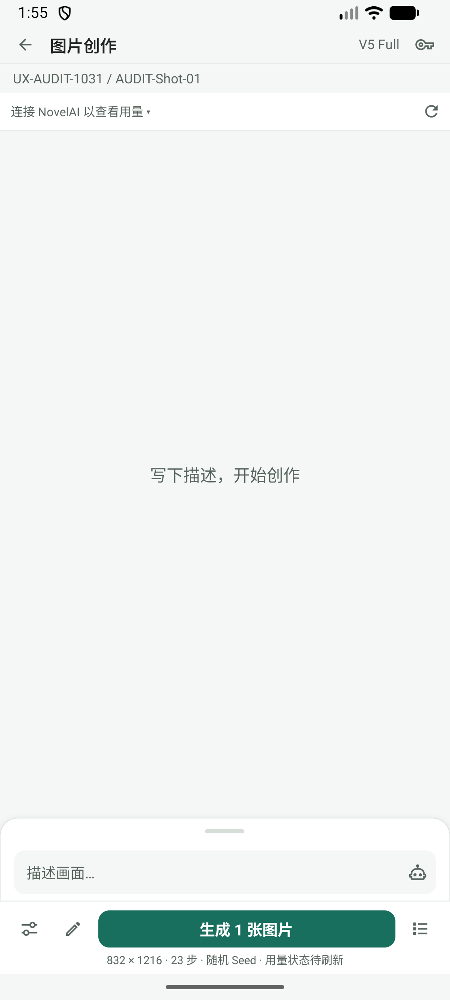

## 步骤 23 · 全局素材空态

健康度：**当前状态可达；相关执行分支未全验**。管理/导入等入口；没有项目内容。

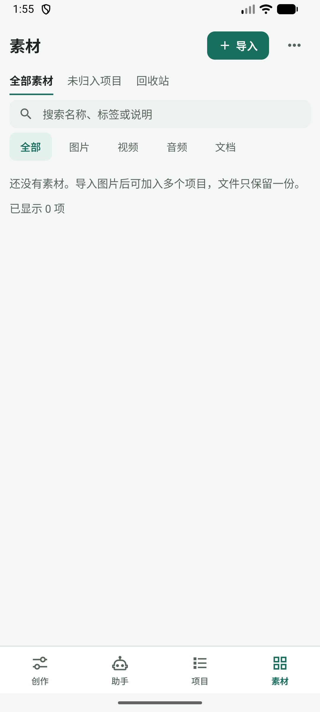

## 步骤 24 · 仍是素材空态

健康度：**重复/状态未达，不计新验证**。点击导入时目标匹配失败；此图不能证明导入面板已经打开。

[保留原图，不计有效业务状态](24-library-import.png)

## 步骤 25 · 素材导入面板：仅截图有效

健康度：**只接纳视觉证据**。相册/文件/新建Prompt入口视觉可见；当时dump失败后读到旧树，拒绝此文件XML和JSON作为控件证据。

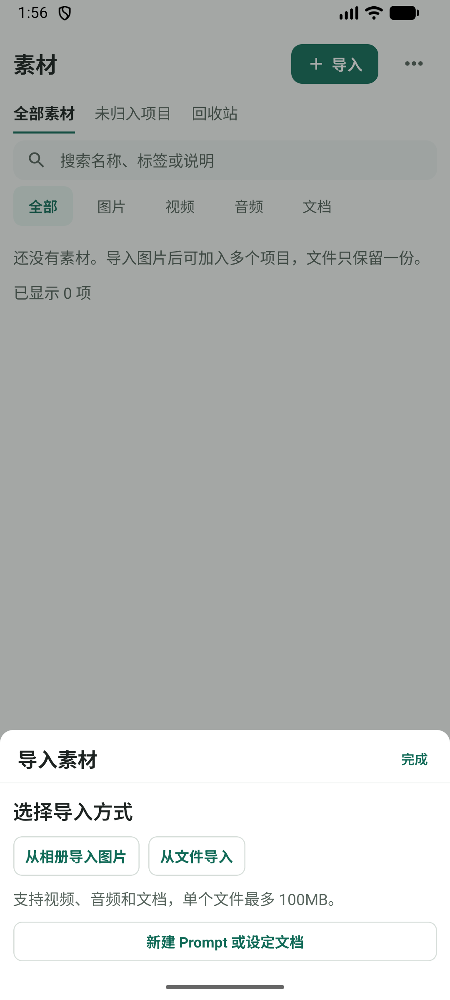

## 步骤 28 · 素材管理菜单

健康度：**当前状态可达；相关执行分支未全验**。存储、历史作品、创作草稿、迁入入口。

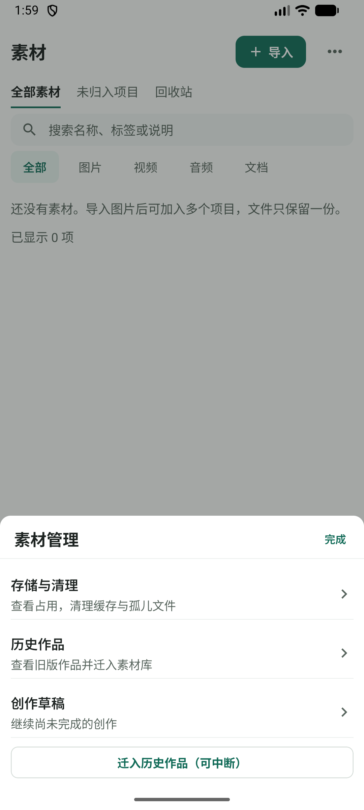

## 步骤 29 · 存储与数据管理

健康度：**需优化/条件可用**。完整备份/数据库备份/清理/清除同区同色。F11；未执行维护写入。

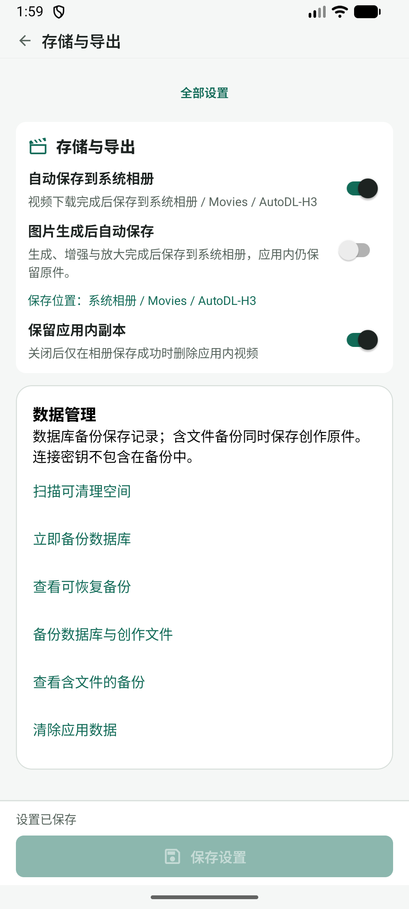

## 步骤 30 · 最近任务浮层

健康度：**当前状态可达；相关执行分支未全验**。空收件箱与全部任务入口；不是全部任务页。

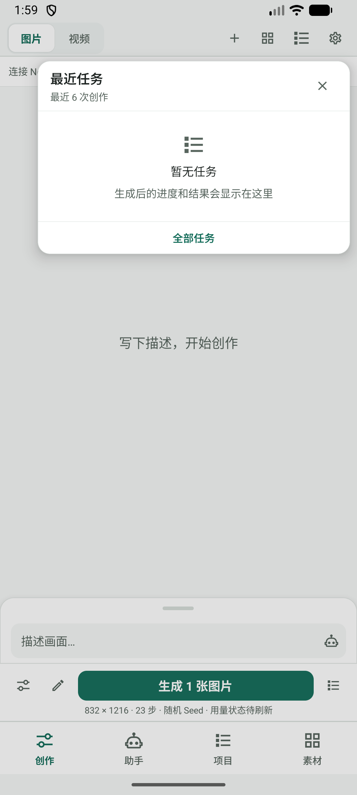

## 步骤 31 · 仍是最近任务浮层

健康度：**重复/状态未达，不计新验证**。设置目标未找到；此图不能证明已进入设置。

[保留原图，不计有效业务状态](31-settings.png)

## 步骤 32 · 全部任务空队列

健康度：**当前状态可达；相关执行分支未全验**。刷新/持续监控/筛选可见；没有真实任务或开启监控。

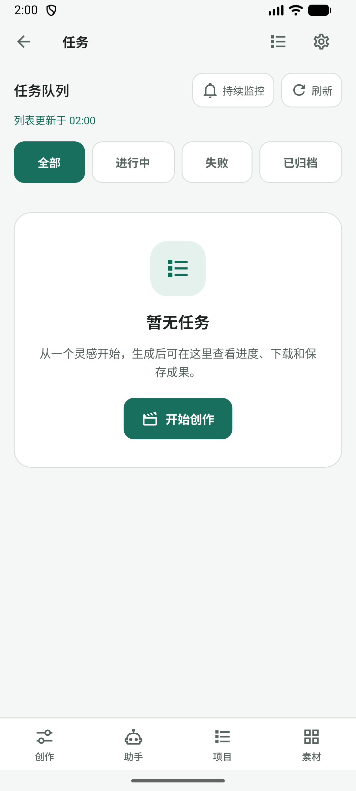

## 步骤 33 · 设置分类

健康度：**当前状态可达；相关执行分支未全验**。分类入口已走通；分区成功不等于设置保存成功。

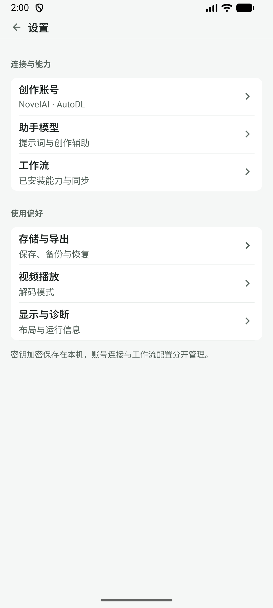

## 步骤 34 · 助手模型设置

健康度：**当前状态可达；相关执行分支未全验**。端点为已有假地址，密钥掩码；未保存或验证连接。

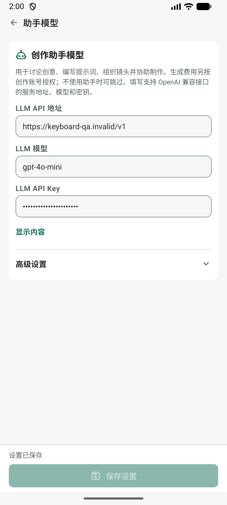

## 步骤 35 · 工作流设置

健康度：**当前状态可达；相关执行分支未全验**。内置包v1.0.1与同步入口；未执行同步。

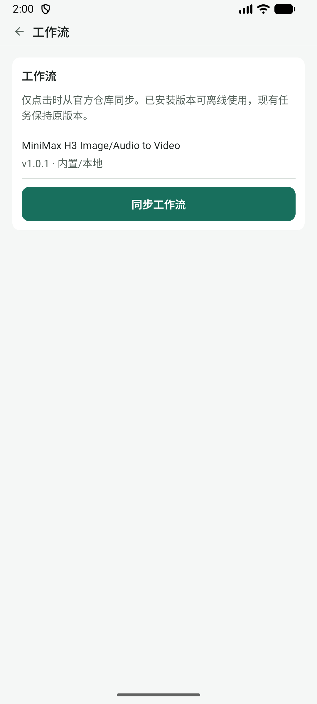

## 步骤 36 · 视频播放设置

健康度：**当前状态可达；相关执行分支未全验**。自动/硬件/软件解码选项；未修改，未验证视频播放。

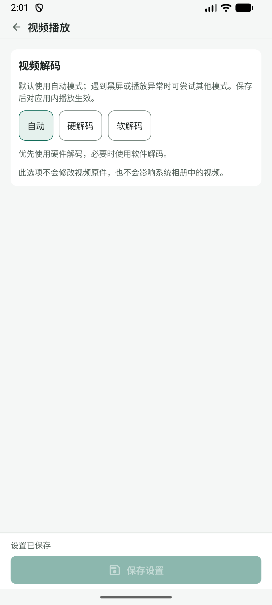

## 步骤 37 · 显示与诊断设置

健康度：**当前状态可达；相关执行分支未全验**。诊断开关可见；未改配置。

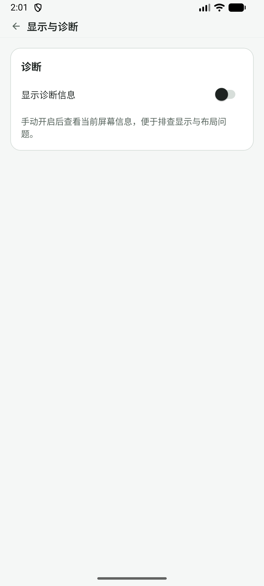

## 步骤 38 · 创作账号面板

健康度：**需优化/条件可用**。NovelAI/AutoDL均未连接；没有连接真实账号。F04。

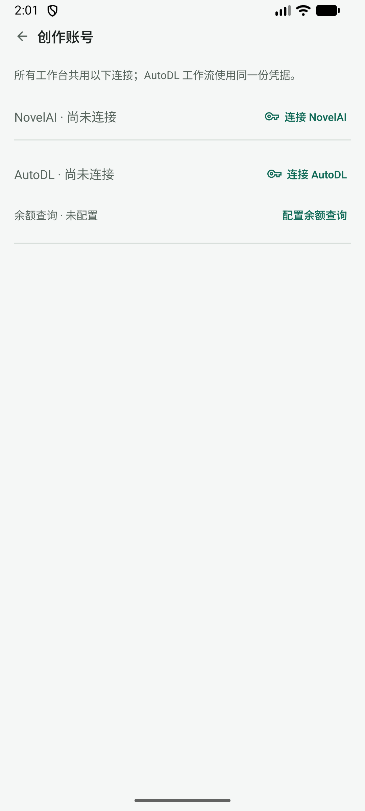

## 步骤 41 · 创作草稿列表

健康度：**需优化/条件可用**。两个图片新草稿无法从标题区分项目/镜头。F05。

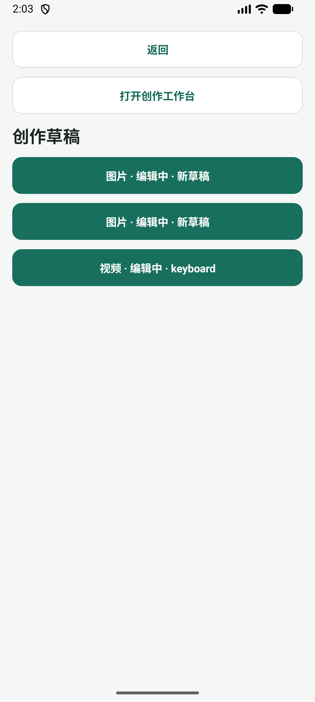

## 步骤 42 · 旧历史作品空态

健康度：**当前状态可达；相关执行分支未全验**。历史作品/结果双重命名；无旧视频可播放。

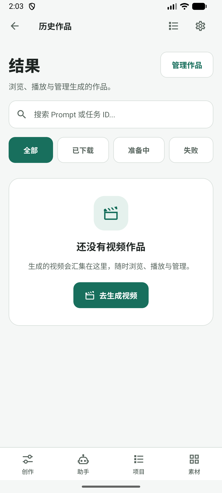

## 步骤 43 · 创作记录浮层

健康度：**需优化/条件可用**。Prompt/未命名标题缺项目镜头归属。F05。

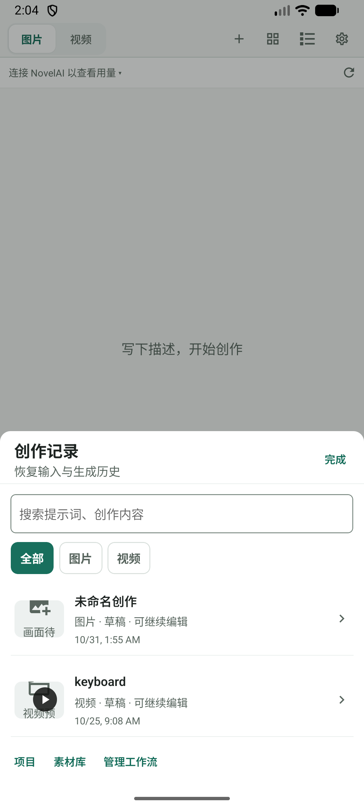

## 步骤 44 · 添加视频参考图来源弹窗

健康度：**当前状态可达；相关执行分支未全验**。设备/素材库来源；只测了设备路径。

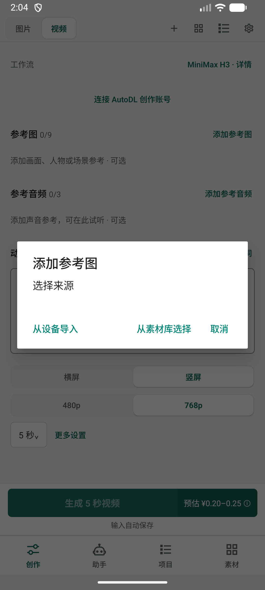

## 步骤 45 · Android系统相册选择器

健康度：**系统输入可达**。当前系统输入过程；格子内是旧测试图，内部UI不作为本轮App证据。

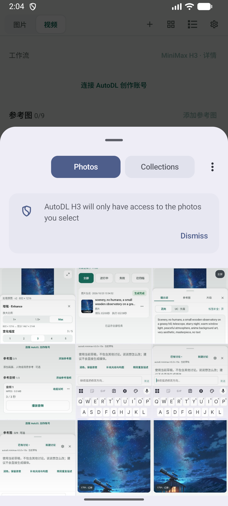

## 步骤 46 · 系统选择器再次观察

健康度：**重复/状态未达，不计新验证**。扫描测试WebP后仍是同一选择器；不额外证明App路径。

[保留原图，不计有效业务状态](46-device-ready.png)

## 步骤 47 · 系统相册已选一图

健康度：**系统输入可达**。选择已有86.png，Done可见；不是本轮生成图，也不是推送WebP。

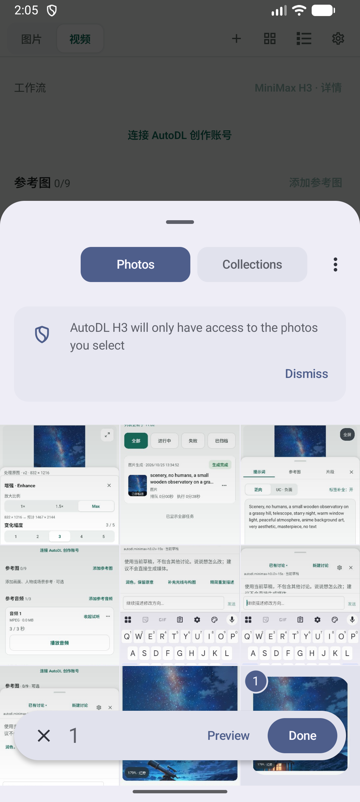

## 步骤 48 · 视频草稿带一张参考图

健康度：**当前状态可达；相关执行分支未全验**。系统Done返回原草稿；自动归档素材，未生成。

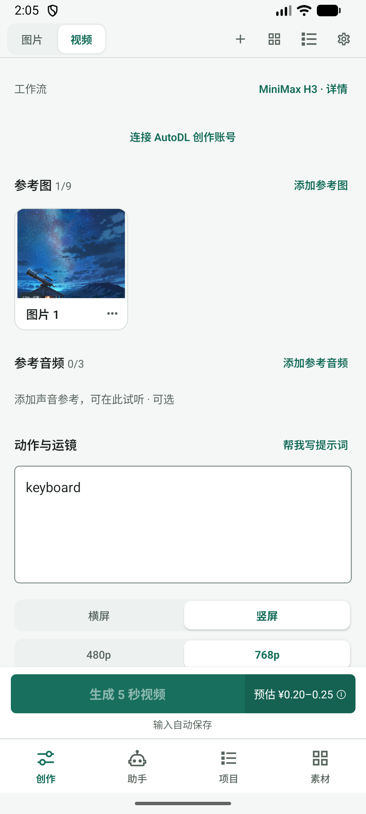

## 步骤 49 · 素材库出现导入项86.png

健康度：**当前状态可达；相关执行分支未全验**。全局库能看到导入输入；图片内容本身不作为当前UI证据。

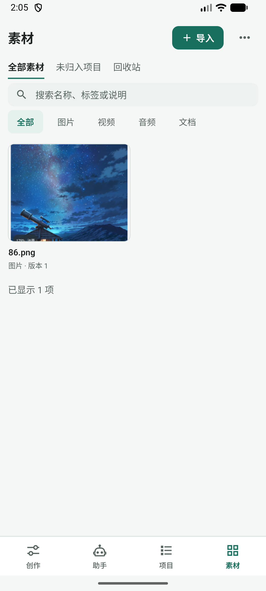

## 步骤 50 · 内嵌素材详情v1

健康度：**当前状态可达；相关执行分支未全验**。导出/加入项目/更多与文件事实可见；独立素材路由未在本轮打开。

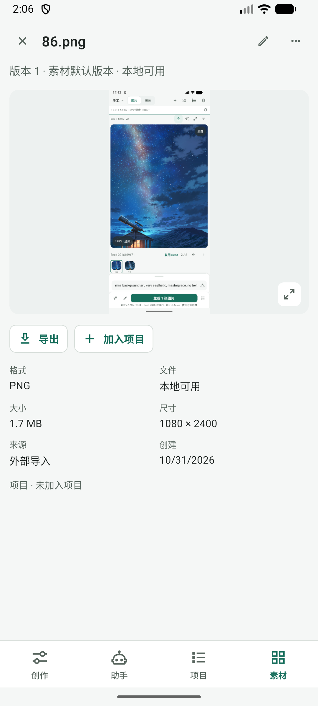

## 步骤 51 · 仍是素材详情

健康度：**重复/状态未达，不计新验证**。滚动未改变有效状态；不是素材操作菜单证据。

[保留原图，不计有效业务状态](51-asset-actions.png)

## 步骤 52 · 素材操作菜单

健康度：**需优化/条件可用**。信息、增强/放大、保存相册、设默认等可见；导出未执行。F09。

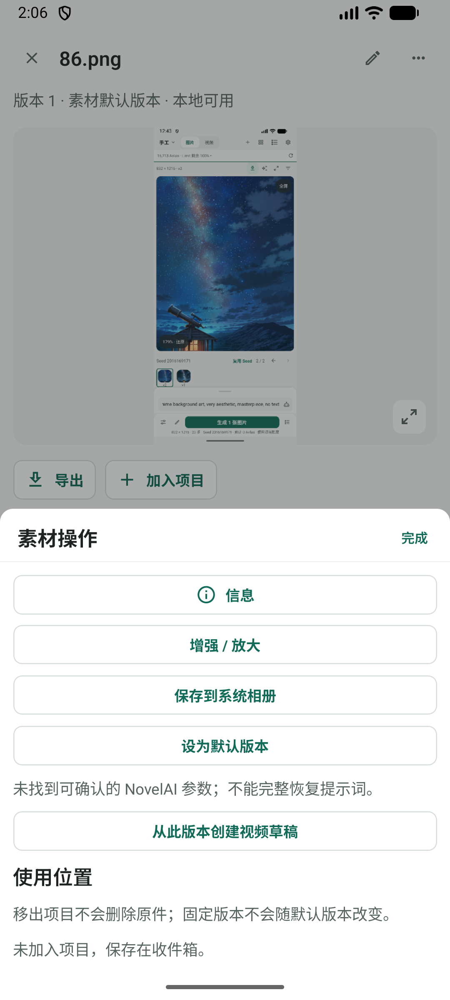

## 步骤 53 · 加入项目内嵌区域

健康度：**当前状态可达；相关执行分支未全验**。项目搜索与固定版本加入入口；尚未证明写入。

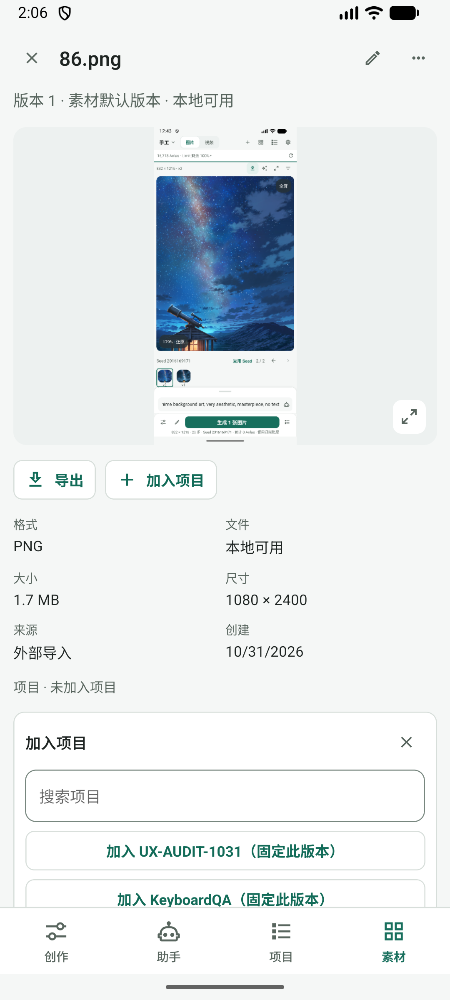

## 步骤 54 · 已加入审计项目

健康度：**需优化/条件可用**。本地加入成功，封面入口藏在此区域；区域仍保持展开。F06。

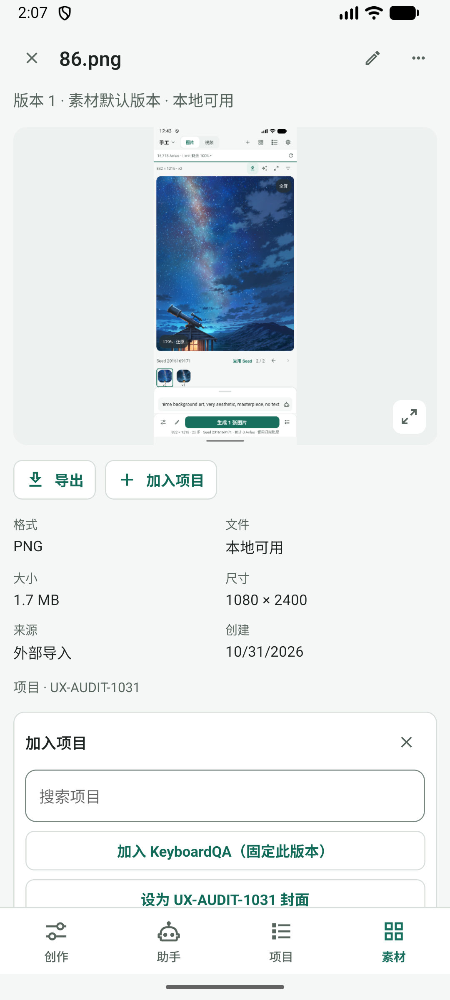

## 步骤 55 · 增强/放大与下层菜单同时保留

健康度：**需优化/条件可用**。两层Sheet与加入区域同时保留；没有启动处理。F03。

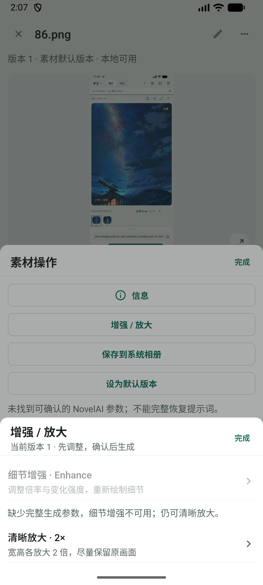

## 步骤 56 · 系统返回后仍在素材操作菜单

健康度：**需优化/条件可用**。真实状态是素材菜单，不是文件名所称选择器；证明返回层级。F03。

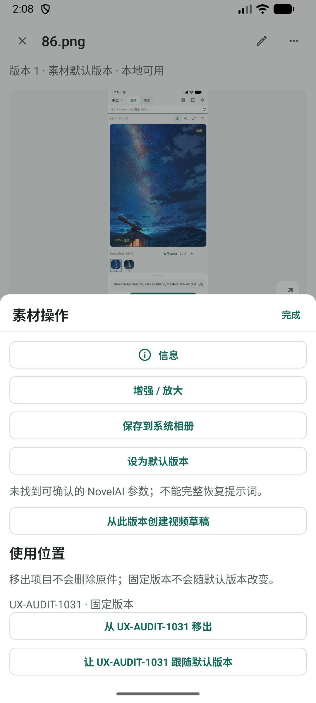

## 步骤 57 · 有图片草稿的镜头卡

健康度：**需优化/条件可用**。真实状态不是选图页；主入口已变为继续已有草稿，选图退至更多。F01后态。

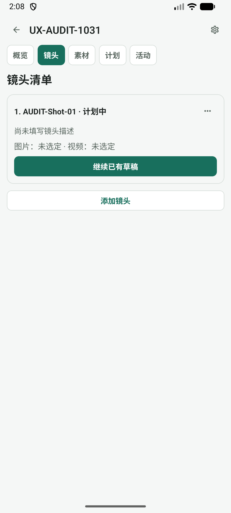

## 步骤 58 · 非空图片版本选择器

健康度：**当前状态可达；相关执行分支未全验**。从镜头更多选定图片进入；项目已有86.png v1可用。

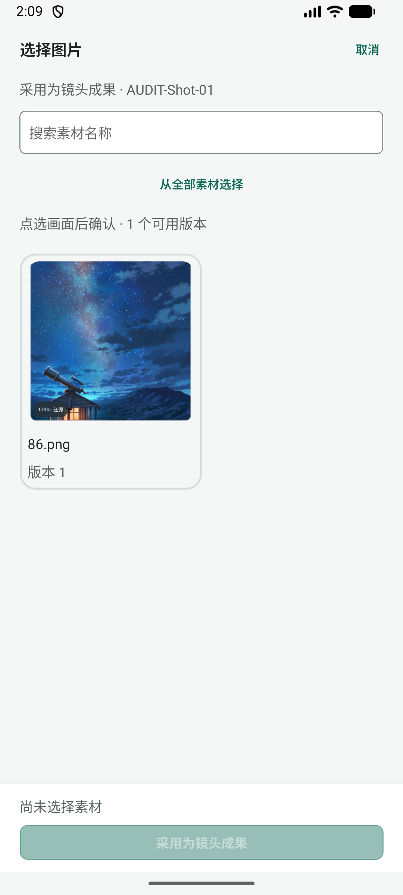

## 步骤 59 · 已选v1待确认采用

健康度：**当前状态可达；相关执行分支未全验**。显示具体版本及确认；选中与采用分开。

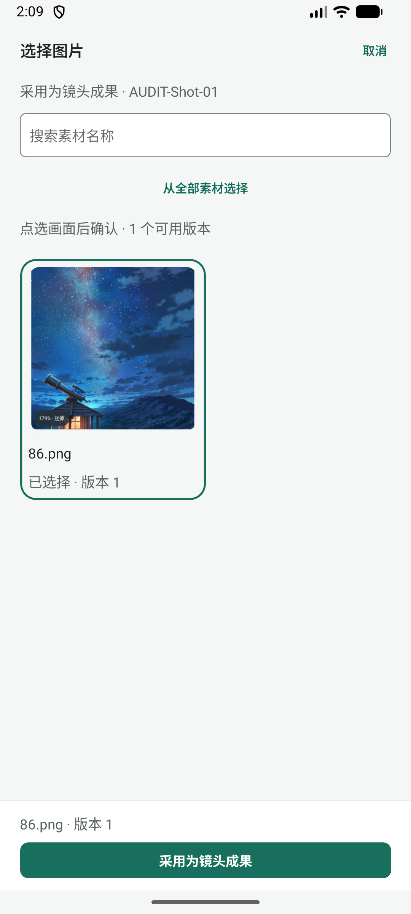

## 步骤 60 · 镜头已采用图片固定版本

健康度：**需优化/条件可用**。显式确认后采用成功；主动作变制作视频。F01边界：采用后动作正常。

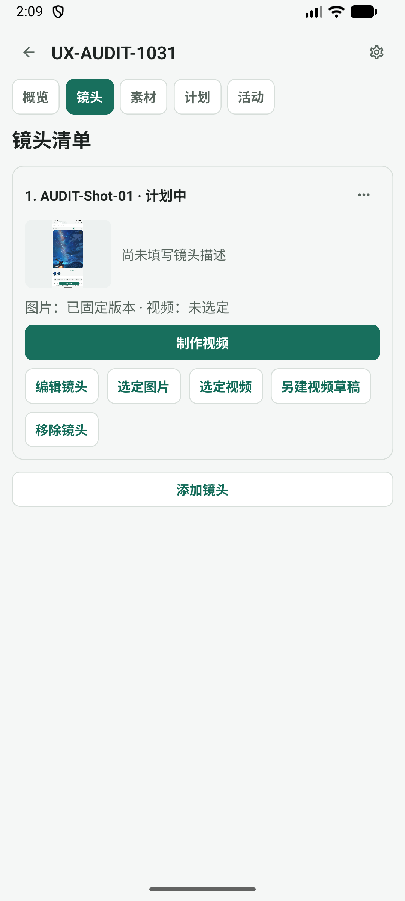

## 步骤 61 · 镜头来源的视频草稿

健康度：**当前状态可达；相关执行分支未全验**。另建视频草稿成功且带采用图片；没有提交任务。

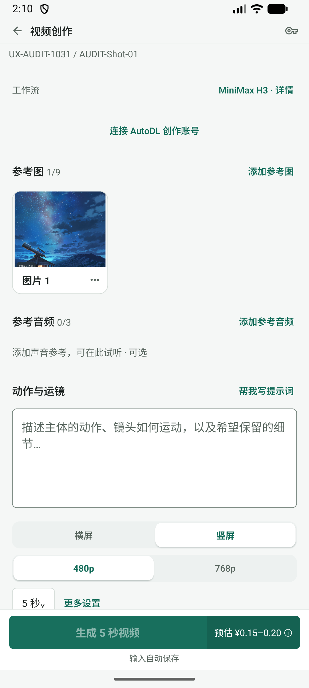

## 步骤 62 · 视频提示词协作抽屉

健康度：**当前状态可达；相关执行分支未全验**。用途、预设、历史和输入可见；未发送对话。

## 步骤 63 · 原独立视频的参考图移除菜单

健康度：**当前状态可达；相关执行分支未全验**。仅对本次新增参考引用做清理，不删除原素材。

## 步骤 64 · 原独立视频参考图恢复0/9

健康度：**当前状态可达；相关执行分支未全验**。通过UI移除此引用；不声明数据库字节/更新时间完全恢复。

## 步骤 65 · 缺失任务结果

健康度：**当前状态可达；相关执行分支未全验**。有未找到说明、返回和任务中心；成功/失败任务未测。

## 步骤 66 · 不完整成果链接

健康度：**当前状态可达；相关执行分支未全验**。首次取证URI被shell拆分导致缺参数；页面有明确说明，不作为App缺陷。

## 步骤 67 · 旧视频不存在

健康度：**当前状态可达；相关执行分支未全验**。稳定显示作品不存在或已删除及返回；有效旧视频播放未测。

## 步骤 68 · 从对话提炼技能初态

健康度：**当前状态可达；相关执行分支未全验**。证据选择/脱敏说明/目标/禁用发送可见；未提炼。

## 步骤 69 · 参数完整但指定版本不存在

健康度：**当前状态可达；相关执行分支未全验**。修复URI引用后再次打开；明确版本不可用，没有替换其他版本。

## 步骤 70 · 独立技能页空态

健康度：**当前状态可达；相关执行分支未全验**。全屏route可达；添加/记录/搜索可见，未安装技能。

