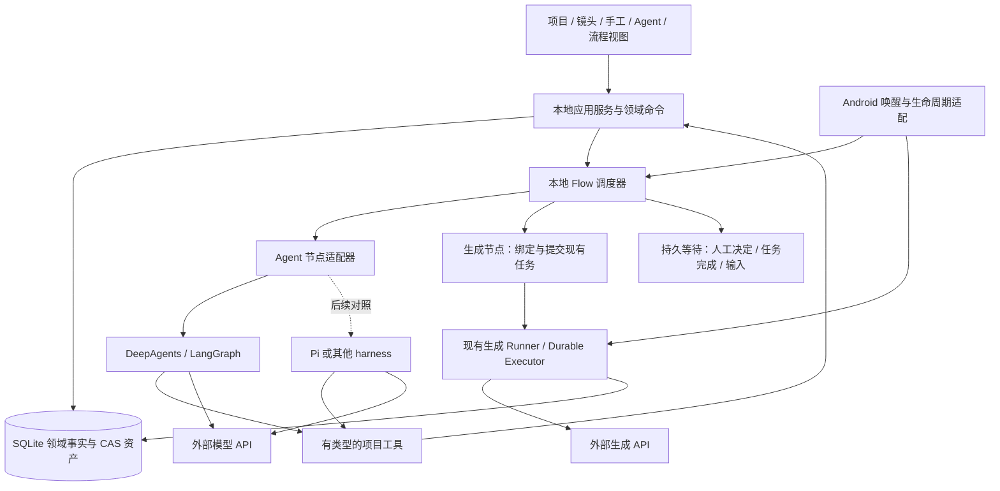

# Android 本地创作工作空间：产品与架构方向评估

日期：2026-10-27。性质：研究与设计建议，未修改应用实现。

## 1. 建议结论

建议将当前产品定位为**以项目、镜头和资产为中心的 Android 本地创作工作空间**，让手工创作、Agent、模板流程共同操作一套领域服务。产品主线是从创意到可继续编辑的成果，技术主线是持久执行与可替换的 Agent harness。

短期继续使用 DeepAgents/LangGraph，补齐应用层；为它建立小而明确的 RuntimeAdapter。Pi，特别是 pi-durable，保留为通过同一验收场景比较的候选。现有证据不足以证明更换 harness 能解决项目、资产、生成源、Skill 制作和流程产品化问题。

约束按用户已确认的定义执行：Agent、编排、状态、项目数据都在 Android 应用内；允许外部模型与生成 API；不依赖用户另开电脑、网关或业务服务器。桌面项目用来借鉴产品与模块边界，其 Node/Python/Go 服务不能直接视为 Android 可用组件。

建议组合：**BeatDesign 的共享项目服务 + InvokeAI 的候选结果与参数回用 + infinite-canvas 的上下文创作 + Cherry Studio 的运行时适配方式 + 当前已有的本地生成执行架构。**

## 2. 调研依据与版本边界

检查了公开仓库 README、许可证、架构文档及部分实现；没有安装这些桌面应用，没有验证它们的完整端到端恢复或性能。以下“已看到”表示源码/文档证据，不等同于完成产品验收。当前仓库的判断以实际源码为依据。

| 项目 | 本次检查的提交 | 许可证 | 对本项目的参考价值 |
|---|---|---|---|
| [BeatDesign](https://github.com/BeatAPI/BeatDesign) | `b94e4afdcd595fe912e88c9e455e3ef52f37de39` | Apache-2.0 | 项目、资产、画布、编辑器、Agent 共用命令服务 |
| [InvokeAI](https://github.com/invoke-ai/InvokeAI) | `2a72b3c5683a2c2f0d7f66fdc32a1edce9244e54` | Apache-2.0 | 创作工作台、资产组织、工作流参数表单、候选结果采纳 |
| [infinite-canvas](https://github.com/tigerowo/infinite-canvas) | `e13006fbaeabe14e4a6d27cba667ff1473009ebc` | AGPL-3.0 | Agent 围绕选中对象及上游素材创作、导演台、模板 |
| [Cherry Studio](https://github.com/CherryHQ/cherry-studio) | `aa813b38c9e3c1410f985d850cbec1c9ea720d53` | AGPL-3.0 | 多 harness 接入、模型能力描述、生成参数映射 |
| [AionUi](https://github.com/iOfficeAI/AionUi) | `11cd2a9a20d1e033157636efc570b41384c66d85` | Apache-2.0 | 专业助手、技能入口、交付物预览的统一门户 |
| [ComfyUI](https://github.com/Comfy-Org/ComfyUI) | `426f5eea52a7ece1dd599fff4cb6cd1f352ddd24` | GPL-3.0 | 有类型的节点与端口、复杂工作流对外暴露简化入口 |
| [Jaaz](https://github.com/11cafe/jaaz) | `145dd85067be77e36d400637a595e19a7b07c77a` | 自定义社区/商业双许可证 | 对话与视觉创作上下文的结合；不作为自由移植代码底座 |

两个版本差异会影响解读：

- InvokeAI 本次 API 查询的最新正式版为 **v6.14.2**，2026-09-27 发布。主分支已经包含 `webv2` 和 v7 项目/工作台设计；本文明确将这部分作为演进参考，不声称正式版已经全部提供。[正式发布](https://github.com/invoke-ai/InvokeAI/releases/tag/v6.14.2)、[主分支工作台架构](https://github.com/invoke-ai/InvokeAI/blob/2a72b3c5683a2c2f0d7f66fdc32a1edce9244e54/invokeai/frontend/webv2/ARCHITECTURE.md)。
- BeatDesign 最新正式版为 **v0.2.5**，2026-10-21 发布，是较早期项目。其文档明确区分已有短视频能力与尚未发布的桌面打包等能力；架构值得参考，成熟度不能与长期维护的图像工具等量齐观。[发布](https://github.com/BeatAPI/BeatDesign/releases/tag/v0.2.5)、[README](https://github.com/BeatAPI/BeatDesign/blob/b94e4afdcd595fe912e88c9e455e3ef52f37de39/README.md)。

### 2.1 BeatDesign：最贴近目标的数据和命令边界

已看到：Studio、Canvas、Editor、Assets 共用项目、生成、资产服务；生成结果首先成为资产，画布节点及时间线引用它；界面和 MCP 走同一个 Command Kernel。画布的视觉连线与真实生成血缘分别保存。

这与本项目已有 CreativeService、不可变 AssetVersion、revision 检查高度一致。应继续扩展这条路线，让 Agent 和界面共享业务命令；未来加画布只需增加布局与引用。其默认生成源是 BeatAPI，其他源通过源码适配接入，不能把它理解成已有任意生成源热插拔。[架构](https://github.com/BeatAPI/BeatDesign/blob/b94e4afdcd595fe912e88c9e455e3ef52f37de39/docs/ARCHITECTURE.md)、[生成源边界](https://github.com/BeatAPI/BeatDesign/blob/b94e4afdcd595fe912e88c9e455e3ef52f37de39/docs/PROVIDERS.md)。

### 2.2 InvokeAI：把生成变成可审阅、可回用的编辑动作

最有价值的是结果先进入 staging，用户比较并采纳；工作流通过表单暴露少量参数；画布处理有明确输入和输出。v7 主分支还把创作状态组织进项目和可布局工作台。

手机上可以转化为“候选托盘 → 对比 → 采用到某个镜头”，参数从历史版本回填新草稿。应用已存在候选/选定/版本语义，应复用，不另设一套画布采用状态。InvokeAI 仍依赖本地服务器和 Python 推理环境，项目恢复也依赖服务器；其部署方式不满足直接嵌入当前 APK。[结果筛选](https://invoke.ai/features/canvas/run-workflow/)、[主分支项目设计](https://github.com/invoke-ai/InvokeAI/blob/2a72b3c5683a2c2f0d7f66fdc32a1edce9244e54/docs/src/content/docs/Users%20Guide/02.Projects/introduction.mdx)。

### 2.3 infinite-canvas：Agent 的对象上下文很值得借鉴

Agent 可以围绕选中节点及上游引用工作，把生成结果放回创作空间；Skill、导演台和工作流模板与创作对象关联。它比单纯模型聊天入口更接近综合创作门户。

适合借鉴的是“对这个镜头继续修改”“使用这张图和上游角色设定”的对象范围。不能把任意画布连线直接当成执行依赖，也不能照搬手机上的复杂 3D 导演台。仓库采用 Next.js/React 前端、Go 后端，另有依赖 Node 的 canvas-agent；README 明确处于开发阶段且不保证历史数据兼容。[功能](https://github.com/tigerowo/infinite-canvas/blob/e13006fbaeabe14e4a6d27cba667ff1473009ebc/docs/overview/features.md)、[运行说明](https://github.com/tigerowo/infinite-canvas/blob/e13006fbaeabe14e4a6d27cba667ff1473009ebc/README.md)、[Agent 依赖](https://github.com/tigerowo/infinite-canvas/blob/e13006fbaeabe14e4a6d27cba667ff1473009ebc/canvas-agent/package.json)。

### 2.4 Cherry Studio：Pi 已有桌面集成案例，应用宿主仍然重要

已看到 Pi 和 Claude Code 的驱动适配约定，统一宿主通过能力描述与驱动注册管理会话；Pi 的实际实现导入 `@earendil-works/pi-coding-agent`，并处理模型注入、工具桥接和会话恢复。

这支持“产品契约稳定、harness 可替换”的方案。同时也说明接入完整 Pi 后，应用仍需维护模型、权限、历史、恢复和界面适配。其 Electron 主进程、Node 路径和文件依赖不能直接搬到 Hermes。

另一个实用参考是生成参数：以模型能力和参数目录驱动表单、验证，再映射到服务商协议。可以借鉴这个单一契约方向，但图片、视频、角色控制等仍需各自的领域类型。[新增运行时](https://github.com/CherryHQ/cherry-studio/blob/aa813b38c9e3c1410f985d850cbec1c9ea720d53/docs/references/ai/adding-a-runtime.md)、[Pi 实现](https://github.com/CherryHQ/cherry-studio/blob/aa813b38c9e3c1410f985d850cbec1c9ea720d53/src/main/ai/runtime/pi/PiRuntimeDriver.ts)、[参数架构](https://github.com/CherryHQ/cherry-studio/blob/aa813b38c9e3c1410f985d850cbec1c9ea720d53/docs/references/ai/image-generation-parameters.md)。

### 2.5 AionUi、ComfyUI、Jaaz：分别参考入口、图契约和交互

- AionUi 适合参考“专业助手 + 技能 + 可交付文件”的入口设计。其当前开发说明是 Electron 前端加 AionCore 本地后端，不能以“本地”二字推导 Android 可嵌入；多个 Agent 入口也不自动等于持久多 Agent 流程。[README](https://github.com/iOfficeAI/AionUi/blob/11cd2a9a20d1e033157636efc570b41384c66d85/readme.md)。
- ComfyUI 适合参考有类型的输入/输出、可版本化图和简化操作面。对本产品，复杂模型图可以作为生成操作的实现；手机主界面应面向镜头、选图、角色一致性等创作任务。它的 Python/PyTorch 引擎不应成为 APK 的必需运行环境。[README](https://github.com/Comfy-Org/ComfyUI/blob/426f5eea52a7ece1dd599fff4cb6cd1f352ddd24/README.md)。
- Jaaz 值得观察对话、画布和分镜的结合。源码依赖包括 LangGraph/LangGraph Swarm，本身也表明创作门户不必以 Pi 为前提。其现行许可证对修改、再分发等有额外限制，不能按 MIT/Apache 类项目直接复用；这里仅讨论通用产品思路。[依赖](https://github.com/11cafe/jaaz/blob/145dd85067be77e36d400637a595e19a7b07c77a/server/requirements.txt)、[许可证](https://github.com/11cafe/jaaz/blob/145dd85067be77e36d400637a595e19a7b07c77a/LICENSE)。

## 3. 当前仓库的真实起点

| 已有部分 | 源码证据 | 后续处理 |
|---|---|---|
| DeepAgents 接入、自定义模型、工具、中间件 | `mobile/src/agent/h3Agent.ts`、`modelAdapter.ts` | 抽出 AgentDefinition 和 RuntimeAdapter；保留模型兼容适配 |
| 内置技能的只读虚拟文件系统 | `agentWorkspace.ts`、`skillBundle.ts` | 增加运行时 Skill 安装目录与版本注册，不再只有构建期打包 |
| 项目、镜头、草稿、资产版本、选定关系 | `mobile/src/creative/types.ts`、`story.ts`、`drafts.ts` | 继续作为领域事实；新增视图只存引用与布局 |
| 手工/Agent 共用创作工具与命令 | `creative/agentTools.ts`、`creative/runtime.ts` | 让新流程节点也调用相同命令 |
| 持久生成执行、账号绑定、预算、下载归档 | `tasks/providerExecution.ts`、`providers/applicationRegistry.ts`、`workflows/executor/` | 保留，扩展能力描述和事件订阅 |
| 选图后继续视频的持久计划 | `creative/plans.ts`、`planRunner.ts` | 从现有窄流程演进到有类型、可恢复的 Flow，而非另起一套任务队列 |
| 手工/Agent 工作模式、项目进展与镜头入口 | `ui/WorkbenchModeSwitcher.tsx`、`creative/ProjectOverview.tsx` | 继续共享项目上下文，减少切换丢失选材 |

主要缺口：技能导入和制作没有产品闭环；Agent 配置仍偏固定；会话恢复不等于图执行恢复；事件没有完整子 Agent/节点归属；计划尚不是通用创作流程；生成源和流程模板尚缺统一的能力发现及选择体验。

现有 `WorkflowPackage` 主要描述**某个服务商工作流如何调用**。新增 `FlowDefinition` 应描述**跨 Agent、生成、选图和资产的创作流程**。两者可以组合，但生命周期和执行事实不能混成一个对象。当前生成层的约束详见[本地生成后端架构](../architecture/generation-backend.md)。

## 4. 产品方向：同一个项目的多个操作视图

### 4.1 主对象与使用路径

用户从项目简报开始，积累角色/场景参考、剧本和镜头；通过手工或 Agent 产生草稿；提交后得到候选；选择采用版本，再继续后续生成和导出。

项目主页回答四件事：要交付什么、已有何种素材、当前卡在哪里、接下来能做什么。Agent 会话是协作入口；成果和执行事实保存在项目中，可以脱离聊天查看和继续。

建议沿现有导航渐进演进：项目页承担镜头、资产、计划与交付进展；工作台保留手工/Agent 两种工作方式；任务中心聚合真实运行；能力库集中管理 Agent、Skill、流程模板和生成源。能力库内部采用分类，不必立刻增加多个一级底部导航。

### 4.2 手机上的桌面能力转译

| 桌面常见形态 | Android 首选表达 | 后续扩展 |
|---|---|---|
| 无限画布 | 镜头列表、参考素材组、上下游摘要 | 平板/横屏画布概览 |
| 多面板工作台 | 对象详情 + 底部参数面板 + 上下文操作 | 大屏分栏 |
| 节点流程图 | 步骤卡片、分支分组、输入输出配置 | 熟练用户的可视连线编辑 |
| 输出 staging | 候选托盘、对比、明确采用到哪个镜头 | 多版本并排比对 |
| Agent 控制台 | 带实际状态的执行卡片与必要交互 | 展开子 Agent 与工具日志 |
| 时间线编辑器 | 镜头排序、预览与导出交接 | 另行验证端侧剪辑/渲染能力 |

可视画布只是项目的一种视图。布局连线、资产推导关系、可执行流程边必须分别建模；移动节点不改变已经提交的生成参数，删除视图卡片不直接删除底层资产或运行任务。

首期建议限定为图像/视频创作，并为音频和文档留下资产类型与能力接口。完整 NLE、复杂 3D 导演台和通用 Office 门户应有独立需求与性能验证，避免一次性扩大所有编辑器范围。

## 5. 建议架构

图中领域数据库保存项目/流程运行事实；harness checkpoint 保存推理执行状态。两者各司其职，通过稳定 ID 和命令回执衔接，不把同一个生成状态机实现两遍。

### 5.1 最少需要明确的契约

| 对象 | 内容与责任 |
|---|---|
| `SkillPackage` / `SkillVersion` | 标准 SKILL.md、引用资源、来源、内容哈希、应用兼容清单 |
| `AgentDefinition` | 角色、模型配置引用、技能版本引用、工具范围、输出 schema、运行限制 |
| `FlowDefinition` / `FlowVersion` | 有类型节点/端口、依赖、条件、等待、受限重复与错误处理 |
| `CapabilityDefinition` | 能做什么、输入/输出、参数约束、引用素材要求、可用平台 |
| `ProviderBinding` | 具体账号/协议/模型/工作流版本及能力映射；不直接携带秘密 |
| `FlowRun` / `NodeRun` | 固定定义版本与输入、状态、依赖结果、等待原因、重试与回执引用 |
| `AgentRun` / `CheckpointRef` | harness、Agent/父运行归属、推理 checkpoint、恢复兼容版本 |
| `Decision` | 候选集合、用户/自动策略决定、采用的具体资产版本 |
| `ProjectView` / `CanvasDocument` | 对领域对象的引用、位置与显示状态 |

这些是概念边界，不要求机械地各建一张表，也不要求立即引入通用 DI 或插件框架。定义和运行实例要分开：编辑模板只影响新运行；旧运行继续使用固定版本。

### 5.2 Skill 导入与制作

支持本地 ZIP/目录、明确的 GitHub 目录来源；安装后在设备内保存不可变版本。保持 SKILL.md 的通用格式，将能力依赖等应用扩展写在独立兼容清单中。安装时展示“可直接使用 / 可部分使用 / 缺少哪些能力”。

指令和引用资源优先完整支持。需要桌面 shell、Python/npm 或专属 Hub 工具的技能，可以导入和编辑，但执行前必须判断依赖；导入成功不代表可运行。脚本执行与原生/JS 可执行扩展是独立运行能力，不能伪装成普通技能文本导入。

制作入口：从一次成功创作提取技能草稿 → 编辑目的、适用条件、操作指引与引用 → 选择工具依赖 → 在隔离测试项目试运行 → 保存为个人技能版本 → 导出。Skill 本身不能授予新的工具或账号权限；有效能力取 Agent 配置、运行授权和平台能力的交集。

技能与流程都可复用，但前者指导 Agent 如何做，后者规定跨步骤的输入输出和运行顺序。一次会话可以产出两者的草稿，由用户分别保存。

### 5.3 Agent 与流程编排

先提供导演、分镜、图片提示词、视频提示词等少量可编辑角色；一个 Agent 配置可以复用于多个流程节点。角色数量应由实际任务收益决定，不把所有普通步骤都包装成独立 Agent。

首批流程节点建议只有：Agent、生成、人工选择、条件、并行/汇合、受限批处理、资产处理。Agent 输出结构化分镜或参数提案，后续节点使用明确字段；避免依靠下一位 Agent 猜上一段自然语言。

执行责任要唯一：Flow 调度器管理跨节点依赖和持久等待；Agent harness 管理节点内部推理和工具轮次；现有生成执行器管理服务商任务、查询和归档。跨角色的显式长期依赖优先放 Flow；Agent 节点内部的临时委派可用 DeepAgents subagent。

动态规划先形成 Flow 提案并校验，再冻结版本执行；只对短期已知步骤规划也可。运行中的计划修改应产生显式变更，只影响未开始部分；已有生成输入和消费记录保持固定。

### 5.4 图像生成源与工作流编排

围绕能力选择执行源，例如文生图、参考图编辑、局部重绘、图生视频、放大；服务商、模型、账号、参数预设与低层工作流分别配置。

调用路径：逻辑能力 → 已校验的候选绑定 → 具体服务商/模型/工作流版本 → 输入预检与费用授权 → 现有提交命令。优先以项目预设或用户指定绑定运行，后续再提供显式的路由策略。

模型能力目录统一驱动参数表单、工具 schema 和提交校验。共性字段共享类型；NovelAI 角色控制等特色参数保留专属 schema/命名空间。将所有生成源压平成 prompt/size 两个字段，会损失当前最有价值的精细控制。

已提交的运行固定其 ProviderBinding；改变默认生成源只影响未来任务。跨源切换会改变参数、输入要求和费用，需重新预检。远端结果未知时先核实，不把超时当成无消费失败然后自动换源再生成。

声明式工作流包可以更新已支持协议下的参数和绑定；真实新协议仍需开发 ProviderAdapter。Skill 导入不承担协议扩展。

### 5.5 持久执行与 Android 生命周期

跨生成等待、人工选图和模型推理不能依赖页面中的长 Promise。节点提交现有生成命令后，保存 jobId 并进入等待；由任务状态投影、归档事件或重启后的 reconciliation 唤醒，不让 LLM 反复轮询。

FlowRun/NodeRun 与领域命令使用稳定 operationId/commandId。模型生成的新 toolCallId 不能作为跨崩溃重放的唯一去重身份。外部 API 不保证幂等时不能承诺严格 exactly-once；需要现有 UNKNOWN、收据和核实路径。

建议区分 `READY/RUNNING/WAITING_TASK/WAITING_USER/INTERRUPTED/FAILED/CANCELLED/SUCCEEDED`，每次转换持久化；恢复时先核实已提交副作用，再决定后续。Agent 正常等待人工输入不能被映射为“没有最终回答”的错误。

Android 宿主负责唤醒、租约和生命周期。WorkManager、前台服务与 JS runtime 是不同层，需明确 Headless JS 或原生执行桥的实际责任，复用已有 native receipt 和任务运行入口。系统仍会限制后台执行，Android 16 还涉及长时间 worker 的配额；产品承诺应是“执行事实可恢复，系统允许时继续”，不承诺强制停止后仍常驻。[Android 官方后台任务概览](https://developer.android.com/develop/background-work/background-tasks)、[长时间 Worker 限制](https://developer.android.com/develop/background-work/background-tasks/persistent/how-to/long-running)。

### 5.6 事件、预览与项目可迁移性

采用应用自己的事件契约，至少携带 projectId、flowRunId、nodeRunId、agentRunId、parentRunId、toolCallId 和业务 operationId。聊天只展示用户需要的摘要与操作卡，详细执行树按需展开。AG-UI 是交互适配，领域任务事实以持久存储为准。

项目导出包含资产、版本引用、镜头、生成 recipe、流程/技能定义快照和视图；排除账号秘密。远端任务引用可以记录为历史，但在新设备上不应自动恢复提交；先检查账号、素材、版本和已发生副作用。这样未来桌面版可以读取同一个项目模型，不要求现在开发同步服务器。

## 6. Harness 方向与替换门槛

| 方案 | 当前适用判断 | 主要新增工作 |
|---|---|---|
| DeepAgents/LangGraph 升级应用接入 | **主线推荐**；已有模型、工具和浏览器适配，所需 Skill/subagent/interrupt/checkpoint 扩展点已存在 | 持久 checkpoint 适配、AgentDefinition、SkillRegistry、完整事件和恢复 |
| Pi agent-core | 可做轻量循环的对照；单用它不会得到完整创作工作空间 | 技能产品、会话与持久流程、工具桥接和移动兼容 |
| pi-durable | 值得验证持久 Agent 状态与恢复收益；API 仍为 Experimental | Android SQLite 适配、模型适配、Hermes 运行和恢复验收 |
| 完整 pi-coding-agent + 内嵌 Node | 同设备 sidecar 符合本地约束，但改变部署复杂度 | Node/ABI、IPC、文件系统、生命周期、工具桥和包管理 |
| Kotlin 原生运行时，例如 Koog | 若 RN/JS 后台运行成为经实测确认的主要瓶颈，再重点比较 | 原生服务、TS 工具桥、事件与模型能力迁移 |

RuntimeAdapter 初期只定义配置/启动、事件、取消、人工输入恢复、checkpoint 引用、能力查询等必要接口。DeepAgents 的 checkpoint 可以保持自身格式，不必先造通用 checkpoint 格式；换引擎不承诺能继续所有旧推理栈，旧运行可由原适配器完成或明确终止后新建。

Pi 的打包实验、端侧开源项目和限制详见[前一份 harness 调研](2026-10-27-on-device-agent-harness-survey.md)。本次 Cherry Studio 的源码提供了桌面 Pi 集成证据，未提供 Android 可运行证据。是否替换，应以同场景的完整性、恢复正确性、维护成本与设备表现决定，而不是以桌面功能表多少决定。

## 7. 演进顺序和验收

### 阶段 A：让已有能力成为可扩展产品

- 抽出 AgentDefinition、SkillRegistry 和薄 RuntimeAdapter，以当前 H3 Agent 作为首个内置实例。
- 支持技能导入、编辑、试运行、版本固定；保留现有模型和生成工具适配。
- 打通对象上下文：从项目、镜头、候选版本进入 Agent，回来仍能看到其真实变更。
- 按当前依赖和 Metro/Hermes 约束单独评估 DeepAgents 升级，避免框架版本与产品大改绑成一次不可分辨的迁移。

验收：导入一个指令型 Skill、创建个人 Agent、完成现有图像/视频创作；历史运行能查到使用的定义版本，界面与 Agent 修改同一份数据。

### 阶段 B：完成可恢复的跨步骤创作

- 在现有计划和生成执行器上实现最少 Flow 节点及 FlowRun/NodeRun。
- 引入 Agent checkpoint、人工决定恢复和事件归属；明确 Flow 与 harness 的任务所有权。
- 扩展生成能力目录与第二种同类生成源，验证 UI/Agent/Flow 能复用相同绑定契约。

验收：分镜 → 并行出候选 → 人工选图 → 视频 → 归档；在等待、发送后未确认、下载中分别中断并重启，核实没有错误重提交、没有丢失采用关系。

### 阶段 C：扩展手机创作表达

- 将已可执行的流程投影为步骤编辑器，增加模板参数表单和候选对比。
- 根据实际项目规模决定是否增加横屏/平板画布；画布读写已有领域对象。
- 打通个人技能/Agent/流程模板的组合发布与项目导出。完整时间线渲染另做移动端技术验证。

验收：一个人可保存、复用和修改完整创作模板；流程视图、镜头视图、Agent 入口不会产生互不相认的成果副本。

### 阶段 D：用证据决定换底座与跨端

同一条基准流程分别接 DeepAgents 与候选 harness，对比：工具/模型适配缺口、checkpoint 恢复、取消和人工暂停、维护所需私有补丁、APK 增量、内存、首事件延迟与后台恢复。只有候选在关键指标上提供可验证收益，才迁移生产主线。

若未来启动桌面版，优先复用领域类型、流程定义、命令和 provider 协议；设备存储、唤醒和 UI 保持平台适配。桌面端是同一领域模型的新宿主，不是 Android 编排依赖。

## 8. 一条建议贯穿各阶段的验收故事

“导入一份个人风格 Skill，用导演 Agent 创建三镜头短片方案；每个镜头生成两张图片；用户选定其中一张后生成视频；所有结果进入项目。”

在这条故事中检查：技能缺失工具是否能提前解释；角色和流程版本是否固定；是否只传递需要的上下文；候选是否没有擅自覆盖既有选定版本；等待选图是否无需 LLM 常驻；应用重启后是否能恢复真实步骤；切换默认账号/生成源是否不会改写已提交任务；远端未知状态是否不会产生盲目重复消费。

该故事同时验证用户最关心的 Skill 导入/制作、Agent 配置、编排、生成源、资产回用与 Android 本地运行。它比先搭建大量空壳角色或全功能节点画布更适合用作方案验收依据。
