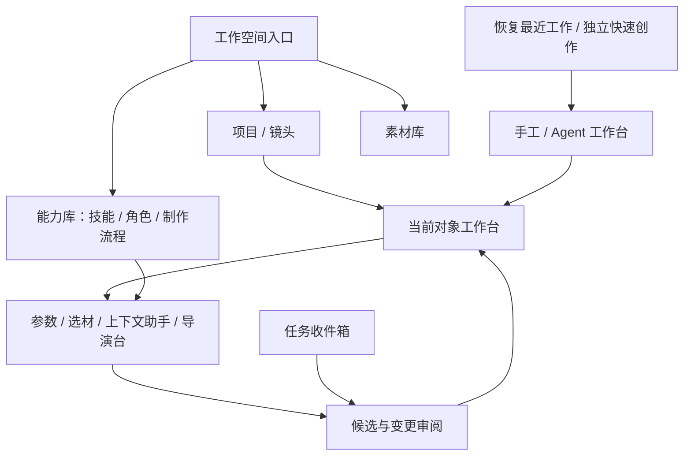

# 全本地创作平台的 UI 设计逻辑与演进路线

日期：2026-10-29。性质：设计方案与实施顺序，未实现新界面，未开展本轮实机可用性测试。

依据：[移动创作 UX 研究](2026-10-28-mobile-ai-creative-ux-research.md)、[平台与 3D 架构审查](../reviews/2026-10-29-platform-evolution-and-3d-director-review.md)、[本地 Agent / Skill / 编排评估](2026-10-29-local-agent-skills-and-orchestration.md)。当前源码基线为 `08d61d22aa52febc01feded2c4c5b7dc93ead87e`；10 月 28 日研究中的行号和风险不能直接当作当前实机结论。

## 1. 核心判断：从生成工具演进为围绕作品的制作工作空间

延续原研究的 **Focus—Intent—Surface—Return**，把功能增长转化为同一对象上可连续完成的制作任务：

**当前对象 → 选择意图 → 调用能力 → 审阅产物或变更 → 回到原对象。**

保留手工 / Agent 两种工作方式；独立快速出图、出视频不强制创建项目。长篇制作以项目和镜头组织，未来的角色、场景、3D、剪辑都沿对象关系进入。近期最重要的交付依然是“镜头 → 参考图 → 视频 → 候选审阅 → 采用 → 原镜头”的完整闭环。

所有编辑、技能管理、流程编排、存储、渲染和恢复在设备内运行。远端仅承担模型请求及必要输入上传、任务查询和结果下载；没有项目服务器、云端 Agent、远程 MCP 或运行时 CDN。UI 必须如实呈现离线和 Android 生命周期限制。

参考平台提供的是制作能力方向；移动端组织方式应以原 UX 研究为准。先建立可返回的对象工作台，再增加专业工具与空间布局，避免把桌面无限画布当成所有人的首页。

## 2. 信息架构：分清对象、工作方式、能力与执行

| 维度 | 包含什么 | UI 责任 |
| --- | --- | --- |
| 创作对象 | 项目、镜头、草稿、素材版本；后续角色、场景、时间线 | 告诉用户正在处理什么，产物属于哪里 |
| 工作方式 | 手工、Agent | 改变交互方式，尽量保持当前创作焦点 |
| 可复用能力 | 技能、助手角色、制作流程模板 | 解释怎么做、由谁做、按哪些步骤做 |
| 本次执行 | 模型任务、制作流程运行、待审阅提案 | 说明进度、阻塞原因、产物与下一步 |

这四个维度不能并列堆成一级 Tab。建议保持主工作台入口，增加稳定、带文字的“工作空间”入口，访问最近工作、项目、素材库、能力库；任务收件箱保持可见，设置进入更多菜单。能力库不埋入设置，普通快速生成也不必经过目录页。

能力库内部按“技能 / 助手角色 / 制作流程”组织，可有局部分类切换。内容素材与能力文档分别管理：同一个选择器组件可以复用，但选照片、选技能、选流程必须有不同标题、筛选和确认文案。

当前底栏已经隐藏，顶部已有工作方式切换，不应再恢复一排“项目 / 素材 / Agent / 技能 / 流程 / 3D”全局导航。早期不强制新增首页，启动优先恢复上次工作；最近工作目录是随时可进入的辅助入口。

## 3. 交互契约扩展：新功能必须回答同样四个问题

| 契约 | 基础含义 | 新能力的要求 |
| --- | --- | --- |
| Focus | 当前项目、镜头、草稿或具体版本 | 打开技能或导演台时仍能知道在为哪个镜头工作 |
| Intent | 生成、修改、比较、采用、导出、求助 | “试用技能”“调整机位”“执行制作流程”必须有明确目标 |
| Surface | 主内容、短 Sheet、编辑抽屉、全屏任务、选择器、候选托盘 | 长文本、流程编辑、3D 使用独立工作表面，避免多层 Sheet |
| Return | 来源、选中项、滚动位置、编辑状态 | 保存、取消、系统返回、重启恢复都可回到合理位置 |

建议把状态分成三个层次：作品事实由领域服务持久化；本次执行冻结输入版本、角色/技能版本和目标；界面保存返回锚点、选择和必要视图状态。返回锚点只决定导航，不授予工具权限。路由仅携带稳定 ID，不放 Prompt、媒体正文或密钥。

打开选择器或助手时，先保存当前编辑快照并切换主动表面；返回顺序遵循键盘 → 当前表面 → 全屏任务 → 来源对象。Android 返回不能只依赖 `router.canGoBack()`。来源已删除时回到所属项目或最近工作，并解释原因。

同一工作区只有一个主动输入表面。宽屏可以同时呈现列表、画面和工具，但键盘焦点及编辑事务仍需明确。手机折叠或窗口缩小时保留对象和编辑状态，不重置任务。

## 4. 创作主界面：稳定位置、阶段动作、非打断结果

主界面沿用原研究提出的结构：上下文标题、作品主体、阶段操作区、受控工具表面、助手入口和任务提示。标题区说明“项目 / 镜头”，对象主体优先展示画面、视频或文本；高级能力进入可发现的工具目录。

| 当前镜头状态 | 默认主操作 | 可直接到达的辅助操作 |
| --- | --- | --- |
| 没有参考图 | 制作参考图 | 选择已有素材、3D 取景 |
| 有图片候选但未采用 | 审阅参考图 | 比较、继续调整 |
| 已采用参考图 | 制作视频 | 导演设置、修改参考图 |
| 模型生成中 | 查看进度；允许继续其他工作 | 返回镜头、查看本次输入 |
| 视频候选就绪 | 审阅视频 | 对比、保留其他候选 |
| 已采用视频 | 预览片段或继续下一镜头 | 重做、导出 |
| 有待处理提案或阻塞 | 查看变更或处理阻塞 | 查看来源、保留当前版本 |
| 远端结果不明 | 核查原任务 | 查看提交记录 |

动作优先级仍为：正在进行的显式编辑任务 ＞ 待审核或阻塞事实 ＞ 阶段建议。模型完成不能抢走键盘、切换页面，或在手指按下时把原按钮变成另一种动作。通过“2 个候选就绪 · 查看”托盘收取结果。

“预览”“保留候选”“用于镜头”“保存至手机”各有独立含义。生成成功不自动采用；采用固定具体版本。即使进入流程自动化，也必须区分用户主动配置的自动选择策略与默认人工审阅。

## 5. Agent：从单独聊天页扩展为对象上的协作入口

保留全局 Agent，承接项目规划、长对话、批量制作；增加对象上的上下文助手，处理“增强这个镜头的压迫感”“把这次经验提炼成技能”等短任务。两者复用同一运行与命令体系，不能各自拥有一套项目事实。

上下文助手默认显示当前对象、所用角色和必要输入。扩大到其他项目必须显式选择；只在界面切换焦点不等于会话获得新项目权限。现有项目绑定会话应保留隔离，不能通过修改标题或参数静默改绑旧对话。

助手输出优先形成可操作结果：文本修改有前后对照；镜头创建有清单；生成有真实任务卡；技能提炼有草稿入口。聊天消息不是执行成功证据，只有领域收据和运行状态可以更新任务卡。

已有 `AgentCreativeCards`、`ProjectActivityPanel` 的结果卡和提案审核应继续使用。上下文助手接入前需要调整宿主生命周期：当前 `AgentScreen` 卸载会调用 `disposeAll()`，直接复制为可关闭浮层可能销毁其他运行。表面的关闭与 Agent 运行的结束应分开处理；已提交任务不因关闭聊天而取消。

已在范围和预算内授权的正常步骤连续执行，避免每次工具调用都确认。只有扩大范围、增加消费或需要人工决策时展示具体差异及可执行选项。

## 6. Skill：先让人理解用途，再提供专业编辑

技能是可复用的方法；助手角色决定使用哪些技能和工具；制作流程决定步骤与依赖。UI 应明确区分，避免把三者都叫“Agent”。技术格式 SKILL.md 放在高级编辑和导出中，日常界面以用途、输入、步骤、示例和适用限制为主。

### 6.1 三条创建路径

| 路径 | 交互流程 | 关键反馈 |
| --- | --- | --- |
| 导入 | 本地文件 / ZIP / 粘贴 → 兼容性预览 → 加入技能库 | 可直接使用、部分可用、缺少能力、无法解析；导入与启用分开 |
| 描述创建 | 描述需求 → 模型生成草稿 → 编辑与试用 → 保存版本 | 说明本次模型输入，试用是否会调用收费生成 |
| 经验提炼 | 从会话 / 镜头 / 流程选择证据 → 预览范围 → 提炼草稿 → 修订保存 | 哪些结论来自实际采用，哪些只是模型推断 |

例如从镜头结果的更多菜单选择“提炼为技能”，默认选中本次采用版本和关联操作；用户能删去无关消息和资源，再发起模型请求。得到“双人对话机位设计”草稿，编辑适用条件、步骤、例子和限制；保存后再选择“仅存入库”或“用于当前助手”。不会自动把整段聊天、私人路径和授权信息打包。

技能详情提供适用条件、依赖、来源、版本、使用位置和试用记录。草稿、正式版本、启用范围、兼容性是不同维度，不用一个“已安装”标签混在一起。缺少脚本解释器或外部专用工具时解释受影响的功能，不把文档导入成功显示成脚本可执行。

同名导入显示并存或更新目标，不静默覆盖。编辑生成新版本；正在执行的任务继续引用已固定版本。普通技能停用影响后续装配；安全权限撤销由宿主立即执行，不能混同为“更新后下次生效”。更新不自动给所有角色替换绑定。

角色配置采用“用途 / 模型配置 / 技能 / 可用工具 / 预算”的渐进表单。初学者直接使用默认助手；不要求先懂技能或配角色才能创作。模型密钥复用安全设置中的配置引用，不写进角色或技能正文。

## 7. 编排：手机先呈现制作步骤，复杂图编辑后置

产品层建议称“制作流程”，与现有模型生成工作流区分：前者连接选材、Agent、3D、本地处理和人工审阅；后者是一次生成使用的模型方案或参数工作流。

首个入口放在项目或镜头的“制作方案”中：选择模板 → 填入目标镜头与素材 → 预览步骤及预计模型调用 → 设置预算与审阅节点 → 开始。模板是可复用定义，运行是此次执行；编辑模板不改变已启动任务。

手机默认使用可展开的步骤清单，显示输入、输出和依赖。只有确需修改分支、并行关系时才打开全屏图编辑器；宽屏可以提供图视图，但不能以连线成功代表运行条件已经满足。

运行页按真实状态显示“本地处理中 / 模型生成中 / 等待你选择 / 等待联网 / 需要打开应用继续 / 完成 / 失败”。已完成产物可以直接查看；失败定位到具体步骤。进度只在分母稳定时展示百分比，不能把开放式 Agent 规划伪装成精确进度。

“采用并继续”如果会触发下一次收费模型请求，应在按钮旁明确后果，并复用已授予预算。重复点击或重启恢复不能重复提交。结果不明先核查，不能把“重试”作为默认主操作；远端不支持取消时区分“停止后续步骤”和“取消远端任务”。

当前 `ProjectPlans` 已有选材、视频生成、阻塞恢复等体验，但执行内核仍是固定 selection/video。首版 UI 只覆盖已支持步骤；通用编排扩展必须先有对应的本地步骤处理器和恢复规则，不能先展示无法执行的任意流程。

## 8. 3D 导演台：从镜头进入的预演工具

推荐入口为“镜头 → 导演设置 → 3D 取景”，也可在缺少参考图时直接进入。它回答的是“人物怎么站、镜头在哪、画面怎样构成”，不要求用户先管理完整 3D 工程。

### 首版操作模型

- 单一全屏视口，以“布景 / 摄影机”切换操作目的。布景调整人物、道具和朝向；摄影机调整构图、景别、焦距或视角。可提供默认低模场景和双人站位模板。
- 明确区分编辑观察视角与最终摄影机画面；始终能一键回到摄影机。选择对象后只展示该对象的少量属性，数值输入作为精调入口。
- 触控拖动与可见控件并存，提供撤销、重做、重置视角。手机无需依赖桌面的 WASD、多键组合或不可发现的手势。
- 主操作使用“导出取景图”，明确为本地生成参考图片；后续“用此取景制作图片 / 视频”进入已有生成工作台，在提交时才上传本次必要参考素材。
- 导出后先预览并选择是否用于当前镜头。保存场景与导出参考图分开；返回时保留场景编辑，不能因未采用参考图而丢失布景。

首版只做静态场景、摄影机和 PNG。UI 根据具体模型能力展示可用输入，不能承诺模型必然遵循机位、深度或运动。之后再增加运镜路径、关键帧条、本地预览和编码导出；时间轴与深度控制需有真实渲染和模型支持后才出现。

3D 文档、场景版本、取景图片各有身份：编辑场景不改变已提交任务的参考图；能从参考图查看来源场景，并另存新版本继续修改。场景和渲染在本地完成，Three.js 等资源若使用 WebView 必须随包提供，不加载在线编辑器。

宽屏以后可并列场景视口、摄影机画面与属性栏；手机保持一个主视口。大型场景、贴图和渲染先建立设备预算与性能验证，再开放导入范围。

## 9. 本地优先必须成为可理解的使用体验

| 情境 | 应有表现 |
| --- | --- |
| 无网络 | 已有项目、素材、技能编辑、布景与本地处理可用；需模型的动作解释等待原因 |
| 将素材发给模型 | 提交预览列明所选参考素材与目标；不把整项目或技能证据库默认上传 |
| 关闭应用 | 恢复已保存草稿和运行事实；不能承诺所有本地步骤持续后台执行 |
| 模型任务已在远端提交 | 恢复后先查询原任务；本地渲染中断与模型仍生成是不同状态 |
| 本地文件权限失效或资源缺失 | 指出缺失项并允许重新定位；不显示为模型失败 |
| 能力不可用 | 在导入与调用位置说明缺少哪项能力，避免统一导向一个无关的联网按钮 |

不需要在每个页面展示 SQLite、CAS、LangGraph、DeepAgents 等实现概念。“保存在此设备”“需要联网生成”“取景图在本地导出”已经足够帮助用户决策。

DeepAgents 升级是技术验证轨道，不能成为技能库、返回契约或镜头闭环 UI 的统一前置条件。现有评估发现新版 Metro 对 `node:crypto` 的兼容阻塞；继续复用稳定版本实现应用自己的存储与管理，待兼容和恢复验证完成再切换。新版框架支持某特性，也不直接等于 UI 可承诺设备后台执行或任意脚本能力。

## 10. 增量实施顺序与具体落点

以下顺序表达依赖，不是固定工期；每一步都应产生一条可独立验收的使用路径。3D 原型可在公共契约明确后单独验证，不必等待完整流程编辑器。

| 阶段 | 交付重点 | 最小可验收成果 |
| --- | --- | --- |
| A：作品闭环 | 镜头焦点页、生成来源与返回、候选采用 | 一个镜头从参考图到视频采用，全程不丢对象；独立快速生成可用 |
| B：公共交互 | 标题/动作区、主动表面、选择器与任务托盘 | 键盘和返回确定；多候选可找回；当前输入不被异步结果打断 |
| C：助手与能力库 | 上下文助手、技能导入/编辑/启用、经验提炼 | 从镜头提炼技能并用于另一个任务；查看提案后应用变更 |
| D：3D 静态闭环 | 布景、摄影机、本地取景、导入生成工作台 | 离线编辑导出 PNG，联网生成后回原镜头审阅 |
| E：制作流程 | 模板入口、步骤清单、人工节点、恢复 | 先跑通已支持的真实步骤，再逐个扩展步骤类型 |
| F：专业制作 | 运镜、Animatic/时间线、宽屏布局、按需空间画布 | 保持相同对象和返回语义，性能与设备能力达标后开放 |

工程落点：

- `ProjectShots.tsx` 已有阶段主操作和焦点过滤；先建立真正的镜头详情路径，减少单页条件分支，保留现有领域命令。
- `CreativeHome.tsx`、`ImageDraftScreen.tsx`、`VideoDraftScreen.tsx` 逐一接入统一上下文，不同时重写所有编辑器。`CreativeWorkspace.tsx` 的对象管理与编辑表面逐步拆分。
- 原研究中的 `ContextHeader / ContextActionBar / SurfaceHost` 是目标组件，不是当前已完成的基础设施。先为两种真实表面建立调度与恢复，再推广，避免形成另一个庞大容器。
- `AgentScreen.tsx` 与运行宿主先解耦生命周期，再接上下文入口；复用 `AgentCreativeCards` 和 `ProjectActivityPanel`，不再造任务状态源。
- `ProjectPlans.tsx` 的步骤展示可增量抽取；技能库、角色配置、3D 编辑各自拥有对象编辑页，共用导航和表面契约。
- 当前 `adaptiveLayout.ts` 主要是 compact、边距和列数规则。原研究的 600/840dp 分栏是待实现方案；按可用窗口宽度验证，不能将现状描述为已具备完整折叠屏工作台。

性能与无障碍贯穿 A—F：版本分页、缩略图与可见项解码、列表虚拟化、受控轮询同步推进。点击区依据实际布局和 hitSlop 测量，不只看图标外观尺寸；按原研究目标验证 44–48dp 点击区、主动作可达、大字号和键盘场景。

## 11. 设计验收脚本与决策门槛

每次交付记录 APK/代码版本、设备、窗口尺寸、字体倍率和本地素材规模。先测基线，再修订时间阈值；原研究的完成率与发现时间是目标，不是已有结果。

| 脚本 | 必须观察的结果 |
| --- | --- |
| 无项目快速出图 → 修改 → 保存至手机 | 不强制建项目或配置技能；导出与采用含义清楚 |
| 镜头 → 参考图 → 视频 → 多候选 → 采用 | 候选和目标不漂移，返回恢复原镜头 |
| 参数输入 → 选择素材 → 返回 → 系统返回 | 只有一个主动输入表面，文本和选择不丢失 |
| 上下文助手提出修改 → 对比 → 应用 / 拒绝 | 真实收据驱动 UI，关闭助手不取消已提交任务 |
| 导入含缺失脚本依赖的技能 → 查看说明 | 导入成功与可执行能力区分，不自动安装依赖 |
| 从已采用镜头提炼技能 → 编辑 → 在新任务试用 | 来源可删选，草稿不自动启用，模型消费明确 |
| 任务运行中更新技能或角色 | 当前运行版本固定；后续任务显示所用版本 |
| 制作流程待选材 → 采用并继续 → 重启 | 状态恢复，不重复消费，不把已完成步骤重跑 |
| 离线进入 3D → 导出取景 → 返回镜头 | 全程不依赖网络，场景与图片可恢复 |
| 模型提交后断网 / 关闭应用 → 恢复 | 核查原任务，不用重新提交掩盖未知状态 |
| 数百素材选材、连续滚动、折叠窗口、大字号 | 记录响应和帧表现，当前对象与主动作仍可达 |

阶段验收同时检查“找得到、做得完、回得去、不会误采用或重复消费”。新增能力如果无法说明对象归属、结果去向和恢复方式，应先补齐交互契约，再加入主界面。
