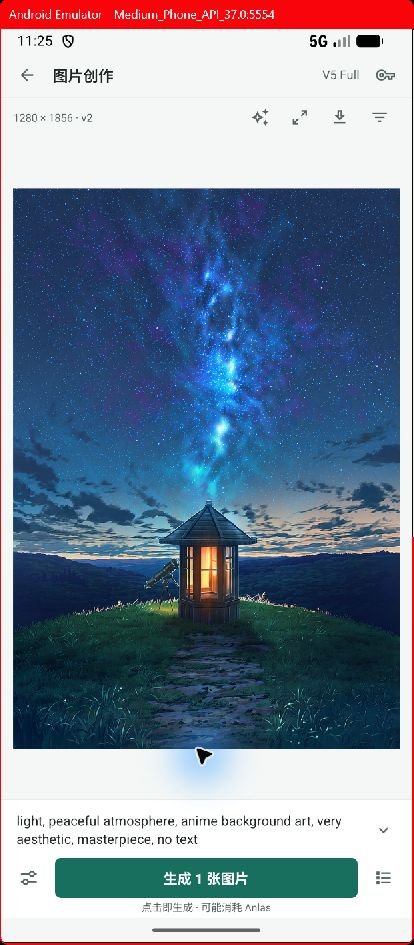
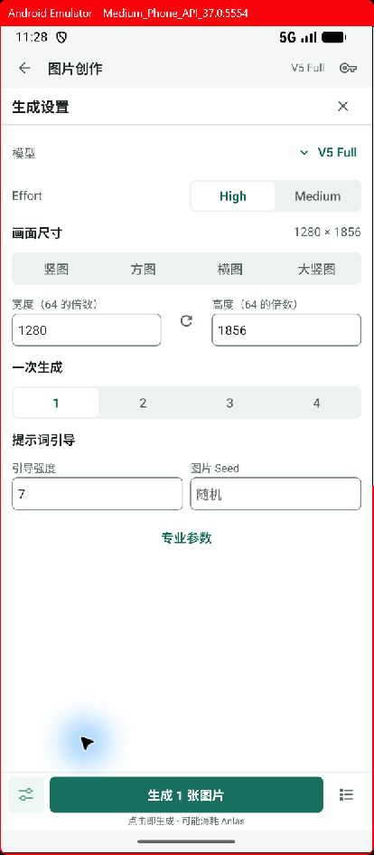
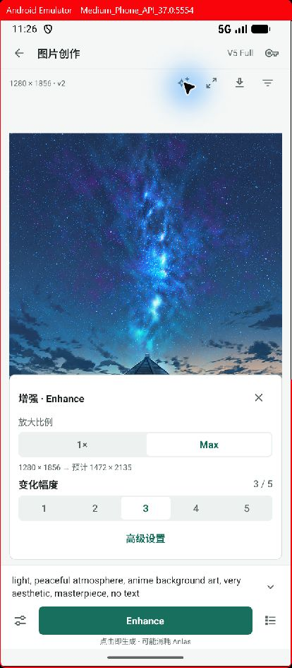

# 图片手工工作台：紧凑画布交互

本次落实用户对“页面元素过多、Enhance 独立成页、每次生成弹确认、控件过大”的反馈。继续保留手工 / Agent 两个工作台；本文件更新此前双工作台设计中图片手工创作的具体交互。

## 官网对照

在用户已登录的内置浏览器中，实际操作 [NovelAI 图片创作](https://novelai.net/image) 的窄屏页面，对照普通画布、生成设置、Enhance 及其高级设置，未触发新的付费生成。

- 画布为主体，提示词与生成按钮留在底部；常驻操作使用小图标。
- 设置采用紧凑字段、选择器与开关；高级参数按需展开。
- Enhance 是当前图片上的浮动面板，默认只展示倍率与变化幅度；高级设置才显示 Strength / Noise。
- Enhance 复用底部生成位置，不需要创建一个用户可见的新工作流程。

## 已实现

| 用户意图 | 交互 |
| --- | --- |
| 写描述、生成下一张 | 画布底部两行提示词输入与一个生成按钮，点击直接准备并提交本次请求 |
| 调整常用参数 | 左下设置图标在当前工作区展开设置，底部生成位置保持可见 |
| 选择模型、采样器 | 显示当前值，点击后展开选项；长采样器名称不再挤成多列按钮 |
| 调整复杂参数 | 专业参数默认收起，步数、Rescale、透明背景等仍可达 |
| 描述、负面、角色、底图、片段 | 从提示词展开入口进入画面编辑；保留提示词助手 |
| Enhance | 当前图片工具栏打开浮动面板，调整倍率、变化幅度；高级设置含 Strength / Noise 数值与滑块 |
| 清晰放大 | 图片工具栏打开 2× 放大面板，复用底部提交位置 |
| 看历史图片 | 右下历史入口按需打开，选择版本后回到画布 |
| 查看图片元数据 | 图片工具栏的更多菜单 → 图片信息，保留原始元数据与生成配方入口 |

图标控件视觉尺寸为 40，紧凑数值框最小高度 36，分段选择最小高度 32。图标另加触控范围，并保留中文可访问名称、选中及禁用状态。紧凑密度限定在图片工作台，避免其他页面被无关调整。

打开设置时保留画布组件实例、预览选择和任务轮询。关闭 Enhance 恢复普通生成的提示词与参数；增强期间的提示词、角色、模型设置作用于本次增强，不覆盖原有手工输入。打开图片工具只读取原文件与参数，不创建草稿或提交任务。

## 连续操作与数据一致性

- 再次生成时，在内部复制已提交草稿，保留素材、项目、镜头及底图关联，继续留在同一画布；历史提交的参数保持不可变。
- 每次明确点击仍只授权一次请求，沿用请求幂等和提交锁；移除的是中间确认弹窗。
- 保存失败不会继续准备生成，输入保留；并发修改仍须先解决草稿冲突。
- 结果为 UNKNOWN 时阻止再次提交，并提供原任务核查入口。
- 数值框区分键盘中间文本与滑块修改，既保留 `0.` 这类输入，也在拖动滑块时同步更新显示数字。

## 验证

- TypeScript 类型检查通过。
- Android x86_64 debug 构建通过，覆盖安装到现有模拟器，保留现有数据。
- 全量 Jest：230 个测试套件通过，1496 项通过，4 项沿用既有跳过；覆盖新增画布、不可变草稿、重复点击、UNKNOWN、数值同步测试。
- 在 Android 模拟器检查画布、设置、高级参数、内嵌 Enhance、Strength / Noise、关闭工具、历史及图片信息。
- 本轮使用已有图片验收界面，未新增付费云端请求。NovelAI V5 Full、Enhance 和独立超分继续使用既有协议与运行时，协议及运行时回归测试纳入全量检查。

截图目录：[窄屏验收](evidence/2026-10-24-compact-image-canvas)。

| 画布 | 设置 | Enhance |
| --- | --- | --- |
|  |  |  |
