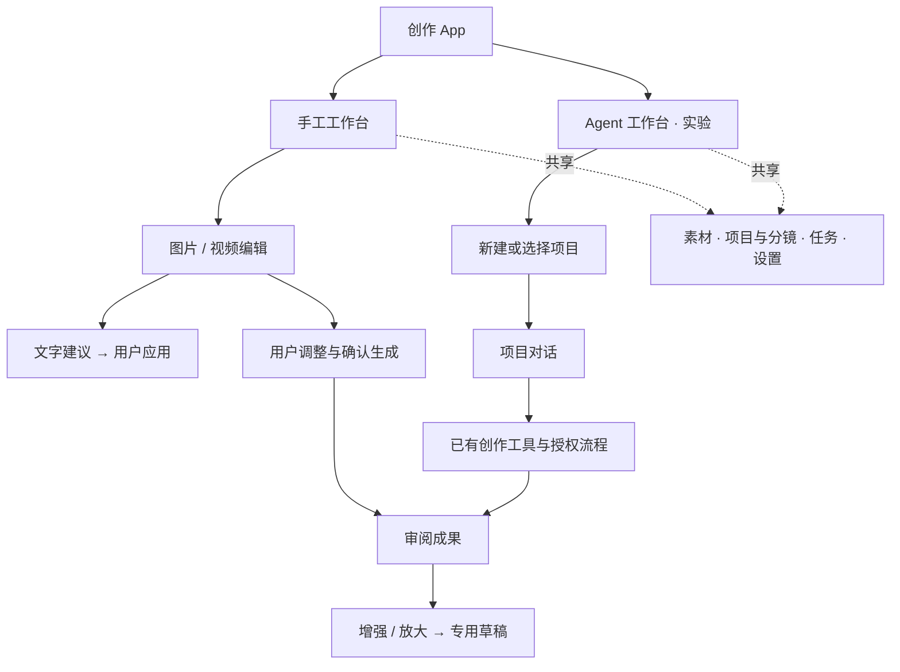
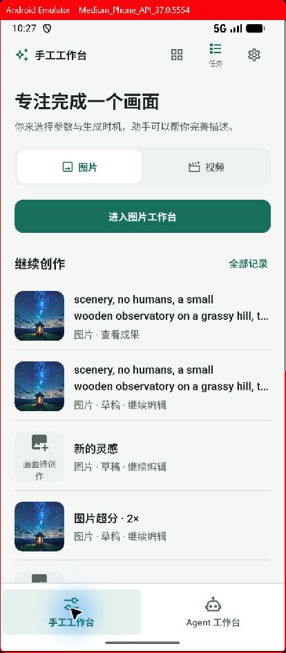
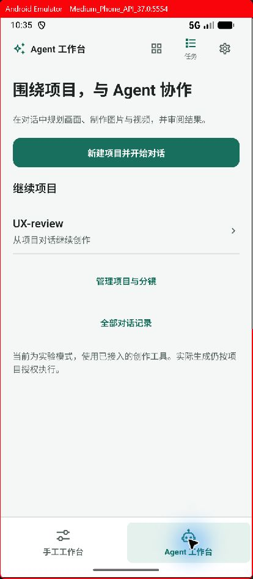
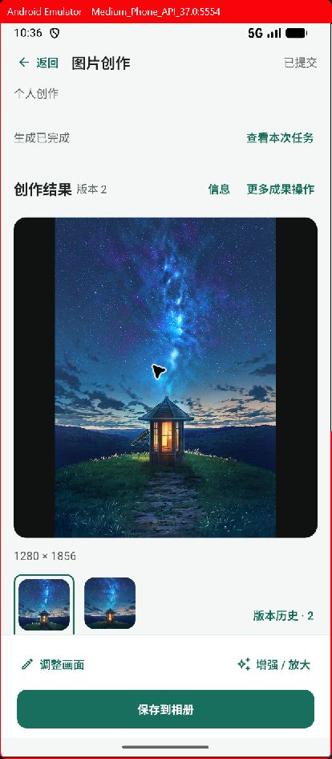
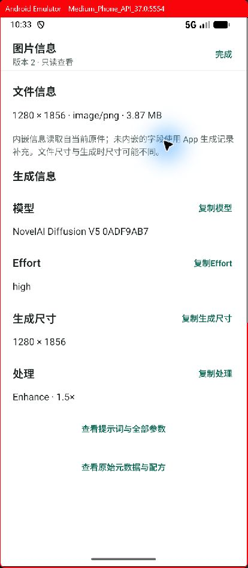
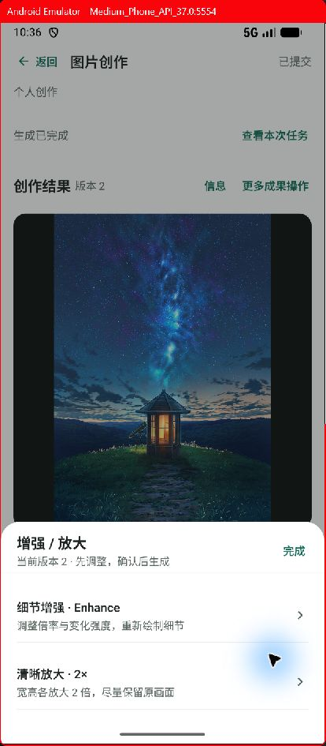
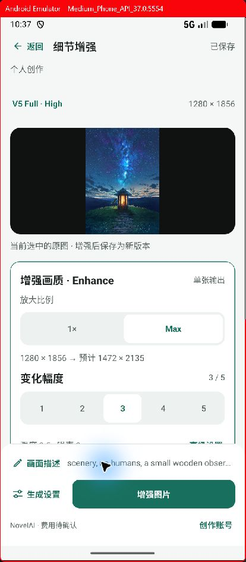
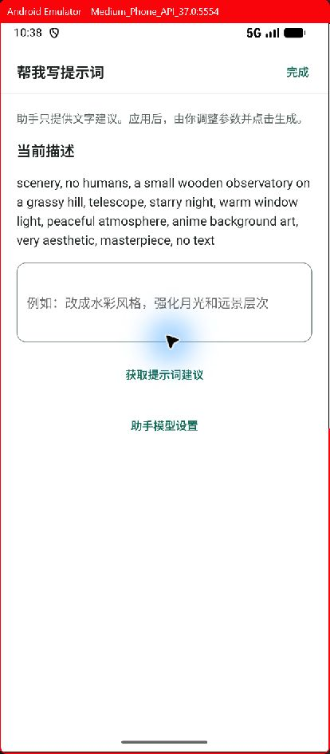
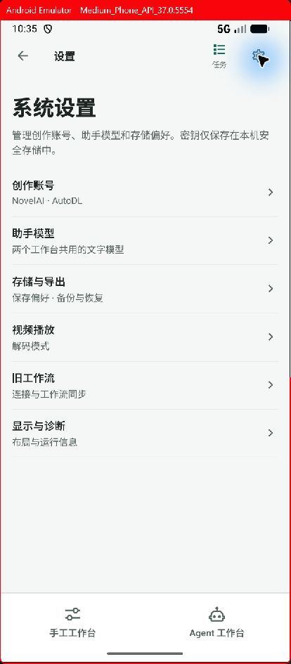

# 双工作台与交互收敛

日期：2026-10-24。基线：`a5fa8e04`。依据用户确认，一级导航改为两个工作方式，取代此前的创作、项目、素材、助手四入口建议。

## 产品结构

| 维度 | 手工工作台 | Agent 工作台 |
|---|---|---|
| 起点 | 图片或视频；继续最近草稿/成果 | 创建或选择项目 |
| 主要工作区域 | 画面、提示词和当前参数 | 当前项目的对话 |
| 助手职责 | 给出文字建议，由用户应用 | 通过已有工具规划和推进创作 |
| 生成时机 | 用户点击生成并确认 | 沿用已有项目授权与工具执行契约 |
| 状态归属 | 真实草稿、任务和不可变成果版本 | 真实项目、项目范围内的会话与创作记录 |

素材、任务和账号共用同一套底层数据。切换工作方式不复制文件、不迁移任务、不重新授予生成权限。项目与分镜保留为组织视图，通过项目模式入口或手工首页的“工具与项目”进入。

## 已实现的交互

### 入口与项目对话

- 底栏仅保留“手工工作台”“Agent 工作台”；素材、任务和设置使用顶部入口。辅助页返回沿访问历史，冷启动默认手工工作台。
- 手工首页只处理新建与继续；描述在编辑器输入。旧首页未完成描述继续带入新草稿，转交成功才清除对应类型的暂存描述。
- Agent 首页先展示项目选择和新建入口；选择后以该项目对话为中心。项目创建成功后才进入对话，重复点击不会重复创建。
- 项目会话的列表、搜索和分页在 SQL 层按项目过滤。新会话保存后绑定项目；绑定函数拒绝把已有会话悄悄移到其他项目。切换项目重新进入对应会话集合，原会话保留。
- “全部对话记录”保留旧入口及已有会话行为，不强制迁移历史范围。实验说明明确保留，未声称已完成用户另处开发的 skills 集成。

### 人工生成中的文字辅助

图片描述编辑器和视频动作描述均有“帮我写提示词”。它只调用共用的文字模型，不运行 Agent 图、不绑定创作工具、不提交图片或视频任务。建议可编辑，必须点击“应用到当前草稿”才更新描述；父草稿的描述发生变化时禁用应用，防止覆盖较新的文字。关闭页面会取消等待中的请求；用户仍自行设置参数与点击生成。

### 成果与处理

| 状态 | 默认内容 | 主操作 | 按需进入 |
|---|---|---|---|
| 编辑草稿 | 画布或历史参考、描述和参数摘要 | 生成 | 完整描述、角色、底图、专业参数 |
| 已提交 | 真实任务状态、当前成果与少量版本 | 保存到相册，或用于此镜头 | 信息、历史、其他成果操作 |
| 无结果/结果不明 | 实际状态和原任务入口 | 核查原任务 | 参数快照、明确复制为新草稿 |
| 增强或放大 | 固定来源版本与专用参数 | 增强/超分 | 描述、相关设置与账号 |

- 已提交的图片、视频及超分结果共用固定底部操作栏。图片保留“调整画面”“增强 / 放大”，突出保存或采用。编辑态的历史预览不再出现第二套成果操作，避免与“生成”竞争。
- “增强 / 放大”统一进入方式选择：细节增强可调倍率、变化强度；独立清晰放大保持 2×。素材页与成果页复用相同入口及准备逻辑。进入只创建草稿，未提交请求。
- 图生图、局部重绘、制作视频、素材详情、参数快照和复制草稿进入二级菜单。无成果时也能找到参数和复制入口。复制仍明确提示后续需要重新授权。
- 当前版本最多展示四个候选；完整历史进入独立浏览。浏览只改预览，不改变镜头采用或素材默认版本。
- 对增强成果点击“调整画面”恢复普通生成草稿，避免在不知情的情况下再次进入 Enhance；图生图和局部重绘仍有明确入口。
- 普通生成设置先显示模型、尺寸预设和数量，采样器、种子、精确尺寸等进入“专业参数”。旧 Max 增强设置保留明确兼容提示，可显式切回普通图生图，不静默改写旧草稿。

### 查看与管理

图片“信息”使用全屏查看：默认文件尺寸和大小、模型、Effort、生成尺寸、处理摘要；提示词、完整参数及原始元数据按需展开，保留复制与原件读取能力。视频“本次生成参数”保留提交快照、描述、参考图和完整字段，均为只读。

素材详情默认以预览、版本及创作/保存为中心。名称标签、项目关系、比较和使用位置归入“更多”，回收站恢复仍直接显示。设置首页真正只显示分类；进入后仅渲染相应表单，切换类别回到顶部，未保存更改继续保留；校验失败会切到对应类别。

## 实现边界

- 本轮建立两个主工作台和手工生成的主要收敛路径；不把实验 Agent 描述成已经完整自动创作。现有生成工具和授权流程继续工作，授权后续跑、消息内联成果卡和新 skills 接入仍需后续独立实现与验收。
- 项目管理仍保留当前概览、镜头、素材和计划视图；此前建议的“默认镜头视图”尚未切换。任务页已有真实进度、监控和恢复机制，本轮未重排其诊断与监控区域。
- `CreativeWorkspace` 的项目/素材视图尚未完成源码层面的全拆分；本轮先收敛用户默认看到的内容。结果操作栏、图片处理入口、参数快照和文字建议已拆成独立组件。
- 当前模拟器尚未配置文字模型；本轮检查配置引导，没有借本次改版新增付费生成或执行真实 LLM 调用。图片验收复用已有 V5 Full 和 Enhance 真实成果。

## 验证

- 完整 Jest：228 套通过，1 套跳过；1,489 项通过，4 项跳过。
- 最后界面修正的定向回归：6 套、30 项通过；TypeScript 检查通过。
- Android x86_64 debug 构建与覆盖安装通过，保留原数据。
- 新增行为覆盖：项目创建成功/失败与重复点击、按项目搜索分页、禁止错误重绑定、文字建议手动应用与并发描述变化、无结果时保留复制与参数、增强成果回到普通调整、编辑态不显示第二套成果动作、辅助页按访问历史返回、素材不误显示回收站状态、视频快照与缺失参考图。
- 窄屏验收证据和最终安装状态见本目录的 `evidence/2026-10-24-dual-workbench`。截图是实际 Android 页面，不是设计稿。

最终包已覆盖安装到现有 Android 模拟器，保留原有数据。人工走查确认：手工/Agent 切换；现有项目进入后的模型配置引导；Agent → 设置 → 返回 Agent；真实 V5 Full 增强成果的固定工具栏；信息默认摘要；增强/放大方式选择；从选中版本建立 Enhance 草稿并显示倍率和强度；完整描述编辑器 → 文字建议面板。走查只新增了一份未提交的 Enhance 草稿，没有授权或提交新的生成请求。

| 手工工作台 | Agent 工作台 |
|---|---|
|  |  |

| 成果审阅 | 图片信息 |
|---|---|
|  |  |

| 增强与放大 | 可调增强草稿 |
|---|---|
|  |  |

| 文字辅助 | 设置分类 |
|---|---|
|  |  |
