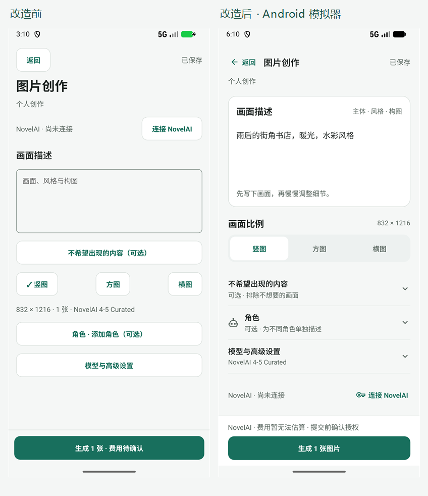

# 创作工作台交互改造：第一批实施与验收

日期：2026-10-24。基于同日[产品与交互对标评估](2026-10-24-product-interaction-benchmark.md)实施。本次修改已落入 React Native 页面和公共组件，并构建安装 Android x86_64 调试包进行模拟器检查；不是仅提供设计稿。

## 已实施

| 区域 | 修改后的体验 |
| --- | --- |
| 首页与导航 | 新建区区分图片/视频；示例只填入描述；最近草稿整行继续，有成果时显示缩略图。任务和设置有独立图标入口，辅助页面可返回创作。 |
| 图片工作台 | 紧凑标题与保存状态；画面描述成为主体；比例用分段选择；负向描述按需展开；角色与高级参数移入底部面板。生成操作固定在底部，并明确说明费用暂无法估算、提交前确认授权。 |
| 参数面板 | 模型、采样器、噪声采用可辨认的选项；宽高、步数/引导强度并排；表单错误在面板内显示；完成与系统返回均可收起，沿用自动保存。补充软键盘避让和滚动。 |
| 视频工作台 | 参考画面先于运动描述；当前参考图大预览、其他参考图缩略图切换；分辨率和时长以摘要展示，通过面板调整，支持常用时长与自定义时长。 |
| 选材 | 两列虚拟化缩略图网格替代大卡片列表；先选择，再通过固定底栏确认使用；验证失败保留选择、重复点击有锁。 |
| 生成结果 | 展示实际任务状态与候选缩略图；图片可以继续修改或转入视频准备；状态未知时核查原任务，避免把重新提交包装成恢复。 |
| 素材与版本 | 图片预览和视频封面复用统一组件；版本缩略图便于切换；A/B 比较可在同一预览位置切换，参数差异使用可读名称，原始快照收进技术详情。 |

公共交互组件位于 `mobile/src/creative/WorkbenchUI.tsx`，媒体呈现位于 `MediaPreview.tsx`。视频封面使用已有原生提取接口，按不可变文件版本共享结果、限制并发为 2，缓存最多 100 项；提取失败及原文件缺失有占位。

## 保持的业务约束

- 首页示例、选择素材、继续修改和制作视频均不会直接触发付费生成。最终生成仍经过已有账号和授权检查。
- 草稿自动保存、冲突检测、离开保护与提交快照沿用已有逻辑。
- 结果继续修改保留所选版本和项目/镜头范围；A/B 切换本身不改变项目采用关系或默认版本。
- 选择素材只有明确确认后才调用使用动作；验证失败不关闭面板。
- 未知任务只引导核查原任务，不自动再次提交；不显示虚构进度、费用或时长。

## 验证记录

1. TypeScript：`npm run typecheck` 通过，包括最后的键盘避让调整。
2. 全量 Jest：中途执行为 213 个测试套件通过、1 个跳过，1413 个测试通过、4 个跳过。后续选材网格、版本比较和面板调整后，最终执行创作模块及标签导航/UI 合约回归，39 个套件通过、143 个测试通过、2 个跳过。最终修改后没有再次运行整个仓库测试集。
3. 新增行为测试覆盖：封面解码共享与过期结果丢弃、原文件缺失、继续修改的上下文、图片转视频不提交、未知任务核查、A/B 选择不改写原始快照、选材确认/去重点击锁与失败后的选择保留。
4. Android：自包含 x86_64 调试包构建成功并安装到 API 37 模拟器。验证首页示例传递、图片参数面板、视频时长回写摘要、参考图选择与重复素材去重、选材固定确认栏；检查 1.5 倍系统字号后恢复到 1.0。
5. 键盘检查：验证高级参数面板的下部输入和顶部完成操作；对应截图单独保存。

构建/测试日志位于本地 `.local-tools/interaction-redesign-*.log`。本轮使用两个明确的演示草稿进行页面验收，没有填写供应商凭据或执行付费生成。已有图片作为选材演示内容，不能用其证明供应商生成或真实视频解码已通过。

## 截图

截图来自 Android 模拟器；对比图仅缩放拼接原始截图，未绘制替代 UI。改造前页面为空草稿，改造后为填有示例描述的草稿，内容状态不同。

- [首页](../evidence/2026-10-24-interaction-redesign/home.png)
- [高级参数](../evidence/2026-10-24-interaction-redesign/image-settings.png)
- [软键盘](../evidence/2026-10-24-interaction-redesign/image-settings-keyboard.png)
- [视频参考图](../evidence/2026-10-24-interaction-redesign/video-reference.png)
- [选材确认](../evidence/2026-10-24-interaction-redesign/asset-picker.png)
- [1.5 倍字号：首页](../evidence/2026-10-24-interaction-redesign/home-large-font.png)、[视频工作台](../evidence/2026-10-24-interaction-redesign/video-large-font.png)

## 范围与后续

本轮完成创作主路径及素材版本的第一批改造，不代表整个对标路线图已完成。助手授权后自动续跑、项目/镜头整体信息架构、主素材库虚拟化和活动任务数量提示尚未实施。视频封面和结果切换已有代码与测试覆盖，真实供应商生成、多候选结果和真实视频素材仍需要具备相应数据的验收。当前安装包为模拟器 x86_64 调试产物，未验证 iOS 或手机 arm64 发布包。
