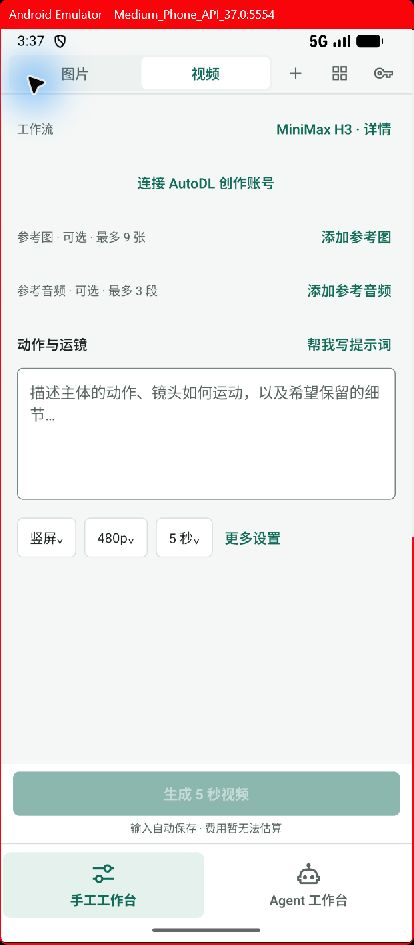
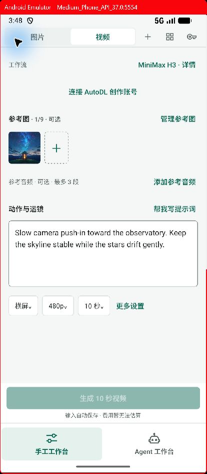
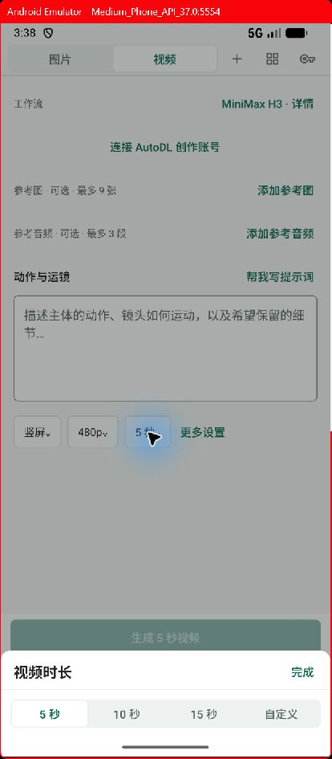
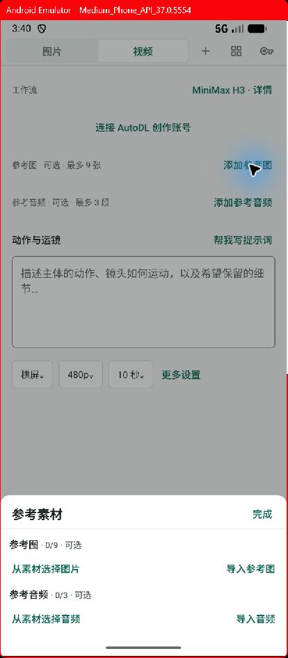

# 视频工作台调整实施记录

按 [交互方案](2026-10-24-video-workbench-interaction.md) 实施“准备优先”。本轮聚焦手工视频创作，没有改变手工／Agent 两个主工作台模式。

## 已完成

- 首屏按工作流、参考素材、动作与运镜、常用参数组织。无素材时仅一行添加入口；添加后显示小缩略图，点击可查看原图。描述区默认 4–6 行，不再被首张参考图挤到底部。
- H3 的方向、清晰度、时长分别打开紧凑面板；5／10／15 秒直接应用，自定义时才出现数字框。Seed 留在更多设置。生成操作直接提交，没有逐次确认页。
- 有任务后才显示创作／结果两个本地视图。提交后查看真实状态，可以回到输入准备下一次。完成不会抢走输入焦点；等待或 UNKNOWN 时不允许再次提交。结果播放器沿用既有组件，修正了画布容器高度。
- 工作流候选来自实际活动目录，检查视频输出、执行适配器及输入结构。当前仅一个可用项时显示详情，有多项才提供切换。账号缺失在准备区提供连接入口，禁止生成。
- 新草稿恢复上次可用的工作流。兼容工作流根据自己的字段定义显示参数，常用区域最多三个通用字段，其余放入更多设置。
- 每个工作流独立保留草稿。首次切入带入兼容字段；超量或格式不兼容的素材全部留在原草稿，不自动截断。切回恢复原输入；已提交输入通过可编辑副本继续使用。项目和镜头归属保持一致。
- 草稿固定工作流 ID、版本、内容标识。更新后需显式对齐；准备和提交均检查版本。清理目录时保留草稿引用的旧定义。旧 H3 草稿继续可读。
- 参考音频已接通导入、素材选择、版本引用、保存、准备、任务快照及提交；图片和音频分槽保存。提交前检查格式、数量及合计 50MB 上限。
- 跨工作流结果保留在同一创作脉络，视频配方记录生成它的工作流。历史版本参数读取其自身任务草稿；参数面板使用提交快照中的实际随机种子。

## 验证

- TypeScript 检查通过。
- 首轮全量测试：231 个套件、1516 个用例通过；随后增加了兼容工作流别名／音频准备和旧版已提交草稿恢复用例，并通过相关回归。
- 最终全量测试：231 个套件、1518 个用例通过；另有 1 个套件、4 个用例按原有条件跳过。
- Android x86_64 自包含 Debug 包构建成功，已覆盖安装到 emulator-5554。最终包 SHA-256：`24F3457CB6A641857FB5E54366EFE35658E5DE5948C0BBB4AADBC9AAD80002EB`。
- 模拟器验证：空白首屏、添加参考图、素材库选定版本、缩略图显示、描述输入、返回收起输入状态、方向独立选择、时长直接应用、单工作流详情、更多设置中的 Seed、重新安装后恢复描述／参考图／横屏／10 秒配置。
- 状态和事务测试覆盖：连续点击只提交一次、生成时编辑不改原请求、完成不自动切页、UNKNOWN 不重发、来回切工作流恢复各自输入、旧提交恢复为副本、图像／音频错误替换回滚、媒体篡改拒绝、版本变化拒绝。

## 验证边界

模拟器没有连接 AutoDL 创作账号，本轮未发送付费视频请求。非 H3 工作流使用兼容定义测试验证字段映射、动态参数与音频提交准备；内置目录仍只有 H3 一个工作流 ID，不声称验证了多个真实服务商。播放器沿用原有实现，本轮没有重新验证远端生成、视频播放失败和全屏播放全过程。

宽屏并排布局、独立首尾帧／时间轴、历史视频一键复用完整配置没有在本轮新增；它们需要单独的能力声明或后续交互工作。

## 窄屏截图

| 空白创作 | 添加素材并恢复输入 |
| --- | --- |
|  |  |

| 时长面板 | 素材面板 |
| --- | --- |
|  |  |

[工作流详情截图](evidence/2026-10-24-video-workbench/workflow-details.png)
