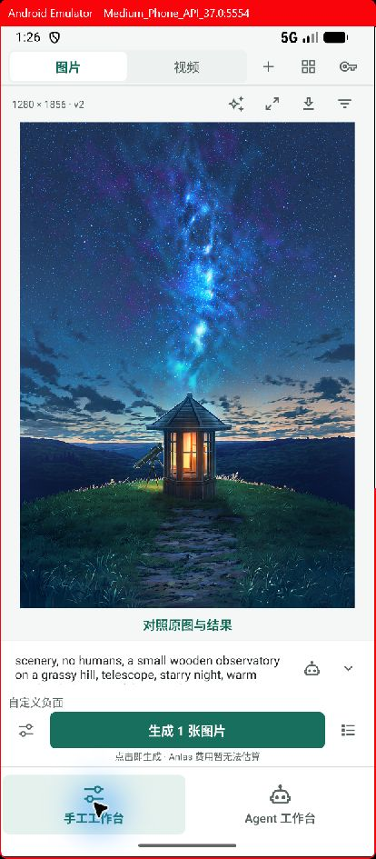
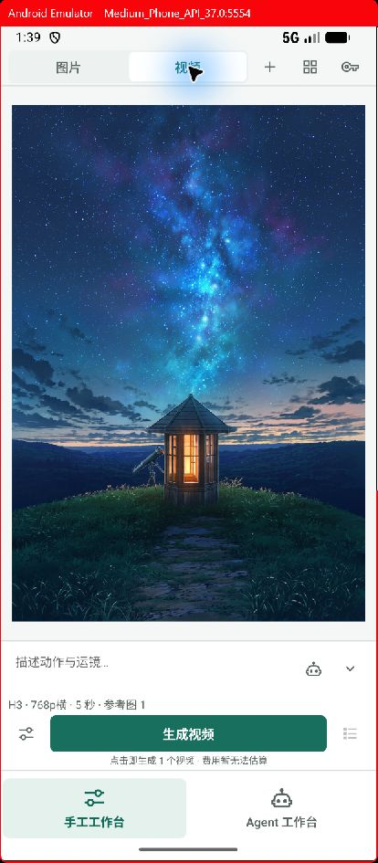
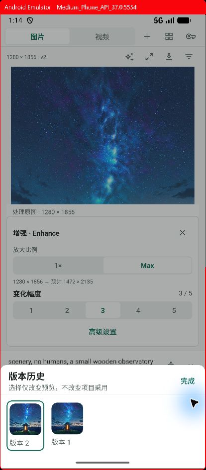
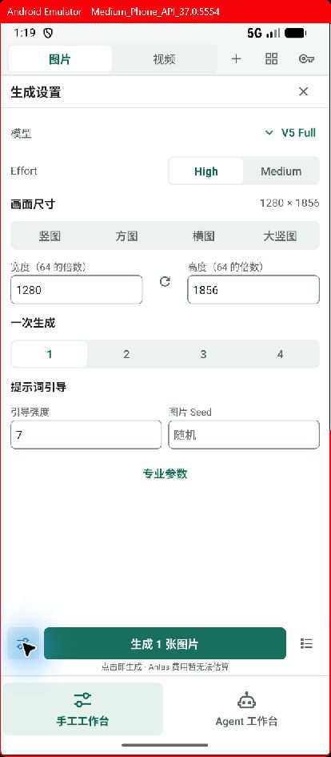
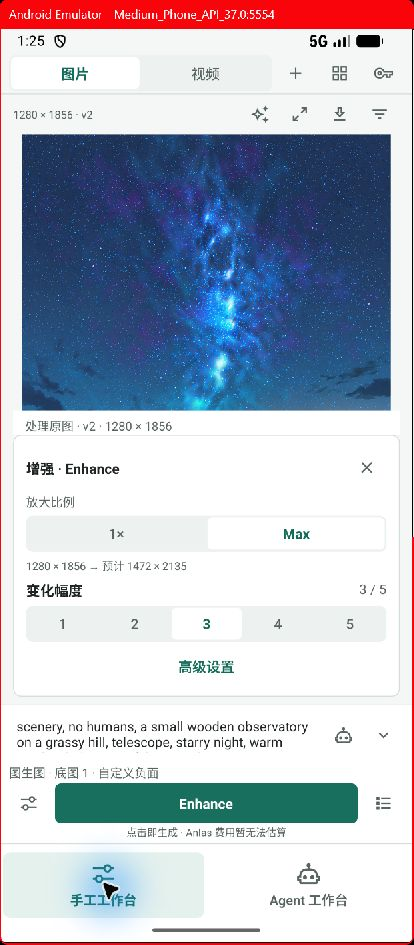
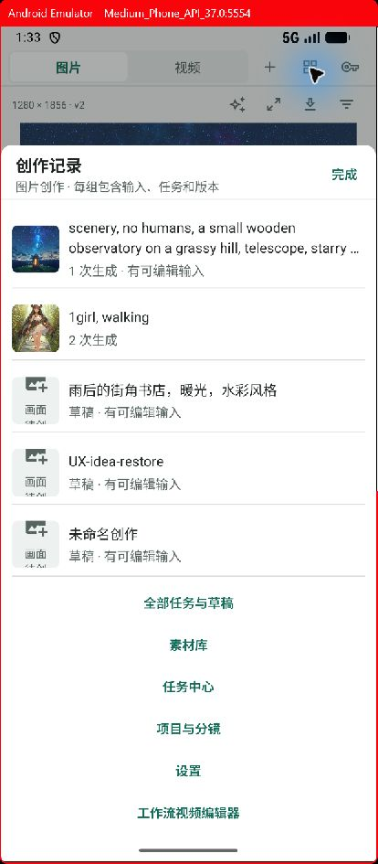
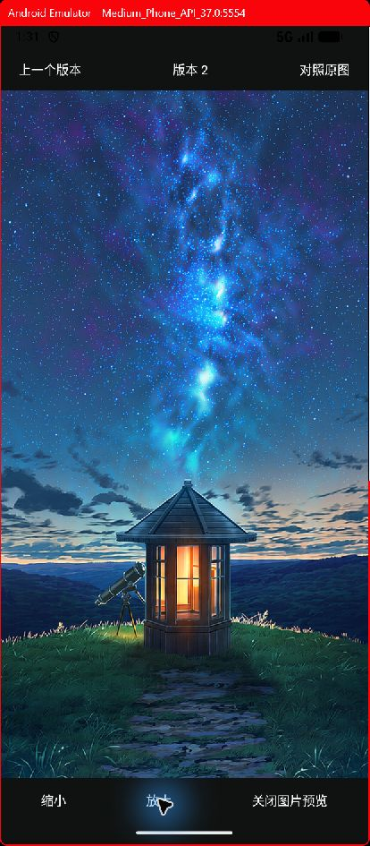
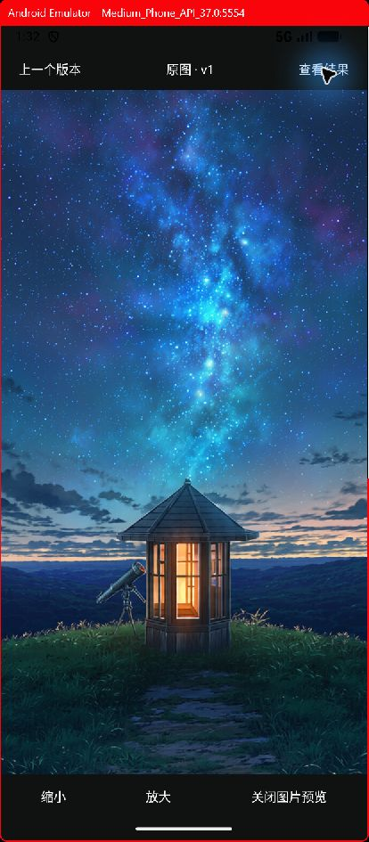
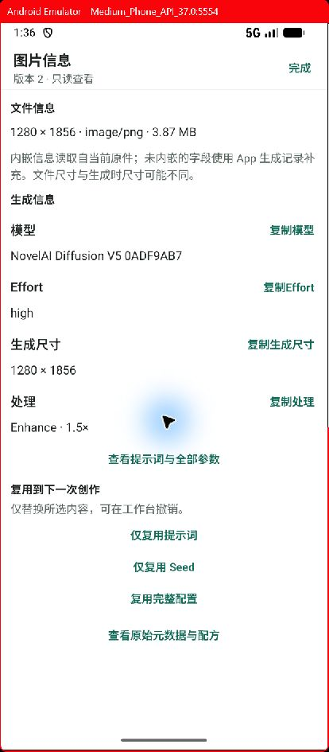
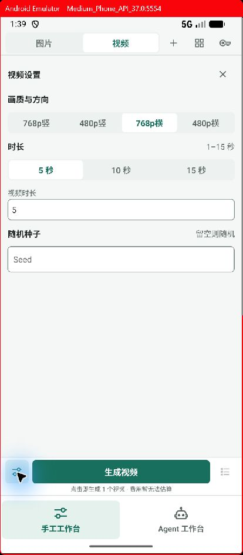

# 连续创作工作台：实施与验收

基于 [工作台交互复查](2026-10-24-workspace-followup-review.md) 实施。目标是让手工模式围绕当前作品、描述和一次生成操作组织；图片与视频共享交互规则，复杂功能通过上下文入口展开。

## 已完成

- 手工首页直接恢复上次图片／视频工作区，取消“进入工作台”中转页。新建、记录、账号采用紧凑入口；项目、素材和任务通过导航面板访问。
- 图片与视频均在画布内连续创作，点击生成直接提交一次请求，不再出现每次重复确认的弹窗。视频设置、参考图和完整描述按需展开，助手只提供可编辑的提示词建议。
- 等待生成时可以准备下一次输入。已提交草稿与引用保持不可变，修改会复制到下一份可编辑输入；结果区继续跟踪原任务。生成中、结果未知、存储冲突和提交锁仍阻止重复提交，不隐式排队。
- 当前编辑输入自动保存。切换模式、新建和打开其他记录前先保存，失败则留在原工作区；图片／视频各自记住最后使用的草稿。
- 近期记录按引擎、项目、镜头和素材分组，合并不可变请求及后续输入；隐藏没有内容的空白草稿，保留带参考图或镜头关联的草稿。
- Enhance／放大入口统一进入图片画布，独立放大不再路由到另一套页面。工具明确标注源版本；切换历史图片会退出旧工具，关闭预先准备的工具后不会在下次恢复时重新弹出。
- 放大携带并校验项目和镜头关联。工作区显示项目／镜头路径，结果仍由用户明确选择是否用于镜头。任务详情返回原工作区，避免额外压入重复编辑器。
- 返回操作优先关闭当前设置或工具，再离开工作区。图生图、局部重绘及元数据复用直接应用到当前输入。
- 历史使用底部缩略图面板；全屏查看复用双指缩放、平移、双击、下滑关闭能力，并支持相邻版本和原图／结果对照。对照保留当前缩放与平移；切换版本重置视野。
- 图片信息支持仅复用提示词、仅复用实际 Seed、复用完整配方，应用后可以撤销；原图片记录保持只读。缺少完整配方时不提供完整恢复。
- 主画面仅在启用时显示底图、角色、负面词等配置摘要；助手紧邻提示词。统一收紧字段、间距、标题和工具面板，图标仍保留触控区域。
- 区分素材库、系统相册和镜头采用。相册保存显示进度和结果，失败可明确重试；结果未知不会自动重复保存。

## 验证

- TypeScript：`npx tsc --noEmit` 通过。
- Jest 全量：231 套通过、1 套跳过；1509 项通过、4 项跳过。覆盖真实 SQLite 的镜头范围、图片／视频不可变请求和引用复制，以及界面的重复提交、UNKNOWN、下一次编辑、工具退出、模式切换保护、元数据复用。
- 最后补充查看器切换版本重置视野及深色状态栏后，查看器定向测试 2 项通过，TypeScript 再次通过。
- Android x86_64 Debug 构建成功，最终 APK 已覆盖安装到 `emulator-5554`，保留原有数据。
- 窄屏实际检查了工作区恢复、模式切换、Enhance 源标识、历史切换退出旧工具、设置／工具返回、版本缩放与原图对照、近期分组、图片信息入口。
- 本轮使用已有图片与视频参考图，没有发送新的图片／视频生成请求；提交一致性由自动测试验证。尚未据此声称所有引擎参数都经过新的线上生成验证。

## 界面记录

| 图片画布 | 视频画布 |
| --- | --- |
|  |  |

| 历史与处理源 | 设置与记录 |
| --- | --- |
|  |  |
|  |  |

| 放大结果 | 同一视野对照原图 |
| --- | --- |
|  |  |

## 保留的边界与后续工作

- 费用缺少可靠估算来源，目前明确显示无法估算，不推算免费资格或承诺费用。
- 近期分组沿用现有最近 100 条草稿查询，面板最多展示 20 组，生成次数表示该查询范围内的请求数。长期项目需要进一步加入分页和持久会话统计。
- 横屏、系统大字体、读屏与实体设备尚未完成完整验收；不能把本次默认字号窄屏检查当作全部适配通过。
- Agent 继续使用项目和对话工作区，共享素材与镜头成果。本轮没有新增自主执行能力；外部 skills 的接入与成果自动回流仍需后续开发和专门验收。
