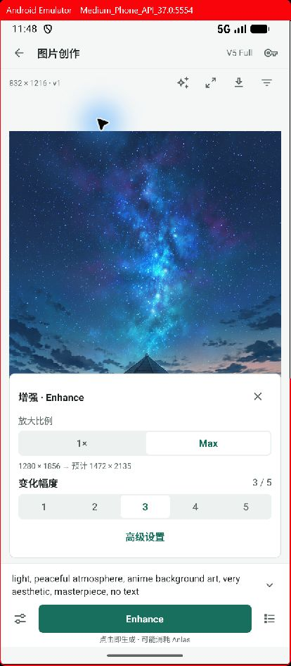

# 工作台交互复查与后续改进

复查基线：`89c2f4f7`。结合 Android 窄屏实际操作、当前代码，以及已登录内置浏览器中的 [NovelAI 官方图片工作台](https://novelai.net/image)。本轮使用已有图片检查，未提交新的生成请求。

当前图片页已经具备画布、底部提示词、直接生成和按需展开参数的基本结构。下一轮重点是处理对象一致、连续创作、跨入口统一，以及结果审阅能力。以下区分实际复现、代码确认和设计建议；本文件是评估清单，尚未实施其中的调整。

## 优先级与证据

### P1：画布切换后，Enhance 仍处理旧图片

**已在模拟器复现。** 打开版本 2 的 Enhance 后，从右下历史切到版本 1：画布标注 `832 × 1216 · v1`，增强面板仍显示版本 2 的 `1280 × 1856 → 1472 × 2135`。未点击执行。

原因：`ImageDraftScreen.tsx` 分别维护 `currentVersion`、`processingSource` 和 `enhanceInput`；历史选择只更新画布，提交仍使用打开工具时固定的原图。独立放大也使用相同的源快照机制，存在同类风险。

建议规则：**用户切换历史图片时退出当前处理工具。** 如果以后支持切图后继续处理，则须同时重新读取源图、尺寸和配方，完成前禁用执行。面板用简短版本标识明确处理对象。单次提交仍使用固定快照，避免任务提交时被切图改变。

验收：打开 Enhance／放大 → 切换历史版本 → 画布、工具源、尺寸及实际请求一致；加载失败时不能提交旧源。

### P1：放大丢失镜头关联

**代码确认。** `createImageProcessingDraft()` 接收 `shotId`，但 `upscale` 分支只传 `projectId`；`draft.createUpscale` 的 schema 不接收镜头，写入时 `shot_id` 为 `NULL`。

这会使从镜头图片发起的放大结果失去原镜头上下文，结果主操作也可能从“用于此镜头”变为“保存到相册”。

建议：图片处理统一携带项目、镜头、素材和源版本关联，校验镜头所属项目；生成新版本后保留原采用关系，用户明确选择后才替换镜头采用版本。

验收：镜头 → 生成 → Enhance／放大 → 查看结果 → 用于原镜头，全程无需重新查找项目或镜头。

### P1：同一工具的入口和返回逻辑不统一

**代码确认。** 当前画布内放大是浮动面板；素材详情通过 `ImageProcessingSheet` 创建放大草稿后，`CreativeImageDraftRouter` 仍将其路由到独立的 `UpscaleDraftScreen`。从记录重新打开放大任务也进入该旧页面。以此图生成／局部重绘则新建草稿并替换路由。

内嵌设置和处理面板也未接入统一的返回层级：`ImageDraftScreen` 的离开拦截只处理未保存、提交和保存状态，没有优先关闭设置／工具的规则。任务页的“返回创作与结果”使用 `router.push`，会另开工作台实例。

建议：生成页、素材页、历史记录复用同一编辑器和工具面板。素材入口只决定初始图片、初始工具及返回位置。统一返回顺序：键盘／模态层 → 当前工具或设置 → 原工作区；任务详情返回原编辑器实例。需要新建独立创作时使用明确命名的操作。

验收：同一图片从不同入口打开 Enhance／放大，控件、执行方式和返回行为一致；返回后提示词、预览版本和滚动位置保留。

### P2：首页与记录需要按创作组织

**界面与代码确认。** 手工首页仍需先选择图片／视频再点“进入工作台”；进入即创建草稿，即使没有任何编辑。近期列表直接展示前六条底层草稿，没有按当前图片／视频选择过滤。模拟器上已出现空白“新的灵感”和相同提示词的多条记录。

连续生成内部复制不可变草稿是合理的数据机制，但每次复制都呈现为一条独立“创作”，会让用户难以理解哪些属于同一组探索。

建议：手工模式默认恢复上次图片／视频工作区，保留一个小的“新建”入口。首页近期内容按创作会话或素材组织，每组包含草稿、生成次数和版本；无修改的空白草稿不占据近期列表。底层任务与历史配方继续完整保留。

验收：同一画面连续生成五次，近期列表是一组创作，内部可查看五次任务与全部版本；切换图片／视频不会混淆当前编辑内容。

### P2：隐藏配置后，还需要表达“当前启用了什么”

**界面与代码确认。** 底部两行提示词可以快速编辑，但长文本初始显示末尾；展开箭头并不直接表达其中包含负面词、角色、底图和助手。图生图／局部重绘入口在“画面编辑 → 底图”中。助手需要经过画面编辑再打开另一个面板。

建议：主界面只在相关配置启用时显示简短摘要，例如“图生图 · 底图 1 · 角色 2”；点击摘要进入对应配置。提示词折叠状态展示可读开头和省略提示。助手紧邻提示词操作，输出作为可编辑建议，支持应用和撤销。复杂参数继续按需展开。

验收：不展开设置即可识别生成方式、参考图和角色是否启用；从摘要一步到对应编辑位置；助手不会自行提交生成。

### P2：Enhance 需要完整的结果审阅闭环

**代码确认。** 全屏图片目前使用普通 `Image` 展示，未提供缩放、平移或相邻图片切换。版本历史占据全屏，少量缩略图也会遮住整个画布。素材管理已存在 A／B 与参数差异比较，但画布里的增强结果没有就近入口。

建议：补充双指缩放、双击查看细节、平移和相邻版本切换；普通历史用底部缩略图面板，保留当前画布。增强完成后提供“原图／结果”对照，复用现有版本和参数比较能力，逐步支持同步缩放。原图始终保留。

同时区分“已在素材库”“存入系统相册”“用于镜头”三个结果动作。保存失败和重试应能在当前工作区确认，不要求用户另找素材详情。

验收：Enhance 完成后可直接检查同一局部的原图和结果，完成比较、选择采用及保存，不离开画布。

### P2：等待生成时仍应支持准备下一张

**代码确认。** `editable` 与 `pending` 直接绑定，任务生成中提示词和参数不可编辑；自动保存期间生成按钮禁用，但底部没有对应的保存状态说明。费用统一显示“可能消耗 Anlas”，不能帮助判断当前设置的影响。

建议：将“本次已提交的请求快照”和“下一次可编辑输入”分开。等待期间可以准备下一张，明确显示当前任务状态；是否允许下一次提交或排队另行定义，不能隐式排队。自动保存用轻量状态反馈。费用在有可靠估算来源时显示预计值和免费条件，不可估算时明确说明。

UNKNOWN、重复点击防护和单次授权继续独立约束实际提交，不能因允许编辑而解除。

验收：等待时编辑不会修改已提交任务；完成后保留新输入；UNKNOWN 不会因点击或恢复页面而重复发送原请求。

### P2：元数据从“能看”提升到“能复用”

**代码确认。** 图片信息可以查看、复制完整参数与原始元数据；素材详情另有“恢复参数并继续出图”。画布内缺少仅复用提示词、仅复用 Seed 或选定参数的便捷操作。

建议：在图片信息中提供按需展开的“复用”操作，区分提示词、Seed 和完整配置。应用前说明覆盖哪些当前输入，应用后支持撤销；始终区分图片的实际生成记录与下一次输入。没有完整配方的导入图片应明确提示可复用范围。

验收：从历史图片复用 Seed 时，当前提示词保持；复用全部参数时，底图可用性和模型约束得到校验，结果配方本身不被改写。

### P2：视频与 Agent 模式需要统一边界

**代码确认。** 视频仍保留生成确认弹窗、提交后独立结果页面以及旧的大卡片结构。图片页已经采用的画布连续操作尚未覆盖视频。

建议：视频沿用“预览主体、底部描述、单一主操作、设置按需展开”的结构；保留时长、多参考图等视频专属配置。点击生成时表达本次执行范围，沿用请求授权和任务一致性机制，简化重复确认与页面往返。

Agent 模式遵循用户已确认的方向：项目 → 对话 → 工具执行状态与成果。项目关联和素材可以共享，主工作区保持对话。手工模式中的助手负责提示词建议，具体生成仍由用户发起。外部 skills 完善前，重点做好真实工具能力、状态反馈和成果回流，不扩展额外的配置仪表盘。

验收：图片和视频共享基础交互规则；切换 Agent／手工模式可找回同一项目的成果，编辑内容和执行权限边界清晰。

### P3：将紧凑规范沉淀为组件规则

**代码确认。** `CompactWorkbench` 目前仅覆盖图片工作台；其他页面仍主要使用 20 间距、26 标题及 48／56 高度控件。图片页内也有未跟随密度的字段与设置行，整体节奏仍可能不一致。

建议：定义少量统一的标题、字段、列表、菜单、工具面板和底部操作区规范。减少重复边框、说明段落和整块按钮；控制视觉密度，同时保留足够的触控范围。复杂操作用行内选择、菜单和上下文面板，避免每项功能都新增卡片。

这部分须单独验收窄屏、横屏、系统大字体、键盘和读屏，不能只按默认字号截图判断。当前尚未据此认定这些适配存在故障。

## 建议的下一轮范围

1. **先完成一致性修复**：处理源、镜头关联、跨入口工具和返回顺序。为版本切换、镜头处理和返回恢复补充有意义的回归检查。
2. **再完成连续创作闭环**：默认恢复工作区、会话化记录、轻量历史、查看细节和原图对照；提高提示词与已启用配置的可发现性。
3. **最后统一其他工作区**：视频交互、元数据复用、等待期间准备下一张、全局组件密度，以及 Agent 项目的成果回流。

主界面长期保留“当前作品、描述、一个主要执行动作”；每次新增功能先明确归属对象、出现时机、退出方式和结果回流位置，再决定入口。不同生成引擎的参数约束保持各自准确，不为了界面统一而伪装支持能力。

## 主要代码位置

- 画布、处理状态、提交与返回：`mobile/src/creative/ImageDraftScreen.tsx`
- 预览、历史、图片操作和全屏查看：`mobile/src/creative/CreativeResults.tsx`
- 处理源与上下文：`mobile/src/creative/imageProcessing.ts`、`mobile/src/creative/drafts.ts`
- 跨入口页面选择：`mobile/src/creative/CreativeImageDraftRouter.tsx`、`mobile/src/creative/ImageProcessingSheet.tsx`
- 首页与近期记录：`mobile/src/creative/CreativeHome.tsx`
- 提示词与助手：`mobile/src/creative/NovelAiPromptEditor.tsx`
- 元数据与已有比较：`mobile/src/creative/ImageMetadataPanel.tsx`、`mobile/src/creative/VersionComparison.tsx`
- 视频与 Agent：`mobile/src/creative/VideoDraftScreen.tsx`、`mobile/src/creative/AgentWorkspace.tsx`
- 任务返回：`mobile/app/creative-task/[id].tsx`
- 组件密度：`mobile/src/creative/WorkbenchUI.tsx`、`mobile/src/creative/creativeUI.ts`
