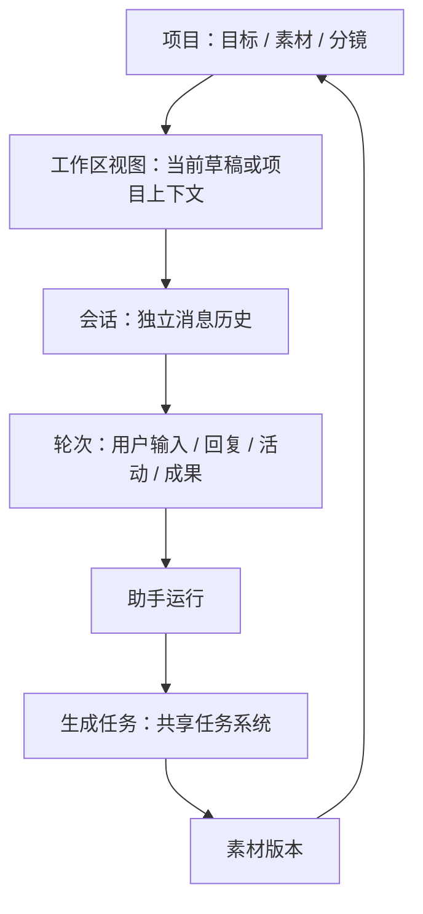

# 会话、工作区与创作记录体验收敛

日期：2026-10-27。代码基线：`0fe623a4`（beta.16）。状态：代码审查和参考实现调研后的设计方案，本文不代表以下功能已经实现。沿用已有手工 / Agent 双工作台，不增加第三套工作台或第二套任务系统。

## 1. 估价是否需要更新工作流下发

现有 H3 估价不需要。beta.16 的 `autodlPricing.ts` 直接获取 AutoDL 公开工作流价格，读取 `price_type=minimax_h3` 对应的 `billing_config.minimax_h3`，结合当前时长、分辨率估算；价格缓存有效期为五分钟。当前工作流已经提供这些输入参数，更新客户端即可使用。

边界：目前是 H3 专用适配，不能推导为任意工作流均支持报价。新增提供商、模型或计费类型需要客户端计费适配；若工作流参数或标识改变，也需要更新对应工作流定义。工作流描述的是能力和参数，不应固化会变化的价格。

后续报价契约应绑定提供商、远端工作流标识、计费类型、规范化计费参数、获取时间和有效期；任务提交保存当时的估价快照。UI 区分“预计”“账单实际扣费”和“余额”，不以余额差反推某次任务的实际费用。没有可靠报价时显示“暂无法估算”，不能显示 0 元。余额属于账号设置和提交附近的简要状态，不进入工作流每行列表。

## 2. 当前问题与证据

| 模块 | 当前实现 | 改造目标 |
| --- | --- | --- |
| `creative/VideoDraftScreen.tsx` 工作流选择 | 说明、版本、输入能力、选择按钮逐项展开 | 点击整行选择，详情按需展开；当前项有明确勾选 |
| `creative/CreativeHome.tsx` | 创作记录只展示前 20 组；同时平铺素材、项目、任务、设置等导航 | 记录专注“继续哪次创作”，支持搜索、筛选、分页；管理入口回各自所属导航 |
| 同上 `RecentCreation` | 每行单独读取素材版本 | 批量构建记录摘要，滚动时不重复逐行查询 |
| `creative/PromptAssistSheet.tsx` | 独立 ScrollView、数组索引作 key、纯文本、状态文字与尾部建议面板 | 共用会话渲染，建议归属原轮次；稳定消息 ID |
| `creative/promptAssistant.ts` | 已有最多四轮模型 / 工具循环，但 UI 只有状态字符串 | 保留现有执行能力，补结构化事件，真实展示标签搜索、校验、建议等工具活动 |
| `creative/promptAssistantSession.ts` | 本地文件只保留最后 24 条消息 | 区分完整可查历史与送给模型的上下文预算；迁移已保留的历史 |
| `agent/PromptAssistantUi.tsx` | 已有 FlatList 与投影，但 UI、上下文、媒体、工具展示混在大组件中 | 拆出共享会话层，页面仅提供数据和能力 |
| `agent/RunTimelineRow.tsx` / `ToolTimeline.tsx` | 两套过程展示；完成时主动收起 | 收敛一个工具活动渲染器，尊重用户主动展开状态 |
| `agent/runTimeline.ts` | 部分中间回复被收入整个运行的过程组 | 普通回复、用户补充保持时间顺序；只折叠相邻工具活动 |
| `creative/AgentCreativeCards.tsx` | 创作卡在聊天时间线外独立集合展示 | 按 run / job 关联回原轮次，不重复维护任务状态 |
| `creative/AgentCreativePanel.tsx` | 项目选择、项目范围、授权撤销混在一个面板 | 范围选择、项目管理、授权各归所属位置 |

## 3. 信息架构：共用组件，不混合上下文



工作区是可恢复的工作上下文和布局，不因为名称叫 workspace 就增加一层必须新建的实体。运行时文件系统 workspace 与产品项目也不混为一谈。允许未归属项目的个人创作和会话。

- 项目承载长期目标、素材和分镜。会话承载一次连续讨论；新会话隔离历史，保留用户明确选择的项目或草稿引用。
- 手工助手与 Agent 使用同一套会话壳和时间线。前者配置“建议编辑”能力，后者配置项目执行能力。标题可说明工作范围，消息样式不再分叉。
- 切换会话是恢复该会话的范围，不把旧消息自动搬到另一个项目。运行中的范围固定；需要换项目时新建或恢复目标项目的会话。
- 任务属于共享任务系统，关闭对话不等于取消生成任务。停止当前助手轮次与取消已提交媒体任务是两个明确动作。
- 引用素材显示名称、缩略图及实际可访问的内容。只有元数据可见时不能暗示模型看过图片或听过音频。

## 4. 统一会话界面

### 窄屏结构

```text
‹  项目 / 当前草稿                 会话 ▾   ⋯
   当前会话标题
─────────────────────────────────────────
                     用户的修改要求

  正在查找标签                         停止
  ▸ 2 项活动 · 1.8 秒

  助手说明：保留主体，调整镜头与光线……

  提示词修改建议                     待采用
  描述       查看差异
  角色 1     查看差异
                        [采用修改]

  ▸ 已完成 · 3 项活动 · 4.2 秒
  生成结果缩略图 / 视频封面（存在时）
  排队 00:12 · 运行 00:48 · 查看结果
─────────────────────────────────────────
  [引用的草稿 / 素材，可移除]
  描述下一步…                       发送
```

这是不同状态的布局示意，不表示停止和发送需要同时出现。运行时发送位置替换为停止；失败时保留原输入和明确重试动作。没有工具事件的轮次不显示空活动组，没有结果的轮次不显示成果占位。

用户消息右侧轻背景，助手正文使用正常页面背景和 Markdown，不给每段文字套大卡片。卡片仅用于具有独立动作的建议、授权、成果。默认不显示原始 JSON、内部工具名、token 计数或调试路径；放在活动详情的技术信息区。

顶部只保留上下文、会话切换和更多。新建会话放会话选择器首部；重命名、归档、删除放会话行菜单。助手模型设置放更多，避免与工作区设置并排重复。手工模式仍为覆盖式助手面板，不能改变背后生成栏和预览布局。

### 工具活动与时间线规则

1. 用户输入开启轮次；工具活动按真实事件 ID 和顺序展示。普通助手回复、中途用户补充、授权请求都打断连续活动组，不能被折叠吞掉。
2. 执行中摘要显示最新动作和已完成数量；完成显示活动数、耗时。失败、取消、中断分别表示，不能统一显示“已完成”。历史未记录耗时则不补造。
3. 活动详情默认折叠。用户主动展开后，完成、新事件、分页均不自动收起；重入会话可恢复选择。
4. 工具卡默认只呈现动作、对象和结果摘要。参数与完整结果二次展开，长结果按需加载，不一开始渲染整段 JSON。
5. 建议卡放在产生它的轮次；采用后显示“已采用”或“部分采用”。保留修改前后差异、逐项选择、过期校验和撤销。旧建议不能覆盖已变化草稿。
6. 授权卡保留具体动作、范围、次数 / 成本依据；只提供确有实现的选择，不添加实际无效的“始终允许”。失效授权不可再次提交。
7. 媒体成果引用同一个 job / version；排队和运行耗时来自任务记录。缺失原件、下载失败与生成失败分开展示。点击成果用现有统一查看器。
8. 只有底部跟随状态才随流式内容滚动。查看旧消息时出现小型“新内容”入口；分页、展开工具、键盘出现均保持阅读锚点。无消息长度驱动的整页高度动画。

### 屏幕和辅助功能

宽屏可将会话列表和项目资源作为左右侧栏；窄屏同一时间只展示一个主内容区，资源选择完成返回原输入位置。布局按可用宽度和字体缩放决定，不按设备名称。触控区域至少 44–48 dp，视觉图标可更小；正文不强制固定高度。减少动态效果时关闭展开过渡，状态变化仍清晰。读屏播报阶段变化，不逐字播报流式输出。

## 5. 工作流切换与创作记录

### 工作流选择器

一行包含提供商图标、工作流名称、一行能力摘要、当前勾选；例如“MiniMax H3 / 图 + 音频 · 最长 15 秒”。整行选择，不再有重复的“选择工作流 XXX”按钮。详情图标只展开版本、输入约束和说明，不能触发选择。

保留工作流切换时各自草稿输入、兼容性校验和异常恢复。切换会丢失无法映射输入时，应先说明受影响字段；可恢复的缓存切换不反复确认。不可用项展示原因。管理与同步合并为底部一个入口；列表较长时提供搜索，空状态区分未同步与无匹配结果。

### 创作记录

按创作组展示，不把同一组每次提交当成一整张历史卡。默认每行：56 dp 封面、两行以内标题、图片 / 视频与版本数、相对时间、必要状态。当前创作用细小标记，状态不能仅靠颜色。长按或行尾更多管理名称、项目归属、归档，不在每行堆操作按钮。

顶部搜索与“全部 / 图片 / 视频”轻量筛选；按最近更新时间分组。首次加载分页，继续加载不截断为固定 20 项。点击恢复原工作区和最近选择的版本，进行中创作仍可查看历史结果。记录里不再重复放任务中心、设置等导航菜单；这些已有顶部入口，项目和素材从工作区上下文入口访问，旧工作流编辑器归工具入口。

列表摘要在服务层批量查询。沿用当前图片和视频各自的创作组 identity，不仅用 target_asset_id 合并视频会话，避免把独立会话拼在一起。搜索应覆盖全部历史，而非只搜索已加载页。

## 6. 项目与工作区

- 项目选择：紧凑封面行，名称、最近活动和需要处理的数量；新建一个入口，行内更多管理。避免项目列表、项目范围列表、项目管理三套相同选择器。
- 项目内：默认显示可继续的分镜 / 创作与待确认成果；简报编辑按需进入，不占首屏一整块表单。空项目只显示必要的下一步。
- 工作区标题说明当前项目、草稿或分镜。上下文选择一次完成，返回会话不再多退一层。资源选择器共用，但“选中引用”和“采用为项目成果”的语义要分开。
- 会话列表：标题、一行最近内容、更新时间、运行 / 待确认状态。项目内自动限定范围，允许显式查看全部；草稿助手会话仍按草稿隔离。
- Agent 的过程留在时间线；项目视图只呈现资产与待处理事项。任务入口提供所有后台任务，不在每处复制一套任务列表。

## 7. 共用组件与数据边界

```text
手工建议执行器 ── PromptAssistAdapter ─┐
                                    ├─ ConversationProjection
现有 Agent 运行 ─ AgentRunAdapter ────┘        │
                                             ▼
ConversationShell / WorkspaceHeader / SessionBrowser
ConversationTimeline
  MessageRow / ActivityGroup / ToolCallRow
  PromptProposalCard / DecisionCard / ArtifactCard
ConversationComposer
```

共享层放在 `mobile/src/conversation/`，不反向依赖具体工作台。使用类型化数据与回调，不让共享组件直接执行工作流或读取账号密钥。能力通过配置注入：可引用对象、可用工具、建议采用、授权、任务查看；不靠 `isManual` 散布样式分支。

继续使用现有 Agent 持久化运行记录、事件契约和增量投影。手工助手增加结构化事件适配，包含 sessionId、turnId、runId、eventId、顺序、真实工具调用 ID 和时间。渲染模型只派生自这些来源，不再建第三份相互竞争的消息 / 任务状态。

保留现有 `timelineProjection.ts` 稳定对象缓存；将 `runTimeline.ts` 改为能保持中间回复顺序的活动片段投影。随后替换 `RunTimelineRow` 与旧 `ToolTimeline` 的呈现，最后删除旧分支。提取组件时让两个调用方实际同时使用，不能只新建一套暂未接入的组件库。

手工工具循环仍只支持当前允许的建议能力。共用外观不引入项目写入、付费生成或更大授权范围。现有 proposalContextKey / base 校验、视频字段限制和角色索引校验全部保留。

### 旧数据迁移

历史文件按会话 ID 幂等迁移到统一会话持久化接口，先写入、核对数量与摘要，再标记完成；失败仍可读取原文件，不先删除。为旧消息分配并保存稳定 ID，不能每次渲染重新生成。仅迁移真实保留的数据：早已被最后 24 条截断的历史无法恢复；旧记录没有工具轨迹时不伪造轨迹。

列表分页与模型上下文窗口分离。UI 可查完整保留历史，模型上下文仍遵守现有预算。切换、重启、异常中断后恢复真实状态；不能让无执行器的旧运行永久显示转圈。原始数据和迁移版本均可检查，迁移过程中避免双写覆盖。

## 8. 实施顺序和验收

| 阶段 | 交付 | 验收重点 |
| --- | --- | --- |
| A：组件及投影收敛 | 一个共享消息 / 活动 / 建议 / 成果渲染体系，两个入口接入；手工结构化事件与存储迁移 | 两入口行为一致；旧会话可读；无重复工具；失败 / 停止 / 重启状态准确；中间回复顺序不变 |
| B：会话壳与导航 | 共用输入区、会话列表、上下文头部；覆盖式手工助手 | 新会话不污染上下文；切换恢复草稿与滚动位置；键盘不推动生成栏；关闭不误取消后台生成 |
| C：选择与记录 | 紧凑工作流选择器、可搜索分页创作记录、共用项目选择 | 选择整行可点；详情不误选；旧草稿保留；超过 20 组能找回；视频组 identity 正确 |
| D：项目与成果关联 | 项目继续创作视图、会话内结果与授权、移除重复面板 | 项目切换不携带旧上下文；任务状态只有一份；图片 / 视频可查看；失效建议与授权不可执行 |

各阶段不是长期并行维护两套 UI 的理由。迁移提交必须列出已接入的调用方与可删除旧路径。先有共用组件和数据契约，再改两入口样式；避免先美化手工助手、随后再复制到 Agent。

回归场景至少覆盖：长文本中段编辑；键盘打开后拖动历史；流式期间读旧消息；工具失败后继续；分页时重复事件；用户展开工具后运行完成；刷新重放；会话切换；过期建议逐项采用和撤销；授权失效；生成仍运行但助手已停止；缺失媒体文件；窄屏与大字体。投影和迁移做自动化测试，键盘 / 布局 / 滚动需 Android 真机或模拟器验证，不能只靠 TypeScript 通过判定体验完成。

## 9. 参考实现与取舍

调研使用第一方源码，DeepSeek Harness 固定于 `22ddee3792402c3e70ec5f86a63c3e3e895a2f60`。参考其轮次、活动分组、稳定事件身份和阅读锚点；不照搬网页组件或直接替换本项目的执行框架。其 chat / trajectory 目标分离也不意味着本应用需要手工 / Agent 两套 timeline。

- [DeepSeek Harness：共享会话层](https://github.com/deepseek-ai/deepseek-harness/blob/22ddee3792402c3e70ec5f86a63c3e3e895a2f60/packages/client/ui-conversation/README.md)
- [DeepSeek Harness：对话节点](https://github.com/deepseek-ai/deepseek-harness/blob/22ddee3792402c3e70ec5f86a63c3e3e895a2f60/packages/client/ui-chat/src/client/conversation-nodes/README.md)
- [DeepSeek Harness：会话子系统](https://github.com/deepseek-ai/deepseek-harness/blob/22ddee3792402c3e70ec5f86a63c3e3e895a2f60/docs/subsystems/conversation.md)
- [LangChain Agent Chat UI](https://github.com/langchain-ai/agent-chat-ui)：参考工具展示、人机确认和自定义成果呈现的职责划分。

以上是设计参考，不是本应用完成性能验证的证据。当前回合产出为方案文档；未修改应用代码、执行数据库迁移或构建新 APK。


## 10. 实施记录（2026-10-27）

已接入的共享层位于 `mobile/src/conversation/`：消息与 Markdown、虚拟列表、输入与发送/停止、活动分组、工具详情、运行类型与文案。手工建议和 Agent 均实际使用这些组件；原 RunTimelineRow 仅保留兼容导出，ToolTimeline 仅适配旧数据，不再维护独立视觉实现。

- 手工助手记录真实工具开始/结束/失败事件与稳定消息 ID；建议编辑归属原消息，保留字段采用、撤销和过期保护。旧文件格式原地兼容读取，不破坏性迁移；新增历史不再截断到 24 条，模型上下文预算不变。非终态旧运行在恢复时标为中断。
- Agent 投影保留中间回复及用户补充顺序，工具按消息位置分组；完成不强制收起用户已展开的详情。成果按持久化 origin.run_id 归到对应轮次。会话仅有一个成果轮询器，行组件不再各发起轮询。
- 两处会话列表、项目入口、项目管理列表、工作流选择和创作记录采用共用 RecordRow。讨论重命名按需出现，新建讨论归会话选择器。
- 工作流整行选择与独立详情披露；创作记录支持类型筛选、全量已读取记录搜索、每次增加 30 行，批量查询当前展示范围封面。这里是渐进展示，不声称已改成数据库游标分页。
- 项目选择进入目标项目自己的会话，不直接重写旧会话范围。项目默认进入镜头；显式简报入口保留。未改任务、账号或生成授权的执行逻辑。

架构取舍：共用呈现与运行类型，现有 Agent 数据库和手工兼容文件通过各自适配器提供数据，没有把两者强行迁入同一数据库；这避免了不必要的历史迁移风险。手工助手关闭时仍停止当前建议请求，已经提交的生成任务不受影响。成果摘要内联到轮次，完整预览和授权继续使用现有详情面板。

验证：全量 Jest 266 套件、1672 项通过，原有 1 套件 / 4 项跳过；最终标题和按需重命名调整后，相关 3 套件 / 17 项再次通过。TypeScript 与 git diff --check 通过。x86_64 Android Beta 验证包构建、覆盖安装、冷启动成功；模拟器检查助手覆盖层、键盘、会话选择、创作记录、工作流详情以及创建项目。模拟器未配置 LLM，真实模型流式和工具请求未在线验证；其状态变化、停止隔离和成果归属有自动化测试覆盖。未执行付费媒体生成。

证据在本地忽略目录 `build/conversation-qa/` 及 `build/conversation-*-tests*.log`、`build/conversation-android-build*.log`。此次没有提交 Git 或发布新的手机 APK；x86_64 包仅用于验证。

## 11. Timeline 第二轮改造（2026-10-27）

参考 [DeepSeek Harness Chat conversation node rules](https://github.com/deepseek-ai/deepseek-harness/blob/master/packages/client/ui-chat/src/client/conversation-nodes/README.md)，本轮采用移动端 Detailed 的阅读方式：运行中的步骤直接呈现，历史过程收拢，回复始终位于过程折叠之外。保留应用原有配色和原生触控尺寸，不移植浏览器专用控件。

### 修正的数据与顺序问题

- `conversation/projectTimeline.ts` 是两个入口的共同投影；Agent 的旧模块只保留工具补全适配和兼容导出。
- 按已记录的 reasoning/text/tool 顺序，把思考放到对应回复之前，把工具放到它实际发生的位置。用户追加输入不被吞进过程折叠。
- 手工助手逐轮记录文本和工具所属消息；模型返回的思考内容也进入独立事件记录。历史消息中的合并正文仍保留，供既有上下文和存储兼容使用，不再用它冒充过程时间线。
- 不再把早期仍在执行的并发工具强制标成完成。分段耗时只来自已知时间戳，未知耗时不伪造为 0 秒；整个运行只有尾部一处运行提示。
- 过程身份基于 run、所属消息和相对回复的位置，不因前面新增过程段而改名。展开选择属于会话列表而非临时行组件，虚拟列表回收后可以恢复。

### 显示与操作

- 运行时不重复显示“执行过程”标题，直接显示步骤；完成后过程恢复紧凑摘要。手动打开的详情在完成后保持打开。
- 中间回复保持可读；不再为每条中间回复绘制一行复制操作，复制保留给本轮最终回答。
- 思考有单行预览；工具显示目标、状态、真实耗时及可读摘要。待办显示勾选/执行状态，校验结果和标签查询直接显示结果摘要。原始输入/输出仍可展开，长内容分段读取。
- 查看详情即退出跟随滚动。手工助手增加回到最新消息入口；加载历史或阅读过程时不自动拉到底部。
- 停止、失败、部分工具失败仍保留记录；手工助手的同一运行错误不再同时绘制在过程和列表底部。

### 验证范围

- 类型检查通过。全量 Jest：267 套通过，1681 项通过，原有 1 套/4 项跳过。后续密度与跟随调整再次运行相关 8 套/111 项，全部通过。
- 新增顺序、并发状态、分段身份、provider reasoning、虚拟化回收及手动展开保留测试。
- Android x86_64 beta 构建通过。使用临时、本地回放页面检查真实原生组件；回放页不进入交付源码，也不调用在线模型或生成服务。
- 模拟器未配置真实 LLM，本轮不声称完成了线上模型全链路验收。旧记录没有保存的逐轮正文/思考顺序不会被虚构补齐。
- 本轮没有引入参考项目的整个 Host/Node Store，也没有新增四档显示偏好或整轮跨段折叠设置；共享组件与现有两种存储适配继续保持兼容。
