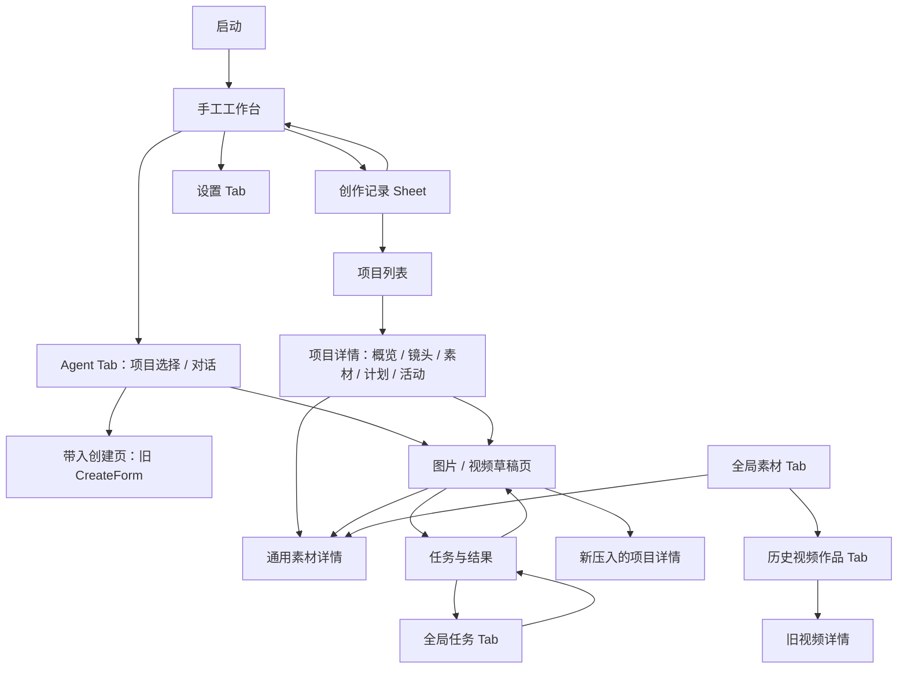

# 当前 UI 逐页与导航链路审查

日期：2026-10-29。基线：`5ccb5955ef11a0fdbfbd1e241971c10b5eea3b86`。

## 1. 结论与证据边界

用户感觉“某些地方不该跳到另一些地方”有源码依据。主要问题集中在：**同一入口混用新旧工作台、对象查看被导向对象管理、返回被实现为新建页面、点击具体结果却没有携带结果身份、辅助设置没有返回来源的语义。**

这次检查了 `mobile/app` 的 17 个路由文件（14 个内容页、两层布局及启动重定向），并向下检查项目子页、Agent 卡片、结果组件、选择器与编辑表面的导航。没有安装 APK 或进行本轮触控录屏；组件测试使用模拟 router，不能据此确认真实 Expo Router / Android 返回栈。

证据标记：**事实**表示代码明确执行该动作；**设计问题**表示动作存在、但与产品目的不一致；**待验证**表示实际表现依赖导航栈、Tab 保留状态或设备。P1 优先修复容易误认对象/版本、丢失来源的路径；P2 修复操作冗余和导航语义；不把“尚未实现未来功能”记为当前缺陷。

运行了 10 组已有组件/路由测试，60 个用例全部通过。测试覆盖当前组件动作，但没有真实导航容器的端到端覆盖；部分用例还明确断言了本报告建议改变的行为，修复时需要同步调整验收标准。

## 2. 当前页面地图与结构问题

图中关系不是都要删除。真正的问题是边没有表达“查看、编辑、切换工作方式、返回来源”之间的区别：同样使用 `push`，有时新增详情、有时被当作返回；同样进入 create，有时恢复新画布、有时打开旧表单。

顶层 projects/assets/tasks/gallery/settings 仍是隐藏 Tab，`backBehavior="history"`；详情页则在外层 Stack。视觉上它们是普通辅助页，结构上却是平级且可能保留状态的 Tab。所有 `push('/(tabs)/…')` 不能机械视为普通 Stack 压栈；需要真实容器验证，也不能简单全局替换成 `replace`。

## 3. 逐页评估

下表文件路径以仓库根目录为起点；编号对应第 4 节详细问题。

| 页面 / 表面 | 当前入口与操作 | 评估与应有行为 |
| --- | --- | --- |
| 启动 `/` | 无条件重定向 create | 入口本身合理；恢复由工作台负责，不应因为未来项目能力增加而强制插入首页。当前“最近工作”与已挂载工作台不完全一致，见 N08 |
| 手工 `/(tabs)/create` | 通常为 CreativeHome；有 prompt/draftId 时为 CreateForm | 同一路由承载两套产品语义，是第一优先问题 N01。创作记录作为原地恢复是合理的；“项目与素材”只去项目列表，见 N09 |
| 手工创作记录 Sheet | 原地切换选中创作；含项目、工作流入口 | 恢复应先保存当前输入，现有 `change()` 已有此保护；其他导航未统一走保护，见 R03 |
| Agent 项目选择 | 选择项目用 setParams 进入对话；可建项目、进入全部对话 | 绑定项目独立会话是合理的；进入后缺少回项目选择的对称路径，“全部对话”入口消失，见 N10 |
| Agent 项目对话 | 项目切换、成果 Sheet、导出到 create | 卡片应打开精确结果 N02；带入生成应进入统一工作台 N01；去项目管理不等于选择项目 N10 |
| 项目列表 `/(tabs)/projects` | 新建、搜索、归档筛选、打开详情 | 新建后停留列表 N11；更多里的历史作品/草稿跳到全局，需明确标为全局入口 |
| 项目详情 `/creative-project/[id]` | 默认镜头；概览/镜头/素材为局部状态，计划藏在更多 | 上次页签写入但没读取 N12；计划入口与 Agent 来路不一致 N13；局部状态和路由参数可能分离 R02 |
| 项目概览 | 镜头进展、简报、助手、最近草稿、紧急计划 | “让助手协助本项目”带 projectId 合理，应保留；不应因此把旧会话静默改绑。最近草稿进入专用工作台合理 |
| 项目镜头 | 阶段动作、素材选择、生成草稿；有采用视频时打开素材详情 | 参考图到生成携带 shotId/projectId 的方向正确；“审阅视频成果”不应被通用素材管理接管 N07；返回闭环见 N03 |
| 项目素材 | 项目内素材列表、导入、制作图片 | 项目范围正确；查看素材后继续制作只有 projectId，没有镜头，需由明确操作决定是否恢复镜头，而非猜测 |
| 项目计划 | 选图、授权、继续、查看生成任务 | 选择后可能继续消费已有明确说明，应保留；查看任务应带来源计划/步骤，不能只到泛任务详情，见 N13/N14 |
| 项目活动 | 提案前后对照、接受/拒绝、打开草稿/任务 | 审核本身合理；Agent“处理这项建议”仅定位项目页签，不能定位具体提案 N13 |
| 全局素材 `/(tabs)/assets` | 列表、导入、更多中的历史作品/草稿 | 可以保留为浏览目的地；它不应代替“为镜头选择素材”的选择器。入口可发现性受 N09 影响 |
| 素材详情 `/creative-asset/[id]` | 版本、导出、参数恢复、增强、项目固定、默认版本 | 作为显式“查看素材与版本”目的地合理；不能默认充当镜头审阅。缺失指定版本会静默显示其他版本 N06；从镜头进入后上下文不足 N07 |
| 图片 `/image-draft/[id]` | 编辑器、历史、提示词协作、增强、局部重绘 | 已有原地编辑能力应保留；任务页中的相同动作不能一律 replace N04；顶部返回、助手配置回来后的恢复见 N15/R03 |
| 视频 `/creative-draft/[id]` | 编辑/结果两状态、生成轮次、设置 | 轮次选择可恢复本身合理；外部点击具体候选应覆盖此默认 N02。返回先进入编辑态会混淆“关闭详情” N15 |
| 任务与结果 `/creative-task/[id]` | 任务状态、结果、核查、返回工作台、到全局任务 | 本次任务混入其他轮次 N05；来源被宽泛 returnToWorkbench 标记替代 N14；从此处图片续作替换任务页 N04 |
| 全局任务 `/(tabs)/tasks` | 按任务上下文分派新任务详情或旧视频详情 | 兼容分派有实际原因，不是所有 `/video` 都错误；应统一展示用途和来源。到设置/工作台后回原任务的规则待统一 N14/N16 |
| 历史作品 `/(tabs)/gallery` | 旧视频列表、播放/删除、空态去生成视频 | 旧记录浏览可保留；“去生成视频”没有指定视频模式，可能打开图片工作台 N17；不能称为完整创作成果总库 |
| 旧视频 `/video/[id]` | 按媒体 ID 或任务 ID 读取，播放、下载、分享 | 双 ID 读取已有兼容，不是“素材 ID 当任务 ID”的错误；缺失记录时返回没有兜底 N18 |
| 草稿列表 `/creative-drafts` | 按 provider 分派编辑器；返回创作 | 从素材/项目更多进入后，返回实际回素材/项目却标“返回创作” N19；与主工作台记录为两个入口，应说明不同范围 |
| 设置 `/(tabs)/settings` | 分类和分区共用局部 activeSection；外部带 section | 配置入口本身必要；外部配置完成却先返回分类 N16；参数与局部状态可能脱节 R01 |
| 素材选择器 | 原地 Modal、项目/全部、选中后确认 | 不跳通用素材详情是正确设计；需要明确使用目标 N20。不能因本次审查而把选择器改成素材管理页 |
| 提示词助手 / 参数抽屉 / 版本对比 | 原地编辑/对比；助手设置会关闭表面再导航 | 大部分留在作品上的方式正确；配置返回应恢复原表面及待处理建议 N16 |

## 4. 应优先处理的具体路径

### N01 · P1 · Agent 带入生成，进入了另一套旧创建页【事实】

- 触发：Agent 的 Prompt 版本“预览并带入创建页”或 Prompt 导出。
- 当前：`AgentScreen.tsx:321–333` 保存旧 `draftStore` 草稿并 navigate create，携带 draftId；`app/(tabs)/create.tsx:9–16` 因此渲染旧 `CreateForm`，不是 CreativeHome。保存调用也没有传 projectId/shotId。
- 后果：从手工和从 Agent 到达“创作”看到两套界面；本次导出没有表达项目/镜头归属。返回创作首页只切换 legacy 局部状态，没有消费清理路由参数。
- 建议：保留旧格式读取兼容，通过一次适配转换为正式图片/视频创作草稿；带入预览明确目标和素材，进入统一工作台。原项目/镜头是否绑定应显式决定。不要直接删除兼容读取导致旧草稿失效。

### N02 · P1 · 点击具体视频候选，却只打开草稿【事实】

- 触发：Agent 成果 Sheet 点击视频候选 B。
- 当前：`AgentCreativeCards.tsx:84–86` 遍历每个 output，但跳转仅传 `card.draft.id`；`creative-draft/[id].tsx` 只读 id。`VideoDraftScreen.tsx:80` 解析结果会话；`VideoGenerationHistory.tsx:30–49` 优先恢复本地记录的已选轮次，且没有外部 versionId/jobId 选择参数。
- 后果：点击 B 不能保证显示 B，可能恢复 A。多轮时会话级 `workbenchResultDraft()` 还可能解析到较新的提交。图片点击则原地预览实际图片，两种媒体的点选语义也不一致。
- 建议：点候选携带 versionId + jobId，先精确预览；“继续编辑草稿”作为另一个动作。只有不指定结果的普通“继续创作”才恢复上次轮次。

### N03 · P1 · “返回此镜头”实际新建一个项目页面【事实】

- 触发：项目 P → 草稿 D → 采用 → 点击返回此镜头；或点击工作台所属项目面包屑。
- 当前：`CreativeResults.tsx:199` 与 `WorkbenchScope.tsx:17` 都 push 项目详情。
- 后果：形成 P → D → P′；系统返回又回到 D，再回 P。页面内容看似返回，导航历史却向前增长。原项目的页签、滚动和展开状态也没有复用。
- 建议：有来源锚点时恢复原项目和镜头；没有来源时才进入一个明确目的地。面包屑“查看所属项目”和“返回”也应区分。不要仅把 push 改 replace，后者仍不保证恢复原页面。
- 现有 `CreativeResults.test.tsx:258` 明确断言 push，说明测试通过不能证明该闭环合理。

### N04 · P1 · 从任务结果继续修图，会替换掉任务页面【事实 / 设计问题】

- 触发：任务中心 → 图片任务详情 → 调整画面 / 以此图生成 / 局部重绘 / 增强。
- 当前：`CreativeResults.tsx:110–121` 图片续作统一 replace；`CreativeResults.tsx:229` 的处理 Sheet 也统一传 replace，而该组件同时用于任务详情。
- 后果：原任务详情被移除，返回直接落到任务列表等更早来源；“围绕这次结果继续尝试”无法返回刚才的任务结果。对工作台内续作防止堆栈增长的策略，被复用于所有宿主。
- 建议：让宿主声明动作模式：工作台内编辑原地切换；从独立任务/素材发起衍生编辑保留来源。保持“不立即收费生成”的现有保护。

### N05 · P2 · “本次任务结果”实际可以浏览整个素材历史【事实】

- 当前：`creative-task/[id].tsx:41` 渲染 `CreativeResults draft={draft} taskDetail`，没有 onlyJob；`CreativeResults.tsx:67` 仅在 onlyJob 时限制 jobId。
- 后果：旧任务详情可选择同一素材的其他轮次版本，下方任务状态仍是原 job，容易把所看画面与原任务的耗时、消费和错误关联。默认优先原任务结果的逻辑不能消除切换后的歧义。
- 建议：任务页默认只展示本次产物；“查看完整创作历史”显式进入会话。跨轮次浏览时同步显示实际来源任务。

### N06 · P1 · 指定版本不存在，悄悄显示默认版本【事实】

- 当前：`CreativeWorkspace.tsx:125` 找不到 versionId 时直接回退 currentVersionId 或第一个版本，没有提示。入口包括镜头已采用成果和结果详情。
- 后果：带精确版本意图的跳转，可能显示另一个版本，用户随后执行保存、处理或设为封面时操作的是回退版本。
- 建议：普通浏览可以选择默认版；明确指定 versionId 的入口显示“该版本不可用”，提供“查看其他版本”，用户确认切换后再恢复操作。区分“记录不存在”和“原文件待恢复”。
- 现有 `CreativeWorkspace.test.tsx:55` 还明确测试回退，需要随产品规则一起修改。

### N07 · P2 · 镜头的“审阅视频成果”去了通用素材详情【事实 / 设计问题】

- 当前：`ProjectShots.tsx:66–67` 传 assetId、采用 versionId、projectId，未传 shotId 或审阅意图。素材详情主要提供版本、导出、说明、项目固定等管理动作。
- 后果：能播放已采用视频，但无法在该上下文直接进行镜头层的比较、换 TAKE 或返回原镜头；“设默认版本/固定项目版本”与“采用到镜头”又是不同操作。
- 建议：镜头动作进入带 shotId 的成果审阅表面，优先当前采用与候选；素材信息作为次级入口。现有单独“生成记录与候选”应继续可达。

### N08 · P2 · 工作台最近记录与当前画布有两个选择状态【事实 / 设计问题】

- 当前：独立图片/视频页都会 `rememberWorkbenchDraft()`；`CreativeHome.tsx:41` 重新聚焦只刷新 drafts，已有 `active[mode]` 不同步，初始化又在有 active 时跳过。
- 后果：在任务或项目中编辑 B 后回手工，仍可能显示旧 A；切换图片/视频又可能重新读取记住的 B。对用户来说，同样“回工作台”出现不同结果。
- 建议：明确“回来源画布”与“恢复最近工作”的区别。采用带 ID 的工作台打开请求；没有打开请求时保持原焦点，不因为全局记忆改变而暗中切换，也不把旧 A 错称为最近 B。

### N09 · P2 · “项目与素材”入口实际只通向项目列表【事实】

- 当前：`CreativeHome.tsx:77` 仅 push projects；项目列表无直达全局素材按钮。手工与 Agent 的素材访问路径不对称，后者有顶栏素材入口。
- 建议：拆为“项目”和“素材库”，或提供一个明确目录；选参考素材仍使用原地选择器。不要用复合标签掩盖缺失目的地。

### N10 · P2 · Agent 项目选择、项目管理、全部会话的层级不完整【事实 / 设计问题】

- 当前：`AgentWorkspace.tsx:24,35–49` 选项目 setParams 后只呈现 AgentScreen，没有清除 projectId 返回项目选择的对称动作；“全部对话记录”只在无 projectId 分支出现。`AgentCreativePanel.tsx:48` 的“查看项目与新建项目”去全局项目列表。
- 后果：切换到某个项目后，不能从该选择面板回到无项目/全部会话；点击新建项目进入管理，完成后也不会自动选中它并回对话。
- 建议：项目切换器提供“项目列表/其他会话”明确目的地；新建在选择器中完成，创建后返回目标助手。保留项目会话隔离，不以重新绑定旧会话修补导航。

### N11 · P2 · 创建项目成功后仍留在列表【事实 / 设计问题】

- 当前：`CreativeWorkspace.tsx:148–153` 丢弃 project.create 返回对象，清空表单并 refresh。
- 建议：创建并进入项目详情，或提供清楚的“已创建 · 打开项目”结果；从 Agent 选择器发起时回到 Agent 并选中项目。不同来源不应都固定回全局列表。

### N12 · P2 · 项目页签保存了，却从未恢复【事实】

- 当前：`CreativeWorkspace.tsx:42,105` 默认 shots，并写 saveProjectTab；`service.ts:73` 定义 projectTab，但业务 UI 没有调用。
- 后果：退出项目再进入始终回镜头；“从上次工作继续”与实际不同。
- 建议：明确目的的路由参数优先，其次项目保存的页签，最后默认镜头。返回原页面优先恢复实例和视图，不依赖重开后读一个页签。

### N13 · P2 · 计划/提案跳转只定位项目，没有定位所点对象【事实】

- 当前：`AgentCreativeCards.tsx:91` 按展示名是否包含“修改”选择 activity/plans，未传 planId/proposalId。`CreativeWorkspace.tsx:163` 计划入口还需展开“更多”；主局部导航没有计划。
- 后果：一条具体待处理卡片跳到一整页清单，用户重新寻找；相同能力从 Agent 可直达、从项目难以发现。展示文案改变还可能影响路由分类。
- 建议：卡片携带结构化 kind 和目标 ID，进入并突出对应计划/建议；计划有稳定项目内入口，不必增加全局 Tab。

### N14 · P2 · 任务页把“返回来源”与“打开编辑器”合成一个动作【事实 / 设计问题】

- 当前：`creative-task/[id].tsx:27` 仅凭 returnToWorkbench='1' 决定 back，否则 replace 成任务关联草稿；参数没有来源草稿/镜头/计划/选中版本。`:59` 又无条件提供到全局任务中心的跳转。
- 后果：从任务列表进入时按钮叫“返回创作”，但并无工作台来源；从项目计划查看任务后不能直达原计划。任务中心 ↔ 详情的交叉 Tab/Stack 操作也缺少去重规则。
- 建议：“返回”恢复真实来源；“打开这次创作”明确为向前动作，并解析稳定创作会话；下载/异常能本页完成则不再送全局清单。需要全局中心时保留原任务定位。

### N15 · P2 · 视频详情的返回，先把用户送到编辑态【事实 / 设计问题】

- 当前：`VideoDraftScreen.tsx:69,213` 的 closePanel 在 view='result' 时 setView('create')；顶部返回和硬件返回都复用它。
- 后果：从 Agent/项目来只想看成果，按返回却看到参数编辑器，再按才离开。这个行为对“主动切到结果再回编辑”可能成立，对外部只读预览不成立。
- 建议：返回先关闭浮层，是否退出结果态由进入目的决定；“继续编辑”使用显式按钮。不要让所有访问都默认经历结果→编辑→来源。

### N16 · P2 · 从创作进入设置，返回先到设置分类；原工具不恢复【事实 / 设计问题】

- 当前：`settings.tsx:28–29` 有 activeSection 就先清掉，再次返回才离开；`PromptAssistSheet.tsx:93` 去模型设置前先 onClose；视频工作流设置前也清掉 sheet。
- 后果：为解决一个配置问题离开创作，完成后多经过分类页，回来还需重开助手/工作流选择器。顶部“返回工作台”依赖历史，未必回工作台。
- 建议：从设置首页进入分区则回分类；从对象工作台直达分区则“完成并返回”恢复来源及原表面。设置草稿与正式保存仍要区分，不因离开而假装配置已生效。

### N17 · P2 · “去生成视频”未指定视频模式【事实】

- 当前：`gallery.tsx:119–120` 仅 push create；`CreativeHome` 取保存的 idea.mode，可能为 image。若 create 仍承载 legacy 状态，目标还可能是旧表单。
- 建议：显式传递“打开视频工作台”的意图，说明恢复上次视频或新建草稿；消化请求后避免参数反复重放。

### N18 · P2 · 旧视频页没有无历史时的返回兜底【事实】

- 当前：`video/[id].tsx:66–67,109` 成功、异常、不存在三种界面都直接 back。
- 建议：历史存在则回原列表/任务；无历史或恢复到孤立页面时提供确定的历史作品/任务入口。错误页面也需可退出。

### N19 · P2 · 草稿列表的“返回创作”标签与真实目标不一致【事实】

- 当前：`creative-drafts.tsx:13` 有历史则 back；常见入口是素材/项目的更多菜单，返回可能就是这些页面。
- 建议：来源返回使用“返回”或来源名称；“打开手工工作台”另列明确动作。不要用标签承诺路由没有表达的目的地。

### N20 · P2 · 选择器知道媒体类型，不知道使用目的【事实 / 设计问题】

- 当前：`CreativeAssetPicker.tsx:14,59,72` 只有 kind/projectId，图片来源、遮罩、镜头采用、视频参考都叫“选择图片 / 使用所选图片”。
- 后果：同样按确认，有时只改草稿参考，有时直接更改镜头采用版本；用户看不到目标差异。
- 建议：补 target/intent 展示，如“为镜头 03 选择参考图”“选择局部重绘遮罩”；确认文案匹配真实后果。不增加通用管理页跳转，保留选中→确认的两步。

## 5. 需要实机或真实导航容器验证的风险

| 编号 | 条件与源码 | 风险及验证方式 |
| --- | --- | --- |
| R01 | settings section 来自参数，activeSection 是另一份 state；`:27` effect 只依赖 section | 从分区返回分类，再离开并以相同 section 打开，若 Tab 复用且参数未变化，可能不再定位分区。用真实导航连续两次打开账号设置验证，不把“可能”写成已复现 |
| R02 | 项目 route `key={id}`；projectView/focused/selected 主要只取初始参数；视频 route 也只将 id 初始化到本地 state | 同一路由实例参数变化时可能显示旧对象/页签；验证同项目不同 shot、同素材不同 version、相同路由不同 draft。素材 initialVersionId 已有同步 effect，应保留，不能笼统称所有参数都不同步 |
| R03 | Home 切类型/新建/模式走 change→leave guard；设置、任务、项目入口有直接 push/navigate；usePreventRemove 只针对路由移除 | 前进导航或 Tab 切换不一定经过相同保存/互斥逻辑。600ms 自动保存和冲突保护已存在，不能断言必然丢数据；需在未保存/保存失败/提交中逐个验证每个出口 |
| R04 | 隐藏 Tab history，多个页面使用 canGoBack→back；辅助页无固定 return anchor | 顶部“返回工作台”可能回上一个辅助 Tab或退外层详情。验证“草稿→任务详情→全部任务→返回”和“Agent→设置→素材→返回”，记录顶栏与硬件返回是否一致 |

另外，`UpscaleDraftScreen.tsx:38` 的“返回内容管理”写成 push assets，但当前图片路由始终渲染 ImageDraftScreen，未发现该旧组件的生产入口；不把这条死代码路径计为当前用户可触发缺陷。后续清理或重新接入时修正。

## 6. 导航应有的目的地规则

| 用户动作 | 应做什么 | 不应隐含发生什么 |
| --- | --- | --- |
| 点一个具体候选 | 打开精确 versionId/jobId 的预览 | 自动恢复另一个轮次、采用版本 |
| 继续创作 | 打开所属会话并恢复编辑状态 | 去全局素材或旧创建表单 |
| 采用到镜头 | 执行领域命令并留在审阅上下文，提供返回原镜头 | 改素材默认版本、创建重复项目页 |
| 返回原镜头 | 恢复原镜头位置，无来源才用兜底 | push 一个内容类似的新页面 |
| 查看素材与版本 | 打开素材管理详情 | 把它当所有预览操作的默认目的地 |
| 选择参考图 / 遮罩 | 原地选择、说明目标、确认后回调用表面 | 跳到素材管理后要求用户自行找回来 |
| 打开账号/模型设置 | 临时离开配置，完成后恢复来源表面 | 强制游览整个设置分类 |
| 查看异常 | 精确定位原任务并提供本次处理能力 | 先丢到全局列表重新搜索 |
| 切换手工/Agent | 明确是否携带当前焦点；项目会话隔离 | 默默改绑会话或把当前输入当成新请求 |

技术上不需要建立大而全的导航框架再开始修复。先定义少量打开请求：`openCreativeSession`、`openOutput`、`openProjectObject`、`openSettingsFor`、`returnToOrigin`；请求携带对象 ID、意图和轻量返回锚点。使用现有领域命令和持久任务事实，不让路由决定权限或消费授权。

## 7. 建议的修复批次与验收

1. **精确结果与对象身份**：修 N02/N05/N06，先保证点 B 就看 B，任务不混轮次，缺失版本不被替换。覆盖同素材多轮、多候选、已删除版本。
2. **统一创作入口**：修 N01/N08/N17；完成旧草稿→新工作台适配，明确恢复或新建意图；保护原项目绑定和未保存输入。
3. **镜头闭环与返回**：修 N03/N04/N07/N14/N15；同时用真实导航验证 R02/R04，确保返回链长度不随多次采用不断增加。
4. **辅助页与项目管理**：修 N09–N13/N16/N18–N20；验证 R01/R03。不同来源进入设置、新建项目、选材均回到正确位置。

最少实机脚本：

- 项目镜头→草稿→生成→采用→返回镜头→硬件返回，不重复出现同一项目页。
- Agent 中连续点击视频 A/B，均显示所点候选；再用“继续创作”恢复会话。
- 旧任务详情→继续修图→返回，仍能看到原任务的精确结果。
- 删除指定版本后打开旧引用，明确显示不可用，不对其他版本执行后续动作。
- 画布输入后立即去设置/任务/项目；在保存正常、失败和生成中分别验证。
- 从助手直达模型设置→完成→回原助手；两次以相同 section 进入，均定位正确分区。
- 历史作品空态“去生成视频”，在最近模式为图片时仍进入视频。
- 创建项目分别从项目列表和 Agent 选择器发起，完成后进入各自合理目的地。
- 直接打开失效视频/素材/项目链接，无历史仍能退出错误页面。

本轮仅增加审查文档，未修改产品行为、路由或现有测试。修复时应以以上完整路径为验收单位，组件 mock 断言仅作为补充。
