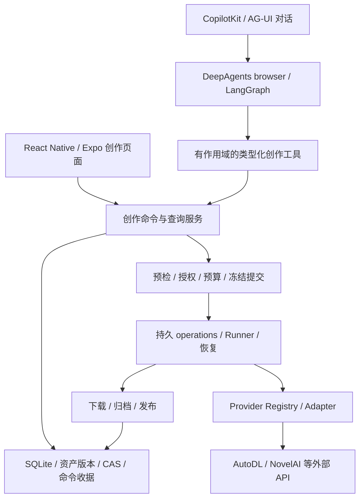

# 面向完整创作平台与 3D 导演台的架构审查

日期：2026-10-29。性质：源码与外部项目对照审查，不修改业务实现。

配套交互方案：[全本地创作平台的 UI 设计逻辑与演进路线](../research/2026-10-29-local-creative-ui-evolution.md)。

## 结论

当前架构可以继续演进为本地创作平台，无需推倒重建。最有价值的基础是共享创作命令、版本化资产、持久任务、授权预算与服务商适配层。React Native 和 DeepAgents 都不是当前的决定性障碍。

但“已经能扩展图片和视频工作台”不能等同于“已经具备无限画布、通用流程和 3D 预演内核”。需要新增编辑文档与渲染层、推广计划执行协议，并隔离框架和平台依赖。

用户已明确硬约束：**不要服务器端，除模型请求外全部本地运行。** 本报告据此以 Android 设备内完整运行的平台为目标，不再包含 SaaS、云端编排、服务器执行或跨设备同步的演进分支。

允许的远端交互限于模型调用及其必要的参考素材上传、模型任务状态查询和结果下载。Agent 工具执行、Skills 读取、计划调度、人工决策、项目与资产存储、3D 编辑与渲染、剪辑合成、编码导出、预算记录和恢复均在设备本地。模型服务只接收本次推理所需输入，不承担应用项目管理和 Agent 执行。

WebView 如采用，页面、Three.js、脚本与基础人偶随 APK 打包，使用应用本地资源和类型化 bridge，不依赖远程网页、CDN 或额外启动的 Node/Bun/Go 服务。断网时手工编辑、已有资产访问和本地渲染应可用；依赖模型的步骤等待联网后继续。

## 1. 审查范围与证据版本

- 当前仓库 HEAD：`08d61d22aa52febc01feded2c4c5b7dc93ead87e`。
- open-ai-canvas：GitHub main 查询到 `0a6f7c4d345d75e9f5f596644c88410e63bb1bc6`。
- Toonflow-app：GitHub master 查询到 `af6e884c3d8cda353acaf8ef13aea8ea754a4afd`。
- 阅读了本地生成架构、创作领域、Agent 装配/恢复、平台适配和边界测试，以及参考项目的依赖、运行时入口和 3D 模块。
- 外部项目未在本机安装运行；其功能描述与源码结构不能替代 Android 实机可用性或性能证据。
- README 部分边界落后于当前源码：Agent 创作工具、项目/镜头、资产版本和计划已出现，不能把它们都判为 Roadmap。

## 2. 当前系统实际结构

这里的“后端”是 APK 内的应用服务和执行内核，没有独立 HTTP 业务服务器。LLM 推理和图像/视频模型生成在远端，项目、编排、工具执行与状态管理均在设备端。领域服务可通过进程内接口调用，无需为了分层而建立本地 HTTP 服务器。

### 已有且应保留

| 基础 | 源码证据 | 平台演进价值 |
| --- | --- | --- |
| 共享命令入口 | `mobile/src/creative/service.ts` 的 `execute`；`agentTools.ts` 调用同一服务 | 手工与 Agent 共用校验、版本冲突和幂等收据 |
| 项目与镜头 | `creative/types.ts`、`creative/story.ts` | 可承接分镜、候选结果与项目组织 |
| 资产和版本 | `creative/types.ts`、文件资源与 CAS 链路 | 可追踪输入和成果，避免编辑器仅存临时 URL |
| 持久生成 | `tasks/providerExecution.ts`、`workflows/executor/` | 已区分生成、下载、导出和不确定结果 |
| 作用域与消费授权 | `creative/agentScope.ts`、`agentTools.ts`、提交链路 | 后续自主编排仍可复用授权、预算和账号绑定 |
| 声明式工作流 | compiler / registry / provider manifest | 新增兼容工作流可复用执行基础 |
| 人工选择与恢复 | `creative/plans.ts`、`planRunner.ts` | 已有持久人工决策的种子能力 |

## 3. 主要架构缺口，按依赖顺序排序

### A1：计划模型尚不是通用流程引擎

`plans.ts` 的创建命令固定写入 selection 和 video 两个步骤；`planRunner.ts` 直接准备并提交视频，一个视频步骤取得结果便将计划标记 COMPLETED。这对当前产品成立；若直接加入图像生成、3D 渲染、配音和合成步骤，现有完成条件就不够。

建议逐步引入版本化 StepDefinition、StepHandler、输入/输出绑定、依赖满足条件和整图终态计算。先抽取现有两种步骤，再增加第三种真实步骤验证扩展能力。UI 画布节点和持久执行步骤必须分开：空间连线不应自动成为可消费的执行依赖。

### A2：编辑文档层缺位

当前 Shot 包含标题、描述、顺序、审阅状态与选定图片/视频；它不承载场景对象、摄影机、轨道、时间码或剪辑。CreativeAsset 的 kind 只有 image/video/audio/prompt/document，文件 MIME 也尚无 GLB/GLTF 准入。

建议新增独立、版本化的 CanvasDocument、SceneDocument、ShotPlan 和 TimelineDocument。画布布局引用领域 ID；场景与动画引用资产版本；生成时冻结这些引用。角色、地点和道具的稳定身份及其跨镜头引用也需要明确，不能一直依赖标题与 description 推断。

3D 对象可以先作为受 schema 校验的 JSON 文档归档；模型二进制另走 CAS。不要仅通过把 GLB 后缀加入白名单就视为完成支持，还需 MIME、加载器、依赖文件、引用与备份恢复契约。

### A3：Agent 会话恢复与任意步骤续跑存在边界

`h3Agent.ts` 创建 DeepAgent 时没有注入应用持久 checkpointer；`runtimeStore.ts:96` 重建运行时会把已有运行终结为 interrupted。已有消息、工作区、总结和任务恢复是实际能力，但不应宣称任意模型/工具步骤都能从断点自动续跑。

LangGraph 本身提供 checkpointer 机制，参见[官方持久化文档](https://docs.langchain.com/oss/javascript/langgraph/persistence)。是否接入图级 checkpoint，应由实际需要决定，并验证 Expo SQLite 兼容性；不能直接假设 Node SQLite saver 可以用于 React Native。

优先让确定性长流程进入应用持久计划；Agent 负责理解、规划和提出命令。需要自主多轮恢复时，再增加模型步骤日志或持久 checkpointer。重放不得重新消费：现有 tool-call 派生的幂等键不能自动证明“重新规划产生新 run/tool ID”时也会去重，仍需稳定业务 step/command 身份。

### A4：前端与 Android 平台仍需进一步隔离

页面已有部分 runtime/service 入口，但 `creative/service.ts` 同时汇集查询、SQL、命令分发和部分视图状态；`agentTools.ts` 同时依赖 LangChain、数据库获取和具体生成准备流程。现有边界测试保护执行内核等关键方向，并未建立完整的“UI 禁止 SQL / 领域禁止平台依赖”规则。

建议增量拆出领域命令/查询契约、应用编排、持久存储、Android 平台能力。保持 APK 内的模块边界，不拆成远端服务。嵌入式 3D 编辑器可以复用纯 TypeScript 契约，但 React Native 页面本身不等于可直接复用的 Web 编辑器。

### A5：Agent UI 和运行时的适配成本需要受控

`LocalCopilotKitProvider.tsx:17` 使用 `agents__unsafe_dev_only` 注入本地 Agent；Metro 还为遥测、LangChain browser 入口、流式 fetch 和 Markdown/Worklets 做了适配。这些是具体升级风险，并不证明当前功能错误。

建议保留外部事件协议，在应用侧定义小的 AgentRuntimeAdapter，接收应用工具契约，提供启动、取消、事件订阅和恢复状态。把 LangChain tool、AG-UI 映射、CopilotKit 注册分别收敛在适配器中。先保护已工作的链路，再评估是否更换 UI 或 harness。

### A6：服务商扩展还需覆盖本地创作协议

`applicationRegistry.ts` 已支持统一注册与额外适配器；但 `drafts.ts`、计划、视频工作流准入仍有 AutoDL/NovelAI 产品专属分支。增加 adapter 不会自动获得任意模型的编辑 UI、媒体输入、预算协议与计划支持。

下一步适合引入能力描述（输入媒体、参考帧、输出种类、任务状态来源），用第三个真实服务商验收，而非仅注册一个测试对象。

本地平台需要补充的能力是项目包导入导出、备份恢复、设备存储管理、模型用量记录和本地任务调度。多人登录、云端同步、集中计费和服务端 worker 不纳入本路线。

## 4. 两个参考项目应如何借鉴

| 项目 | 核对到的结构 | 借鉴重点 |
| --- | --- | --- |
| open-ai-canvas | React/Vite；Three.js + React Three Fiber；Go 后端；独立 Pi 桥接运行时 | 版本化预演场景、摄影机/骨骼轨道、渲染模式、场景到 Prompt 编译 |
| Toonflow | Vue/Vite + Three.js；Bun/Express 应用；Pi 会话；director3dNode 独立节点 | 小模块封装、方案草稿、局部编辑、校验与预览后提交 |

证据：[影策 Web 依赖](https://github.com/ddcat-ai/open-ai-canvas/blob/0a6f7c4d345d75e9f5f596644c88410e63bb1bc6/web/package.json)、[Pi 桥接](https://github.com/ddcat-ai/open-ai-canvas/blob/0a6f7c4d345d75e9f5f596644c88410e63bb1bc6/backend/agent-runtime/pi/agent-runtime.mjs)、[Toonflow 服务依赖](https://github.com/HBAI-Ltd/Toonflow-app/blob/af6e884c3d8cda353acaf8ef13aea8ea754a4afd/apps/server/package.json)、[导演台说明](https://github.com/HBAI-Ltd/Toonflow-app/blob/af6e884c3d8cda353acaf8ef13aea8ea754a4afd/packages/nodes/director3dNode/readme.md)。

两者采用 Pi 是值得比较的事实，不是迁移理由。其所审入口依赖 Node/Bun 环境和文件/会话设施，不能据此推断可直接替换 APK 内的 DeepAgents browser。Toonflow 虽有 mobile 应用目录，也不应把其平台打包方案等同于当前 Hermes/Expo 运行时。这里只借鉴数据模型、交互与模块边界，不引入参考项目的服务器作为运行依赖。

Toonflow 导演台的 readDocument/editDocument 是节点内部工具；主 Agent 并未自动获得这些工具。借鉴时要显式设计主 Agent → 导演模块的委托或共享命令接口。影策 README 将更完整“世界引擎”标为内测方向，应与已存在预演代码区分。

## 5. Agent 基座选型建议

| 层 | 建议 |
| --- | --- |
| DeepAgents / LangGraph | 近期保留，已有 browser 接入、Skills、工作区、总结与工具链投入；补应用层边界 |
| AG-UI | 保留为事件边界；创作事实继续由领域存储与命令服务管理 |
| CopilotKit RN | 可继续使用；隔离本地注册接口，补依赖升级冒烟验证 |
| Pi | 仅作为设备内运行候选；先证明无需服务器的 Android 运行、事件/工具适配、恢复与成本，再考虑迁移 |
| 业务流程执行 | 放入应用持久计划/任务层，避免依赖聊天组件挂载或模型连续在线 |

对比基座应共用验收：长上下文读写、图片输入、结构化工具、取消、进程退出恢复、人工决策、重复命令不重复消费、API 错误和配额耗尽。比较端到端成功率、应用适配量、内存/包体与维护成本，不能只比较工具列表长度或演示效果。

## 6. 3D 导演台的最小闭环

产品定位建议：用可编辑的空间与时间信息表达镜头意图，输出生成参考，改善主体站位、构图和动作沟通。它无法保证生成模型精确执行每一条路径。

推荐数据关系：Project → SceneDocumentVersion → ShotPlanVersion；ShotPlan 固定场景版本、摄影机、动作轨道和时长；RenderArtifact 固定两者版本、时间点、分辨率和渲染模式；生成草稿固定这些渲染产物版本。场景修改后，旧产物保持原来源，并提示可重新渲染。

推荐交互与执行：

1. 手工或 Agent 以同一命令创建简单地面、方块、低模人偶与摄影机。
2. 自然语言生成受限场景/轨道 patch，在独立草稿上校验对象 ID、关节、时间范围和资源上限。
3. 用户预览并采纳后提交新版本；拖拽期间使用临时预览，手势结束再提交命令并形成撤销单位。
4. 从指定版本渲染构图图和关键帧，归档 CAS，作为现有图像/视频草稿的参考输入。
5. 通过现有授权、预算、任务、归档与候选比较链路完成生成。

MVP 先做静态摆场、摄影机、关键帧 PNG 和参考输入。随后增加基本动作轨道、镜头插值、深度图、短白模视频。深度/姿态/视频控制必须与服务商能力匹配：当前 AutoDL 输入契约有图片和音频，不能把控制视频或深度图直接当作已经支持的专用条件接口。

### Android 渲染路径

建议先对“APK 内打包的 WebView + Three.js”做技术验证，便于复用参考项目的渲染与编辑设计；这只是候选，当前项目尚无已验证的该链路。应用服务仍持有权威数据，WebView 通过版本化、类型化 bridge 传递命令和事件；大媒体通过本地资源引用/文件交接，不逐帧传 base64。

同时评估原生 GL 路径的初始化、资源加载、触控、截图和上下文恢复成本。若 WebView 在目标设备的帧率、内存、截图或资源访问不达标，再选择其他渲染方案。React Three Fiber 的 Web 组件和 DOM 控件不能直接搬进 RN。

首轮验收应覆盖：低端/中端目标设备、典型场景对象数量、持续拖动、切后台/恢复、WebGL context 丢失、资产丢失、旋转屏幕、项目重开、画面导出与生成输入完整性。性能预算由实测设定。

视频导出单独设计。Toonflow 的 `renderMedia.ts` 使用 DOM canvas、captureStream 和 MediaRecorder，并要求页面可见；这种实现不能证明 Android 后台稳定编码。MVP PNG 跑通后，再验证 WebView 编码或原生编码器，不先承诺离屏长片导出。

本地运行的能力边界必须通过恢复设计解决：当前后台入口采用系统调度的任务切片，不是常驻 Agent。应用进程退出时不承诺继续本地推理编排或渲染；保存步骤、输入版本与渲染进度，在重新获得执行机会时恢复。远端已提交的模型任务通过原任务 ID 查询，不能因重启重新提交。离线编辑和本地媒体处理不应被模型连接状态阻塞。复杂场景或长片的性能限制通过资源预算、代理预览、分段渲染和原生编码处理，不转移到服务器。

## 7. 实施顺序与可验收结果

| 阶段 | 交付 | 验收 |
| --- | --- | --- |
| 1：边界整理 | RuntimeAdapter、领域工具描述、查询/命令分层 | 当前手工与 Agent 创作保持一致，升级风险集中在适配层 |
| 2：3D 闭环验证 | 场景/镜头 schema、低模取景、PNG 导出和资产绑定 | Android 上保存重开后仍可编辑；参考图进入现有生成链路 |
| 3：流程推广 | 抽取现有 selection/video handler，接入 render step | 人工决策后恢复；退出重开继续；计划按全部必要步骤计算完成 |
| 4：编辑工作台 | 画布布局、动作轨道、撤销/重做、候选比较 | 所有视图引用相同项目/资产事实，旧版本可复现 |
| 5：本地平台完善 | 本地剪辑与编码、项目包、备份恢复、存储与资源预算 | 断网可编辑和导出已有素材；进程中断可恢复；无服务器运行依赖 |

不建议先复制完整无限画布、插件市场和多 Agent 系统，再补资产与执行语义。最有信息量的下一步是完成“可编辑 3D 镜头 → 参考图 → 现有生成 → 结果对照”这一条链路，验证它是否实质改善创作。

## 8. 本次验证

初次审查时 TypeScript 检查通过；架构边界、创作计划、Agent 本地边界和 RuntimeStore 四组现有测试全部通过，共 46 项。随后按用户明确的全本地约束修订本文，仅修改文档，未重跑业务测试。未运行收费生成、APK 构建或设备 3D 性能测试。本报告不把历史验证记录当作本次实测。
