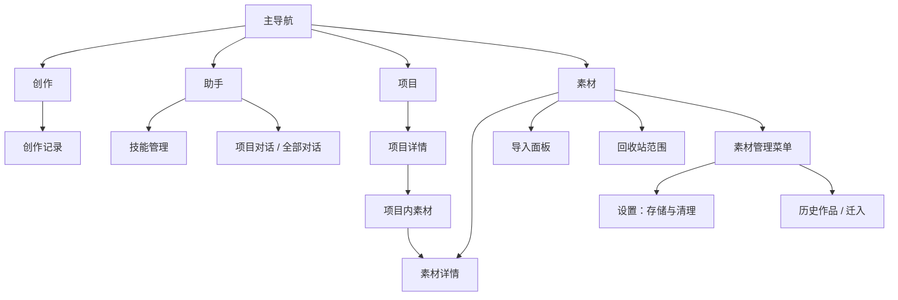

# 素材库与主导航调整（2026-10-30）

## 问题与决定

此前隐藏全部底部导航，创作和助手靠顶部模式切换；素材库作为辅助页面存在，创作里还需从创作记录进入。素材页混合技能、存储、迁入说明与导入表单，内容被挤到下方。

调整为四个始终可发现的主入口：创作、助手、项目、素材。键盘展开时收起底栏。切换保留已挂载页面和导航历史；创作切换必须等待现有草稿保存守卫，项目表单保留离开确认。

## 页面关系

| 入口 | 主用途 | 下一级 | 返回方式 |
| --- | --- | --- | --- |
| 创作 | 图片、视频手工制作 | 创作记录、任务、设置 | 关闭面板或栈返回 |
| 助手 | 项目对话与全部对话 | 技能管理、项目对话 | 详情栈返回；对话内返回项目选择 |
| 项目 | 项目列表与归档项目 | 概览、镜头、素材、计划、活动 | 项目详情返回原列表 |
| 素材 | 全局素材库 | 素材详情、导入、回收站、管理菜单 | 详情返回原筛选与列表位置 |
| 素材详情 | 名称标签、版本、项目使用位置 | 加入项目、制作、版本预览 | 栈返回原项目或全局素材库 |
| 素材管理菜单 | 低频维护 | 存储与清理、历史作品、创作草稿、迁入历史 | 关闭菜单或栈返回 |

3D 导演台仍是设计研究方向，没有可用产品页面，本次不添加空入口。

## 素材库排版

- 一个页面标题，右侧导入和更多管理；下方依次是范围、搜索和类型。
- 全部素材、未归入项目、回收站直接切换；不必通过管理说明卡寻找。
- 图片和视频使用宽幅缩略图；音频与文档采用独立图标面板，标题与版本信息放在下方。
- 导入方式放入弹出面板；技能管理置于助手首屏；清理放到素材管理菜单。
- 文档筛选仅包含文档和提示词，排除音频；原件缺失继续显示恢复状态。
- 保留分页、引用保护、回收站恢复、迁入一致性告警。

## 验证记录

见最终测试记录与 Android 截图。测试素材为本地合成样本，未调用付费生成服务。

自动化检查：全量 Jest 290 组、1803 项通过；既有 1 组 / 4 项跳过。TypeScript 通过。新增主导航守卫测试、文档/音频分类回归，并更新素材管理入口与创作保存守卫测试。日志：`build/library-final-tests.log`、`build/library-typecheck.log`。

Android 17 / x86_64 实际验证：
- 素材双列缩略图正常；默认字体和 1.3 倍字体无入口遮挡。
- 素材详情返回原列表；音频筛选中重复导入仅显示一项。
- 素材管理 → 存储与清理 → 系统返回；助手 → 技能管理 → 返回；导入面板、回收站均可达。
- 搜索键盘展开时隐藏主导航；关闭后恢复。
- 项目名称编辑未保存时切换素材弹出离开确认；继续编辑保留输入。
- 测试后恢复 1.0 字体，并逐字节核对原数据库恢复成功，无 WAL 遗留。
- 截图：`docs/evidence/2026-10-30-library-navigation/`（本地合成素材，仅用于布局验证）。
