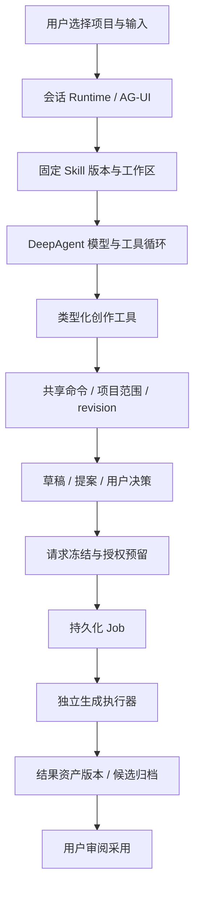

# Agent 创作工作台：功能与系统架构审查

> 历史归档（整理于 2026-11-01）：阶段架构审查；后续以改进台账与 agent-video-workbench 架构说明为准，不将原缺口全部视为当前缺陷。 状态与后继见[归档索引](archive/2026-10-31-agent-workbench.md)；现行页面设计见[设计谱系](../design/README.md)。原文“当前”、优先级、源码行号和复跑命令均属于审查时基线；复现探针不属于现行正确性回归。桌面执行端、远端 Worker 及外部业务编排服务器均禁止；旧文相反建议已失效。

日期：2026-10-31。对应本地 HEAD：`13e6be6f361e8c1b207484c9eeca956e9f6504ce`。

**用户明确约束：禁止桌面 Worker、远端 Worker，以及承担本应用 Agent/编排/状态的外部业务服务器或网关。Agent、编排、状态和项目数据必须在 Android 应用内运行；允许调用外部模型与生成 API。本文已删除此前将 Worker 列为可选扩展的建议，该方向不进入后续设计或路线图。**

本报告补充[上一份产品与交互审查](2026-10-31-agent-workbench-benchmark.md)，重点核查实际实现：资产与资源接入、Skill、模型与生成端口、权限和费用、Agent 编排、恢复与运行环境。没有修改产品代码，没有发送真实 LLM 请求或付费生成请求。

后续执行入口：[分析、设计与改进 Handoff](2026-10-31-agent-workbench-handoff.md)，包含发现台账、来源映射、禁止项和启动指令。

## 1. 核心判断

当前项目已经具备创作工作台的事务底座：项目与镜头、不可变资产版本、草稿、用户选择、变更提案、账号凭据代次、预算预留、幂等任务、独立执行器、结果归档和恢复隔离。继续沿用这些能力，比重建一个“聊天框 + 画布 + 插件市场”更合理。

主要短板集中在三个连接处：

1. **资源文件还没有充分变成可约束生产的创作知识。** 图片、音频、文档有资产身份，但角色、场景、服装、声音、风格、连续性规则及其版本引用还没有形成完整业务模型。
2. **接入配置还没有形成统一能力系统。** LLM 可配置兼容端口，媒体生成主要绑定 NovelAI 与 AutoDL；Skill 是文本指导包，不能自动补齐缺失工具、供应商或执行环境。
3. **模型推理与生产任务已经部分分离，但通用持久化编排尚未完成。** 现在有可靠的生成 Job，也有“选图→视频”的计划；还不能等同于剧本→分镜→配音→多镜头生成→质检→剪辑交付的可恢复生产线。

因此，下一阶段应围绕“资源语义 → 能力解析 → 冻结执行计划 → 授权 → 持久化运行 → 审阅采用”建设。画布、聊天、列表、分镜板是这些共享对象的不同视图。

## 2. 证据范围与对标依据

### 本地实现

| 层 | 已核查入口 | 能确认的事实 |
| --- | --- | --- |
| 创作对象 | [service.ts](../../mobile/src/creative/service.ts)、[types.ts](../../mobile/src/creative/types.ts) | 项目、资产、版本、查询、共享命令、幂等与修订检查 |
| 文件资源 | [fileImport.ts](../../mobile/src/creative/fileImport.ts)、[fileResources.ts](../../mobile/src/creative/fileResources.ts)、[usageGraph.ts](../../mobile/src/creative/usageGraph.ts) | 哈希入库、文件可用性、恢复、引用关系 |
| Skill | [package.ts](../../mobile/src/agent/skills/package.ts)、[store.ts](../../mobile/src/agent/skills/store.ts)、[runtime.ts](../../mobile/src/agent/skills/runtime.ts) | 文本包校验、启用绑定、每轮版本快照、撤销 |
| 凭据与授权 | [accounts.ts](../../mobile/src/creative/accounts.ts)、[accountVerification.ts](../../mobile/src/creative/accountVerification.ts)、[budget.ts](../../mobile/src/creative/budget.ts) | 精确账号代次、撤销、预算和请求绑定 |
| 供应商 | [applicationRegistry.ts](../../mobile/src/providers/applicationRegistry.ts)、[ProviderAdapter](../../mobile/src/workflows/providers/registry.ts) | 内置媒体供应商、代码扩展点、准备/提交/查询接口 |
| Agent | [h3Agent.ts](../../mobile/src/agent/h3Agent.ts)、[agentTools.ts](../../mobile/src/creative/agentTools.ts)、[runtimeStore.ts](../../mobile/src/agent/runtimeStore.ts) | DeepAgents、业务工具、项目范围、会话持久化与中断处理 |
| 生产编排 | [plans.ts](../../mobile/src/creative/plans.ts)、[planRunner.ts](../../mobile/src/creative/planRunner.ts)、[executorRuntime.ts](../../mobile/src/tasks/executorRuntime.ts) | 选图后视频计划、依赖、独立执行和结果回填 |
| 恢复隔离 | [restoreIsolation.ts](../../mobile/src/storage/restoreIsolation.ts) | 恢复新 epoch、撤销旧授权、隔离旧任务与计划 |

以上是源码证据，不代替全部端到端验收。运行环境仍以 React Native/Android 为主；桌面端产品是系统组织方式的参考，不能直接据此承诺桌面后台、手机后台或跨端协同能力。

### 参考项目的具体可借鉴机制

公开源码固定到本次获取的提交，避免把 README 宣传当作实测结论。两款参考产品均未安装运行。

| 参考 | 源码可确认的机制 | 对本项目的启发 |
| --- | --- | --- |
| Toonflow | [资源加载与上下文](https://github.com/HBAI-Ltd/Toonflow-app/blob/aaf8b1d5cec6160adf595ab1c09cb078dc6f0f0b/apps/server/src/agent/runtime/resources.ts)、[Skill 管理](https://github.com/HBAI-Ltd/Toonflow-app/blob/aaf8b1d5cec6160adf595ab1c09cb078dc6f0f0b/apps/server/src/agent/skills/index.ts)：工作区与全局资源、按需读取 Skill 正文、同名工作区优先 | 项目能力和全局能力需要明确作用域；按需提供上下文 |
| Toonflow | [供应商类型契约](https://github.com/HBAI-Ltd/Toonflow-app/blob/aaf8b1d5cec6160adf595ab1c09cb078dc6f0f0b/packages/providers/types.d.ts)：模型能力、表单规则、媒体输入、可选估价/余额、任务恢复 | 将供应商、模型能力、请求规格和任务恢复分开；其展示价格字符串不能直接替代本项目金额账本 |
| Toonflow | [子 Agent 运行](https://github.com/HBAI-Ltd/Toonflow-app/blob/aaf8b1d5cec6160adf595ab1c09cb078dc6f0f0b/apps/server/src/agent/runtime/subAgent.ts)：指定工具、独立会话、取消信号、等待输入、usage 汇总 | 子 Agent 是受约束的任务执行单元，需要成本和状态汇总 |
| 影策 | [工具策略注册表](https://github.com/ddcat-ai/open-ai-canvas/blob/82fc5c03233c33380a5335146c50bb507deb5692/backend/internal/agent/tool/policy.go)：统一定义读写/媒体/预处理、缓存版本、可见条件和审批 | 工具的副作用和权限应由宿主元数据决定，不能只靠工具名和提示词 |
| 影策 | [生成审批](https://github.com/ddcat-ai/open-ai-canvas/blob/82fc5c03233c33380a5335146c50bb507deb5692/backend/internal/app/cloud_agent_media_approval.go)：改参数后重建准备结果、校验解析后的规格、更新资源租约与哈希 | 用户审批实际将执行的请求；改模型、参考或规格后重新准备 |
| 影策 | [Agent 调度器](https://github.com/ddcat-ai/open-ai-canvas/blob/82fc5c03233c33380a5335146c50bb507deb5692/backend/internal/app/cloud_agent_runtime_scheduler.go)、[独立运行时边界](https://github.com/ddcat-ai/open-ai-canvas/blob/82fc5c03233c33380a5335146c50bb507deb5692/yingce-agent/README.md)：持久状态推进、事件唤醒；Node 执行推理，Go 保留数据库/审批/计费职责 | 认知运行时可替换，生产事实、授权和计费必须由统一宿主控制；远端失败不能随意切换另一执行路径造成重复 |

参考代码快照及来源索引见 [sources.json](../evidence/2026-10-31-agent-system-review/sources.json)。这些机制可以借鉴，但不能据此推断竞品所有插件、恢复、计费都已通过生产验证。

## 3. 当前能力与缺口

| 能力 | 当前实现 | 需要调整/补齐 |
| --- | --- | --- |
| 项目事实 | 项目、镜头、草稿、版本引用、已采用结果与提案 | 角色/场景/声音/风格实体、制作规格、连续性约束、交付定义 |
| 资产治理 | 原件哈希、导入去重、版本、描述标签、回收站、使用关系、缺失恢复 | 批量接入、媒体元信息/代理、派生关系、结构化知识和跨模态检索 |
| Skill | 受限文本包、完整性校验、全局启用、run 固定版本、撤销 | 来源与兼容性、能力依赖解析、项目作用域、样例评估、升级差异 |
| LLM | endpoint/model/key 可配置，兼容接口及特定推理模型适配 | 多连接档案、能力验证、任务路由、整轮成本/工具调用上限 |
| 媒体生成 | AutoDL 与 NovelAI、workflow 包、统一 Job 执行 | 供应商无关的账号/端口/模型契约、上传与报价、取消/核查能力、更多媒体任务 |
| 权限 | 项目范围、用户授权、账号代次、请求哈希、过期/撤销、原子预留 | 素材外发边界、端口及模型约束、LLM 与媒体双预算、实际费用证据 |
| Agent 计划 | 模型多轮工具、todo、工作区；持久化“选图→视频” | 通用 typed DAG、事件续跑、检查点、部分重跑和失效传播 |
| 多 Agent | 框架具备默认通用子 Agent 机制的基础 | 显式角色、独立工具集/预算、项目范围继承、结果合并与持久化 |
| 后台运行 | 前台调度、后台任务、Android 原生任务监控服务 | Android 应用内持久调度、恢复与停机原因；禁止桌面及远端 Worker |
| 交付 | 单任务下载/归档/相册导出 | 多镜头时间线、字幕/配音/音轨、拼接渲染、工程包和交付校验 |

## 4. 资产与资源：从文件仓库升级为生产资料系统

### 4.1 保留底层版本机制，补足四层模型

建议分开维护：

| 层 | 对象示例 | 应承担的职责 |
| --- | --- | --- |
| 文件与派生文件 | Blob、缩略图、视频代理、转码、波形、提取帧 | 内容哈希、存储位置、大小/MIME、校验、可用性、缓存和生命周期 |
| 资产与版本 | 一张参考图、一段配音、一份剧本的版本 | 稳定业务身份、不可变内容、来源、生成 recipe、版权/使用说明 |
| 创作语义 | 角色、服装、场景、声音、风格、道具 | 特征约束、批准的参考版本、禁止变化项、适用镜头和有效版本 |
| 制作绑定 | 项目/集/场/镜头/时间线对上述资源的引用 | 引用用途、精确版本、采用状态、连续性和变更影响 |

例如“角色 A 夜景造型”不是一个文件夹名。它应能绑定角色设定 v3、服装参考图 v2、声音 v1，并被镜头 08–12 显式引用。换服装参考产生新的绑定版本，已有已采用视频保持原引用，下游显示待复核。

当前导入会按同种类 + 相同原件哈希复用资产/版本，并能链接到多个项目；这有节省存储和避免重复的价值。但同一张图片可能承担“角色设定”和“宣传封面”两个业务用途。应把文件去重和用途身份分开，避免只靠全局资产标题表达不同语义；不必为每个用途复制原件。

### 4.2 建立可追踪的接入流水线

建议接入过程为：选择来源 → 本地暂存 → 校验/哈希 → 媒体探测 → 生成预览 → 元数据提取 → 用户归类 → 建立项目引用 → 可检索。

- 先补批量本地导入、Android 分享导入、系统文件选择器/目录授权、创作包导入。远程 URL 或对象存储可作为素材读取来源，解析与归档仍在 Android 应用内完成；不得要求桌面代理或远端 Worker。每个连接器声明读权限、原件归属和撤销行为。
- 图片提取尺寸/方向/透明通道；音视频提取时长、编码、帧率、音轨；生成代理、关键帧、波形。OCR/ASR/视觉描述是有来源、有版本的派生结果，可失败重试，不阻塞原件入库。
- 为远程素材保留来源 ID、内容 hash/版本、抓取时间、授权信息和原件位置；“URL 可访问”与“已保存且可复现”分开标记。临时签名 URL 不作为长期资产身份。
- 状态建议拆为原件可用性、派生处理状态、索引状态；不要用一个“处理中”掩盖所有阶段。不同步骤独立幂等，可见失败原因。
- 支持导入前清单和重复项处理。当前文件导入上限 100 MB、单次选择一个文件，生成预览参考总量限制 50 MB；大媒体接入需要代理/分片等专门设计，不能只放开限制。

### 4.3 检索必须返回可执行引用

现在 `asset_search` 主要搜索标题、描述、标签，返回资产及版本摘要；它不等于理解素材内容。建议顺序：

1. 结构筛选：项目、角色、场景、类型、状态、批准版本、可用性。
2. 文本全文检索：剧本、Prompt、OCR/ASR，返回页码/片段/时间码。
3. 需要时再增加语义与跨模态检索；向量索引是可重建派生数据，不能取代项目归属和版本事实。
4. 提供按需 `asset_inspect`：图片缩略图、视频指定时间范围/帧、音频片段及转写。按模型视觉能力、外发许可和上下文预算选择，不把全部原件塞进聊天。

Agent 读取结果应至少包含 `assetId/versionId/purpose/availability/evidence`。搜索不能自动采用“最新版本”；生成时冻结确切版本、内容哈希和用途。

当前 `creative_context` 一次返回全部镜头；`asset_search` 截取前 30 个资产，但每个资产版本列表未分页。长项目会放大上下文成本，应改为摘要 + 游标 + 按对象读取，并展示剩余授权量，而非仅返回原始 request_limit。

### 4.4 生产资源和媒体资产分开管理

LoRA、模型权重、ComfyUI 节点/工作流、声音模型、字体、字幕模板、参考 LUT、Skill 包，均是生产资源，但不应统统塞进图片/视频资产库。用依赖清单关联 Android 本地能力或外部生成 API 的资源引用：资源 ID、版本/hash、来源、许可、兼容引擎、所属生成服务、可用状态。

外部生成 API 所使用的大型权重、LoRA 或工作流，只记录其服务能力与稳定资源标识，不引入应用管理的桌面/远端执行环境。Android 本地资源必须经设备能力与存储评估。安装一个 Skill 不应暗中下载模型或安装 ComfyUI 节点。工程导出携带依赖清单和可再现的参数，不默认附带密钥或巨型权重。

## 5. Skill：区分指导、工具和流程

### 5.1 当前机制的边界

当前 Skill 接入做了有价值的收敛：仅 md/txt/json，单根 SKILL.md，最多 32 文件、512 KiB；校验路径、ZIP 完整性、引用；声明 `dependencies/requires/allowed-tools` 的包会拒绝。运行时按内容 hash 固定版本，启用版本进入只读 `/skills/`，撤销会阻断活跃运行。

这意味着当前 Skill 是**文本指导能力**。导入某款桌面 Agent 的 Skill，不能因此获得该产品的画布工具、浏览器、Shell、MCP 或视频引擎。现有系统提示已经要求：缺 MiniMax Hub 工具时只能产出前期包，不能声称完成生成；应把这个提示词边界进一步做成宿主可查询的能力状态。

### 5.2 三类扩展应该有不同生命周期

| 类别 | 内容 | 运行方式 |
| --- | --- | --- |
| Skill | 方法、规范、示例、参考资料、输出结构 | 模型按需读取；没有独立权限 |
| Tool/Connector | 读资产、写草稿、调用外部服务、媒体探测 | 宿主注册类型化接口并执行权限校验 |
| Workflow/Plan | 节点、依赖、输入输出绑定、决策点、恢复策略 | 持久化调度器推进；不依赖模型记住执行状态 |

例如“分镜导演 Skill”声明会使用镜头读写和参考图能力；工具实际存在才可执行。Skill 可以建议建立计划，不能靠一段 Markdown 获得脚本执行权或付费权限。

### 5.3 建议增加的管理能力

- **来源与版本**：仓库/作者/许可、固定 commit、内容 hash、更新时间、兼容版本、变更摘要。先支持受检文本包；GitHub 导入也是获取指定版本，不执行仓库安装脚本。
- **能力依赖清单**：声明任务类型、所需工具/模型能力、输入输出 schema、引用资源版本。先增加独立 metadata 和解析器，不直接解除现有危险字段限制。
- **安装前诊断**：返回可执行、仅可生成文本方案、缺少工具、缺模型、缺资源、需要授权；用户能直接跳到缺失连接的配置页。
- **作用域**：全局可用、项目选用、单次运行临时选用。当前启用绑定主要全局且最多 8 个本地 Skill，长项目需要组合优先级和冲突处理；本地扩展永远不能覆盖宿主权限规则。
- **按需上下文**：默认给名称、描述、能力和短摘要，命中后读取完整文件；大参考资料走资产引用，不嵌入每轮系统提示。
- **可测质量**：每个 Skill 附样例输入、输出 schema、质量标准、允许的工具行为。用固定样例验证结构正确、资源引用存在、不会虚报生成；再做人工质量评审。
- **升级与撤销分离**：普通升级仅影响新运行，老计划保留版本快照；紧急撤销立即停止新的模型/工具执行。已存在的生成 Job 由其自身任务/取消策略处理，不能假设撤销 Skill 会撤回远端已受理任务。

带脚本的 Skill 不能通过桌面/远端执行环境落地。优先将所需能力实现为 Android 应用内类型化工具；任意脚本执行不在当前方案中。若研究受限解释器，必须证明 Android 内可运行及资源/权限边界。MCP 只在无需额外 Worker/网关且符合允许的外部服务接口边界时评估，不自动提供媒体任务幂等、预算与结果归档契约。

## 6. 生成端口：把“填 API Key”变成完整能力接入

### 6.1 现状应准确区分

LLM 侧已有 endpoint/model/key 和上下文、超时、重试、推理设置，并以 SecureStore 保存设置；媒体侧 `CreativeProvider` 仍为 `novelai | autodl`。Provider registry 有代码级扩展点，不等同于用户填入任意 URL 就能使用任意图像、视频、音频服务。

账号绑定实现很扎实：密钥安全存储、精确 credential generation、切换凭据撤销授权、原任务查询不随默认账号漂移。应保留。AutoDL 当前没有无消费身份核验接口，代码诚实记录 `authenticated:false`；“已保存/已绑定”和“已远端验证身份”必须在产品状态上区分。

### 6.2 建议的接入对象

| 对象 | 内容 | 为什么要分开 |
| --- | --- | --- |
| ProviderDefinition | 协议/适配器、版本、支持的操作 | 同一供应商可能有不同协议与媒体接口 |
| EndpointBinding | 目标 host、路径、云端/局域网/本机、区域、证书配置 | 同一适配器可连接官方、代理或本地实例 |
| CredentialBinding | 密钥/OAuth 等、账号身份、代次、有效状态 | 端口配置和密钥轮换生命周期不同 |
| ModelCapability | 文本/视觉/图像/视频/音频、规格、参考数、工具调用能力 | 模型名不能替代能力探测 |
| WorkflowVersion | 输入 schema、资源依赖、节点映射、输出契约、hash | workflow 更新不能改变已授权执行的请求 |
| AuthorizationGrant | 项目/用途/操作/目标端口/模型范围/素材外发/预算/期限 | 连接一个账号不代表允许任何项目无限消费 |

应同时支持标准 API 接入和专用适配器。OpenAI-compatible 文本协议不能自动覆盖所有多模态媒体任务；ComfyUI 的远程 workflow ID 也不能直接等同于本机 ComfyUI 的图和文件接口。

### 6.3 建议接入流程

选择连接类型 → 配置地址 → 保存凭据 → 无消费连接/身份检查（若支持）→ 获取或手动声明模型 → 验证能力/规格 → 关联 workflow → 可选用户主动发起的小样测试 → 设为任务类型默认。

状态至少分为“配置有效、网络可达、身份验证、该操作可执行”。探测不应偷偷调用收费生成；无验证接口时明确显示待首次实际调用验证。自定义端口必须展示素材和密钥将发送到的实际目标；连接器不能把密钥转发给模型或写进 Skill。

扩展 ProviderAdapter 时增加可选能力：`capabilities / quote / upload / submit / getStatus / reconcile / cancel / fetchArtifacts / usageEvidence`。能力缺失要返回明确 unsupported，不能模拟成功。上传发生在生成前，也应受素材外发规则控制，并记录外部文件 ID 的范围和过期时间。

估价接口返回数值、币种/计量单位、上限性质、有效期、请求哈希、报价证据；展示价格字符串另存。远端不支持 quote、cancel 或按 client-request-id 核查时，要保留其真实限制。

## 7. 授权与费用：保留严谨账本，补齐执行上下文

### 7.1 三种权限分别表达

1. **连接权**：允许应用保存凭据、读取余额/能力、查询已有任务。
2. **素材出站权**：允许哪些项目/资产版本发给哪个 LLM、视觉服务或生成端口。读取本地素材不应隐含向全部外部模型发送。
3. **执行与消费权**：允许哪些操作、目标模型/端口、次数、并发、期限和费用范围。

普通低影响编辑不必增加反复确认。可以由用户对一个明确范围的计划授予有限额度；宿主对每个步骤原子预留。模型只能消费已有授权，不能自行创建/扩大授权。当前 `generation_submit` 已有这一边界。

审批对象应包含冻结后的请求摘要：输入版本/用途、输出目标、端口、模型、规格、工作流版本、估价/未知费用、次数。编辑这些内容后重新准备请求；是否仍在同一授权范围由宿主规则决定。

### 7.2 当前费用能力的真实边界

`budget.ts` 已支持金额/次数、未知费用请求、原子预留、派发与核销状态；绑定账号代次和请求哈希。未知结果保留占用，而不是重发或擅自退款，这是应继续保持的行为。

但当前 `videoSubmission.ts` 的估价上限为 `maximum:null`，手动图像/视频授权为 `amountLimit:null`、有限次数且允许未知费用。界面 `_costEstimate` 是展示快照。因此不能把现阶段宣传成“各生成端口都能执行硬金额上限”。

建议将状态明确分为：已知可约束上限、只读估价、未知成本。供应商不能提供可约束价格时，提供次数上限和已知风险范围；价格不确定不能转换为 0。取消远端任务也不自动代表费用为 0。

LLM 需要另一份成本与资源预算：整轮累计输入/输出 token、模型调用次数、工具调用次数、时长、子 Agent 汇总成本。现有上下文窗口/单次输出限制和整轮 deadline 不能替代这些指标。无权威用量时标记估算，不冒充供应商账单。

### 7.3 失败与恢复原则

- 配置/参数本地失败且明确未发送，可以修复后重新准备。
- 已发送但响应丢失，先查询原 Job、provider handle 或供应商 request ID。不能自动换账号、换端口、换模型再次生成。
- 只有明确确认未受理或明确终态，才建立新的生成意图；新任务保留与原失败任务的关系。
- 凭据轮换不把旧任务转绑到新账号。查询旧任务是否允许使用退役代次，继续由精确凭据解析规则控制。
- 备份恢复生成新 execution epoch 并隔离旧执行，是当前已有的优点。恢复工程不等于恢复付费授权；Android 本地恢复和工程包导入也要遵守这一边界。

## 8. Agent 编排：认知循环和生产循环各司其职

### 8.1 当前运行链

这条链说明应用已经超出 Prompt 编辑器。重要的缺口是：模型生成的 todo、聊天工作区和摘要可以持久化，但并不等于每个业务步骤都有可恢复的执行检查点。当前 runtime 重建会将未结束 run 标记 interrupted，要求重试；没有在应用层配置完整的图 checkpointer/store 来保证任意模型轮次精确续跑。

`plans.ts` 的持久化计划主要是选图→H3 视频。`planRunner.ts` 处理 READY 的 video 节点、依赖与结果；workflow validator 明确拒绝 composite（`COMPOSITE_UNSUPPORTED`）。不能因为类型中预留 steps/bindings 或框架带 todo，就认定通用 DAG 已实现。

### 8.2 目标分为两种循环

**认知循环**：理解目标、检索事实、制定/修订方案、产出结构化内容、评估结果。可换 LLM 和 Skill，可被取消，不是生产状态的事实源。

**生产循环**：推进持久化节点、冻结输入、等待决策/授权、提交/查询任务、处理产物、质检、审阅、交付。由确定性调度器执行，模型退出后仍能恢复；任务完成用事件唤醒后继节点，不让聊天一直轮询等待。

一个 RunSpec 应记录：项目/镜头范围、模型连接与配置版本、Skill 快照、可用工具集合、输入资产版本、上下文摘要版本、输出 schema、时长/token/工具调用/费用/并发上限、父 run/计划关系。凭据本体留在 Android 设备安全存储，不进入这个可导出的执行快照。

### 8.3 将持久化计划逐步扩成 typed DAG

先实现少量稳定节点：读取与检索、LLM 结构化变换、媒体生成、本地处理、人工决策、审阅采用、导出。每个节点定义输入输出 schema、版本、幂等键、依赖、重试性质、费用类别和执行位置。

建议状态包括 PENDING、READY、RUNNING、WAITING_DECISION、WAITING_AUTHORIZATION、BLOCKED、SUCCEEDED、FAILED、CANCELLED，以及需要核查的 UNKNOWN。错误要区分可重试、用户处理、不可重试、远端结果未知，避免所有异常仅落成一条字符串。

关键能力：

- 冻结输入版本，生成缓存键包含模型/工作流/参数/素材 hash，不能仅按 Prompt 缓存。
- 支持只重跑失败镜头或选定节点；上游改变只标记关联下游待更新，不能覆盖已采用版本。
- 把“生成完成、质量通过、用户采用、交付完成”分成独立事实。
- 配额/并发按供应商、账号与 Android 应用内调度容量约束；不要靠多开 Agent 绕过排队。
- 短步骤可以本地完成；长媒体步骤提交给持久化 Job；模型结果解析与结构校验失败不导致已成功媒体任务重跑。
- 生产节点完成通过持久化事件/outbox 推进。唤醒事件可以重复，步骤执行必须幂等。

### 8.4 多 Agent 的合理位置

当前依赖的 DeepAgents 具备按 harness profile 启用默认 general-purpose 子 Agent 的机制。应用没有显式配置导演/分镜/质检等业务子 Agent、独立权限预算或持久化协同协议；是否实际暴露默认委派工具，还需按模型 profile 验证，不能简单判断“完全没有”或“已经成熟”。

建议先把单个协调 Agent 与生产计划做稳，再加少量有明确产物的角色：策划产剧本结构、分镜产镜头提案、质检只读检查连续性和产物。每个角色固定工具集和输出 schema，继承项目范围与剩余额度；只有协调者提交最终变更提案，避免多个 Agent 并发覆盖同一对象。

委派记录包含 parent/child run、输入版本、结果引用、usage、状态、取消与等待用户输入。父级预算汇总子级消耗，子级不能提高授权。避免为每个镜头新建完整团队导致上下文、成本和状态爆炸。

### 8.5 工具注册表、记忆与可观察性

目前业务工具有 Zod schema 和宿主范围校验，值得保留；但工具元数据和动态能力筛选还应统一。建议注册：副作用类型、作用域、需要的模型/连接器能力、审批策略、成本类别、缓存键、幂等与重试规则、错误码。可见性筛选不代替执行时校验。

记忆分三层：项目事实/设定由结构化对象和版本承载；会话草稿与摘要服务当前推理；用户偏好按作用域存储且可编辑、关闭和删除。模型提炼出的“经验”先作为候选，不把聊天中的猜测直接升级成角色设定、长期事实或权限。

运行详情应能沿 `project → plan → step → run → toolCall → job → assetVersion` 查看：输入版本、实际端口/模型、Skill、耗时、usage/费用证据、等待原因、错误码、重试/核查动作。已有会话事件和任务日志应联通，不能只增加一块显示思考文本的面板。不要记录原始密钥；日志与工程导出默认使用摘要和脱敏引用。

## 9. 执行位置：全部编排在 Android 应用内

当前并非完全没有后台机制：有 Expo 后台 slice，也有 Android 原生 TaskMonitorService、headless 执行和前台通知。它们服务于任务执行/监控，不等于整个 LLM Agent 可以在所有系统状态下持续在线。代码处理了前台服务超时和停止原因；本轮未验证 OEM 杀进程、强制停止、重启后的所有行为。

桌面 Worker、远端 Worker、外部 Agent 运行时和业务调度服务器均为禁止项。不得以后台限制、长任务、插件兼容或多 Agent 为由将编排迁出 APK。参考项目中的 Node/Go/Python 服务只用于理解模块边界，不作为部署组件引入。

| 执行域 | 职责 | 必要边界 |
| --- | --- | --- |
| Android 应用内 | Agent harness、工具、计划推进、SQLite 事实、授权、任务租约、原件与派生文件、恢复与导出 | 持久化、并发限制、明确后台状态及停止原因 |
| 外部模型 API | 接收获准上下文、返回文本/结构化结果/模型原生工具调用建议 | 不接管应用权限、业务状态或工具执行 |
| 外部生成 API | 接收冻结的媒体请求、运行供应商生成、提供任务状态与结果 | 应用内创建/记录/查询 Job；不托管应用的 Agent 或生产计划 |

应用内前台调度、后台 slice 和 headless 执行共用同一持久执行内核，通过 lease/attempt/epoch 拒绝过期执行者。进程恢复先核查原生成任务，不能把本地中断当作供应商未受理。手机关机或被系统限制时，本地 Agent/计划暂停；已由供应商受理的生成可在其服务端继续，应用恢复后查询归档。这是允许的生成 API 行为，不是远端 Worker 编排。

长任务设计应使用可恢复的小步骤、检查点、持久事件和用户可理解的暂停/继续状态。前台服务和后台任务必须按 Android 实际限制验收，不能承诺关机后本地 Agent 继续运行。工程包导入/备份恢复不得携带有效消费授权或自动启动执行。媒体探测、代理和后期处理优先评估 Android 原生实现，超出设备能力时如实限制规格，不绕行到禁止的执行环境。

## 10. 本轮确认的具体问题

### P1：带音频草稿的 Agent 提交契约不完整

证据：[agentTools.ts:94](../../mobile/src/creative/agentTools.ts) 调用提交函数只传 images/versionIds 等，遗漏 `preview.audios`；[手动提交:58](../../mobile/src/creative/videoRuntime.ts) 明确传 audios；[底层校验:63](../../mobile/src/creative/videoSubmission.ts) 要求草稿的 audioRefs 与 audios 一致。

因此，当视频草稿含音频参考时，Agent 入口按代码路径会触发 `DRAFT_INPUT_CHANGED`，而非完成提交。这里是静态调用链确认，未发送真实生成验证。当前已有混合图音底层测试会显式传 audios，没有覆盖这个入口缺失。[planRuntime.ts:10](../../mobile/src/creative/planRuntime.ts) 也省略 audios；现有选图计划默认不带音频，但若其草稿含音频同样会受影响。

建议形成共享的 prepared submission 对象，手动、Agent、plan 三入口只附加 origin/authorization，不分别挑选媒体字段。验收：混合图音草稿经三个入口产生一致冻结输入；不存在音频时保持空列表；重复提交仍只产生一个 Job。P1 表示相关功能闭环优先修正，不表示所有生成均不可用。

### P1：费用上限的产品承诺必须与真实路径一致

当前金额账本能力存在，但媒体入口以未知费用次数授权为主。若设置或文案声称“此计划金额绝不超过 X”，必须先让实际 dispatch 绑定可约束报价/供应商限额。仅显示估价时明确其性质。此项是实现边界与产品表达的审查结论，没有证据表明已经发生越额扣费。

### P2：生产编排范围窄于通用工作台目标

选图视频计划已经可持久化，但音频/批量镜头/质检/导出等没有统一节点契约；composite workflow 明确未支持。应沿当前计划结构演进，避免另做一套只存在聊天消息里的“计划”。

### P2：长项目检索和上下文缺少统一分页/按需读取

全量镜头与逐资产全量版本会扩大模型输入；Agent 不能仅凭搜索元数据可靠判断视觉一致性。补摘要分页和受限媒体检查，比直接扩大模型上下文更优先。

### P2：接入与能力诊断不统一

LLM 设置、媒体账号、workflow、Skill 分属不同入口，缺少统一“任务为何不能执行”的解析结果。新建一个能力诊断服务，将缺工具/缺账号/缺资源/不支持规格/缺授权转换为可操作状态；不用模型猜测配置步骤。

## 11. 实施顺序与验收

以下是依赖顺序，不是未经估算的工期承诺。

| 阶段 | 具体工作 | 可验收结果 |
| --- | --- | --- |
| A：统一执行契约 | 修正媒体参数差异；统一 PreparedSubmission；结构化错误；暴露真实授权余量/未知成本 | 同一草稿经手动、Agent、plan 输入一致；重复点击/断流不重复消费；变更引用触发重新准备 |
| B：资源事实与能力目录 | 角色/场景/风格/声音绑定；媒体探测与代理；分页检索；Provider/Endpoint/Model/Tool 目录 | 一个镜头能列出完整依赖与确切版本；缺失资源可定位；不兼容任务在提交前被解释 |
| C：连接与授权闭环 | 多连接档案；无消费验证；能力检测；素材外发规则；有限计划授权；费用证据 | 账号连接不自动消费；模型/端口/素材变化被重新校验；凭据轮换不转绑旧任务 |
| D：生产计划通用化 | typed 节点；决策/授权等待；事件续跑；部分重跑；失效传播 | 退出聊天后，已授权生产任务可在允许的执行环境继续；只重做选定失败镜头，保留已采用版本 |
| E：Skill 与角色协作 | 来源固定版本、项目组合、依赖解析、样例评估；少量受约束子 Agent | 安装前知道可执行范围；旧 run 不被普通升级漂移；子 Agent 成本、权限和结果可追踪 |
| F：Android 本地后期交付 | 音轨/字幕/时间线、原生转码拼接、工程包；应用内长任务检查点与恢复 | 在支持的设备/规格上产可播放样片和依赖清单；本地中断后恢复不重复生成；不导出密钥 |

优先验收一条完整场景：导入角色参考与配音 → 建立 6 个镜头 → 固定角色/风格 → 产分镜与候选 → 用户选择 → 有限授权 → 并行生成 → 连续性/规格检查 → 重做一个失败镜头 → 采用 → 拼接导出。每一步都能定位对象、版本、费用和责任边界，才说明系统形成了创作工作台。

暂缓：先做无限画布再补业务模型；默认启用大量 Agent；把任意 Git 仓库当可执行 Skill；把所有工具暴露给所有模型；在远端结果未知时自动换端口；同步完整密钥和授权数据库。它们会放大当前连接处的问题。

## 12. 验证记录与限制

本轮运行四组既有测试：`skills/runtime`、`creative/agentScope`、`creative/budget`、`creative/videoSubmission`。结果：4 组通过，31 项通过、1 项跳过，用时约 22 秒；未调用实际供应商。

- [测试日志](../evidence/2026-10-31-agent-system-review/targeted-tests.log)
- [机器可读结果](../evidence/2026-10-31-agent-system-review/targeted-tests.json)

这些测试支持现有 Skill 快照、范围控制、预算和底层提交机制的相关断言；不覆盖全部工具入口、多设备、真实计费、供应商取消、手机后台或新提出的能力。音频入口差异仍需实现修正和针对入口的回归验证。

最终建议保留现有领域与事务底座，先完成共享请求契约、资源语义和能力解析，再扩展持久化生产计划。前端工作台应把这些状态和对象变得可见，而不是单独承担后端尚不存在的编排能力。
