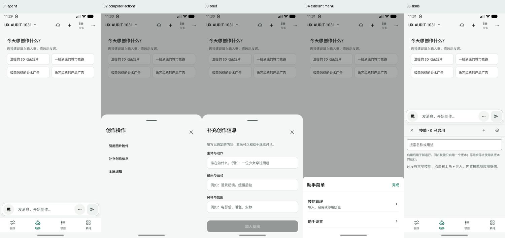

# Agent 创作工作台对标审查

> 历史归档（整理于 2026-11-01）：阶段需求与竞品研究；后续实现范围见工作台改进台账，现行 UI 规格见 docs/design。 状态与后继见[归档索引](archive/2026-10-31-agent-workbench.md)；现行页面设计见[设计谱系](../design/README.md)。原文“当前”、优先级、源码行号和复跑命令均属于审查时基线；复现探针不属于现行正确性回归。桌面执行端、远端 Worker 及外部业务编排服务器均禁止；旧文相反建议已失效。

补充：[功能与系统架构审查](2026-10-31-agent-system-architecture-review.md)进一步核查资产接入、Skill、生成端口、授权预算、Agent 编排与运行恢复。

**范围约束：桌面与远端 Worker 均为禁止项。Agent、编排、状态与项目数据在 Android 应用内；允许外部模型和生成 API。桌面产品仅作设计与机制参考，不引入桌面编排或外部业务服务器。**

日期：2026-10-31（Asia/Shanghai）。结论：继续沿用项目、资产版本、镜头和共享命令底座，把助手升级为能围绕具体创作对象规划、审阅、执行与接管的工作台。优先打通对象上下文、待处理决策、候选采用、授权续跑；再建设分镜生产和交付能力。

## 1. 证据与范围

- 本地源码 HEAD：`13e6be6f361e8c1b207484c9eeca956e9f6504ce`。审查前已有两处未跟踪的前轮审计输出，本轮保留。
- 本轮模拟器：`emulator-5554`，1080×2400；`com.example.autodlh3` versionCode 76，versionName 1.5.0-preview.4。没有核验 APK 与当前源码逐字节对应，界面观察和静态判断分开陈述。
- 本轮重新采集助手首页、输入菜单、创作信息、助手菜单、技能面板；通过新鲜 UI 树定位，再保存并查看截图。初次深链遇到加载画面，已拒收并重新采集稳定界面。
- 参考项目核查其公开 README 和影策功能清单、代码地图；没有安装运行两款参考产品，也没有验证其全部功能质量。“官方声明支持”不等于本轮实测成熟稳定。
- 没有发送 LLM 消息、发起付费生成、创建项目/素材、变更授权或修改产品代码。关闭技能面板后回到助手。
- 未覆盖真实生成中的进度、候选选择、授权后恢复、进程退出、导出成功/失败、TalkBack、大字体和键盘场景。这些列为后续验收，不能用截图或源码替代运行结果。

本轮截图，左到右对应步骤 1–5：

| 步骤 | 实际观察 | 健康度与发现 |
| --- | --- | --- |
| 1. 打开助手 | 当前项目、历史、新对话、任务、菜单、四个灵感建议 | 基础清楚；只有项目名，缺当前镜头、进行中的工作和下一步 |
| 2. 打开更多创作操作 | 引用图片附件、补充创作信息、全屏编辑 | 可达；输入菜单与顶部菜单分散，两处相同省略号不利于预判用途 |
| 3. 打开创作信息 | 主体动作、镜头运动、风格氛围、加入草稿 | 单镜头描述清楚；不能表达整片交付、角色约束和批量目标；下方字段需要滚动 |
| 4. 打开助手菜单 | 技能管理、助手设置 | 菜单简洁；没有当前模型/技能/授权的轻量运行摘要 |
| 5. 打开技能管理 | 内嵌半屏管理区，0 已启用，提示没有本地技能 | 管理占用对话空间；内置技能与本地启用数的关系需要用户自行理解 |

截图可见的可访问性风险：顶部多数动作靠图标区分、两处省略号用途不同；“0 已启用”没有就近解释内置技能；表单需保留清晰的滚动和焦点提示。UI 树显示多个动作已有无障碍标签，不能据此认定 TalkBack 顺序、放大字体或屏幕对比度均通过。

## 2. 对标中真正值得借鉴的部分

| 参考 | 公开可确认的方向 | 对本项目的启发 |
| --- | --- | --- |
| [Toonflow README](https://github.com/HBAI-Ltd/Toonflow-app) | 画布组织文本、角色、场景和视频；自选模型；Agent、MCP、插件；本地与跨端部署 | 让创作对象和引用关系可见，能力扩展有统一入口，借鉴其创作组织方式 |
| [影策 README](https://github.com/ddcat-ai/open-ai-canvas) | 结构化短剧生产、角色锁定、人工接管、画布、技能、任务及时间线 | 从单次生成扩展到一组镜头的生产、审阅和交付 |
| [影策功能清单](https://github.com/ddcat-ai/open-ai-canvas/blob/main/docs/content/docs/overview/features.mdx) | 制作台为事实源，画布精修后显式采用；过期提示、版本记录、预算贯通；并行与尾帧衔接有不同条件 | 多视图共享同一业务对象；版本采用、上游变化影响和执行范围必须明确 |

本项目当前是 React Native/Android 工作区。桌面工作台的空间布局不能直接移植到手机：桌面可同时看对象、成果和 Agent；手机适合聚焦一个对象、底部审阅卡和完整详情页。共享数据契约比共享像素布局更重要。

## 3. 已有能力应保留，避免重复开发

以下由当前源码确认，未表示全部端到端实测通过：

- `creative/types.ts`：项目、通用多媒体资产、不可变版本、来源配方和异步执行引用。
- `creative/agentTools.ts`：项目/镜头/草稿命令、项目内素材搜索、文本读取和写入、生成提交与状态查询；通过共享服务执行，使用稳定 ID 和 revision。
- `creative/story.ts`：镜头顺序和编辑状态、采用图片/视频版本、项目版本固定。
- `creative/changeReview.ts`：修改项目或镜头已有 before/after 提案与用户采用，不能说“缺少人工审阅”。
- `creative/plans.ts`：已有持久化“选图→创建视频草稿→等待授权或执行”的有限计划，不能说“没有工作流”。
- `creative/AgentCreativeCards.tsx`：本会话/本轮创作、草稿、实际成果、任务跳转、有限次数授权，已经区分生成与结果归档。
- `agent/PromptAssistantUi.tsx`：已有图片附件和图片引用，不应重新建设同一种附件系统。
- `agent/h3Agent.ts`、`agent/skills/*`：已有 DeepAgent、内置技能、本地技能和工具运行机制，无需为对标而先更换框架。
- `agent/runtimeStore.ts`：会话和运行展示有持久化；重新创建 runtime 时运行会转为 interrupted。这不能等同于任意 Agent 执行步骤均可精确续跑；生成任务与有限选图计划的恢复是另一层能力。

## 4. 优先调整：把现有能力变成连续交互

本节 P0 表示放开更多自主批量执行前应满足的条件，不代表已经发现线上事故。P1 表示下一轮工作台体验，P2 为后续扩展。

### A01｜P1｜可见的对象上下文

依据：截图 1 只显示项目；`AgentWorkspace.tsx` 路由只接收 projectId；`creative_context` 读取项目、镜头和计划，但没有用户当前选中对象的统一契约。

调整：保留项目选择，在输入框上方加可收起的上下文摘要：当前镜头、引用素材及版本、当前目标。支持 `@镜头 / @角色 / @素材 / @技能`；图片附件引用继续复用。用户从镜头、成果或素材点“交给助手”时携带对象 ID、精确版本、revision、来源页面和意图。

不能自动把整项目文件塞进每轮上下文。展示本轮实际使用的引用；对象改版后标注已过期；可一键移除引用并返回原对象。

验收：从镜头 B 进入助手后，界面和模型使用的焦点都为 B；手动修改 B 后旧提案无法静默覆盖；跨项目对象不能混入。

### A02｜P1｜面向当前项目的首页和能力说明

依据：截图 1 的四个建议是泛化风格；截图 3 是单段画面简报；`AgentWorkspace.tsx` 在无项目时直接要求先去创建项目。

调整：有工作时首页优先显示“继续当前镜头 / 审阅待选图 / 完善分镜”；新项目才显示创作类型示例。提供可编辑的项目简报：交付类型、目标时长/比例、受众、风格、角色约束、参考和预算偏好。参数按任务渐进展开。无项目时可以讨论或通过轻量动作建项目，不把项目管理当作先修步骤。

提供“我能做什么”并明确当前可用的生成服务、内置技能和需要外部工具完成的交付；避免用户把“写出短片提示词”理解为“制作了完整短片”。

验收：首次用户能从明确目标进入第一份可审阅草稿；已有项目不被灵感示例挡住；示例只填入或创建待审草案，不自动消费。

### A03｜P1｜统一待处理决策与成果卡

依据：`h3Agent.ts` 目前引导修改审阅到项目活动、选图到计划；`AgentCreativeCards.tsx` 对计划/提案主要是“查看并处理”的跳转。

调整：保留底部稳定的会话成果入口，增加“待你处理 N 项”：选候选、接受局部改写、补连接、补授权、处理冲突。在助手中直接展示 before/after、候选缩略图和明确动作；需要大图时打开全屏比较，返回保留位置。使用同一条领域命令处理，项目页同步更新。

明确区分“生成候选”“采用为镜头当前版本”“设为素材默认版本”“设为项目封面”；采用后展示具体对象和版本。结果卡应提供查看、对比、局部重做、采用、交给视频和保存。

验收：选图后不必重新向助手描述选了哪张；提案只能由用户采用；旧 revision 冲突有刷新/重算入口；两个页面处理同一决策只成功一次。

### A04｜P0｜授权绑定具体意图，确认后自动续跑

依据：`AgentCreativeCards.tsx` 当前授权为项目内一次请求、15 分钟、费用未知、`amountLimit:null`，且提示再发送“按当前草稿继续”。这已有有限授权，但不是草稿级或金额级约束。

调整：授权卡列出供应商/账号、草稿或计划及版本、数量、规格、预计费用/计价单位、有效期和实际影响范围。确认通过后发出持久化恢复事件，继续对应动作，无需补发聊天。修改模型/数量/分辨率超出原范围应产生新决策。

金额上限只有在执行器具备对应价格单位和原子预留/结算时才能承诺。费用无法可靠得知时，明确“仅次数限制、费用未知”，限制请求数；不能把参考人民币估价当成 AutoDL 积分硬上限。

验收：双击确认、页面重建、进程恢复不会重复消费；授权失效/撤销后不提交；未知提交结果只查询原任务；授权只恢复所绑定意图。

### A05｜P1｜重做技能的使用入口与管理层级

依据：截图 4–5；当前内嵌面板占半屏，0 已启用容易与内置能力混淆。

调整：对话内只保留当前技能标签、搜索和本轮选择；管理/导入/编辑去独立页。显示“内置能力可用；本地技能 0”，并让用户看到本轮实际使用的技能版本及用途。区分全局启用、项目默认、本轮指定。提炼技能先给证据和预览，再保存、启用。

技能是方法指导，工作流是可恢复步骤，工具是执行能力，模型是推理/生成服务；这四类不要放到一个混合市场里。

验收：新建技能一次进入编辑；本轮指定的版本可追溯；停用对正在运行任务的影响可见；技能不能扩大项目范围和消费权限。

### A06｜P0/P1｜让停止、恢复和状态有准确语义

调整：运行卡同时显示 Agent 讨论/工具执行状态与媒体任务状态，显示阶段、耗时、已完成/总数、等待原因和下一动作。停止助手、暂停后续计划、取消尚未提交请求、申请取消远端任务分别表达；服务不支持取消时说明实际结果。

恢复优先对账命令回执、jobId、已归档成果和未决决策，再从确定未执行步骤继续。保留现有 UNKNOWN 与归档判断，不能用“重新发送原提示词”替代恢复。

验收：杀进程后进入统一恢复摘要；已经发出的任务不被重复提交；停止助手不被描述成远端生成已取消；完成必须可打开对应成果。运行轨迹默认短摘要，参数和调试日志放二级详情。

## 5. 建议加入的创作能力

| ID / 优先级 | 功能与范围 | 现有基础与需要新增的部分 | 可验收交付 |
| --- | --- | --- | --- |
| B01 / P1 | 结构化分镜板 | 已有镜头列表/排序/图片视频槽位；补景别、运镜、对白、时长、角色/场景引用和候选网格 | 一份文本先生成待审的 3 镜头草案，逐镜修改后才进入生成 |
| B02 / P1 | 角色、场景、风格设定库 | 已有通用资产、标签和版本固定；补创作身份、别名、设定文档、锚定参考、角色变体和锁定状态 | 不同镜头明确引用同一设定版本；更新设定提示影响镜头，不覆盖已采用结果 |
| B03 / P1 | 有边界的批量生产 | 已有单次生成和有限选图计划；补镜头级依赖、并发上限、预算预留、单步重做和部分失败恢复 | 3 个镜头只重做失败项，成功项保留；等待选图不占生成并发 |
| B04 / P1 | 候选比较与反馈闭环 | 已有素材版本、实际成果预览；补跨候选比较、标记缺陷、反馈定位到镜头和版本 | “保留构图，只改表情”变成带具体版本和保留约束的新草稿 |
| B05 / P2 | 连贯性辅助检查 | 基于结构化分镜/设定/候选，检查角色、服装、画幅、时长、首尾帧和音轨 | 给出可定位的疑点和依据；用户选择是否重做，检测不能宣称保证一致 |
| B06 / P2，若定位完整短片则 P1 | 轻量成片交付 | 单素材导出已有基础；本轮未发现已验证的整片编排闭环 | 镜头排序、基础裁剪、音轨/字幕、成片预览与导出，附素材和参数清单 |
| B07 / P2 | 模型能力与切换解释 | 已有 provider/workflow registry；补按任务过滤的能力表、模型用途和不兼容参数说明 | 切模型前显示哪些引用/参数不支持，不静默丢弃；输出记录实际模型版本 |
| B08 / P2 | 可视化关系与画布 | 先把镜头/资产关系呈现出来，再决定是否引入无限画布 | 画布是现有对象的视图；移动节点不复制素材；采用与撤销有统一语义 |
| B09 / P2 | MCP/插件扩展 | 与技能文本分开，按实际缺口接入服务和工具 | 工具声明输入输出、支持平台、权限和错误；沿用命令、授权和任务账本 |
| B10 / P2 | Android 应用内恢复 | 复用本地任务、租约、检查点与恢复隔离；桌面/远端 Worker 禁止 | 前后台和进程重建共用执行事实；暂停原因明确，恢复不重复生成 |

制作分镜和批量时，先完善数据和命令，再建设编辑器。不要把 500 条镜头 JSON 直接作为一次模型输出应用到数据库；先校验、预览、分批确认。

## 6. 推荐的工作台结构

Android 平板/宽屏：可采用项目对象树（设定、分镜、素材、交付）、对象编辑/候选比较与 Agent 分栏；任务保持可收起。全部状态和编排仍在同一个 Android 应用内，宽屏布局不引入桌面执行依赖。

手机：保留创作、助手、项目、素材四入口；顶部项目＋可折叠对象摘要，中间对话与对象卡，下方待决策/成果条及输入。大图比较、复杂表格和技能管理用独立表面，返回保留原对象、草稿和滚动位置。

Agent、项目页、分镜板和未来画布都操作同一组对象。聊天记录负责解释决策，项目对象和执行账本负责保存实际制作状态。

## 7. 实施顺序与发布门槛

| 阶段 | 建议工作包 | 依赖与发布门槛 |
| --- | --- | --- |
| 第一批：连续协作 | A01 对象上下文、A03 决策卡、A04 授权续跑、A06 状态语义；顺手收敛 A05 | 先定义焦点/决策/恢复契约；用真实持久化和重复事件验收，不能只演示正常聊天 |
| 第二批：镜头生产 | B01 分镜板、B02 设定引用、B04 候选比较、A02 项目简报 | 验证 3 镜头、2 候选、多版本、修改冲突和显式采用 |
| 第三批：受控批量 | B03 依赖与并发、A06 对账恢复 | 先跑未知费用、部分失败、杀进程和撤销授权矩阵，再开放更多自主执行 |
| 第四批：交付及扩展 | 根据产品定位决定 B06 成片交付；再评估 B08–B10 | 若用户目标是完整短片，成片交付应先于插件市场、3D 和团队协作 |

第一里程碑建议采用一条可演示且可恢复的场景：用户从已有镜头进入助手，看到当前设定和版本；助手准备两张候选；用户比较并选择；确认一次指定规格的视频请求后自动续跑；结果显示为待审候选，用户显式采用；退出重开仍可追溯输入、授权和成果。优先证明这条链，而非一次加入所有参考产品功能。

暂缓：手机默认无限画布、3D 导演台、通用低代码编排、公开插件市场、实时多人协作和大型运营后台。若后续实际任务证明需要，按对象契约逐项引入。

## 8. 后续必须补的验证

1. 从镜头/素材/结果进入助手，返回与上下文一致。
2. 审阅提案时对象已经被手动改过，不能覆盖新版本。
3. 选择候选与授权重复点击、双页面处理、过期授权均不重复执行。
4. 中途断网或杀进程：区分未提交、已提交、结果未知、成功未归档、原件缺失。
5. 批量部分失败仅重做选中项；成本单位与限制按真实执行器生效。
6. 本地技能启用/停用、版本变更及工具缺失时的真实运行表现。
7. TalkBack 焦点顺序、200% 字体、键盘遮挡、触控尺寸、对比度、减少动画。
8. 短片目标下，验证最终成片的时长、画幅、音轨、字幕及导出失败恢复。

本报告是界面观察、静态能力审查和公开参考研究的组合；没有将未运行的服务链路记作通过。
