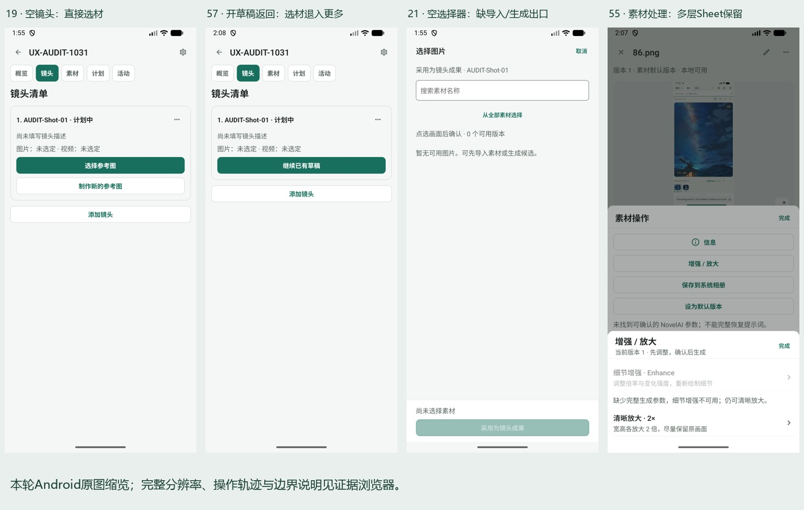
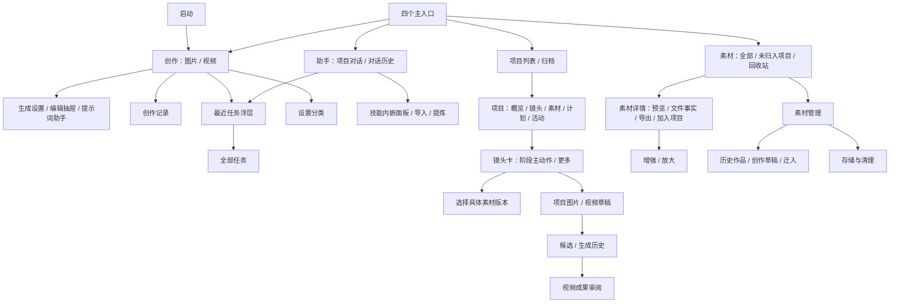
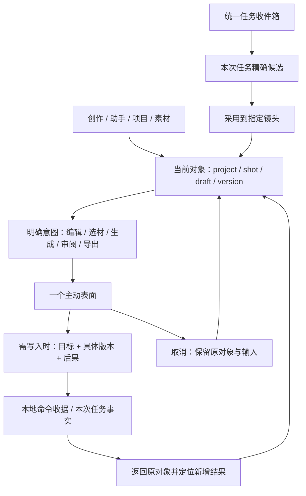
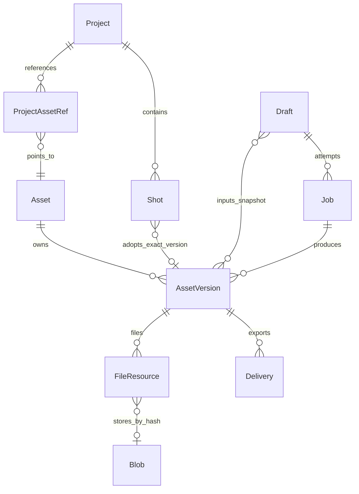

# 当前 App 逐页 UX/UI、导航与资源管理审查

日期：2026-10-31（Asia/Shanghai）。对象：Android 本地 AI 创作工作台，不是桌面版。

**结论：保留四个主入口与现有版本资产体系，优先改进“镜头阶段动作、选择器出口、表面互斥、历史语义和配置返回”；不建议再做一次全局换皮。** 当前可用的单项能力已经较多，但“一个镜头接着做下一步”的连贯性，仍弱于功能入口本身的完整性。

图中依次为19、57、21、55原图缩览，分别支持F01、F02、F03；55中的缩略图内容只是导入测试素材。完整分辨率与每一步健康度见下列证据入口。

## 阅读与证据入口

- [证据浏览器](../evidence/2026-10-31-full-ux-audit/evidence.html)：按截图查看界面、可见控件及处理器索引；原图可放大。
- [逐状态与控件清单](../evidence/2026-10-31-full-ux-audit/ui-controls.md)：每张有效 UI 树中的按钮、输入框、启用状态、坐标、源码候选位置。
- [源码控件及导航索引](../evidence/2026-10-31-full-ux-audit/source-index.md)：762 个 JSX 交互声明及辅助工厂调用、112 处 router 调用、22 个路由文件；包含布局、路由别名与复用组件，**不是 762 个独立可见按钮或全部实测通过数**。
- [逐交互处理器台账](../evidence/2026-10-31-full-ux-audit/source-behavior.md)：每项声明的回调、禁用表达式、同名 UI 候选及后续核验提示；不将静态枚举包装成运行验证。
- [后续执行任务包](2026-10-31-ux-execution-handoff.md)：按依赖拆分实施任务、验收场景与资源迁移要求。
- [证据清单](../evidence/2026-10-31-full-ux-audit/manifest.json)：截图真实状态、接纳/排除说明、文件哈希。
- [逐步截图与健康度](../evidence/2026-10-31-full-ux-audit/evidence-steps.md)与[跳转操作轨迹](../evidence/2026-10-31-full-ux-audit/navigation-trace.md)：完整截图内嵌，注明哪一次动作走到了哪里。

本轮不修改产品实现。下述“建议”均是待实施设计；源码风险与设备已见问题明确分开。

## 1. 范围与可信边界

源码：`5185fe2099834d4848befd70ce20dc5bb0babfcb`。安装包：`com.example.autodlh3`，`1.5.0-preview.4`，versionCode 70。模拟器 `AutoDL_Keyboard_QA_20261025 / emulator-5554`，1080×2400、420dpi，约 411dp 宽。

安装 APK 与本地 `mobile/android/app/build/outputs/apk/debug/app-debug.apk` 的 SHA-256 均为 `75175292d9b0b7149f43aadeb130fece6c34c4df72020bdf8e7b56fdb9aa028c`。这确认截图对应本地该构建产物；不把构建产物相同进一步说成源码提交可完全复现的证明。

证据分四类：

| 标识 | 含义 | 可得结论 |
| --- | --- | --- |
| V | 当前运行截图 + 新抓取 UI 树 + 操作前后观察 | 页面当前可见、按钮到达某状态、此次本地写入完成 |
| S | 当前源码/AST/处理器 | 功能分支、参数、潜在风险；不能代替真实执行 |
| R | 既往调研或本次官方参考资料 | 设计依据；不是当前故障证据 |
| D | 本报告设计判断 | 改进方案；仍需实施和验收 |

没有进行收费生成、真实模型对话、删除原有项目/素材、备份覆盖、恢复或清除数据。没有本轮真实视频成品与多版本任务样本，因此任务成功/失败/未知、精确多候选、播放解码、授权后的执行只作源码审阅和验收设计，不能标为全部通过。没有开展用户实验、TalkBack、外接键盘、折叠屏和性能基准；不声明无障碍合规。

新增本地审计项目 `UX-AUDIT-1031`、镜头 `AUDIT-Shot-01`、测试草稿及一项 `86.png`。`86.png` 是模拟器相册中选中的已有测试截图，作为**导入输入样本**；其内部出现的旧 App 界面不是本轮功能证据，也不是本轮生成结果。另将仓库 WebP 测试文件复制至模拟器 Download 并媒体扫描，未提交模型。原有视频草稿添加了一张本地参考图，审计结束移除此引用；测试对象保留供复查，详见交接记录。

启动时出现过 Android **System UI** ANR；01 启动画面、02 系统阻塞画面排除，不归因于 App。24、31、51、56 等文件名与实际状态不一致或重复，清单按实际内容解释。25 导入截图视觉有效，但当时 UI 树抓取失败后读到了旧树，其 XML/JSON **不得用于该面板控件的实测证明**。后续已修正取证脚本：抓取前删除旧 XML，失败拒绝回用。

## 2. 对既往研究的采纳与修正

本次重新阅读了 10 月 27 日创作平台架构、10 月 28 日移动创作 UX 研究、10 月 29 日本地 UI 演进与研究采纳计划，以及 10 月 30 日素材导航记录。

| 既有建议 | 本轮核验 | 本轮决定 |
| --- | --- | --- |
| 以 Focus—Intent—Surface—Return 组织交互 | 来源条已在项目图片工作台出现（22）；素材选择显示目标镜头（21、58） | 继续补齐，不新增另一套上下文模型 |
| 隐藏主 Tab，使用工作空间入口 | 当前四主入口已恢复且清晰可见（03、06、10、23） | **以当前四入口为基线**；不照抄旧研究再隐藏 |
| 任务只展示本次结果、指定版本不替换 | 源码已包含 onlyJob、OutputTarget、失效提示等修复 | 保留；需要有样本的回归，不能把历史缺陷重新算为已复现 |
| 素材列表虚拟化、版本分页 | 当前 CreativeWorkspace 已用 FlatList，版本条也已分页/虚拟化 | 不再报告“全列表未虚拟化”；关注剩余轮询和摘要读取 |
| 能力库、角色、制作流程、3D | 技能已有当前入口（08、09）；3D 仍无生产页面 | 技能先改可发现性和使用闭环；3D 与任意流程后置 |
| 对象事实、执行事实、视图状态分离 | 存储已具备大量实体与持久恢复约束 | 增量加关系与投影，不重写数据库和执行器 |

## 3. 当前功能树及合理性

合理之处：高频工作方式、作品组织和全局素材分别可达；快速生成不要求项目；账号、技能、维护没有都挤进主 Tab。

主要结构问题：

1. “创作记录、创作草稿、生成历史、最近任务、全部任务、历史作品”各有数据意义，用户却缺少一致解释和同一对象的连续线索。
2. 镜头卡可根据草稿切换动作，但旧草稿会影响“接下来应该做什么”；当前动作选择偏向执行状态而不是用户制作目标。
3. “概览”和“镜头”定位基本合理，项目设置却在内容区插入历史入口、归档和封面说明；设置不是一个清楚的独立任务表面。
4. 当前 `/creative-shot/[id]` 是**视频成果审阅页**，不是覆盖图片、描述、视频候选的完整镜头工作台；不能仅凭已有 shot 路由就宣称镜头焦点页已经完成。

## 4. 逐页审查

下表覆盖全部业务路由；布局与启动重定向另计。每行控件详情、状态及源码见 ui-controls.md 与 source-index.md。没有截图的业务分支给出具体限制。

| 页面/路由 | 证据与健康度 | 按钮/跳转核验与问题 | 改进 |
| --- | --- | --- | --- |
| 启动 `/` | S；入口基本合理；01/02排除 | index 重定向 create；不是作品目录。启动阶段未测数据库只读/维护恢复 | 恢复最近工作同时保留显式新建，不强迫新增首页 |
| 创作 `/(tabs)/create` 图片 | V04/05；有条件可用 | 图片切换、生成设置、关闭、主导航已走通；新建/生成/生成历史不是全部执行。空画布大而输入提示较弱；账号未连接时生成按钮仍启用 | 空态显示“描述画面＋参考图＋生成条件”；主操作按准备条件解释下一步 |
| 同页视频 | V03/44/48；有条件可用 | 参考图→来源选择→系统相册→返回成功；账号未连接，生成禁用；参数随内容需滚动，提交区固定 | 缺账号提示与图片一致；参考素材折叠摘要；保持提示词与主操作可见 |
| 助手 `/(tabs)/agent` | V06–09；基本可达 | 技能通过助手菜单进入内嵌面板；没有真实发送。示例会填入而非直接发送，文案清楚 | 增加“正在协助哪个项目/镜头”和交付物入口；保持全局对话与对象助手的范围隔离 |
| 项目 `/(tabs)/projects` | V10/16/17；基本可用 | 新建→填写→创建→项目详情已走通；归档仅看到入口。列表新建表单内嵌，操作与列表混排 | 新建作为明确编辑表面；列表显示封面、镜头阶段与最近任务摘要 |
| 素材 `/(tabs)/assets` | V23/28/49/50；基本可用 | 全局素材卡→内嵌详情、关闭返回列表成功；管理→存储/草稿/历史作品已走通；回收站未执行写入 | 保留四层：范围、搜索、类型、内容；增加业务分类/使用目的而非更多全局 Tab |
| 全部任务 `/(tabs)/tasks` | V30/32；空态可用，执行态未测 | 任务图标先开最近任务，全部任务再进队列；页面还重复有任务图标。持续监控/刷新可见，未启动监控 | 顶部保留返回、筛选、刷新；用统一状态说明执行/下载/导出/需处理，减少重复入口 |
| 历史作品 `/(tabs)/gallery` | V42；兼容页可达 | 标题同时“历史作品/结果”，空态“去生成视频”；管理仅可见 | 命名“旧版视频作品”，说明迁入后从素材管理；只读兼容入口逐步降级 |
| 设置 `/(tabs)/settings` 与 `/settings-panel` | V29/33–38；分类基本可用 | 分类→分区→返回分类；从素材直达存储→返回来源成功。旧 Tab 与 standalone 是两个入口宿主 | 统一设置路由契约，保存与离开区分；配置完成显示“返回刚才的创作” |
| 项目 `/creative-project/[id]` | V11–15/19/57；需优化 | 概览/镜头/计划/活动切换已走通；设置齿轮展开内容而非进入独立设置页；封面靠多步说明 | 保留页签恢复；设置使用短面板，提供真正“选择封面”动作；镜头主动作按制作阶段决定 |
| 素材 `/creative-asset/[id]` | V50–55 为同一复用详情组件的内嵌宿主；独立路由 S | 预览、导出、加入项目、名称标签、更多；加入审计项目完成；详情导出与菜单保存调同一导出函数 | 两宿主共用对象与选择状态，返回分别回栈/关闭检查器；归并重复导出文案；项目引用独立于默认版本 |
| 图片 `/image-draft/[id]` | V22；来源清楚，结果分支未测 | 从镜头新建进入；来源条正确；返回镜头已走通。设置/助手/编辑/历史为局部表面 | 只保留一个主动编辑表面；生成完成进入候选，不抢焦点或自动采用 |
| 视频 `/creative-draft/[id]` | V61；来源和参考图可见，提交分支未测 | 路由直接渲染 VideoDraftScreen；从镜头另建草稿进入成功。正常草稿与精确结果打开语义不同 | 参数使用 OpenIntent；明确“返回来源”与“回到创作编辑” |
| 镜头 `/creative-shot/[id]` | S；没有已生成视频可供完整实测 | ShotOutputReview 只汇集视频候选、采用、素材/工作台入口 | 扩展为完整镜头焦点页，或将现路由明确命名“视频成果审阅”，避免职责误读 |
| 任务 `/creative-task/[id]` | V65 缺失态；成功态 S | 缺失任务有说明与任务中心入口；本次任务范围、project/plan/step 返回参数已有实现，核查/重试未运行 | 采用运行时间线：准备→提交→生成→下载→候选就绪；未知先核查，下载失败不提示重生成 |
| 精确结果 `/creative-output/[id]` | V66 链接不完整、V69 指定版本缺失；成功态 S | 完整参数失效时没有替换为其他版本；精确版本视图不等同普通素材浏览 | 失效、原件缺失、记录不匹配分别说明；无用户选择不得替换版本 |
| 草稿列表 `/creative-drafts` | V41；可达但信息不足 | 出现两个完全同名“图片·编辑中·新草稿”；没有项目/镜头帮助区分 | 改“未完成创作”，每行显示标题、所属项目/镜头、更新时间、缩略图；统一到记录查询投影 |
| 技能 `/agent-skills` | V08/09 为内嵌面板、V70 独立 route | 本地技能为空，导入展开；内嵌模式同屏保留聊天输入；安装、启用、停用未实际写入 | 面板只快速选用；导入/版本/诊断进全屏；区分内置与用户技能，显示用途和输入输出 |
| 提炼 `/agent-skill-extract` | V68 证据选择初态；模型分支未测 | 对话、已选证据、脱敏及发送条件可见，不证明 LLM 提炼可运行 | 保留证据预览；缩短首屏说明，按步骤呈现；保存→显式启用分开 |
| 旧视频 `/video/[id]` | V67 缺失态；成功态 S | 明确“作品不存在或已删除”并有返回；下载中/播放分支需有效旧媒体 | 保留读取；用旧媒体只读身份指向素材投影，避免新系统继续写两套事实 |

### 4.1 界面设计与视觉层级

本节基于当前截图的设计判断，不冒充用户研究结论；没有量测对比度，因此不报告某颜色已经违反标准。

| 画面 | 当前优点与具体问题 | 建议布局与交互 |
| --- | --- | --- |
| 图片工作台（04/05） | 画布优先符合视觉创作；空白画布仍占主要空间，首次输入提示与账号条件不在同一视觉焦点，设置抽屉加入后上下内容竞争 | 无结果时把描述、参考图、账号准备做成短起步区；有图后恢复画布优先。高级参数渐进展开，提交区说明本次规格与缺项 |
| 视频工作台（03/61） | 参考图、音频、描述按输入类型组织；空白音频和参数也消耗首屏，长描述时下一步与当前镜头关系较弱 | 参考输入用缩略图摘要，无内容音频折叠为可选项；描述优先，底栏保留规格/估价/动作。来源条可回到镜头，不只显示名字 |
| 助手与技能（06/08/09） | 对话和输入连续；技能面板加入后同时出现两个任务中心，技术格式词与一般创作语言不一致 | 对话首屏明确正在协助的对象；技能快捷选择保留小面板，导入/编辑改全屏。对话交付使用可回到对象的卡片 |
| 项目与镜头（12/15/19/57） | 页签提供稳定分区；内联设置、镜头更多、草稿状态抢占主动作，用户需要记住展开状态 | 概览显示阶段摘要，镜头卡固定阶段动作和候选计数；设置为短任务表面。项目封面和最近工作提供对象识别，减少同名文字列表 |
| 素材详情（50–55） | 版本和文件事实可查看；详情、加入项目与叠层菜单形成多层滚动/操作焦点，主要用途不够突出 | 预览＋固定版本条＋“用于…”作为主要结构；基础信息默认摘要，完整技术元数据折叠；对象操作使用一个主动表面，避免多个同色文字动作均像主操作 |
| 记录与任务（30/32/41/43） | 收件箱与队列入口已有区分；多种记录行主要靠标题而缺归属/缩略图，空态去向不总能完成原任务 | 用统一行模板显示对象、阶段和时间；任务时间线说明系统正在做什么。空态动作按来源任务推荐，不统一粗略跳回创作 |
| 设置维护（29/33–38） | 分类减少一次看到的设置量；维护动作同色同区，日常备份和破坏性操作缺视觉区分 | 日常配置、空间/备份、危险区分别分组；每区一个主要动作。保存与返回反馈清楚，避免以绿色可点击文字承担所有层级 |

共同规范：优先减少同时活跃的对象/表面，再统一字阶、间距、控件高度与状态色；不能仅扩大按钮导致页面更长。标题表示对象，次级文字表示归属/版本，状态使用文字加图标而非仅颜色。错误放在受影响操作附近，保留可恢复动作；诊断细节可展开。宽屏可逐步采用导航栏＋对象列表＋工作区＋检查器，手机仍以单焦点任务为主，不压缩照搬桌面三栏。

## 5. 可直接实施的问题卡

优先级：P1 阻碍创作连续性、易误解当前对象或消费；P2 效率、可发现性与界面一致性。没有足够证据将本轮任何一项标为数据损毁 P0。

### F01 · P1 · 镜头阶段主动作被旧草稿占据（V19→22→57）

复现：审计镜头无图→制作新的参考图→不生成直接返回。19 有“选择参考图／制作新的参考图”；57 变为“继续已有草稿”，选择已有图片退到更多菜单。即使后来已经从全局库把图片加入项目，用户仍需“更多→选定图片”。

影响：一次尝试改变了工作流入口，用户无法直接改走已有素材路径。`ProjectShots.tsx` 的 continuing 分支优先于 selected_image 分支是当前源码依据。不是草稿丢失，而是动作优先级不符合制作阶段。

方案：主操作由镜头成果缺口决定，“选择／制作参考图”和“制作视频”保持稳定；已有草稿显示独立“继续图片草稿”卡，指明类型/时间，不挤掉选材。验收：空镜头→开图草稿→返回→选已有图→制作视频全程无需在更多里寻找必要动作。

### F02 · P1 · 空选材页没有完成任务的出口（V21）

复现：无项目图片时点选择参考图；页面说明“先导入或生成候选”，仅提供搜索、切换全部、取消、禁用确认。方案：空态直接提供“从设备导入”“制作参考图”；返回选择器时自动定位新增版本并等待确认；取消恢复原镜头和已选项。对象采用仍须显式确认，导入成功不等于镜头已采用。

落点：CreativeAssetPicker、fileImport、ProjectShots、返回上下文。验收：空项目、不空全局、全空三种状态均有直接路径；导入取消不丢原输入；无网络可完成本地选材。

### F03 · P1 · 嵌套操作表面让返回深度增加（V52→53→55→56）

复现：素材详情→加入项目（内嵌区域仍开）→素材操作（Sheet）→增强/放大（又一个 Sheet）；系统返回先回素材操作，而非详情。55 保存了双层遮罩；56 是返回后的素材菜单，文件名不代表选材页。

方案：引入单一主动表面；进入处理工具先关闭菜单，加入项目与处理工具互斥。处理取消回素材详情并恢复具体版本；不靠多个独立 boolean 控制叠层。验收：顶部完成、系统返回、遮罩点击三种出口一致；一次返回关闭当前表面，不跨对象；读屏焦点不落在被遮挡控件上。

### F04 · P1 · 未连接账号时生成条件不一致（V03/04/38）

视频生成禁用并显示连接 AutoDL，图片生成仍启用、上方仅“连接 NovelAI 以查看用量”。本轮没有点击生成，因此不声称一定触发收费或崩溃。问题是点击前不能预判下一步。

方案：统一 ReadyState（缺输入／缺连接／待用量核查／可生成／提交中），缺连接时明确主操作“连接 NovelAI”，连接成功返回原草稿。保留本地编辑，不因连接要求挡住所有功能。验收：两类工作台在相同准备条件下给出一致反馈；不能用按钮 disabled 隐藏原因。

### F05 · P1 · 多种历史列表缺少对象身份（V41/43，S CreativeHome）

41 两个“图片·编辑中·新草稿”无法区分；43 创作记录也以 Prompt/未命名为标题，缺项目/镜头。源码草稿状态、生成任务、资产版本都有身份，但列表没有有效投影。

方案：作品对象为一层、生成尝试为下一层；统一最近工作查询，行展示“项目／镜头 · 图片/视频 · 草稿/候选 · 更新时间”。保留任务收件箱用于运行事实；旧历史作品明确旧版。验收：两个空 Prompt、同名项目、同素材多轮结果可区分，搜索项目/镜头能找到草稿；不同列表打开同一结果不改变版本。

### F06 · P2 · 项目封面操作藏在关系管理中（V15/54）

15 要用户阅读说明并跨到项目素材、版本、加入项目才能设封面；54 证实封面入口位于加入项目区域。方案：项目设置直接“选择封面”，调用图片版本选择器；封面不必先由用户理解项目引用关系。服务层事务负责确保引用存在及固定版本。验收：项目→设置→选图→确认完成；取消不改封面；移出素材前能说明封面引用。

### F07 · P2 · 活动流暴露内部命令与状态（V14，S ProjectActivityPanel）

`project.create · 已保存` 对普通创作者帮助有限；源码提案的非 WAITING 状态也直接渲染枚举。方案：映射为“创建了项目”“更新镜头描述”“采用参考图 v2”，附对象跳转；原命令/收据放可展开诊断。验收：正常列表不显示内部 command/state，异常仍有可复制诊断编号。

### F08 · P2 · 高频图标命中区偏小且含义相近（V03/04/05，S WorkbenchUI）

新建、记录、任务、设置、生成历史等多个纯图标并列。03 的部分图标 UI 树 bounds 约 89px，即约 34dp；源码 compact IconAction=34、hitSlop=5，TextAction=36。hitSlop 不等同可见边界，也可能受父容器和邻近目标限制，不能仅看截图断言实际命中区或无障碍违规。

方案：设计目标采用至少 48dp 不重叠命中区，图标可保持小；记录与任务增加文字/首次提示；减少主栏次要动作。验收：1.0/1.3/2.0字体、窄屏、触摸边界、TalkBack名称与焦点顺序；被裁剪元素不可被读屏误选。

### F09 · P2 · 同一导出行为两种按钮名（V50/52，S267/275）

详情“导出”和更多“保存到系统相册”均调用 exportCreativeVersion。方案：外显“保存到手机”，依媒体类型说明相册/下载；分享未来另设；完成后显示位置与可打开动作。验收：重复点不重复交付；失败与目标未知保留原件；导出不改变镜头采用。

### F10 · P2 · 技能管理挤占聊天且创建语义偏技术（V08/09）

助手菜单→技能后，聊天、输入、技能导入与搜索同时占屏；SKILL.md/ZIP 对新手是格式而非用途。方案：快速面板只显示已启用能力和切换；导入/编辑/提炼使用独立全屏任务；先用途、输入、适用限制，再高级格式。验收：关闭技能不停止无关对话运行；停用语义与运行冻结版本保持现有安全契约，不为文案简化改变撤销行为。

### F11 · P2 · 维护动作缺少明确视觉危险层级（V29）

清理、数据库备份、完整备份、清除应用数据位于同一数据管理块，清除也用相同绿色文本。未执行清除，不能声称缺少二次确认。方案：日常“空间与备份”与危险操作分组；首选含文件的完整备份，数据库备份标为高级；清除使用独立危险区和影响清单。验收：可分辨“记录可恢复但媒体未备份”；恢复前说明隔离执行，不自动消费。

### F12 · P1 · 计划授权仍无金额上限（S，非实测消费故障）

ProjectPlans.authorize 明文“最多一次／15分钟／费用未知／无金额上限”，grant 的 amountLimit=null。这已有次数限制和未知结果防重发，是应保留的保护；仍缺用户可理解的金额约束和实际参数确认。

方案：显示生成规格、输入版本、次数、估价时间与币种；已知费用提供金额上限，未知费用明确选项与单次授权；不能发明一个准确价格。验收：过期、估价变化、断网、重复点击、任务未知、重启恢复均核查原任务而非重复消费。

### F13 · P2 · 计划页过早暴露编排概念（V13，S ProjectPlans）

没有镜头、没有候选的项目也显示提示词、读取候选、保存计划。方案：先问“为哪个镜头做视频”，在镜头上以“选图后制作视频”进入；已有计划以步骤清单展示。本轮只支持固定 selection/video，不设计可任意运行的节点图。

### F14 · P2 · 全局设置与局部工具设置需要统一返回契约（V29/33–38；S）

本轮成功路径证明基本返回可用；尚未验证同实例反复直达分区、未保存内容与系统返回全部组合。方案：保留 section/requestId 参数消费，补来源对象和原工具状态；“保存成功”不隐式导航，另给返回操作。验收：直达账号、助手模型、工作流各两次；保存失败/离开/取消；回原草稿不建副本。

## 6. 建议跳转树与交互契约

| 起点与动作 | 目标 | 必须带入 | 完成/取消后的返回 |
| --- | --- | --- | --- |
| 镜头→制作参考图 | 图片工作台 | projectId、shotId、draftId、来源锚点 | 原镜头；候选就绪可取回，生成不自动采用 |
| 镜头→选择已有图 | 版本选择器 | purpose=adopt、目标镜头、当前采用版本 | 确认后更新该槽位；取消不变 |
| 镜头→制作视频 | 视频工作台 | 采用图片具体版本、当前描述快照 | 原镜头；候选在镜头里审阅 |
| 任务/助手卡→看结果 | 精确结果页 | jobId + assetId + versionId，互相校验 | 原任务或原对话，不是默认工作台 |
| 素材→增强/放大 | 同来源的处理草稿 | sourceVersionId、项目/镜头（可空） | 原素材具体版本；新结果作为候选 |
| 素材→加入项目 | 项目选择任务 | assetId、versionId、固定/跟随意图 | 原素材，显示已加入对象；不自动切项目 |
| 项目→更换封面 | 图片版本选择器 | projectId、purpose=cover | 原项目；一次事务更新引用 |
| 生成前→连接账号 | 设置分区/账号表面 | provider、returnAnchor、draftId | 原工作台与未提交输入 |
| 对话→提炼技能 | 全屏证据选择与编辑 | sourceThread/run/selectedEvidenceIds | 原对话；保存后单独启用 |
| 最近任务→全部任务 | 任务列表 | filter、returnAnchor | 返回原工作对象与列表筛选 |

导航状态建议：`OpenIntent {kind,target,origin,returnAnchor,requestId}`。target 存稳定 ID；returnAnchor 保存来源种类、对象 ID、页签、选中版本、必要滚动锚点。正文、密钥、完整媒体与预算授权不进 URL。来源消失时回所属项目/最近工作并解释；返回锚点只决定导航，不授予 Agent 权限。

物理返回优先级：键盘→当前工具/选择器→全屏编辑任务→来源对象→主工作台。需要保存的出口走同一 leave guard；对话运行生命周期不能依附一个面板是否关闭。异步完成只显示“候选就绪”，不偷换焦点、选中项或主按钮。

## 7. 背后的资源管理如何升级

### 7.1 保留现有事实层

已存在 CreativeService 命令、不可变 AssetVersion、内容哈希文件、项目引用、镜头采用槽位、任务/操作/收据、预算预占、文件恢复与备份隔离。继续复用；UI 改造不应创建第二套“画布素材”“聊天文件”事实。

这是逻辑关系图，**不是声称所有关系都已用这些同名表实现**。具体当前表名见 schema.ts 与交接文档。

### 7.2 三种关系必须分清

- **内容身份**：素材及不可变版本，原件、缩略图、预览与 sidecar；重复导入可复用 Blob，但逻辑素材身份是否合并仍遵守现有导入契约。
- **使用关系**：项目收纳、镜头采用、角色/场景用途、参考输入；“加入项目”不能替代“采用到镜头”。同文件可在多个项目不同版本上使用。
- **执行与交付**：生成尝试、远端任务、下载恢复、导出；生成成功、文件可用、已采用、已保存到手机是不同事实。

### 7.3 增量新增的五类投影/契约

| 升级 | 用户收益 | 实施约束 |
| --- | --- | --- |
| WorkspaceFocus + ReturnAnchor | 每次回到原项目/镜头/具体版本 | 视图状态不成为业务权威；过期锚点可降级，不伪造权限 |
| RecentWorkItem 摘要查询 | 草稿、记录和任务有一致标题与所属对象 | 从现有实体投影，分页＋索引；不复制可变状态到多处 |
| UsageGraph 使用关系查询 | 删除前知道哪些镜头/封面/草稿在用 | 先补齐现有引用，再扩角色/场景；精确版本与跟随默认分开 |
| StageSummary 镜头阶段摘要 | 主按钮由真实成果缺口决定 | 已采用版本、候选数、图片/视频草稿分别统计；不可用文件不当成“无成果” |
| ResourceHealth + DeliverySummary | 一眼区分缺原件、待下载、导出失败 | 状态来自文件和交付服务，不靠聊天文本推断；恢复校验哈希 |

角色、场景、道具业务分类先通过有约束的用途关系扩展，保留图片/视频/音频/文本格式分类。未来画布节点只保存对象引用、布局和连线；视觉连线不自动表示执行依赖。未来 3D 场景文档、场景版本、取景 PNG 分别建身份，提交任务只固定本次取景版本。

### 7.4 生命周期与空间管理

1. 导入先检查大小/格式和可读性，再复制并校验原件；缩略图属于可再生缓存，任务输入固定原件版本。
2. 删除先查项目固定引用、镜头采用、草稿输入、任务快照、封面及未来场景引用；被引用时显示使用位置与可执行处置。不能只查项目表。
3. 回收站软删除可恢复；清理缓存、清理无引用文件、永久删除内容是不同动作。将 `asset.trash` 的保护继续作为服务约束，不靠 UI 隐藏按钮。
4. 导出独立交付账本，系统相册副本不是原件引用；目标未知时核查，禁止因不明确的成功状态删除本地唯一原件。
5. 完整备份含数据库、被引用 Blob、技能不可变版本、场景文档与资源清单；密钥走现有安全存储不打包。项目包导出另定义依赖闭包与共享素材策略。
6. 恢复先校验 manifest、哈希和 schema，执行记录隔离；恢复数据不代表重新授权。迁入过程中保留旧记录到投影的一致映射，不能直接删旧表。

### 7.5 性能与长期维护

当前素材/版本列表已有分页与虚拟化，保留这些成果。剩余风险包括 CreativeResults、CreativeWorkspace、ProjectActivity、ProjectPlans 的 2–3 秒轮询及非当前页面是否仍触发读取。本轮没有测耗时，不能宣称已造成卡顿。

建议按对象 revision/事件失效刷新、focus/AppState 暂停读模型；一次批量查询版本摘要与文件健康，缩略图按可见项加载；原件哈希校验在使用/恢复等边界做而非每轮列表刷新。验收使用 100/1000/10000 版本、缺文件、长文本与后台恢复，记录列表首屏、选材响应、滚动帧与内存；先量化再扩画布和时间线。

## 8. 桌面参考的取舍

本次打开并核对两个官方仓库 README，未部署或逐按钮测试参考产品，因此不能用它们证明“交互成熟、没有缺陷”。尤其影策官方自述仍在快速开发，3D 世界引擎部分标注内测。

| 参考 | 可借鉴模式 | 本 App 的适配 |
| --- | --- | --- |
| [Toonflow](https://github.com/HBAI-Ltd/Toonflow-app) | 剧本、角色/场景、图像与片段围绕制作对象关联；模型和能力按需接入 | 手机镜头卡＋对象工作台＋候选托盘；将关系保存在领域层，宽屏以后加可选画布 |
| [影策 open-ai-canvas](https://github.com/ddcat-ai/open-ai-canvas) | 分镜、设定、生成与人工接管；技能与素材分别组织；任务记录带创作归属 | 当前镜头的阶段动作与使用关系优先；手机默认步骤清单，复杂图编辑和 3D 独立进入 |

上述是官方描述的简要概括；本报告其余详细架构建议是基于本 App 当前源码的设计推演，不是从参考仓库直接移植。两者的后台、账户与部署形式也不是本产品的默认架构。保持全本地业务事实与远端仅模型调用边界。

## 9. 实施顺序与验收门槛

| 批次 | 问题 | 最小交付 | 门槛 |
| --- | --- | --- | --- |
| A | F01/F02/F04 | 一个镜头从已有图或新图走到视频草稿，连接账号后回原位置 | 任何路径不丢对象、不建重复草稿；返回不改变采用 |
| B | F03/F08/F14 | 一个主动表面、统一出口与足够命中区 | 键盘、系统返回、遮罩、顶部关闭一致；大字体读屏可用 |
| C | F05/F06/F07/F09 | 最近工作投影、直接封面、可读活动、统一导出 | 同名/空标题可区分；精确版本不替换；导出不改采用 |
| D | F10/F11/F12/F13 | 技能完整任务表面、空间备份分层、计划可理解授权 | 未知任务先核查；恢复隔离；不自动消费 |
| E | 资源与性能 | UsageGraph、健康摘要、分页失效刷新 | 规模与生命周期证据达标后再加画布/3D/通用编排 |

后续 agent 可凭本报告、原图、UI XML、源码快照和问题卡定位与实现，不必为理解问题重新打开 App；修复验收仍必须运行实际界面，不能把“免重新调查”理解成“免回归验证”。

## 10. 本次对照的仓库研究

- [10月27日创作工作台产品架构](../research/2026-10-27-creative-workspace-product-architecture.md)：对象、资产、执行、恢复的边界。
- [10月28日移动AI创作UX研究](../research/2026-10-28-mobile-ai-creative-ux-research.md)：移动信息架构、工作台与连续任务。
- [10月29日本地创作UI演进](../research/2026-10-29-local-creative-ui-evolution.md)：焦点/意图/表面/返回；本次不沿用其中已过时的隐藏Tab建议。
- [10月29日研究采纳与调整计划](2026-10-29-research-adoption-and-adjustment-plan.md)：实施优先级与已有约束。
- [10月30日素材导航](2026-10-30-library-navigation.md)：素材选择、范围与导航现状。
- [10月30日对话与素材UX](2026-10-30-chat-asset-ux.md)：对象操作、历史与上下文；本轮对照当前源码和画面使用。

这些旧文档作为设计背景，不作为本轮故障复现截图；当前实现与旧文档冲突时，以本轮运行和源码为准。
