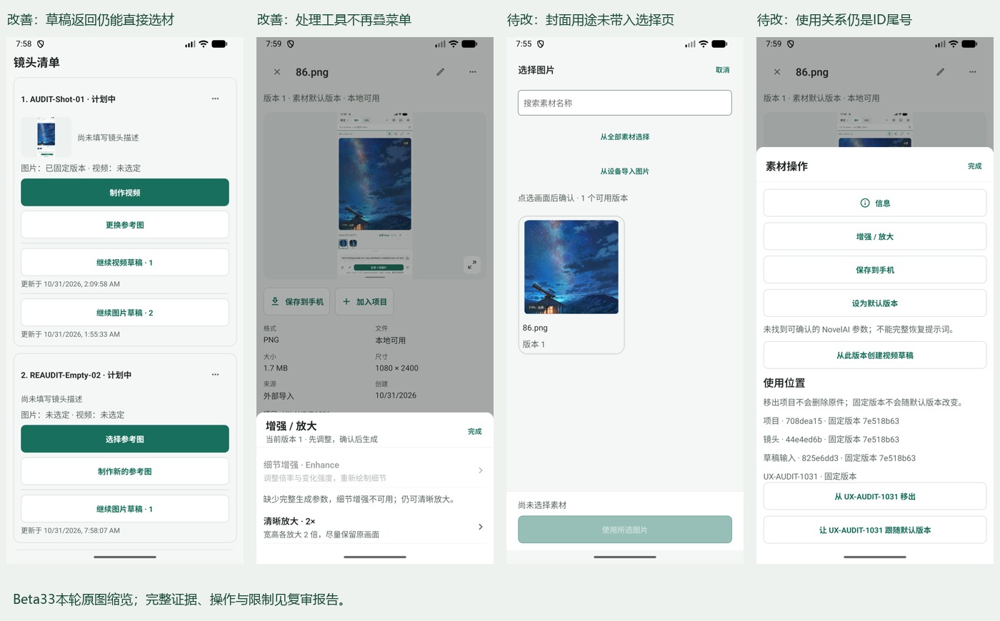
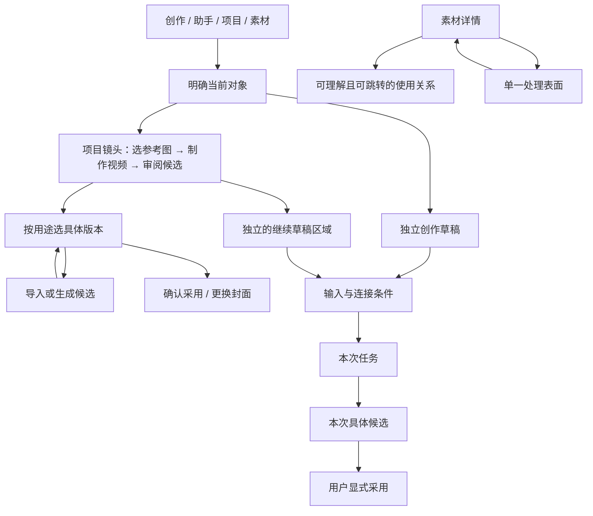

# Beta 33 全面 UX/UI 复审

> 历史归档（整理于 2026-11-01）：R01–R08 在密度调整记录中逐项处理且有待验边界；R09 当时仍开放。后续能力范围以最终台账为准，不能直接重开旧问题。 状态与后继见[归档索引](archive/2026-10-31-agent-workbench.md)；现行页面设计见[设计谱系](../design/README.md)。原文“当前”、优先级、源码行号和复跑命令均属于审查时基线；复现探针不属于现行正确性回归。桌面执行端、远端 Worker 及外部业务编排服务器均禁止；旧文相反建议已失效。

日期：2026-10-31，Asia/Shanghai。对照上一轮 F01–F14，重新采集当前 App，不以实施报告中的“已调整”代替本轮验证。**本轮只审查与留证，不改产品代码。**

结论：这一轮改进方向正确，已修复影响创作连续性的关键入口与叠层问题。当前适合继续受控试用；还不足以认定为完整验证的创作工作台。下一轮应收敛页面动作、补齐业务语义和真实结果状态验证，暂缓新增画布、3D、通用编排等大功能。

图中为本轮21、26、07、25原图缩览。25素材预览内是输入截图，不作为当前界面判断；本轮判断针对外层素材操作菜单。

## 证据入口与基线

- [本轮截图与健康度（本地归档：steps.md）](archive/2026-10-31-agent-workbench.md#local-archive)：按步骤内嵌原图，记录真实状态、失败取证及限制。
- [离线证据浏览器（本地归档：evidence.html）](archive/2026-10-31-agent-workbench.md#local-archive)：检索截图、可见控件及后续定位信息。
- [逐控件台账（本地归档：ui-controls.md）](archive/2026-10-31-agent-workbench.md#local-archive)、[源码交互索引（本地归档：source-index.md）](archive/2026-10-31-agent-workbench.md#local-archive)、[导航调用快照（本地归档：source-navigation.json）](archive/2026-10-31-agent-workbench.md#local-archive)。源码静态扫描为780项交互声明/工厂调用、117处导航调用、22个路由文件，**不是780个按钮实测通过**。
- [清单和哈希（本地归档：manifest.json）](archive/2026-10-31-agent-workbench.md#local-archive)、[本轮操作记录](../evidence/2026-10-31-ux-reaudit/actions.json)。
- [上一轮审计](2026-10-31-full-product-ux-audit.md)、[实施闭环自述](2026-10-31-ux-closure.md)。自述中的测试结果只作背景，不记成本轮执行结果。

源码 HEAD：`71bcf9748952ca0c4380712300bb75ee954fb02e`，起始工作区干净。已安装 `com.example.autodlh3` versionCode71、versionName1.5.0-preview.4。设备安装 APK 与本地 APK SHA256 同为 `40902b28a8b40d99254d661b21d8ae270ff67f90ea3581964611fcdcad17c746`。包一致不等于证明任意源码环境可复现该构建。

设备：emulator-5554，1080×2400、420dpi；使用新鲜UI树定位触控，并查看本轮保存截图。截图可证明可见状态；返回/取消路径由操作前后记录证明。源码只能证明分支和潜在问题，不能代替远端执行。

本轮新增：在原审计项目 UX-AUDIT-1031 下创建空镜头 `REAUDIT-Empty-02` 及一份图片草稿，用于验证 F01；保留供复查。没有修改已有镜头采用、封面、真实账号或助手输入；没有提交真实生成/对话、导出、删除、清库、覆盖恢复。设备相册只打开后取消，没有新增导入。86.png仍是前轮输入样本，其内部旧界面不作为当前证据。没有改显示尺寸、字体或无障碍设置。

17文件名虽为new-image-draft，实际仍是镜头列表，首次点击未到草稿，不计成功；18实际是项目列表。之后重新滚动定位，19→20→21才是有效链路。没有把错误文件名当成App回归。

## 1. 上轮问题的复核结论

“当前路径通过”仅限本轮实际条件；不把取消成功扩展为成功写入、失败恢复和远端消费均已通过。

| 原问题 | 本轮结论 | 新证据及尚缺验证 |
| --- | --- | --- |
| F01 镜头主动作被草稿抢占 | **核心复现路径已修复** | 19新空镜头→20开图草稿→21返回：选择参考图、制作新图、继续草稿并存；05已有图镜头保留制作视频/换图。多草稿密度另记R07 |
| F02 空选择器无出口 | **入口和取消闭环已修复；生成/导入成功回流待验** | 11/12提供制作参考图、导入、清搜索；13系统相册→14取消回原筛选。筛选空不是全库全空的完整替代样本 |
| F03 多Sheet叠层 | **原问题链路已修复** | 24加入项目区域→25菜单→26处理，仅一个主动表面；27系统返回到素材详情，没有回下层菜单 |
| F04 就绪条件不一致 | **逻辑改善；视觉未闭环** | 02/20图片生成enabled=false，01视频同样禁用；但图片仍是饱和绿色按钮，R01 |
| F05 历史对象身份 | **明显改善，部分完成** | 03带项目/镜头、类型和时间，空标题有稳定尾号；任务/精确结果统一摘要与真实多候选尚未验 |
| F06 封面藏关系管理 | **直接入口已修复；选择语义仍不足** | 06→07封面选择器可达并取消，项目设置保持；没有实际更新封面。本次R08记录选择器丢失用途表达 |
| F07 内部命令 | **普通活动文字改善；提案分支未完全处理** | 09显示创建视频草稿等自然语言。源码非WAITING提案仍直接p.state，不能称全部状态已本地化 |
| F08 命中区 | **公共控件改善；全局未闭环** | 顶部图标bounds126px≈48dp，任务有文字；图片生成按钮仍minHeight34，视频主动作44、时长chip40；未测实际触控边缘和TalkBack |
| F09 保存命名 | **文案已统一；交付行为待验** | 23/25均保存到手机；没有执行导出，不能宣称权限/未知交付问题已解决 |
| F10 技能编辑挤对话 | **部分完成** | 31内嵌快速面板仍在；32/33编辑转独立页，需重复点添加，R06 |
| F11 维护危险层级 | **界面分组改善；生命周期待验** | 38完整备份/高级数据库/危险区分开；39只展开危险区，不点清除 |
| F12 金额上限 | **仍开放，提示更诚实** | 源码仍amountLimit=null，参考CNY不等于执行器autodl_points预算；一次/15分钟/未知费用确认仍保留，R09 |
| F13 计划过早暴露 | **初态渐进展示改善** | 08先选镜头，无参数和保存大表单；尚未执行创建计划/授权链路 |
| F14 设置返回 | **基本分区路径可用；边界待验** | 37进入各分区并返回；来源draft/surface/requestId源码保留。保存失败、冷链、同分区重复直达等未穷尽 |

## 2. 整体信息架构与逐页评估

四入口继续保留：创作=快速工作，助手=讨论与协调，项目=制作组织，素材=可复用资源。当前不需要另加一个首页或把任务升为第五主入口。

这张图是建议契约；其中真实生成→候选→采用的完整服务链路没有在本轮运行，使用关系跳转也尚未实现。

| 页面/宿主 | 健康度与当前判断 | 下一步 |
| --- | --- | --- |
| 启动 `/` | S：仍为工作区入口，未测试冷恢复；本轮从已有前台状态开始 | 不新增欢迎首页，补冷启动来源消失/数据库恢复验收 |
| 创作图片 `/(tabs)/create` | 02：可编辑、就绪逻辑改善；大空画布与很小输入区域之间比例仍不利于首次输入，禁用样式不一致 | 空态适当扩大描述区；就绪信息与主动作保持一组；有结果后画布优先 |
| 创作视频同页 | 01：输入按类型组织，固定提交区有效；缺账号时状态说明＋连接按钮＋空参考块占首屏，清晰度/时长要滚动 | 连接状态合并成紧凑横条；音频无内容时折叠；保留描述优先与参数摘要 |
| 图片 `/image-draft/[id]` | 20：项目/镜头来源正确，返回原镜头成功 | 保留该来源与显式采用语义；缺账号禁用视觉R01 |
| 视频 `/creative-draft/[id]` | S：直接VideoDraftScreen，不是通用媒体router；本轮看到独立视频宿主，未新开该独立route成功结果分支 | 用有效视频草稿及任务补生成前/进行中/下一次输入/未知结果矩阵 |
| 助手 `/(tabs)/agent` | 29/34：项目可识别，输入与示例不自动发送；未真实发送 | 增加当前镜头/交付物可回到对象的摘要；保持讨论与执行授权分开 |
| 技能 `/agent-skills` 与内嵌宿主 | 31–33：独立编辑方向正确，但添加意图到达空列表，多点一次才能编辑 | 传入intent=add，一次进入新建；快速面板只显示选用/查看 |
| 提炼 `/agent-skill-extract` | 本轮新截图见steps；只检查证据选择初态 | 需真实对话样本验证证据、脱敏、保存、启用分离，不能用空态盖过执行 |
| 项目 `/(tabs)/projects` | 04：列表简洁可搜索；仍主要靠项目名，缺封面/阶段摘要，更多项目下识别较弱 | 列表补封面、阶段与最近工作，不在列表展示所有任务 |
| 项目概览 `/creative-project/[id]` | 10：简报/镜头进度/最近工作清楚，工作区语义更连贯 | 统一时间显示；继续编辑保留所属对象；不要把诊断信息铺到概览 |
| 同页镜头 | 05/19/21：阶段主动作稳定；草稿逐条大按钮，两个镜头已需要较长滚动 | R07：折叠草稿摘要，完整编辑到镜头焦点，列表维持短卡 |
| 同页素材 | 复用素材/关系组件S；本轮全局素材库和选择器已测，项目素材页未单独重新截取 | 后续补项目范围/全局范围、移入移出、固定/跟随版本的组合 |
| 同页计划 | 08：先选镜头，初态明显简化；计划与手动制作关系仍需解释 | 定位为可选的“选图后自动制作视频”，先保证单镜头流程；真实授权按R09处理 |
| 同页活动 | 09：事件可读；诊断按钮与实际工作同等级，审阅效率仍低 | R05：诊断收进更多/详情，保留对象跳转 |
| 同页项目设置 | 06：短面板且直接封面入口 | 选择封面R08；归档操作不抢正向编辑动作 |
| 素材 `/(tabs)/assets` | 22：范围、搜索、类型、内容四层清楚；素材量少，不能据此证明大库性能 | 保留虚拟化，加入角色/场景等用途关系而非继续增加全局类型按钮 |
| 素材 `/creative-asset/[id]` | 23–28为内嵌详情宿主；独立route S。文件事实与操作清楚，处理互斥通过 | R04：使用位置显示对象名、版本号、跳转；继续保留精确版本 |
| 草稿 `/creative-drafts` | 46：尾号区分改善，但五条均饱和绿色大按钮、无项目/镜头；相比03的最近创作行仍有明显语义落差 | 复用03的对象摘要行，主色只给当前主操作；逐步用最近工作投影统一，不合并任务事实或删除兼容记录 |
| 最近任务/全部任务 `/(tabs)/tasks` | 35/36：空队列可达；队列仍有打开任务中心的重复入口 | 在任务页不再打开自身收件箱；真实进行中/下载失败/UNKNOWN要补验 |
| 任务 `/creative-task/[id]` | 本轮重新检查缺失态；没有真实任务 | 补就绪、提交、下载、失败、未知、精确返回，而不是只审空态 |
| 精确结果 `/creative-output/[id]` | 本轮失效版本提示可达；成功与多候选未测 | 不得替换具体版本；原件缺失与记录失效分开 |
| 镜头 `/creative-shot/[id]` | S：仍是视频成果审阅；本轮没有视频候选可运行 | 不能宣称完整镜头焦点页已建成；以后明确扩展职责或命名 |
| 历史作品 `/(tabs)/gallery` | 本轮重新到空态，兼容身份仍需更明确 | 命名旧版视频作品；降级为历史入口，迁入后统一素材身份 |
| 旧视频 `/video/[id]` | S：未重新播放有效旧视频；上轮缺失态不当成本轮成功证据 | 有效媒体、解码、下载恢复需独立验收 |
| 设置Tab与 `/settings-panel` | 37–43：分类/存储/模型/工作流/播放/显示可达；无保存写入 | 补有修改/无修改离开、验证失败、冷链来源恢复；不要用绿色保存按钮替代错误解释 |

## 3. 本轮仍需处理的问题卡

优先级P1=消费或制作链路的重要风险；P2=用户效率/理解与一致性。以下9项中R09是旧问题继续开放，其他是修复后的细化或新增设计观察；并非9个新崩溃。

### R01 · P2 · 图片生成已禁用，但看起来仍可用

证据02/20，源码 `ImageDraftScreen.tsx:233`：disabled包含`!ready.canSubmit`，opacity只包含busy/saving/pending/conflict，漏掉缺连接/缺描述。结果是UI树enabled=false，画面仍饱和绿色白字。公共按钮改成48dp后，此主按钮仍minHeight34（251行）；视频主按钮minHeight44。

改进：统一按最终disabled/ReadyState驱动样式、可访问状态和附近原因；缺账号可把主动作明确改为连接服务，或保留禁用生成并给紧邻的连接入口。不要只加一个opacity而让用户继续猜。尺寸遵循整组布局，视觉可小，实际目标需独立验证。

验收：缺连接、缺描述、保存中、冲突、可生成五态截图；同一态视觉与enabled一致，读屏说明原因；确认实际命中区不与旁边设置/历史重叠。

### R02 · P2 · 视频准备状态重复，挤占首屏

证据01：状态“连接AutoDL创作服务”后又有48dp连接账号，再加独立参考图、空音频和描述；清晰度、时长位于首屏下方。滚动是正常行为，问题是**低价值重复信息先于关键创作输入**。源码 `VideoDraftScreen.tsx:223–231`、content gap18。

改进：连接状态与操作合并一条紧凑提示；没有参考音频时用“添加声音（可选）”单行；参考图有内容后展示缩略图。描述与参数摘要形成主工作区，完整参数在设置。保留48dp触控目标，不把全部内容再缩成难点的小字。

验收：未连接/已连接、0/1/9图、0/1音频、长提示词、大字体下，能辨认当前对象、编辑描述、查看本次规格并执行下一步。

### R03 · P2 · 选择器修复后堆叠重复出口

证据12/14：“从全部素材选择”既在顶部又在空态；另有制作参考图、设备导入、清搜索、取消返回和禁用确认。路径可用但首屏由动作占据，而非引导用户解除当前阻碍。

改进：范围切换保持一个位置；搜索无匹配首先给清除搜索，全库空才主推导入/制作；非空状态把导入/制作收成同一“新增”菜单。底部只负责选中项及确认，顶部取消即可，不重复三个取消表达。

验收：项目空/全局有、全局全空、筛选空、读取失败各一张，动作不重复；保留本轮已验证的相册取消回原搜索/目标。

### R04 · P2 · 使用关系有数据，但用户无法识别或到达

证据25/28：“项目·708dea15”“镜头·44e4ed6b”“固定版本7e518b63”。源码 `CreativeWorkspace.tsx:304`渲染Text与ID尾号；`usageGraph.ts`只投影kind/object_id/version_id。下面又单独显示UX-AUDIT-1031固定版本，关系表达重复。

改进：批量投影对象标题、所属项目/镜头、关系用途、版本号、可用性与可打开目标。行示例“UX-AUDIT-1031 / AUDIT-Shot-01 · 已采用图片 v1”；诊断才显示ID。项目收纳、镜头采用、任务冻结输入分组，不能把它们都称正在使用。过期对象保留可解释状态。

验收：从关系行回到精确项目/镜头/草稿；100+引用分页/分组；缺来源不跳错对象。删除保护继续服务层全量检查，展示限制100项不等于保护限制100项。

### R05 · P2 · 诊断详情从内容中移出，却成为每条活动的大按钮

证据09：每条活动的诊断详情与查看草稿并列大块按钮，首屏仅容纳少量事件；创建/采用事件仍缺直接业务对象跳转。源码 `ProjectActivityPanel.tsx:33`每项ListAction。22行非WAITING提案状态仍原样输出，属源码未覆盖风险，非本轮实测提案故障。46兼容草稿页则将每条记录都画成饱和主按钮且缺项目/镜头，需一并统一为03已有的摘要行体系。

改进：活动主体为事件、对象、时间、操作者；正常点击打开对象，诊断放行尾更多或详情内展开。补提案状态自然语言映射；统一日期为用户可理解的本地格式，技术时间戳留诊断。

验收：十条混合事件能快速扫描，所有提案终态无内部枚举裸露，诊断仍可复制，失败有明确补救入口。

### R06 · P2 · 点击“添加技能”需要重复表达一次意图

证据31→32→33：内嵌面板点添加，仅到独立技能空列表；再点添加才展开导入/创建。源码 `SkillLibraryScreen.tsx:58`push不携带添加意图，29行importOpen默认false。33还把文件导入、从对话提炼、用途生成、粘贴校验混排。

改进：intent=add打开新建任务；首屏按“导入现有/从用途创建/从对话提炼”选择一种，选后只展示对应字段。保存、安装、启用仍分开；高级格式折叠保留。

验收：快捷面板→添加一步到创建，不先出现空列表；返回回原助手；未保存保护不丢用途输入；安装不自动启用。

### R07 · P2 · 阶段主动作修复，但镜头卡按草稿数无限增高

证据05/19/21：一个已有图镜头带两份草稿，每份一大按钮＋时间；两个镜头已形成长列表。源码 `ProjectShots.tsx`对所有EDITING/SUBMITTED草稿逐个渲染；阶段按钮每次制作视频会创建新草稿。后者是当前行为与可理解性风险，不是重复收费复现。

改进：列表卡保留缩略图、描述摘要、阶段动作与“2份草稿”折叠入口；默认显示最近一份，其余进入完整镜头工作区。主动作明确是继续还是另建；有编辑草稿时优先提供继续，另建作为显式次动作，同时不再遮蔽选材。草稿按类型分组、稳定ID排序，不使用可变的全局序号暗示身份。

验收：1/5/20镜头，每镜头0/1/5草稿；主动作和换图仍直达；长列表不全展开所有草稿；反复返回不意外新建，另建后也能辨认与继续旧草稿。

### R08 · P2 · 封面入口直接了，确认页却不再说明是封面

证据06→07：进入后标题“选择图片”，没有项目/用途说明，底部“使用所选图片”。源码 `CreativeWorkspace.tsx:261`传target但未传purpose；选择器只有intent非空时才渲染target。服务调用确实是project.setCover，用户确认前却无法从当前页看出后果。

改进：扩purpose='cover'，标题选择项目封面，副标题显示项目，确认“设为项目封面”；保持具体版本与取消无写入。不要只传target却让组件隐藏它。

验收：从多个项目、素材引用来源进入封面时均显示真实目标；取消不改，确认只改目标项目，不改变镜头采用；并发revision失败不残留引用。后两项需测试，不是本轮取消成功可证明的。

### R09 · P1 · 金额上限仍未成为可执行约束（旧F12）

证据S：`ProjectPlans.authorize`保留单次/15分钟、明确接受未知费用，amountLimit=null。自述也说明报价CNY与执行器autodl_points单位不同。不是新消费事故，不可为了“关闭审计”只补人民币输入框。

改进：先定义报价、预算预占、执行、结算同单位协议和有效期，再支持真正硬上限；之前保持明确未知费用一次确认，避免把参考价格显示成保证。将无法执行的金额保护留在未完成清单，不标为已解决。

验收：受控mock覆盖过期、报价变更、余额不足、重复提交、UNKNOWN、重启；真实调用另行在明确消费范围内验收。UI自动化不提交收费任务。

## 4. 资源管理与性能的再评估

本轮新增的shotStage、draftPresentation、UsageGraph、useLiveRefresh是正确的增量方向，没有必要推倒数据库。采用状态、草稿、任务、不可变版本、文件健康与交付继续分离。

仍需升级三处：

1. **从引用ID投影到用户能使用的对象摘要。** UsageGraph当前够做引用核对，尚不足以做导航。增加title/projectTitle/shotTitle/versionNo/purpose/openTarget/health；分页批量查，避免每行N+1请求。索引与删除约束保持现有权威。
2. **投影要有一致失效机制。** 活动/计划改为focus与AppState刷新的方向正确；CreativeWorkspace素材版本仍有2秒兜底轮询。对同对象变化使用revision/事件批量失效，不能让每个面板独立全库扫描。当前未测Android耗时，不宣称出现卡顿或性能已达标。
3. **把版本健康、采用和导出回执呈现出来。** 保存到手机统一了名字，实际成功/失败/DELIVERY_UNKNOWN仍来自delivery；镜头缺原件不变成未采用，不重生成。备份含文件和数据库的区别继续保留；完整恢复必须隔离执行授权。

宽屏/未来桌面可使用对象列表＋工作区＋检查器；画布只保存现有对象引用/布局，不能复制一套素材事实。当前优先把“名字、版本、用途、返回”做完整，比新增节点类型更能提升用户体验。

## 5. 下一轮执行顺序与验收

| 顺序 | 最小交付 | 核验 |
| --- | --- | --- |
| A | R01禁用样式/主动作条件，R08封面用途，R06添加意图 | 状态截图与一步到达；不改服务消费或版本约束 |
| B | R03选择器去重，R02视频输入重排 | 项目空/筛选空/有素材；窄屏、大字体、键盘打开时保持目标与输入 |
| C | R04可导航关系，R05业务活动，R07短镜头卡 | 多项目/多版本/多草稿，同名可识别；返回精确对象不偷换版本 |
| D | R09预算协议；真实任务、媒体、失败恢复与读屏 | 先隔离mock，再明确范围的真实服务验收；未知任务不重发、恢复不授权 |

验收门槛：使用有效图/音频/视频/PDF/文本样本、一次任务多候选、缺文件/失败/UNKNOWN、杀进程恢复、相册拒权、备份损坏、TalkBack与大字体。上一轮实施测试日志可复用为背景，但修复后的结果仍需新证据。本轮不再重复跑全量Jest：没有产品改动；验证重点是当前运行界面、源码分支和证据完整性。

本轮截图覆盖主入口、项目五分区、选择器、素材检查器、技能、任务空态和设置；条件业务分支在表中明确S或待验。不能将“全面设计复审”表述为“所有账户、收费任务与每个隐藏按钮全部通过”。
