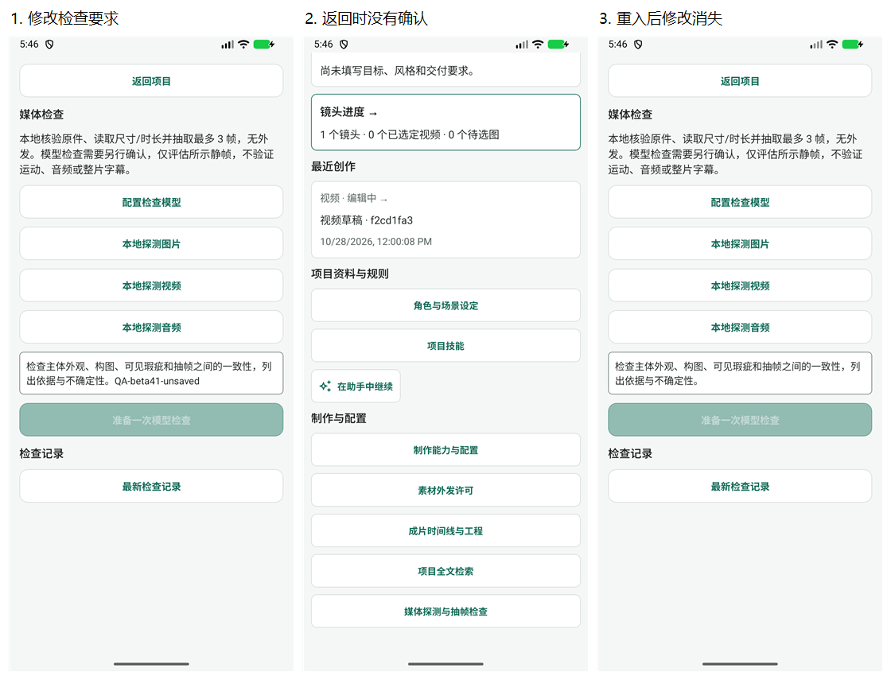

# Beta 41 工作台再次审查

> 历史归档（整理于 2026-11-01）：B1–B3 已修复；beta42 在其覆盖路径中独立复核，仍保留真实服务验证边界。 状态与后继见[归档索引](archive/2026-10-31-agent-workbench.md)；现行页面设计见[设计谱系](../design/README.md)。原文“当前”、优先级、源码行号和复跑命令均属于审查时基线；复现探针不属于现行正确性回归。桌面执行端、远端 Worker 及外部业务编排服务器均禁止；旧文相反建议已失效。

审查日期：2026-11-01。源码 `096bd561`，比较基线 `3f7864a3`；本批 4 个提交、17 个文件。此次为增量功能、导航及运行配置审查，不重新做竞品研究。桌面执行端、远端 Worker 继续属于禁止项。

## 判断

**上轮 R1–R5 的原问题均有有效修复，推进方向正确。** 时间线消费真实新 ID、连接身份与高级偏好分开处理、撤销后可释放配置槽位、使用位置改成有类型的目标分派，这些调整比继续加入口更有价值。

仍确认 3 项 P2：运行缓存忽略连接身份与输入能力；设置回焦读取失败无可见反馈；媒体检查页返回丢失修改。这三个问题分别跨过“设置→运行”“管理→返回”“编辑→离开”的边界，说明单页和领域单元已趋于稳定，但组合流程仍需验收。没有在此次范围内确认新的 P1 消费授权漏洞。

## 上轮问题复核

| 上轮项 | 结果 | 本轮独立依据 |
| --- | --- | --- |
| R1 指定时间线另存后仍合成旧工程 | 原路径已修复 | 保存接收新 ID，清空旧行与渲染状态，以新 ID 读取并更新路由。组件测试覆盖保存失败保留、A→B 后合成 B。 |
| R2 显式连接覆盖思考强度 | 已修复 | 读取层不再覆盖；真实安全存储逻辑、Agent config、真实 SQLite runtime specification 串联测试通过。不兼容模型切换有明确拒绝。 |
| R3 普通保存丢展示身份，回焦不刷新 | 原成功路径已修复，失败路径见 B2 | 保存保留身份；回焦合并服务端有效值与脏偏好；显式连接字段只读。组件测试覆盖 A→B 且保留未保存偏好。 |
| R4 撤销配置永久占满 8 项 | 已修复 | 新增清理、无密钥墓碑，撤销清空密钥；连续 12 次轮换与旧 ID/revision 拒绝测试通过。 |
| R5 封面 overview 页签无效 | 已修复 | 封面固定 brief；七类引用用联合类型及穷尽分派；实际点击目标测试及封面参数回灌项目组件测试通过。 |

实施方说明：[修复台账](2026-11-01-navigation-rereview-fixes.md)。本轮独立相关回归 8 文件/60 项，另复跑运行缓存既有测试 29 项；这些结果与实施方的全仓 1936 项分开计数。

## B1 / P2：连接已切换，现有会话的新运行仍复用旧连接和图片能力

定位：[runtimeStore.ts:52](../../mobile/src/agent/runtimeStore.ts)、[缓存返回:86](../../mobile/src/agent/runtimeStore.ts)、[AgentScreen.tsx:379](../../mobile/src/agent/AgentScreen.tsx)。

触发：同一会话已有空闲 runtime，连接 A 支持图片；用户新增/选择地址、模型、密钥相同，但 ID 或图片声明不同的连接 B，再返回该会话开始新运行。新增连接目前也是调整图片声明的可用方式，因此不是只能手工篡改数据才会触发。

AgentScreen 会重新读配置并调用 ensure，但缓存 key 只含地址、模型、密钥、时间和 token/思考参数，漏掉 connectionId、connectionRevision、supportsImages。只改变这三项时，ensure 原样返回 A 的 runtime；factory 不再运行。默认 factory 创建的 Skill preparer、连接断言和模型适配器均捕获 A 的旧 config。

离线探针：A(images=true)→B(images=false)，保持请求字段相同；返回同一 runtime，factory 仅调用一次，最后收到的仍为 A/true。没有调用模型。由此新运行可能记录 A 的身份、继续按旧图片能力校验；如果 A 被撤销而 B 有效，则可能错误报 A 已撤销。由旧版无连接 ID 配置切入同值显式连接，也可能继续使用未绑定新 ID 的 runtime。

这不等于已证明越权外发或真实扣费，不能据此升级为 P1；但“当前连接/能力只影响后续运行”的承诺未贯通缓存层。上轮设置与 specification 测试构造了新 config，未经过已有会话 runtime 的复用边界，因此没有抓到。

建议：把连接身份、revision、能力纳入配置等价关系；为现有运行与后续运行定义明确切换规则，不能粗暴销毁正在运行的图。保留会话及 composer，后续运行绑定新配置。设置摘要、runtime、运行快照、消费前断言应使用同一份有效配置。

验收：同值不同 ID、同 ID 不同 revision、图片能力 true→false、旧版→显式连接，都能令空闲会话下一轮采用新配置；撤销 A 不应阻止绑定有效 B 的新运行；既有运行和未保存输入不被无声丢弃。

## B2 / P2：返回连接管理后刷新失败，旧身份继续显示且没有重试入口

定位：[settings.tsx:47](../../mobile/app/%28tabs%29/settings.tsx)、[错误 UI:87](../../mobile/app/%28tabs%29/settings.tsx)。

新增 focus 刷新 catch 只 setLoadError(true)。错误提示和“重试读取设置”却全部放在 `if (!baseline)` 分支内；页面已经加载过 A 再去连接管理时，baseline 必然存在。若返回时安全存储读取失败，页面仍以 A 为当前连接，不显示失败，也没有可见重试。重新离开再进入可能再次尝试，但用户无从知道旧信息已经未经刷新确认。

离线组件探针：先加载显式 A → 模拟回焦 readSettings 拒绝 → 仍显示 A，全文无读取失败提示，重试控件数量为 0。这是失败注入验证，未人为破坏设备安全存储。

建议：区分首次加载失败与刷新失败；保留用户输入，同时显著标记“当前连接状态未能更新”，提供仅重新读取有效配置的重试动作。不要为了显示错误就清空整份表单，或回焦时覆盖未保存偏好。

验收：A→管理页→切 B→读取失败，页面不把 A 宣称为已确认的当前连接；用户能重试并看到 B；未保存偏好保留；失败后成功刷新会清除错误状态。

## B3 / P2：媒体检查要求没有未保存保护，返回后直接丢失

定位：[MediaReviewScreen.tsx:15](../../mobile/src/creative/MediaReviewScreen.tsx)、[返回与输入:26](../../mobile/src/creative/MediaReviewScreen.tsx)。

用户可编写最长 1500 字的检查要求，输入只存在组件 state。页头直接 router.back，没有 useUnsavedChanges 或草稿保存；组件卸载后重新进入立即恢复默认要求。设定准备页已经有同类保护，媒体检查页却仍不一致。尚未选择媒体时也能编写要求，因此不需要真实账号或付费调用即可触发。

离线组件探针及当前 beta.41 设备均确认：改文本→点击返回→无确认且 back 立即执行→重入后恢复默认。修复应同时覆盖页头和系统返回；配置检查模型使用 push，可保留当前组件，不能把该成功路径误当作返回保护验收。设备此轮验证了页头返回，未把系统返回当作已测结论。

建议：至少复用统一 dirty/leave guard；若支持保存检查草稿，明确它与已准备、已同意外发的检查记录分离。恢复草稿不能复用旧外发同意。主动发送后的取消/未知状态应继续遵守现有不自动重发机制。

验收：修改检查要求后，页头/系统 Back 均保护；继续编辑内容保留，明确放弃才丢弃；到连接管理再返回保留输入；不自动准备或发送检查。

设备流程及健康状态：

1. 项目→概览→媒体检查：入口正常，页内明确区分本地探测与模型外发。
2. 输入 `QA-beta41-unsaved`：编辑正常，未准备检查或发送请求。
3. 点击返回项目：异常，没有未保存确认，直接回项目。
4. 再次进入媒体检查：异常，临时输入消失、恢复默认文本。之后返回项目，未保存任何业务数据。

图为本轮原始截图的缩小并排，原尺寸 PNG/XML 均在证据目录。画面可确认输入、按钮和内容变化；未开展 TalkBack、焦点顺序或大字模式测试，不能据截图判定无障碍合规。可见优点是目标区较大、外发解释清楚；本轮没有额外确认新的视觉或无障碍缺陷。

## 页面与能力设计的后续重点

主导航四入口、Stack 对象页、项目内部五页签仍合理。此次不建议扩展导航层级，也不建议引入桌面执行或远端编排。应把验收单位从“单个切片有测试”提升为“跨边界完整旅程”：有效配置→已有会话→新运行→运行记录，或来源引用→精确对象→另存→新成果→返回来源。

还有三项应保留在体验清单中，未算作上述已复现功能缺陷：

- “返回项目”仍常常只是 back。从素材使用位置进入工程/检查时，实际返回的是来源。应区分返回来源与返回项目，并为冷启动无历史定义 fallback；此次不宣称覆盖全部冷启动深链。
- Skill 可见性已解决，但默认长英文说明、完整指纹和源码文件占据过多空间；优先呈现中文名称/用途、来源/版本、有效范围，再进入详细文件。运行快照不是实际使用证明，应继续保留这种区分。
- 项目 Skill 页仍调用未按项目/会话过滤的全局最近 20 条运行记录。建议显式选择“本项目/本会话/全部”，并能跳到对应会话和运行；当前文本列表的来源与 scope 不够清楚。此项为源码设计观察，未单独做多项目设备复现。

## 验证边界

独立既有回归共 89 项通过（8 文件 60 项 + runtimeStore 29 项）；类型检查、Skill 36 文件校验通过。另有 3 个独立不良行为探针复现 B1–B3，输出中的复制既有用例不重复计数。探针通过只表示复现成功，不表示功能验收通过。测试副本已移出产品测试目录。

设备先核对为 beta.40，随后覆盖安装现成 ARM beta.41；安装成功但当前 x86 模拟器转译路径报 libreactnative.so 加载失败，未据此推断 ARM 手机损坏。之后用同一 HEAD、JDK 17 构建 x86_64 beta.41（versionCode 80），覆盖安装成功并完成上述设备流程。原数据保留；手机交付目录中的 ARM APK 未被覆盖。最初 beta.40 截图及 ARM 启动错误不作为 beta.41 功能证据。

此次未发起真实模型、付费生成或工程合成，未在设备保存账号或安装 Skill。没有修改产品代码或既有资产；临时编辑已随返回丢弃。设备只走了无消费的导航和输入流程，没有实际调用保存新工程、轮换连接；这些修复由源码与离线测试核验。不能把模拟器结果等同于 ARM 真机性能或 OEM 验收。

证据索引：[README](../evidence/2026-11-01-navigation-review-beta41/README.md)。
