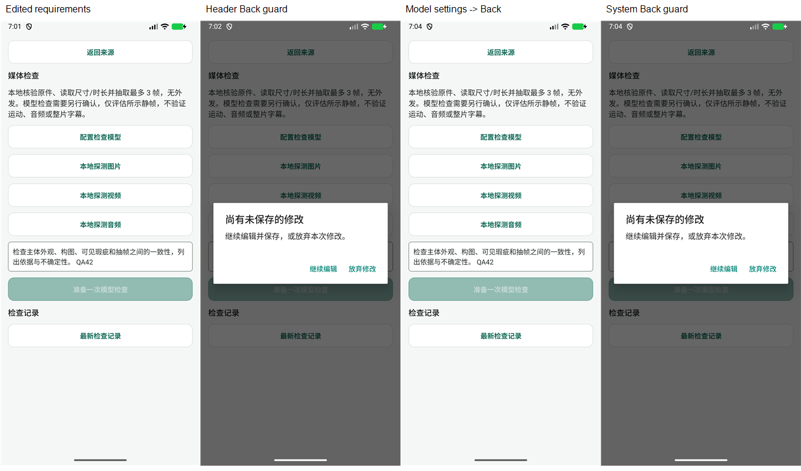
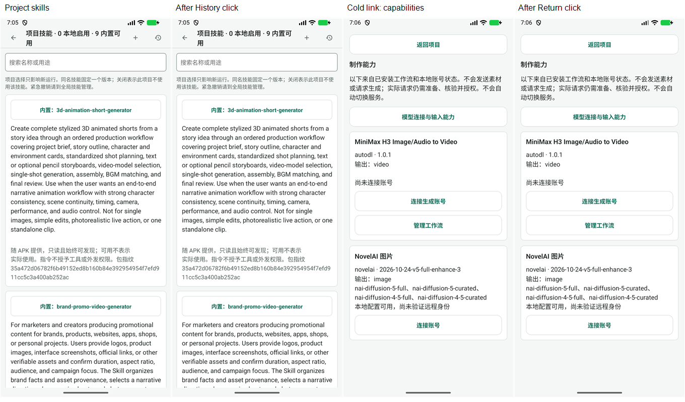

# Beta 42 工作台再次审查

> 历史归档（整理于 2026-11-01）：R1–R3 已修复；beta43 独立复核返回、历史范围与展示。 状态与后继见[归档索引](archive/2026-10-31-agent-workbench.md)；现行页面设计见[设计谱系](../design/README.md)。原文“当前”、优先级、源码行号和复跑命令均属于审查时基线；复现探针不属于现行正确性回归。桌面执行端、远端 Worker 及外部业务编排服务器均禁止；旧文相反建议已失效。

日期：2026-11-01。源码 `a0ac2adf`；比较基线 `096bd561`。本批 4 个提交、19 个文件。设备：`emulator-5554`，包 `com.example.autodlh3.beta`，`1.5.0-preview.4-beta.42` / versionCode 81。

## 判断

**推进方向正确，上轮 B1–B3 在本轮覆盖的路径中已有效修复。** 本轮没有确认新的 P1，也没有确认这批修复引入新的 P2 回归。但此前留在体验清单中的返回去向与 Skill 历史范围，本轮进一步确认了实际问题：2 项 P2、1 项 P3。它们是仍未完成的既有设计问题，不能说成 beta.42 新引入的问题。

本轮不建议继续增加一级页面。主导航四入口、对象 Stack、项目内部页签的分工仍可保留；当前主要缺口是页面间的来源、范围和返回规则，以及运行证据的检索链路。桌面执行端与远端 Worker 继续是禁止项。本批改动没有引入这些执行形态；外部模型/生成连接与业务编排所在地应继续分别处理。

## 上轮问题复核

| 项目 | 结果 | 独立依据与边界 |
| --- | --- | --- |
| B1 已有会话复用旧连接身份/图片能力 | 本轮覆盖路径通过 | runtime key 纳入 ID/revision/supportsImages；busy 时保留旧运行，结束后 AgentSession 重新 ensure，继承最新会话及 composer。相关测试覆盖同值不同身份、能力变更、旧版切入、运行中切换后完成。还核对了已安装 AG-UI 客户端：finalize 前会清除 isRunning，因此不是仅靠测试桩把标志改为 false 的假通过。未做真实模型或真实连接撤销下的设备运行。 |
| B2 设置回焦刷新失败无提示/重试 | 通过离线组件回归 | baseline 存在时也显示刷新失败、旧摘要标未确认；重试不重跑首次初始化覆盖脏偏好。测试覆盖 A→编辑→读取失败→重试 B。未故意破坏设备安全存储。 |
| B3 媒体检查修改返回丢失 | 组件及设备通过 | 页头和系统 Back 都弹确认；继续编辑保留输入；到模型连接再返回保留；明确放弃才离开。没有准备检查或外发。 |

实施方记录：[修复台账](2026-11-01-beta41-review-fixes.md)。它报告的全仓 1945 项与本轮独立复跑的 98 项分开计数。

## R1 / P2：制作能力页冷启动后，“返回项目”没有任何有效去向

定位：[CapabilityCatalogScreen.tsx:13](../../mobile/src/creative/CapabilityCatalogScreen.tsx)。

复现：停止 beta 应用后，以它实际注册的 `autodlh3-beta://creative-capabilities` 打开制作能力页；Android 确认 `LaunchState: COLD`。页面正常加载能力卡片，但点击页头“返回项目”后仍在原页。当前页没有主导航，也没有项目选择入口。截图/XML 12、13 记录了点击前后，未通过账号连接操作绕路。

原因：按钮仅调用 `router.back()`，组件没有接收项目目标、检查 canGoBack 或定义 fallback。常规从项目进入时这条链路能工作，不能因此认为所有入口都有返回目标。若从其他页面进入，“返回项目”也不能保证返回项目。媒体检查只改为“返回来源”解决了文字的一部分问题，没有形成全局协议。

建议分开定义：①“返回来源”有历史时 back，无历史时进入合理的工作台首页；②“打开项目”使用已验证的 projectId 定位真实项目；③全局能力目录没有项目时，回项目列表或主工作台。复用已有导航基础设施，不在每个页面堆一套特例。不得让未验证的来源参数代替业务对象归属检查。

验收：至少覆盖项目→能力→账号配置→返回、助手/其他来源→能力→返回、无历史深链→能力→返回；页头与系统 Back 分别验证。对象已删除、缺参数时仍有可用退出路线。此次只在能力目录完成冷启动复现，其他使用裸 back 的对象页是需要逐项审查的清单，不宣称全部已复现。

## R2 / P2：项目 Skill 历史仍是全局最近 20 条，当前项目记录可被其他项目挤掉

定位：[SkillLibraryScreen.tsx:43](../../mobile/src/agent/skills/SkillLibraryScreen.tsx)、[store.ts:100](../../mobile/src/agent/skills/store.ts)、[历史展示:113](../../mobile/src/agent/skills/SkillLibraryScreen.tsx)。

技能选择已经使用持久化会话范围，并按项目读取；历史却始终调用无参数 `store.runs()`。查询没有 project/thread 条件，固定 `ORDER BY created_at DESC LIMIT 20`，也没有翻页。历史行只展示截短 runId、技能和用量，没有项目/会话来源，也没有定位原会话/运行的动作。

本轮两项独立探针：

1. 实际挂载项目 A 的 SkillLibraryScreen，并传入会话 A；模拟全局历史返回项目 B 的运行。页面确实渲染 B 的 runId，调用 runs 不带范围，行不含项目/会话来源且不可点击。它验证 UI 消费全局结果的行为，不冒充真实设备多项目操作。
2. 使用真实初始化 SQLite、真实 createSkillStore/capture/runs：创建 A、B 项目与各自会话，保存 A 的运行，再保存 B 的 20 个较新运行。A 的快照仍在数据库，runs 返回的 20 条却全部属于 B。没有删除、改写快照或禁用不可变触发器，时间通过测试时钟控制。

影响：项目 A 的用户可能看到其他项目记录，却找不到自己的运行；无法从 Skill 管理确认“本项目本次到底固定了哪些版本”，也无法回到原运行解释外发或失败原因。这是证据范围/检索正确性问题，不是发现了跨账号数据泄露，也不意味着运行实际使用了错误技能。

建议：历史默认跟随当前有效 projectId/threadId；全局视图显式标“全部”。查询在过滤后分页，以 created_at+稳定 ID 游标避免相同时间记录跳漏。行展示项目、会话标题、时间、运行状态，并能定位相应会话与运行。历史技能名称应依据历史引用解析，不能仅凭当前项目版本列表把历史版本称为“缺失技能”；该展示风险来自源码观察，本轮未单独复现。

验收：A 有旧记录、B 连续新增超过 20 条后，A 页仍能查询 A；空项目不出现 B；全部模式明确标来源并能分页；从项目页和会话内嵌面板进入都使用持久化范围；打开历史不修改下一轮技能选择。

## R3 / P3：点击“技能运行记录”没有当前视口反馈；长卡片把本地技能与历史挤到页尾

定位：[历史按钮:66](../../mobile/src/agent/skills/SkillLibraryScreen.tsx)、[内置列表:98](../../mobile/src/agent/skills/SkillLibraryScreen.tsx)、[历史位置:113](../../mobile/src/agent/skills/SkillLibraryScreen.tsx)。

设备已确认“0 本地启用 · 9 内置可用”，所以用户此前提出的“内置 Skill 在管理页不可见”已解决。当前问题变为信息组织：第一张内置技能展开全部英文 description 和完整包指纹，占据首屏大半；9 张内置卡排在本地技能之前。点击右上“技能运行记录”只 toggle 页尾区域，没有跳页、定位、滚动或按钮展开状态，当前屏幕完全不变，容易被理解为按钮失效。该问题即使没有运行记录也存在。

建议先把历史作为可直接抵达的视图或页首区域，点击后能立即看到结果与范围；若沿用折叠区域，应滚动定位并提供展开状态。列表默认展示中文名称、短用途、来源、版本/有效范围；完整说明、指纹和文件留给详情。内置、导入、本项目选择应能快速筛选，而不是让“本地技能”永远排在全部内置长说明之后。保持“可发现不等于实际使用、指令不授予权限”的清晰说明，但无需每张卡重复整段。

验收：点击历史后当前视口出现明确结果/空态；无需穿过 9 张长卡；可以快速找到新导入的本地技能；折叠/展开可访问状态与视觉一致。未测试 TalkBack、大字模式，因此不据截图宣称无障碍合规或不合规。

另有轻微文案欠账：媒体检查复用了“继续编辑并保存”提示，但检查要求没有独立保存草稿入口。保护有效，尚不构成本轮新的 P2；后续可改为“继续编辑”或明确提供与外发授权分离的本地草稿保存。

## 后续推进与验证边界

建议下一批验收以“来源→目标→修改/配置→返回→证据”为单位。先统一返回协议，再修历史查询与定位，最后压缩 Skill 默认展示。保留当前有效的连接身份/权限/运行快照设计；不要为解决检索与导航问题再增加执行层或远端编排。

本轮独立验证：8 个既有测试文件、98 项通过；TypeScript 通过；内置 Skill 36 文件一致性检查通过；另 2 项不良行为探针通过，表示成功复现 R2，不是产品功能验收通过。SQLite 探针最初尝试更新快照时间被不可变触发器正确拒绝，随后改用测试时钟，最终探针未修改持久快照。

设备使用已有 beta.42，不重新构建或安装。完成项目→媒体检查→编辑→页头保护→继续→连接管理→返回→系统保护→明确放弃；项目→Skill 管理→历史按钮；冷启动能力目录→页头返回。结束恢复项目列表。没有发起真实模型、付费生成、媒体检查准备或工程合成，没有新增连接/技能或更改既有项目资产。B1/B2 的失败注入与配置切换来自离线测试，不能解释成真实供应商端验收。

日志过滤没有捕获 GO_BACK 警告或 FATAL；这不是完整进程健康认证。冷启动返回失效以设备截图、XML 与代码为依据。图片为本轮原始截图的等比例并排，已实际打开检查；原图和 XML 保留。

临时探针已移到证据目录；产品代码、既有测试没有保留改动。证据索引：[README](../evidence/2026-11-01-workbench-beta42-review/README.md)。
