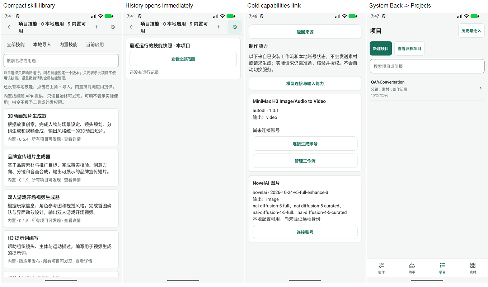
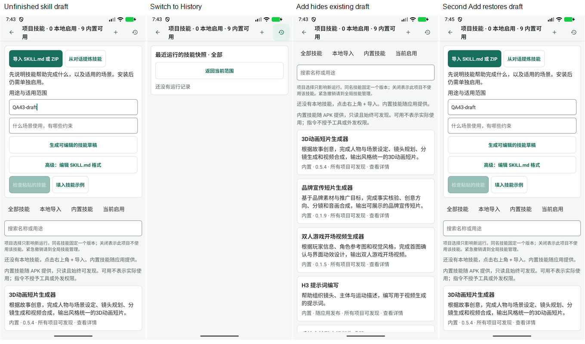

# Beta 43 工作台再次审查

> 历史归档（整理于 2026-11-01）：C1–C3 已修复；beta44 复核原始触发路径，设备与组件证据分别解释。 状态与后继见[归档索引](archive/2026-10-31-agent-workbench.md)；现行页面设计见[设计谱系](../design/README.md)。原文“当前”、优先级、源码行号和复跑命令均属于审查时基线；复现探针不属于现行正确性回归。桌面执行端、远端 Worker 及外部业务编排服务器均禁止；旧文相反建议已失效。

日期：2026-11-01。源码 `a291e9d7`，比较基线 `a0ac2adf`；本批 4 个提交、25 个文件。设备 `emulator-5554`，精确包名 `com.example.autodlh3.beta`，versionCode 82 / `1.5.0-preview.4-beta.43`。

## 判断

**上轮返回出口、历史范围/分页、历史即时显示与卡片密度问题均有有效修复，方向正确。** 新的只读运行证据入口也比直接启动 Agent 重放历史更合理。但新增页面没有共享现有多模态消息呈现，形成 1 项 P2；还确认 2 项 P3，分别涉及已有单次选择的离开保护和新增历史/添加视图的组合状态。未确认新的 P1，也未发现需要新增执行架构的理由。

桌面执行端、远端 Worker 继续是禁止项；本批提交没有引入它们。本轮保持源码、测试、设备交互三种证据区分，不把离线 fixture 当作真实模型或付费调用验收。

## 上轮问题复核

| 上轮项 | 本轮结论 | 独立依据 |
| --- | --- | --- |
| R1 冷启动能力页返回无效 | 原路径通过 | 新 useSourceBack 有历史 back、无历史 replace 项目列表；设备两次明确 COLD 启动，页头和系统返回都抵达项目列表。常规返回分支有组件回归，本轮未在设备重复账号设置整条链。 |
| R2 项目历史混入全局且不能翻页 | 原问题通过离线回归 | SQL 先按 project/thread 过滤，再按 created_at/thread_id/run_id 游标取页。真实 SQLite 既有测试覆盖 A/B/空项目、相同时间、跨页不重不漏、撤销版本原名称；组件覆盖持久 thread 范围与精确运行路由。设备本项目/全部均为空态，没有制造真实运行填充历史。 |
| R3 历史藏在页尾、内置长卡压住本地技能 | 原问题通过，另有 C3 组合状态问题 | 设备历史点击立即显示首屏空态及选中状态；内置改为中文短说明、版本和可展开详情；本地先于内置，增加筛选。 |

实施方说明：[修复台账](2026-11-01-beta42-review-fixes.md)。其中全仓 1952 项为实施方报告；本轮独立复跑 65 项，不合并或重复计数。

本轮设备路径与健康状态：

1. 助手未配置模型→项目列表→现有 QA 项目：正常；未为验收新增账号或模型配置。
2. 项目→项目技能：正常，0 本地启用、9 内置可用；中文摘要和版本可见，长说明/指纹默认收起。
3. 技能→历史→全部：正常，空态立即可见，范围标签随选择变化。
4. 添加→输入用途→历史→添加：异常，第一次“添加”隐藏表单；第二次才恢复，内容仍在。见 C3。
5. 返回：正确提示未保存，明确放弃临时输入后离开。这个成功不代表单次选择也有保护，见 C2。
6. 冷启动能力目录→页头返回：正常，进入项目列表。
7. 再次冷启动能力目录→系统返回：正常，进入项目列表；结束停留该列表。

## C1 / P2：运行证据页遗漏参考图片，无法核对多模态输入

定位：[SkillRunScreen.tsx:17](../../mobile/src/agent/skills/SkillRunScreen.tsx)。参考已有实现：[agentPresentation.ts:91](../../mobile/src/agent/agentPresentation.ts)、[PromptAssistantUi.tsx:616](../../mobile/src/agent/PromptAssistantUi.tsx)。

触发：用户发送“请按参考图修改角色”并携带图片附件；之后在技能历史打开对应运行。新页虽然正确按 userMessageId/messageIds 选择消息，却只输出 role、id、content，从未处理 message.attachments。切换“查看原会话全部消息”仍用同一个文本 map，不能恢复图片证据。多模态 content 数组也只 JSON.stringify，没有图片预览。

独立组件探针：构造项目正常支持的 user image attachment（URL 来源、文件名、displayName/attachmentId）；现有 normalizeMessages 能得到 1 张参考图。挂载实际 SkillRunScreen，文本可见，但对应运行和全部消息两种视图都没有 Image，也没有附件文件名或查看图片入口。探针只验证消息结构的呈现，没有实际读取 fixture 图片文件，更没有调用模型。

影响：依赖“图1”的指令失去可核对的对象；用户能看到模型答复和工具记录，却不能判断输入图是否就是原素材。这里遗漏的是呈现，不是数据库删除，也不等于已证明外发了错误素材。“查看原会话全部消息”只是本页切换，不是跳到已有能显示附件的会话界面，因此当前没有该路径内的补救入口。

建议：共享现有消息归一化/附件呈现，提供只读缩略图和本地预览、名称与稳定附件身份；缺失文件明确显示不可用，不静默省略。继续保持证据页不创建 runtime、不重放请求。运行/连接/技能快照应与实际读取、实际调用分开说明，不把“快照里有”说成“执行过”。

验收：普通文本、正文+图片附件、图片 content 数组、图片文件丢失、同一消息重试都能展示可核对的输入；本次/全部切换不丢媒体；预览不调用模型、不改变任何运行或下一轮选择。建议再补长会话的有界查询与分页；当前整份 load+ScrollView 全量呈现是源码观察，本轮未做 OOM/性能复现，不列为另一个功能缺陷。

## C2 / P3：单次技能选择没有接入未保存保护，关闭后静默丢失

定位：[SkillLibraryScreen.tsx:41](../../mobile/src/agent/skills/SkillLibraryScreen.tsx)、[单次选择:101](../../mobile/src/agent/skills/SkillLibraryScreen.tsx)。这是既有功能本轮进一步确认的问题，不是 beta.43 新引入。

触发：会话技能面板→选择下次运行技能→点选一个版本→尚未保存就关闭面板/切换上下文。dirty 只含技能文本、用途、适用范围和预览，不含 once。已经注册给 AgentSession 的 leave guard 因此允许立即离开；组件卸载后 once 重新为 null，选择消失。

独立组件探针：实际挂载带 registerLeave 的 SkillLibraryScreen，点选一个本次技能，确认已选 1/8；调用注册的离开保护，proceed 立即执行、无 Alert；卸载重入后不再处于待保存单次选择状态。没有实际提交或消费下一轮运行，故不声称已经执行了错误技能。

建议：把单次选择草稿纳入离开保护，明确区分“正在编辑”“已固定等待下一条消息消费”“使用项目组合”。已保存的单次覆盖应能重新读取并在发送前展示，这一点当前源码也没有 UI 回读路径，但本轮没有另做持久覆盖重入探针，不重复计为第二项。

验收：勾选及空选编辑均受保护；继续编辑保留，明确放弃才恢复；关闭内嵌面板、切换会话/项目、页头/系统返回遵守同一决定；未保存的选择不应被自动提交。保存后的持久覆盖与尚未保存的草稿分别标识。

## C3 / P3：已有添加草稿时，“历史→添加”反而收起表单

定位：[SkillLibraryScreen.tsx:69](../../mobile/src/agent/skills/SkillLibraryScreen.tsx)。

设备及组件探针都确认：添加表单打开并输入用途→切历史→点击“添加技能”→历史退出，但添加表单不见，仅剩技能列表→再次点击添加才恢复原输入。设备临时内容为 QA43-draft，截图 08–11；最后已明确放弃，没有安装/保存技能。

原因：历史隐藏表单时 importOpen 仍为 true；“添加”既 setHistoryOpen(false)，又 setImportOpen(!importOpen)，于是把目标表单关掉。新加的“从历史添加”回归只覆盖 importOpen 初始为 false 的路径，遗漏了实际有草稿的组合。

建议把“打开添加”定义为明确去向：从历史进入应设 importOpen=true。若希望同一按钮在表单内承担收起，按当前可见视图判断，并给出明确关闭方式。视图可用一个小的互斥状态表示 library/history/add，避免两个布尔值产生不可见但仍开启的状态。切视图不应丢弃已有草稿。

验收：首次添加、列表→添加、历史→添加、已填草稿→历史→添加、带 intent=add 打开后切换，均一次抵达表单并保留内容。

## 继续推进的判断

页面树无需大改，重点是共享语义：来源返回/项目定位/历史证据是三种不同动作；技能的项目默认、待保存单次草稿、已固定单次覆盖、历史快照也不是同一份状态。当前后端的固定版本、范围断言与不重放运行原则值得保留，前端应把这些状态准确呈现给用户。

优先补 C1 的媒体证据，再一并处理 C2/C3 的状态和离开规则。不建议为这些问题增加一级入口、桌面执行端或远端编排。未来验收应覆盖“含图片的原请求→运行→技能历史→证据→预览→返回”，以及“选择/编辑→历史→添加/关闭→恢复”，而不只是文本消息和初始空表单。

## 验证边界

独立既有回归 7 文件、65 项通过；TypeScript 检查通过；内置 Skill 包 36 文件一致性检查通过。另 2 个临时探针文件、3 项不良行为验证通过，表示复现 C1–C3，不表示功能已修复。探针已移出产品目录。初次探针的一条断言把 React 分段 children 当成连续字符串，修正为实际 Text children 拼接后通过；没有为让探针通过修改产品代码。

设备没有配置可运行 LLM，也没有技能历史数据，本次/全部均为空态；因此 C1 的有媒体运行、C2 的会话内嵌选择来自离线组件验证，不能称为设备端到端验收。没有发起真实模型、付费生成、技能提炼请求或工程合成；没有保存连接、安装技能或修改项目资产。

截图为本轮获取并实际打开检查的原图等比例并排，PNG/XML 均保留。可见控件和说明改善明显；未测试 TalkBack、焦点顺序、大字、ARM 真机性能，不能据此宣称无障碍或性能合规。没有修改产品代码或既有测试。证据：[索引](../evidence/2026-11-01-workbench-beta43-review/README.md)。
