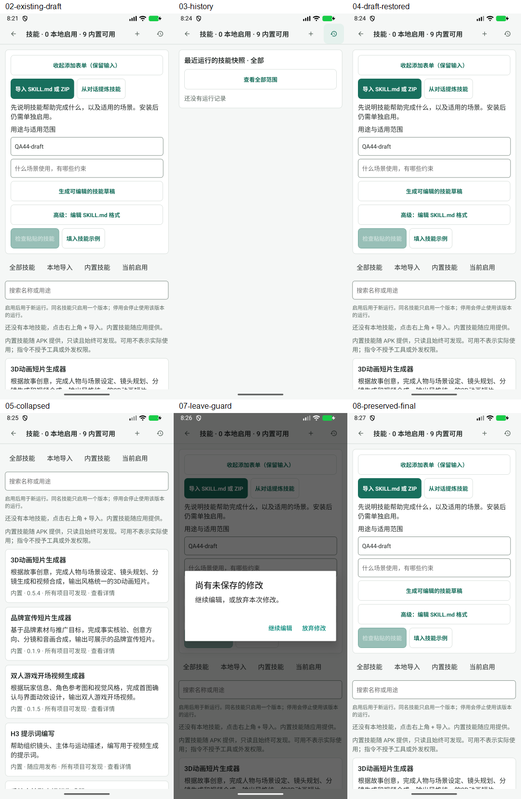

# Beta 44 工作台再次审查

> 历史归档（整理于 2026-11-01）：F1 已修复；beta45 离线联合复核通过，旧版设备截图不证明新版验收。 状态与后继见[归档索引](archive/2026-10-31-agent-workbench.md)；现行页面设计见[设计谱系](../design/README.md)。原文“当前”、优先级、源码行号和复跑命令均属于审查时基线；复现探针不属于现行正确性回归。桌面执行端、远端 Worker 及外部业务编排服务器均禁止；旧文相反建议已失效。

日期：2026-11-01。源码 `3673cca9`，比较基线 `a291e9d7`，本批 4 个提交、14 个文件。设备 `emulator-5554`，包名 `com.example.autodlh3.beta`，versionCode 83 / `1.5.0-preview.4-beta.44`。本轮审查，不修改产品实现。

## 判断

**改进方向正确。上轮三个问题的原始触发路径均已得到修复；本轮确认 1 项 P2：单次技能覆盖被消息消费后，仍打开的会话技能面板没有同步更新。** 后端已经正确消费，前端继续显示“等待下一条消息消费”，使用户对下一条消息采用什么组合产生错误判断。未确认新的 P1。

继续保留 APK 本地执行、持久运行快照和只读证据页。本批变更没有引入桌面执行端或远端 Worker；两者仍是禁止项。本次没有重新评估外部竞品，也不以旧竞品资料代替当前代码和设备验证。

## F1 / P2：已消费的单次技能覆盖仍显示为等待消费

定位：[SkillLibraryScreen.tsx:48](../../mobile/src/agent/skills/SkillLibraryScreen.tsx)、[状态展示与编辑入口:102](../../mobile/src/agent/skills/SkillLibraryScreen.tsx)。关联：[AgentScreen.tsx:424](../../mobile/src/agent/AgentScreen.tsx)、[nextRun.ts:25](../../mobile/src/agent/skills/nextRun.ts)。

触发路径：会话中打开技能面板 → 保存单次技能选择 → 保持面板打开并发送消息 → 消息受理事务消费单次覆盖 → 面板仍显示“已固定，等待下一条消息消费”。再次点击“选择下次运行技能”，编辑器也从这个旧 savedOnce 初始化，继续勾选已经消费的版本。关闭面板重开后才显示“当前使用项目组合，没有单次覆盖”。

原因：savedOnce 只在页面获得焦点或面板自身操作调用 refresh 时读取。AgentSession 在发送和运行状态变化时保留 skillsOpen，PromptAssistantUi 也保留可发送的 Composer；但 SkillLibraryScreen 没有接收运行受理修订号，也没有订阅单次覆盖的消费通知。普通父组件重渲染不会触发这个依赖稳定的 focus effect。运行完成后的父级 runtime 更新同样不能代替单次选择状态同步。

独立证据：真实初始化 SQLite + 实际 SkillLibraryScreen、SkillStore 和 nextRun 函数。预先安装测试技能并保存单次选择；挂载会话面板；用 threadStore.accept 实际调用的 acceptNextRunSkills 在写事务中受理运行。随后确认：

1. readNextRunSkills 已返回 null，数据库中的待消费记录已消失。
2. 已受理运行的持久快照准确包含该版本。
3. 保持面板挂载并更新父级渲染后，界面仍显示“等待下一条消息消费”，选择器仍勾选旧版本。
4. 下一次新运行捕获的是默认组合，本探针默认组合为空，确实没有再次使用该单次版本。
5. 卸载重开面板，显示恢复为无单次覆盖。

探针：[ReviewBeta44.probe.test.tsx](../evidence/2026-11-01-workbench-beta44-review/ReviewBeta44.probe.test.tsx)，结果：[日志](../evidence/2026-11-01-workbench-beta44-review/consumption-probe.log)。这是离线组件与 SQLite 联合复现，没有启动真实模型或 runtime，不能称为设备端到端复现。导航焦点 hook 采用稳定 effect 替身；数据库读写、技能校验、事务消费和组件内部状态均使用产品实现。

影响：用户可能依据仍在显示的单次覆盖继续发送，以为后续消息仍会采用该版本，实际却回到项目/全局默认。**没有证据表明后端重复消费、越权或丢失运行快照。** 需要修复的是前端对下一条消息采用组合的表述。

建议：在消息成功受理且事务提交后，发出会话级技能选择变更通知，或把受理修订号传入面板，使已保存覆盖、运行记录重新读取。保留 once 草稿与 savedOnce 持久状态的区别；后台刷新不能静默覆盖用户未保存的编辑。不要在网络请求开始或受理失败时提前把覆盖清空，也不必每个 streaming token 刷新数据库。

验收：面板保持打开，保存非空及空选覆盖后发送成功，无须关闭重开即可显示恢复默认；历史出现准确的本次技能快照。受理回滚/失败保留覆盖；普通新消息按默认选择；重试继续使用原运行快照且不误消费新覆盖；刷新不抹掉尚未保存的 once 编辑。上述发送路径应至少补一条实际 AgentSession/Composer 集成回归。

## 上轮三项复核

| 上轮项 | 本轮判断 | 独立验证与边界 |
| --- | --- | --- |
| C1 / P2 证据页遗漏参考图片 | 原呈现缺陷通过组件复核 | 新 ReadOnlyMessage 共享 normalizeMessages，展示缩略图、名称、附件身份及只读预览，加载失败保留附件记录。现有回归覆盖普通附件、图片 content、本次/全部视图和 onError；本轮独立重跑通过。未在设备生成含真实媒体的运行，图片实际加载/手势预览仍需设备验收。 |
| C2 / P3 单次选择未保存保护 | 原离开保护通过组件复核；新消费同步见 F1 | once !== null 纳入 dirty，空选编辑同样保护；嵌入关闭、导航移除及注册上下文 guard 有回归。保存覆盖可以回读，和未保存编辑分别显示。不能把“可回读”视为“消费后会自动同步”。 |
| C3 / P3 已有草稿历史→添加反而收起表单 | 通过设备及组件复核 | 添加明确设 importOpen=true，退出历史并回到表单顶部；收起改为独立按钮。已有草稿→历史→添加，一次显示原输入；收起→添加同样保留。intent=add 的组合由组件回归覆盖。 |

实施方：[修复说明](2026-11-01-beta43-review-fixes.md)。其全仓测试数量属于实施方报告，不合并到本轮独立验证数量。

## 页面树与交互语义

| 起点与操作 | 当前落点/行为 | 判断 |
| --- | --- | --- |
| 会话→技能 | 当前会话内嵌面板，threadId 用于核对持久项目范围 | 继续采用此方式合理，无须新增一级页。运行变更必须反映在面板中，见 F1。 |
| 内嵌技能→添加 | 经过未保存判断，关闭面板后 push /agent-skills，带 intent=add、projectId、threadId | 源码逻辑一致；单次草稿不应在跳转时自动保存。设备本轮没有走这条会话链。 |
| 技能页→运行记录 | 同页切换，不新增路由栈，立即展示历史 | 设备正常；当前无真实记录，未据此验收数据分页。 |
| 已有添加草稿→历史→添加 | 历史退出、打开原表单、保留内容 | 设备已通过，消除了之前的双重开关歧义。 |
| 历史→查看运行 | push /agent-run，固定 threadId/runId，只读查看 | 代码和组件路径一致；本批没有添加 runtime 重放入口。 |
| 技能页返回且有草稿 | 提示继续编辑/放弃，继续编辑后原内容仍在 | 设备已通过；本轮没有放弃已有草稿。 |

真正需要继续补齐的是“页面一直开着，背后业务状态已经变化”的交互。单次覆盖、实际运行快照、项目默认组合应分别呈现，并在业务提交点同步；不能只靠重入页面刷新来维持正确性。

## 本轮设备步骤

起点已留有一份 QA44-draft 用途输入和未保存提示，不是本轮新建。为保留已有内容，没有强停应用、冷启动或离开当前技能路由。

1. 继续编辑原有草稿：正常，恢复表单，输入未变（01–02）。
2. 点击运行记录：正常，首屏显示历史空态和选中状态（03）。
3. 点击添加：正常，一次打开表单，QA44-draft 保留（04）。
4. 收起表单：正常，回到技能列表，9 个内置技能及中文摘要可发现；重新添加仍保留原内容（05–06）。
5. 点击返回：正常，出现未保存提示（07）。
6. 继续编辑：正常，内容完整；最终停留原草稿表单（08）。

截图已实际打开检查。表单、历史、列表和警告弹窗没有观察到新的遮挡或水平裁切；长列表仍需滚动。截图不能证明 TalkBack、焦点顺序、大字模式或触控可达性合规，本轮未做这些专项验证。

## 验证与下一步

本轮独立既有回归 **12 个文件、133 项通过**：第一组 7 文件 / 39 项；追加覆盖 AgentScreen、PromptAssistantUi、threadStore、runtimeIntegration、技能 runtime 的 5 文件 / 94 项。另有 **1 项不良行为复现探针通过**，它证明 F1 存在，不表示 F1 已修复。TypeScript 检查通过；内置 Skill 包 36 文件一致性检查通过。

未发起真实模型、付费生成或技能提炼，没有修改连接、项目资产或设备里的技能版本。当前设备历史为空；图片证据及会话内单次覆盖主要来自离线回归。没有重验全部旧路线图、全部授权撤销链或 ARM 真机性能，不能宣称整套产品已完成最终验收。临时探针已移出产品目录，产品代码及既有测试保持不变。

建议下一切片收敛于 F1 的提交后同步，再验收两条连续流程：“参考图片→真实运行→技能历史→证据预览→返回”和“保存单次覆盖→保持面板打开发送→消费后显示→下一条消息默认组合”。当前无需扩大页面树或增加执行架构。长会话证据的有界查询/分页仍是上轮提出的性能待验项，本轮未复现故障，不重复列为新缺陷。

证据：[索引](../evidence/2026-11-01-workbench-beta44-review/README.md)。
