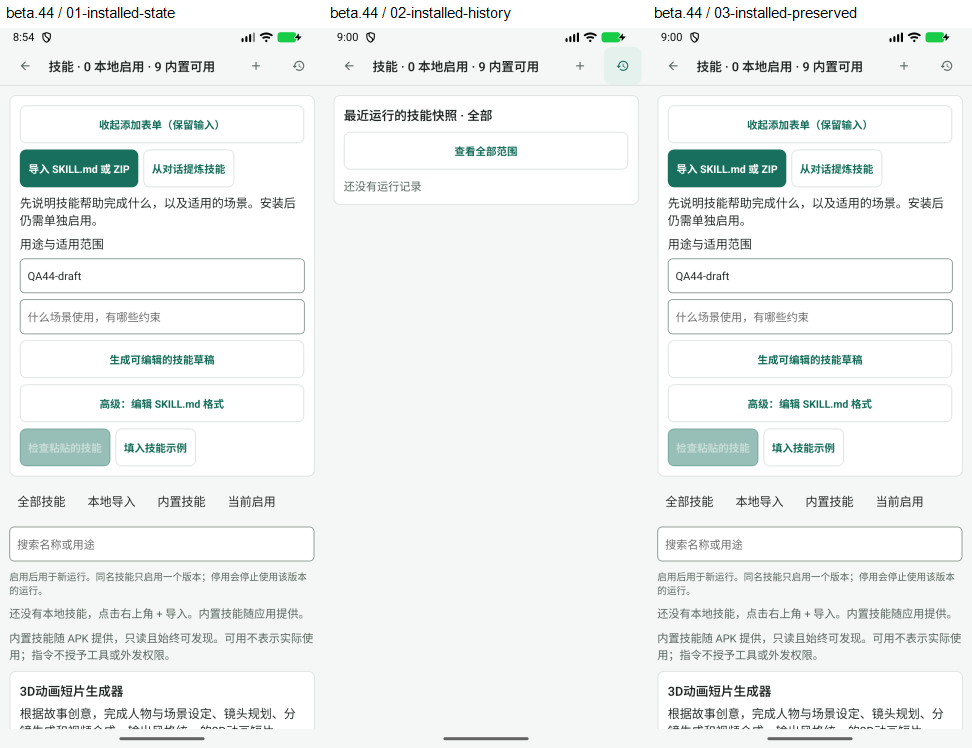

# Beta 45 工作台再次审查

> 历史归档（整理于 2026-11-01）：R1 已修复；beta46 离线复核历史终态更新，新增 E1 另列后续处理。 状态与后继见[归档索引](archive/2026-10-31-agent-workbench.md)；现行页面设计见[设计谱系](../design/README.md)。原文“当前”、优先级、源码行号和复跑命令均属于审查时基线；复现探针不属于现行正确性回归。桌面执行端、远端 Worker 及外部业务编排服务器均禁止；旧文相反建议已失效。

2026-11-01。源码 `c13c0a09`，比较基线 `3673cca9`，2 个提交、7 个文件。本轮审查产品代码及离线运行状态链，不修改实现。

## 结论

**上轮 F1“单次技能覆盖消费后仍显示等待消费”已通过独立复核，修复方向正确。新确认 1 项 P2：同一面板的运行历史没有跟随运行终态更新，能与证据页显示相互矛盾的状态。** 这是本轮进一步确认的生命周期遗漏，没有证据说明由 beta.45 新引入。未确认新的 P1。

源码 beta.45 的事务提交通知、当前会话过滤、后台保留编辑、旧读取结果失效机制均合理。无需扩大页面树或执行架构。桌面执行端、远端 Worker 仍为禁止项；本批提交没有引入这些能力，也没有改变外部模型/生成端口的授权边界。

设备实际仍安装 beta.44（versionCode 83 / `1.5.0-preview.4-beta.44`），不是源码对应的 beta.45。设备留有 QA44-draft 未保存输入，本轮保留原状态，没有覆盖安装或强停。因此以下新缺陷及修复判断来自当前源码、实际组件与真实 SQLite 联合验证，**不是 beta.45 设备端到端验收**。

## R1 / P2：历史状态停在 queued，证据页却显示运行已结束

定位：[SkillLibraryScreen.tsx:99](../../mobile/src/agent/skills/SkillLibraryScreen.tsx)、[刷新与订阅:70](../../mobile/src/agent/skills/SkillLibraryScreen.tsx)。关联：[threadStore.ts:180](../../mobile/src/agent/threadStore.ts)、[状态持久化:217](../../mobile/src/agent/threadStore.ts)。

触发：打开会话技能面板 → 保存单次覆盖 → 发送消息并受理 → 面板在提交通知后读取到 queued → 运行完成/失败/取消并持久化 → 用户点击“技能运行记录”。列表仍显示 queued；重复关闭/打开历史视图及普通父组件更新均不能刷新。打开对应只读运行证据页，读取到的却是 completed、failed 或 cancelled。关闭重开整个技能面板后，列表才恢复正确状态。

原因：新 skillSelectionEvents 覆盖保存/取消单次选择、消息受理提交，但不覆盖运行状态的后续持久化。SkillLibraryScreen 缓存了 runs；“技能运行记录”按钮只切 historyOpen 和滚动位置，不重新读取。AgentSession 的运行结束重渲染不会改变该组件 refresh 的依赖，因而不能触发焦点刷新。

本轮独立探针使用实际 SkillLibraryScreen、SkillRunScreen、threadStore、SkillStore、endPromptRun 与初始化后的真实 SQLite。对 completed、failed、cancelled 分别验证：

1. 实际受理后，面板已经接收通知，单次覆盖提示正确恢复默认。
2. 通过实际 threadStore.save 持久化终态；重新执行 SkillStore.runs 查询得到正确终态。
3. 原面板点击历史，仍显示 queued。切换历史视图两次及父级重新渲染后仍不变。
4. 挂载实际 SkillRunScreen，使用同一 threadId/runId 读取，展示正确终态；原历史依然 queued。
5. 卸载重开面板，历史才展示正确终态。

证据：[探针源文件](../evidence/2026-11-01-workbench-beta45-review/ReviewBeta45.probe.test.tsx)、[结果日志](../evidence/2026-11-01-workbench-beta45-review/probes.log)。三个不良行为断言通过，代表问题已复现，不代表已修复。没有真实调用模型；终态通过产品持久化入口写入，不能声称检验了真实模型到终态的全部链路。

影响：用户可能继续等待已经结束的运行，或无法从历史发现失败与取消。列表与详情对同一运行给出不同状态，削弱运行记录作为审查依据的可信度。没有证据表明持久状态损坏、任务仍在后台重复执行或额度超用。

建议：至少在进入历史视图时重新读取，解决“点击入口却得到陈旧列表”；同时在运行终态持久化成功后通知当前面板刷新，覆盖历史已经展开的情况。可以共享会话/运行记录修订通知，但应区分“选择改变”“运行提交”“运行结束”，不要把所有事件都伪装成选择改变。继续保留现有的旧读取结果保护、未保存编辑和分页位置，不要按每个流式 token 全量读库。

验收：保持面板打开，运行从受理到成功、失败、取消，历史即时显示相应终态；历史关闭后再打开也读取最新值；列表与新打开的详情一致。终态保存失败时不得提前宣称已持久完成，恢复保存后再更新；刷新不清空 once 草稿、不自动跳回历史首页。实际读取记录和用量同样来自 runs 的缓存，本轮没有单独复现它们的增量显示，不另列缺陷。

## 上轮 F1 修复复核

实施方：[beta.44 问题修复说明](2026-11-01-beta44-review-fixes.md)。本轮独立复跑包含新增 selectionEvents.integration.test.tsx 的定向回归。

| 关注点 | 本轮结果 |
| --- | --- |
| 消费时机 | threadStore.accept 在写事务提交后通知；事务内 acceptNextRunSkills 不提前发布。通过。 |
| 非空与空选覆盖 | 保持原面板挂载，成功受理后提示恢复默认，重新编辑不带入已消费版本。通过。 |
| 失败回滚 | SQLite trigger 拒绝受理，覆盖、提示保留，无提交事件/残留运行快照。通过。 |
| 重试 | 使用原运行技能快照，不误消费后来保存的新覆盖。通过。 |
| 未保存编辑与会话过滤 | 后台刷新保留 once，其他会话通知不触发读取。通过。 |
| 真实 Composer 发送桥接 | 实际发送控件连接实际持久受理，原技能面板不卸载且提示更新。通过；没有挂载完整 AgentSession 或真实模型。 |
| 延迟旧读取 | 独立探针延迟返回旧的 pending 行；消费后的新读取先完成，旧结果不能恢复已消费覆盖。通过。 |
| 观察者抛错、空选编辑 | 独立探针使一个订阅者抛错，受理仍成功，后续面板刷新正常；未保存空选保留并继续受离开保护。通过。 |

读取代次在组件卸载/订阅切换时失效，后台读取不先隐藏整个面板，这两项值得保留。它们解决的是过期读取覆盖与编辑状态保护；不能代替遗漏的运行生命周期通知。

## 页面与状态的关系

| 动作或业务节点 | 当前更新方式 | 判断 |
| --- | --- | --- |
| 保存/取消单次选择 | 提交后发布会话通知，后台重新读取 | 本批修复合理。 |
| 消息受理 | 提交后刷新覆盖和运行列表 | 上轮原问题通过。 |
| 运行终态持久化 | threadStore.save，不通知该面板 | R1 缺失的节点。 |
| 点击历史入口 | 仅切视图，不读取最新记录 | R1 的用户可见触发入口。 |
| 新打开运行证据 | 根据 threadId/runId 读取实际持久快照 | 探针中能显示正确终态，因此与陈旧列表矛盾。 |
| 关闭重开技能面板 | 焦点/挂载刷新 | 可以恢复，但不应要求用户用重入页面修正状态。 |

当前页面树本身无需重做。需要让用户的“查看最新记录”动作和运行提交/终态节点有明确的数据更新契约。本批未修改资产接入、Skill 安装校验、生成连接或授权撤销逻辑，本轮没有重新认证这些旧模块的全部功能。

## 本轮设备观察（已安装 beta.44）

1. 读取当前设备版本与现有草稿：正常，QA44-draft 保留，9 个内置技能可发现。
2. 点击运行记录：正常，当前没有真实记录，空态立即显示。
3. 点击添加返回原表单：正常，原输入完整保留；最终停留此状态。

截图均为本轮捕获并打开检查，未发现本段路径新增的可见布局问题。没有用空历史截图代替 R1 复现；也未由截图推断 TalkBack、焦点顺序或大字模式合规。

## 验证范围与推进建议

独立既有回归 **6 个套件、109 项通过**；其中包含新加的 6 项消费同步联合回归。另一个临时探针文件 **5 项**：2 项验证并发/异常保护正常，3 项分别复现 R1 的三个终态。早期 race-probes 日志是同一文件中前两项的单独运行，不重复计数。TypeScript 检查通过；内置 Skill 包 36 文件一致性检查通过。实施方全仓 1968 项是其报告，本轮未独立全量重跑。

没有修改产品代码或既有测试；探针已移出产品目录。没有真实模型、付费生成、技能提炼、连接变更、设备技能安装或项目资产写入。没有升级当前设备，beta.45 安装运行、ARM 真机、真实图片证据与完整模型链仍需验收。

下一步优先补齐 R1，随后做“发送→受理→运行→终态→历史→证据→返回”的连续验收。历史记录和单次覆盖应共享可靠的提交后更新机制，同时保留各自的语义。相比继续增加入口或单独补更多提示，这能更直接地解决本轮发现的问题。

证据：[索引](../evidence/2026-11-01-workbench-beta45-review/README.md)。
