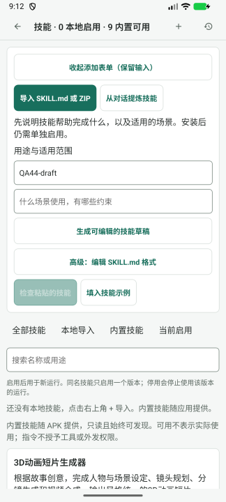

# Beta 46 工作台再次审查

> 历史归档（整理于 2026-11-01）：E1 在 beta47 有修复及实现方联合测试记录；尚无后续独立新版设备完整验收，不能标为全量设备闭环。 状态与后继见[归档索引](archive/2026-10-31-agent-workbench.md)；现行页面设计见[设计谱系](../design/README.md)。原文“当前”、优先级、源码行号和复跑命令均属于审查时基线；复现探针不属于现行正确性回归。桌面执行端、远端 Worker 及外部业务编排服务器均禁止；旧文相反建议已失效。

2026-11-01。源码 `865b57ff`，比较基线 `c13c0a09`，2 个提交、6 个文件。审查提交后运行通知、历史入口、提前打开的证据页及本地 runtime 持久化链。没有修改产品实现。

## 判断

**上轮 R1“历史列表停在 queued”已通过复核，新的 runEvents 和主动重读方向正确。仍确认 1 项 P2：运行过程中提前打开的只读证据页不会更新，终态、后续答复及错误留在旧快照之外。** 这是同一工作流的另一条时序路径，属于本轮新确认的既有遗漏，不能归为 beta.46 新引入的回归。未确认新的 P1。

当前不需要新增入口或执行架构。业务继续在 APK 中执行；桌面执行端与远端 Worker 仍是禁止项。本批没有改变生成端口接入、连接凭据、工具授权或资产写入边界，本轮未重新验收这些旧模块全部能力。

重要边界：设备 `emulator-5554` 实际仍为 `com.example.autodlh3.beta` versionCode 83 / `1.5.0-preview.4-beta.44`，留有 QA44-draft 未保存内容。没有覆盖安装或强停。本轮 beta.46 的主要证据来自当前源码、实际组件、真实 SQLite 以及离线本地 runtime/AGUI 联合验证，不是新版 Android 设备端到端验收。

## E1 / P2：提前打开证据页后，运行结束也看不到最终记录

定位：[SkillRunScreen.tsx:15](../../mobile/src/agent/skills/SkillRunScreen.tsx)。参考现有更新能力：[runEvents.ts](../../mobile/src/agent/runEvents.ts)、[SkillLibraryScreen.tsx:77](../../mobile/src/agent/skills/SkillLibraryScreen.tsx)。

用户路径：运行尚处于 queued/running → 从技能运行记录打开“查看运行” → 保持只读证据页打开 → 运行完成、失败或取消并持久化。历史列表已能更新，但证据页仍显示旧状态；后续助手消息、失败错误也没有出现。“查看原会话全部消息”只切换旧 snapshot 的过滤条件，同样不能取得新记录。普通父级更新无效；卸载重开详情才恢复。

根因：该页只在 threadId/runId 改变时 load 一次，没有监听运行提交通知，没有重新获得焦点时的重读，也没有刷新按钮或说明当前展示的是某个读取时刻的快照。“只读”保证不执行业务操作，但不能替代记录新鲜度的说明。运行入口允许打开进行中的记录，因此这是一条实际可达路径。

### 独立证据

前三项探针对 completed、failed、cancelled 分别检查：实际 threadStore.accept 创建运行和技能快照；先挂载实际 SkillLibraryScreen 与 SkillRunScreen；通过产品 endPromptRun/threadStore.save 持久化终态及后续消息。随后观察到：

1. 实际数据库查询和同屏历史显示正确终态，上轮修复在这个分支确实生效。
2. 原详情继续显示 queued，缺少新增的 review-final-output。
3. 点击“查看原会话全部消息”和普通父级更新后仍旧；重新挂载详情则能看到终态、输出，失败分支也能看到最终错误。

第五项进一步使用实际 createPromptRuntimeRegistry、H3AgUiAgent、threadStore 与 SQLite：用一个可暂停的本地测试图代替模型，让详情在运行中挂载；放行测试图生成答复并触发真实 AGUI 完成与 runtime.flush。数据库与历史已显示 completed、输出已持久化，而原详情仍显示 running、没有 live-final-output。证明该问题不只存在于直接写终态的 fixture。

该联合验证没有访问外部模型或网络。自定义测试图绕过完整 createSkillRunPreparer，因此显式调用产品 SkillStore.capture，补上正常准备器负责的技能快照；没有验收真实模型连接与准备器全部授权。初次该探针遗漏这步，导致历史找不到测试运行；补齐测试搭建后通过，未修改产品代码。

探针：[源文件](../evidence/2026-11-01-workbench-beta46-review/ReviewBeta46.probe.test.tsx)、[结果](../evidence/2026-11-01-workbench-beta46-review/probes.log)。四项不良行为验证通过表示 E1 已复现，不表示已修复。

### 影响与建议

用户无法从已经打开的详情判断任务是否结束，也可能误以为没有最终输出或错误；“全部消息”按钮会强化这种误判。持久化数据实际存在，没有证据说明输出丢失或任务重复执行。

让证据页共享提交后的记录更新机制，至少对当前 thread/run 的终态重新读取，并补重新获得焦点/手动刷新的恢复路径。读取时保留本次/全部消息选择和阅读位置，防止较旧查询覆盖新结果，清理离页订阅，继续保持只读、不创建 runtime、不重放请求。不要因每个流式 token 都重新读取整份长会话。

若产品明确要提供固定时刻快照，应显示读取时刻、进行中提示以及“获取最新记录”动作；当前没有这些语义，不能只靠“只读”标题表达冻结。

验收应覆盖详情在 queued、running、终态三种时刻进入，随后完成、失败、取消及中断恢复；列表、已打开详情与重新打开详情一致，最终消息、错误、工具结果均能核对。本次/全部切换不丢选择，图片仍能只读预览，刷新失败可重试且保留已读内容，返回继续到真实来源。长会话的有界读取仍是待验性能项，不能以全量 load 的逐 token 刷新替代生命周期同步。

## 上轮 R1 的复核

实施方：[beta.45 审查修复说明](2026-11-01-beta45-review-fixes.md)。

| 分支 | 本轮独立结果 |
| --- | --- |
| 历史已打开，保存 completed/failed/cancelled | 列表随提交更新，且与此后新打开的详情一致。通过。 |
| 终态保存失败、恢复后重试 | 失败无提交事件；保存成功后才更新。通过。 |
| 同状态的重复保存/消息更新 | 不重复发布状态通知。通过。 |
| 其他持久化入口写入后打开历史 | 历史入口主动重读。通过。 |
| 历史翻至第二页后收到终态 | 保留游标、页内记录和未保存 once。通过。 |
| 中断恢复 | 本轮额外探针：真实 recoverInterruptedRuns([]) 提交后，原列表更新 interrupted；重复恢复不再通知。通过。 |
| 单次覆盖消费 | 原 selectionEvents 联合回归继续通过；受理改用 runEvents.accepted 后，面板仍重新读取覆盖。 |

新 save 在事务内比较受影响运行的持久状态，提交后才通知，避免只根据 UI 内存状态宣称保存成功；运行事件与技能选择事件分开也合理。不要因 E1 再退回按流式 token 全量刷新。

## 页面与生命周期的完整关系

| 阅读入口 | 数据策略 | 本轮结论 |
| --- | --- | --- |
| 会话技能面板 | 焦点、选择提交、受理及运行状态提交后重读 | 原始消费和历史缓存问题均通过当前回归。 |
| 历史入口 | 点击时主动重读，保留分页 | 正常。 |
| 已结束后新打开证据页 | mount 时读取 thread/run 对应会话记录 | 正常。 |
| 结束前就打开证据页 | 读取一次，此后状态与消息不更新 | E1。 |
| 证据页“全部消息” | 仅对已读 snapshot 改变过滤条件 | 可以切范围，不能作为获取最新记录的补救。 |
| 返回来源 | useSourceBack 按原栈返回，无栈有稳定出口 | 本批未修改；本轮没有重新做设备冷启动返回验收。 |

本轮也查看了会话的 runtime view 订阅和创作成果卡片的焦点/轮询路径；它们不是同样的单次读取实现。没有据此宣称所有页面都存在 E1。建议为不同入口共同定义“首次读取、提交后失效、重入、读取失败”的契约，而不是只修当前某一个按钮。

## 设备观察与验证边界

1. 读取已安装版本并捕获当前技能表单：正常，QA44-draft 输入和 9 个内置技能的可发现状态保持；未执行页面跳转，最终仍停在原表单。

截图为本轮捕获并实际查看的原图等比例缩小。没有新版设备视觉验收，也没有 TalkBack、大字模式或焦点顺序验收；不将旧版截图或空历史当作新版缺陷复现证据。

本轮独立既有回归 **7 套件、69 项通过**，覆盖运行事件、选择消费、技能列表、证据呈现、threadStore、runtimeStore、runtimeIntegration。另 1 个临时探针文件 **5 项通过**：1 项验证中断恢复正常，4 项复现 E1。TypeScript 检查通过；内置 Skill 包 36 文件内容/哈希/元数据校验通过。实施方全仓 1974 项为其报告，本轮未独立全量复跑。

没有修改产品代码或既有测试；临时探针已移出产品目录。没有付费生成、真实模型、技能安装、连接修改或项目资产写入。beta.46 安装运行、ARM 真机、真实媒体证据与完整模型授权链仍需设备验收。

证据：[索引](../evidence/2026-11-01-workbench-beta46-review/README.md)。
