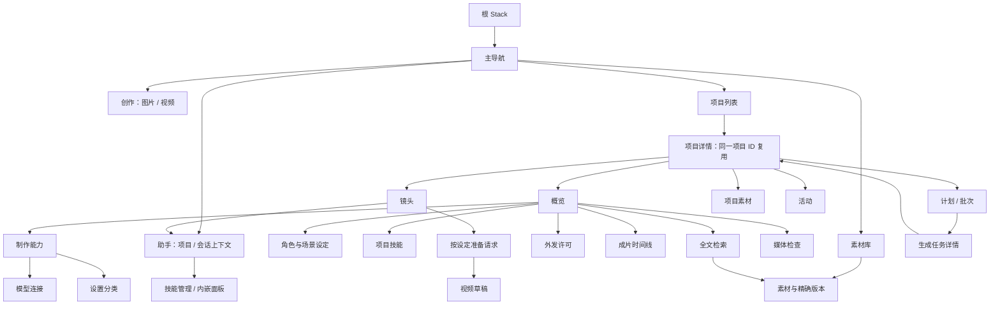
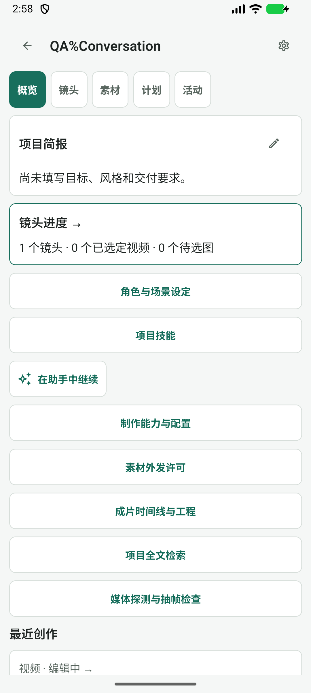
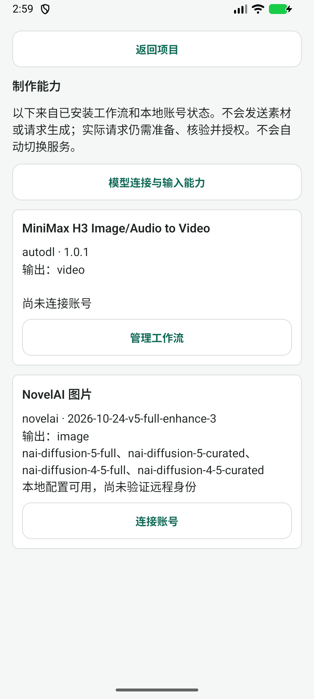
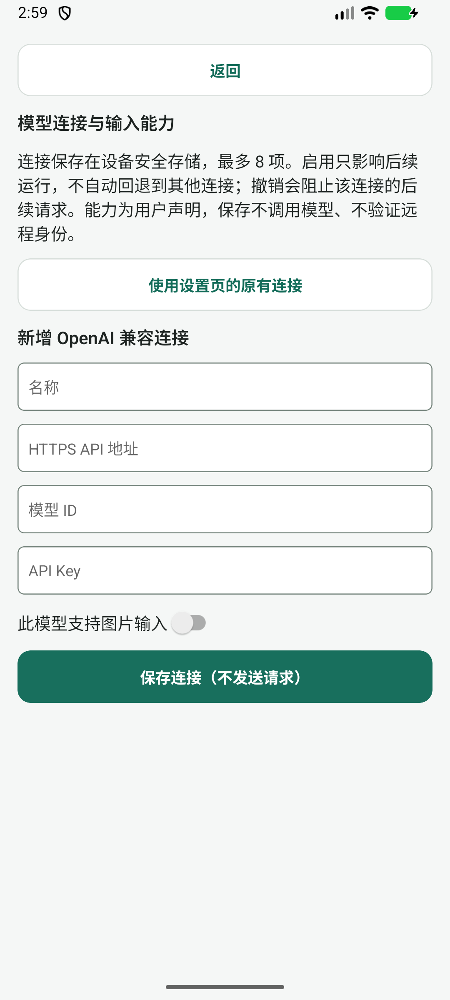
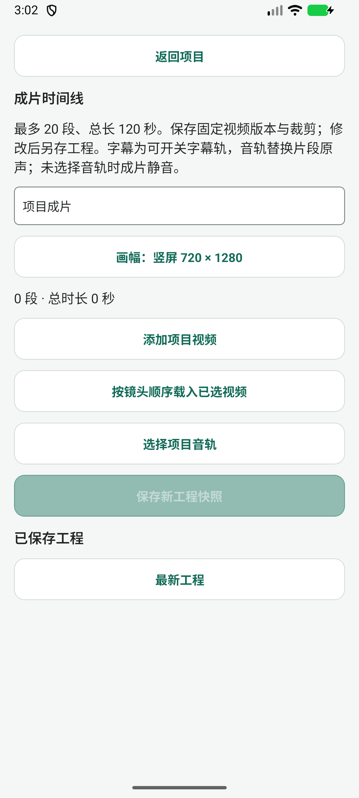
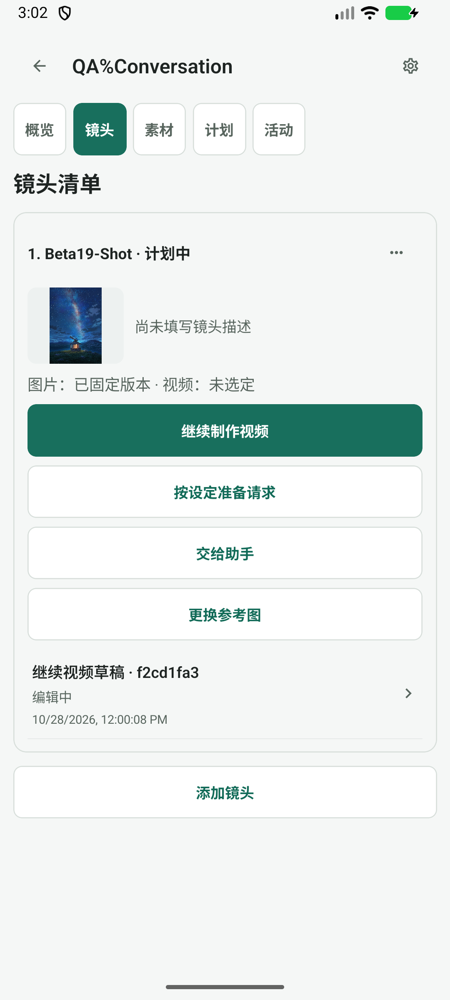
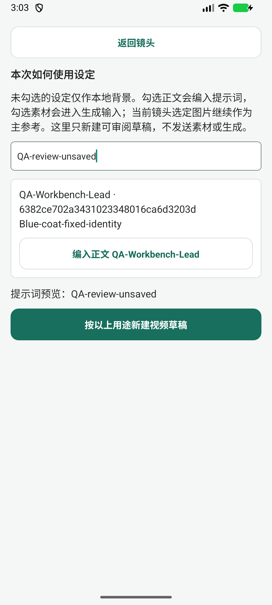
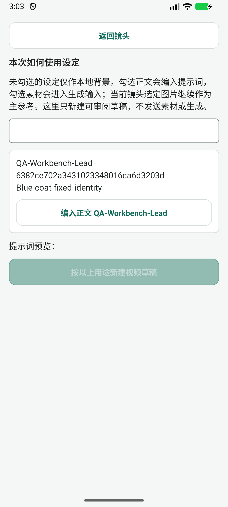

# 工作台后续切片与页面导航复审

> 历史归档（整理于 2026-11-01）：N1–N6 已有修复记录，并由下一轮导航复审核对原触发路径。 状态与后继见[归档索引](archive/2026-10-31-agent-workbench.md)；现行页面设计见[设计谱系](../design/README.md)。原文“当前”、优先级、源码行号和复跑命令均属于审查时基线；复现探针不属于现行正确性回归。桌面执行端、远端 Worker 及外部业务编排服务器均禁止；旧文相反建议已失效。

日期：2026-11-01。源码范围：`b19c9133..03c0e588`，schema 48。设备：Android 模拟器 AutoDL_Keyboard_QA_20261025，已安装 beta.39 / versionCode 78。本轮没有重建安装 HEAD，因此设备观察与最新源码审查分别陈述，不能将已安装包当成 HEAD 的完整设备验收。

## 结论

**领域实现继续走在正确方向上；页面与对象之间的导航契约尚未跟上功能增长。** 上轮 R1–R6 均找到针对性修复，相关测试通过；批次、设定编译、工具策略、预算、本地时间线及检查能力已有具体代码，不能再把它们当作未实现。

但“路线图实现完成”目前只能表示本期组件和领域链路已交付，不能表示所有入口、跨页面参数、编辑保护和完成后的返回都验收完成。本轮发现 6 项 P2 问题：配置保存改变连接身份、技能范围不一致、时间线引用误跳任务、搜索丢版本、内置技能不可见、新设定准备页丢未保存输入。未确认新的 P1 消费授权漏洞。

桌面和远端 Worker 仍是禁止项；本轮没有提出此类扩展，也没有修改产品源码。

## 1. 验证范围

- 独立重跑 17 个相关测试文件，81 项通过；`npm run typecheck` 通过。覆盖上一轮修复、计划/批次、时间线、媒体检查、检索、Skill、模型连接及既有导航辅助。
- 另执行两个临时离线探针：真实设置存储逻辑的连接身份变化、搜索组件点击丢版本，均复现。探针断言的是不良现象，**不是正确性验收**，已移出产品测试目录。
- 模拟器实际点击项目→项目技能→返回→能力→模型连接→返回→助手菜单→全局技能→返回项目→时间线→返回→镜头→设定准备；额外复现输入后返回丢失。没有点击生成、模型检查、安装 Skill、保存连接或创建工程。
- 设备的项目/素材为既有 QA 数据；只输入了一段未提交的 `QA-review-unsaved`，返回后已消失。没有覆写原始素材、设定或草稿。
- 没有真实模型/付费生成、ARM/OEM 性能、进程中断合成、全路径 TalkBack 或大字体验收。助手因未配置 LLM，当前会话内嵌 Skill 面板仅审源码，未在设备进入；没有为测试配置虚构账号。
- 首次启动模拟器遇到 System UI 无响应，选择 Wait 后恢复；该截图不作为产品问题。最终只接受稳定产品截图。

证据与复跑说明：[README](../evidence/2026-11-01-navigation-review/README.md)。实施方已有全仓/原生结果见[完成验收](../verification/2026-11-01-workbench-completion.md)，不计入本轮独立重测。

## 2. 当前页面树与实际跳转机制

当前是 Expo Router 的文件路由 + 根 Stack + Tabs。四个可见主入口为创作、助手、项目、素材；任务/历史/设置仍是 Tabs 内辅助路由，也存在独立 settings-panel。项目详情本身有五个**组件状态页签**，不是五个独立路由。项目 ID 决定 Stack 页面身份，tab/shotId/planId 等只决定页面落点。

定位依据：`mobile/app/_layout.tsx`、`mobile/app/(tabs)/_layout.tsx`、`mobile/src/navigation/PrimaryNavigation.tsx`、`creativeNavigation.ts`、`CreativeWorkspace.tsx`、`ProjectOverview.tsx`。

**合理部分：**主导航没有随着新增功能持续膨胀；项目/镜头/草稿/Job 都有稳定对象 ID；项目页有单实例身份与焦点；`returnToProject` 校验项目存在并用 dismissTo 返回，能避免一层层新建同项目页面；旧页面已存在未保存保护。

**主要缺口：**各页直接拼接 router 参数，新增对象类型没有要求穷尽处理；“返回项目”有时只是 back；新页面的页头、scope 和编辑保护不统一。对象读取已支持精确版本，点击入口却可能忘传版本，这正是功能正确、组合体验仍错误的例子。

## 3. 必须修正的问题

### N1 / P2：保存普通设置会取消已选模型连接，改变运行能力

源码：[settings.tsx:79](../../mobile/app/%28tabs%29/settings.tsx)、[storage.ts:62](../../mobile/src/settings/storage.ts)。

旧设置页从 readSettings 读取的值已经叠加了新连接的 endpoint/model/key；页面保存整个 prepared 对象。saveSettings 只要收到任何 LLM 字段就 selectLlmConnection(null)。因此用户只改播放/导出偏好再保存，也会把选中的连接切回旧存储路径。地址与模型表面可能完全相同，但 connectionId/revision 和 supportsImages 丢失，媒体检查随后找不到显式活动连接，Skill 图片输入声明也可能不再满足。

离线探针：创建支持图片的连接→选中→readSettings→只改播放偏好并全表保存→active=null、connectionId/images 消失，模型名仍相同。没有真实账号或请求。设备只检查了新连接页入口，未保存任何配置。

建议统一连接配置来源；普通偏好只保存发生变更的偏好字段，选择旧连接必须是显式动作。旧助手设置应指向统一连接管理，并显示当前连接身份。验收：任何非连接设置保存均保持 active ID/revision/图片声明；明确更换、撤销才能改变连接。

### N2 / P2：项目助手中的 Skill 面板实际操作全局选择

源码：[AgentScreen.tsx:415](../../mobile/src/agent/AgentScreen.tsx)、[SkillLibraryScreen.tsx:39](../../mobile/src/agent/skills/SkillLibraryScreen.tsx)、[第101行](../../mobile/src/agent/skills/SkillLibraryScreen.tsx)。

项目概览进入技能页时传 projectId，操作 project bindings；会话内嵌面板只传 threadId，不传 projectId，因而显示全局组合，关开关调用全局 revoke/enable。用户身处项目会话，却无法在面板核对这个项目真正生效的覆盖；全局停用还会请求停止其他使用同版本的运行。单次选择虽然绑定 thread scope，展示来源仍与项目组合脱节。

建议从可信会话 scope 读取 projectId，主视图显示“本项目有效技能”；全局紧急撤销作为明确的独立管理入口，展示影响范围。添加/提炼后保留 projectId/threadId 和来源；现有 agent-skills 路由也未接收 threadId，内嵌添加只带 intent，不能自然返回原单次选择。

验收：项目 A/B 不同覆盖时，面板分别显示实际组合；在 A 停用不全局撤销 B；单次覆盖与持久项目选择清楚区分。设备未配置 LLM，内嵌路径未实际进入，此项为确定源码调用链问题。

### N3 / P2：素材使用关系中的“时间线”被当成生成任务打开

源码：[usageGraph.ts:12](../../mobile/src/creative/usageGraph.ts)、[CreativeWorkspace.tsx:306](../../mobile/src/creative/CreativeWorkspace.tsx)。

usage 已返回 kind=时间线、object_id=timelineId；页面处理项目/镜头/设定/草稿后，剩余类型一律跳 creative-task/[id]。点击时间线依赖会拿 timelineId 查询 Job，落入无关的任务详情。保护删除的依赖关系已经接上，但帮助用户定位解除依赖的导航没有接上。

建议增加明确时间线目标 `{projectId,timelineId}`；时间线页独立查询指定工程，不依赖最近20项。导航用可穷尽的类型分派，不用未知 kind 默认当任务。验收：使用位置→对应工程→原素材，完整往返；旧工程超过分页仍能定位；不见或跨项目时给可解释状态。此项由 SQL 与 onPress 调用链确认，未创建工程进行设备复现。

### N4 / P2：全文搜索打开素材时丢失命中的精确版本

源码：[ProjectSearchScreen.tsx:18](../../mobile/src/creative/ProjectSearchScreen.tsx)。

检索以 asset version 为索引单位，结果带 versionId；查看来源只传 assetId，未传 versionId/projectId。素材详情有精确版本支持，但该路径会默认读取当前版本。用户命中旧文本版本中的一句话，打开后看到另一版本，会误以为搜索不准或原文丢失。

组件探针已复现：historical-version 命中后实际 push 仅有 `{id:'asset'}`。建议保留版本和项目来源，给匹配高亮和返回结果位置；不允许悄悄改看新默认版本。验收需覆盖旧版本、超过分页的版本及不存在版本。

### N5 / P2：内置 Skill 已参与运行，却不在技能目录、计数和详情中

源码：[skillBundle.ts](../../mobile/src/agent/skillBundle.ts)、[h3Agent.ts:58](../../mobile/src/agent/h3Agent.ts)、[SkillLibraryScreen.tsx:59](../../mobile/src/agent/skills/SkillLibraryScreen.tsx)。设备截图 05、10 均确认。

打包文件中有 9 个技能根 SKILL.md（36 个总文件），运行时与本地文件一起供 Agent 发现。管理页只读 SQLite 本地安装版本，显示“0 已启用”，仅一句“内置技能随应用提供”；无法搜名称、读说明/参考、了解输入要求，运行记录也只概括“仅内置技能”。这是能力可发现性和运行可解释性问题，用户观察成立。

建议统一 SkillCatalog，来源分内置/用户安装，选择状态分全局/项目/单次。内置包可以只读；必需技能如不可关闭，应标注原因，而非假装不存在。显示名称、描述、版本/包指纹、输入/工具要求、参考文件，并区分“本次可用”与“本次实际读取/使用”。不要把只看见内置技能误实现成复制进可编辑本地库，也不要把指令声明当作权限授予。

验收：首次安装没有用户 Skill 时仍能搜索并查看9个内置技能；计数语义准确；运行详情能解释包版本及实际使用证据。包版本应随升级留证，不能用当前内置文本解释所有旧运行。

### N6 / P2：新“按设定准备请求”页返回会无提示丢失编辑

源码：[SemanticPreparationScreen.tsx:16](../../mobile/src/creative/SemanticPreparationScreen.tsx)、[第18行](../../mobile/src/creative/SemanticPreparationScreen.tsx)。

页面将 prompt、正文选择和素材选择只保存在组件内，没有未保存保护；返回按钮直接 back。设备实测：输入 QA-review-unsaved→返回镜头→直接离开，无确认→再进入，输入为空。截图15/16/17与 UI 树完整保存。本轮没有点击新建草稿。

建议以初始镜头描述+初始选择作为 baseline，增加 dirty、硬件/页头返回保护；可进一步保存本地准备草稿。此页成功新建后 replace 到真实草稿合理，不必强行留下中间空页。验收覆盖返回按钮、Android Back、切应用恢复、提交失败；未成功提交前不得悄悄清空选择。

## 4. 页面组织和交互建议

### 4.1 概览正在成为功能目录，应把入口放回任务发生处

截图04显示一串同权重按钮，将资料、全局设置、外发记录、制作、检索、质检混在一起；最近创作被推到首屏底部。五个项目页签没有覆盖新增能力，却又不宜无限加页签。

建议概览保留项目进度、待处理决策、最近工作；设定/技能放“项目资料与规则”，时间线作为“成片”主要入口；检索进入项目页头；质检可从素材/候选详情带精确 versionId 进入，时间线可从镜头成果进入；账号和模型配置归统一设置。概览仍可保留快捷入口，不应是唯一入口。

当前媒体检查只有 projectId，进入后必须重新选素材；时间线产出/打包后主要显示文本“到项目素材查看”，没有“打开刚生成的文件”目标。建议返回结构化目标 `{assetId,versionId}` 并提供下一步按钮，不让用户凭名称再找一次。

### 4.2 配置诊断应该直达原因并在返回时刷新

截图06：H3 提示未连账号，主要按钮却是管理工作流；应根据缺失项提供连接账号和管理工作流两个适用动作。CapabilityCatalogScreen 只在 after 改变时读取，不会在从账号/工作流设置返回时刷新；应订阅配置事件或用 focus refresh，避免修好后仍显示旧阻塞原因。

旧“助手模型”与新“模型连接”不仅入口割裂，还造成 N1。二者应成为同一资源视图；不能要求用户先绕项目概览→能力页才能发现新连接管理。

### 4.3 统一四种导航语义

| 用户意图 | 建议契约 | 当前情况 |
| --- | --- | --- |
| 返回刚才的位置 | pop，保留查询/滚动/编辑；dirty 决策一致 | 旧页面较完整，新页面存在 N6 |
| 回到某个所属对象 | 校验对象，dismissTo，传项目/页签/焦点 | returnToProject 已有基础，时间线未接入 |
| 查看精确来源 | 对象类型+对象ID+版本ID+项目范围 | N3/N4暴露漏类型和漏参数 |
| 配置后继续当前任务 | 带来源目标，返回时刷新能力，保留准备内容 | 新旧模型设置割裂，能力页缺刷新 |

建议把构造目标、校验与返回封装为统一入口，使用 TypeScript 联合类型及穷尽 switch；实际 router 仍保留 Expo Router，不必更换导航库。新增页面必须声明 scope、entry/return、dirty、focus refresh、空态/归档态。冷启动深链无历史栈的兜底仍需补测，不能仅靠“返回项目”文案假设 back 总能返回项目。

### 4.4 成片页目前更像工程参数表

截图12以及源码中片段主要显示版本ID、毫秒输入和多个按钮；缺少片段缩略图、名称、预览与直达成片详情。当前默认裁剪5000ms，不从探测时长预填，短素材可能直到合成才报越界。未选音轨时静音已有准确告知，建议把是否保留原声做为明确制作决策。先补片段可辨认、裁剪预览、输出可定位即可，无需先上复杂轨道画布。

## 5. 上轮问题和路线图的复核

| 旧问题/方向 | 本轮判断 |
| --- | --- |
| R1计划授权扩大 | authorizePlanRequest/Batch固定command/hash，检查草稿/步骤/项目，回归通过 |
| R2设定引用生命周期 | 使用关系、移出保护、可用性诊断已接入；时间线新增依赖也已接入保护，但导航漏接 N3 |
| R3不能解绑 | unbindShot与原子replaceEntityId已实现，回归通过 |
| R4采用清空编辑 | 设定管理保留编辑缓冲，回归通过；新准备页出现同类 N6 |
| R5排序使计划失效 | shotDependencies采用实际生产输入签名，排序测试通过 |
| R6采用版本超20消失 | 独立adopted读取+历史分页+精确路由版本，回归通过 |
| 批次管理 | 选择镜头、批次摘要、过滤分页、请求逐项绑定授权已实现 |
| 设定进入请求 | compileSemanticVideo显式区分正文与参考，外发许可与消费分开；准备页已可查看，但编辑保护不足 |
| 运行契约 | ToolPolicy含文件工具、角色过滤、runUsage预算、连接/Skill输入检查已有实现；不是任意节点精确断点续算承诺 |
| 本地后期与感知检查 | Android原生合成/工程包/本地探测/静帧模型审阅都有代码与既有验证；本轮仅重跑相关离线测试，不推导真实供应商质量 |

## 6. 本轮设备步骤与截图

1. 项目列表→项目概览：可用，新增入口集中，见截图04。
2. 项目技能→返回：可用，但内置目录缺失，见截图05。
3. 制作能力→模型连接→连续返回：可用；配置入口组织与刷新待改，见截图06/07。
4. 在助手中继续→菜单→技能管理→返回→Android Back：可返回原项目；无LLM时停在配置空态，见截图08/10/11。
5. 成片时间线→返回项目：可用；本轮项目无已保存工程，未设备执行合成，见截图12。
6. 镜头→按设定准备：能保留项目/镜头并读到已绑定设定，见截图13/14。
7. 准备页输入→返回→重进：失败，未保存输入丢失，见截图15/17。

以下均为本轮保存并打开检查的真实截图；完整尺寸和 UI 树保留在证据目录。

可见触控目标大多充足，主要控件有中文标签；不能因此宣称 TalkBack 完整可用。新准备页输入框没有可见字段标题，时间线大量ID/毫秒也增加理解成本；后续应补可见标签、动态状态播报和实际读屏顺序验收。

## 7. 下一阶段验收方式

优先修 N1/N2 的配置与范围，再修 N3/N4 的精确目标，统一 N5 的目录和 N6 的编辑保护；然后整理入口与结果回流。每个问题都要求覆盖调用方和目标页，不只单独测领域函数。

增加一组页面契约集成场景：项目A有独立Skill覆盖、选图片模型→改播放偏好仍保持连接→打开技能看到有效组合和内置目录→检索旧文本版本打开精确来源→从素材使用关系进入指定旧工程→编辑准备页取消返回仍保留→允许丢弃→新建草稿后回到原镜头→配置缺失修复后返回刷新→成片产出后直接打开精确结果。最后才做真实模型和供应商受限次数验收。
